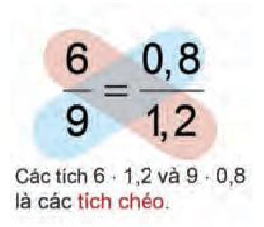
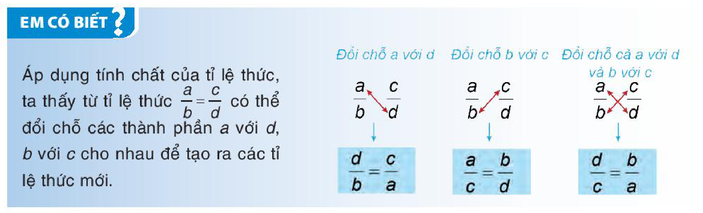

<!-- pdf:5 -->
<!-- Trang mở đầu Chương VI (PDF 5): CHƯƠNG VI. TỈ LỆ THỨC VÀ ĐẠI LƯỢNG TỈ LỆ (ĐẠI SỐ) — Chương này giới thiệu khái niệm và các tính chất của tỉ lệ thức, tính chất của dãy tỉ số bằng nhau, đại lượng tỉ lệ thuận, đại lượng tỉ lệ nghịch và vận dụng chúng để giải quyết một số bài toán đơn giản về đại lượng tỉ lệ trong thực tế. -->

# BÀI 20: TỈ LỆ THỨC

## 🔤 Khái niệm, thuật ngữ

- Tỉ lệ thức
- Tính chất của tỉ lệ thức

## 🎯 Kiến thức, kĩ năng

- Nhận biết tỉ lệ thức và các tính chất của tỉ lệ thức.
- Vận dụng tính chất của tỉ lệ thức trong giải toán.

## 🔴 Mở đầu

Cờ đỏ sao vàng là quốc kì của nước Cộng hoà xã hội chủ nghĩa Việt Nam. Lá cờ có dạng một hình chữ nhật màu đỏ với hình ngôi sao năm cánh màu vàng nằm ở chính giữa.

Nếu tìm hiểu kĩ hơn em sẽ thấy dù lớn hay nhỏ thì các lá cờ đều có một điểm chung về kích thước. Điểm chung đó là gì nhỉ?

*Cột cờ Lũng Cú, Hà Giang*
<!-- ocr-ok: đã đối chiếu ảnh trang PDF 5, chú thích in trắng trên ảnh nền cuối trang -->

<!-- pdf:6 -->

## 1. TỈ LỆ THỨC

*Nhận biết tỉ lệ thức*

**HĐ1:** Lá quốc kì cắm trên đỉnh cột cờ Lũng Cú, Hà Giang có chiều rộng $6\text{ m}$, chiều dài $9\text{ m}$. Lá quốc kì bố Linh treo tại nhà mỗi dịp lễ có chiều rộng $0,8\text{ m}$, chiều dài $1,2\text{ m}$.

a) Tính tỉ số giữa chiều rộng và chiều dài của mỗi lá cờ. Viết kết quả này dưới dạng phân số tối giản.

b) So sánh hai tỉ số nhận được.

- **Pi:** Đẳng thức $\dfrac{6}{9} = \dfrac{0,8}{1,2}$ được gọi là một *tỉ lệ thức*.

> **Tỉ lệ thức** là đẳng thức của hai tỉ số $\dfrac{a}{b} = \dfrac{c}{d}$.

**Chú ý.** Tỉ lệ thức $\dfrac{a}{b} = \dfrac{c}{d}$ còn được viết dưới dạng $a : b = c : d$.

**Ví dụ 1:** Hai tỉ số sau có lập thành một tỉ lệ thức không?

$10 : 15; \qquad \dfrac{2}{7} : \dfrac{3}{7}.$

- **Tròn:** Ta viết các tỉ số đã cho dưới dạng tỉ số giữa các số nguyên để dễ so sánh.

**Giải**

Ta có $10 : 15 = \dfrac{10}{15} = \dfrac{2}{3}$; $\dfrac{2}{7} : \dfrac{3}{7} = \dfrac{2}{7} \cdot \dfrac{7}{3} = \dfrac{2}{3}$.

Do đó ta có tỉ lệ thức $10 : 15 = \dfrac{2}{7} : \dfrac{3}{7}$.

**Luyện tập 1:** Tìm các tỉ số bằng nhau trong các tỉ số sau rồi lập tỉ lệ thức tương ứng:

$4 : 20; \qquad 0,5 : 1,25; \qquad \dfrac{3}{5} : \dfrac{3}{2}.$

**Tranh luận**

- **Tròn:** Tỉ lệ thức là một đẳng thức giữa hai phân số mà thôi.
- **Vuông:** Điều này có đúng không nhỉ?

Em hãy giúp Vuông trả lời câu hỏi trên nhé!

<!-- pdf:7 -->

**Vận dụng 1:** Mặt sân cỏ trong sân vận động Quốc gia Mỹ Đình có dạng hình chữ nhật có chiều dài $105\text{ m}$ và chiều rộng $68\text{ m}$. Nam vẽ mô phỏng mặt sân cỏ này bằng một hình chữ nhật có chiều dài $21\text{ cm}$ và chiều rộng $13,6\text{ cm}$. Hỏi Nam đã vẽ mô phỏng mặt sân cỏ đúng tỉ lệ thực tế hay chưa?

*Sân vận động Quốc gia Mỹ Đình*

## 2. TÍNH CHẤT CỦA TỈ LỆ THỨC

*Tính chất của tỉ lệ thức*

**HĐ2:** Quay trở lại tỉ lệ thức tìm được ở HĐ1: $\dfrac{6}{9} = \dfrac{0,8}{1,2}$, em hãy tính các tích chéo $6 \cdot 1,2$ và $9 \cdot 0,8$ rồi so sánh kết quả.

Các tích $6 \cdot 1,2$ và $9 \cdot 0,8$ là các **tích chéo**.

**HĐ3:** Từ đẳng thức $2 \cdot 6 = 3 \cdot 4$, ta có thể suy ra những tỉ lệ thức nào?

- **Tròn:** Chẳng hạn, chia cả hai vế của đẳng thức $2 \cdot 6 = 3 \cdot 4$ cho tích $6 \cdot 3$ ta được tỉ lệ thức $\dfrac{2}{3} = \dfrac{4}{6}$.

<!-- term: Tính chất của tỉ lệ thức -->
> - Nếu $\dfrac{a}{b} = \dfrac{c}{d}$ thì $ad = bc$.
> - Nếu $ad = bc$ (với $a, b, c, d \ne 0$) thì ta có các tỉ lệ thức:
> $\dfrac{a}{b} = \dfrac{c}{d}; \qquad \dfrac{a}{c} = \dfrac{b}{d}; \qquad \dfrac{d}{b} = \dfrac{c}{a}; \qquad \dfrac{d}{c} = \dfrac{b}{a}.$
<!-- ocr-ok: đã đối chiếu ảnh trang PDF 7, khung tính chất chứa công thức tỉ lệ thức trên nền cam -->

Chẳng hạn, từ đẳng thức $2 \cdot 45 = 6 \cdot 15$ (cùng bằng $90$) ta có thể lập được các tỉ lệ thức sau:

$\dfrac{2}{6} = \dfrac{15}{45}; \qquad \dfrac{2}{15} = \dfrac{6}{45}; \qquad \dfrac{45}{6} = \dfrac{15}{2}; \qquad \dfrac{45}{15} = \dfrac{6}{2}.$

**Luyện tập 2:** Lập tất cả các tỉ lệ thức có thể được từ đẳng thức $0,2 \cdot 4,5 = 0,6 \cdot 1,5$.

<!-- term: Tính chất của tỉ lệ thức -->
**Nhận xét.** Từ tỉ lệ thức $\dfrac{a}{b} = \dfrac{c}{d}$ ($a, b, c, d \ne 0$) suy ra

$a = \dfrac{bc}{d}; \qquad b = \dfrac{ad}{c}; \qquad c = \dfrac{ad}{b}; \qquad d = \dfrac{bc}{a}.$

**Ví dụ 2:** Phương cùng các bạn dự định làm các lá quốc kì Việt Nam bằng giấy đảm bảo tỉ lệ quy định, chiều rộng $14\text{ cm}$ để tham gia Hội khoẻ Phù Đổng. Tính chiều dài của lá cờ.

- **Pi:** Điểm chung về kích thước giữa các lá quốc kì Việt Nam chính là: tỉ số giữa chiều rộng và chiều dài của chúng luôn không đổi và bằng $2 : 3$.

<!-- pdf:8 -->

**Giải**

Gọi $x\text{ (cm)}$ là chiều dài của lá cờ Phương và các bạn dự định làm.

Ta có tỉ lệ thức $\dfrac{14}{x} = \dfrac{2}{3}$. Suy ra $x = \dfrac{14 \cdot 3}{2} = 21\text{ (cm)}$.
<!-- ocr-ok: đã đối chiếu ảnh trang PDF 8, câu chứa phân thức toán học -->

Vậy chiều dài của lá cờ là $21\text{ cm}$.

**Vận dụng 2:** Để gói $10$ chiếc bánh chưng, bà Nam cần $5\text{ kg}$ gạo nếp. Nếu bà muốn gói $45$ chiếc bánh chưng cùng loại gửi cho người dân vùng lũ thì bà cần bao nhiêu kilôgam gạo nếp?

## BÀI TẬP

6.1. Thay tỉ số sau đây bằng tỉ số giữa các số nguyên:

a) $\dfrac{10}{16} : \dfrac{4}{21}$; $\qquad$ b) $1,3 : 2,75$; $\qquad$ c) $\dfrac{-2}{5} : 0,25$.

6.2. Tìm các tỉ số bằng nhau trong các tỉ số sau rồi lập tỉ lệ thức:

$12 : 30; \qquad \dfrac{3}{7} : \dfrac{18}{24}; \qquad 2,5 : 6,25.$

6.3. Tìm $x$ trong các tỉ lệ thức sau:

a) $\dfrac{x}{6} = \dfrac{-3}{4}$; $\qquad$ b) $\dfrac{5}{x} = \dfrac{15}{-20}$.

6.4. Lập tất cả các tỉ lệ thức có thể được từ đẳng thức $14 \cdot (-15) = (-10) \cdot 21$.

6.5. Để pha nước muối sinh lí, người ta cần pha theo đúng tỉ lệ. Biết rằng cứ $3$ lít nước tinh khiết thì pha với $27\text{ g}$ muối. Hỏi nếu có $45\text{ g}$ muối thì cần pha với bao nhiêu lít nước tinh khiết để được nước muối sinh lí?

6.6. Để cày hết một cánh đồng trong $14$ ngày phải sử dụng $18$ máy cày. Hỏi muốn cày hết cánh đồng đó trong $12$ ngày thì phải sử dụng bao nhiêu máy cày (biết năng suất của các máy cày là như nhau)?

## 💡 Em có biết?

Áp dụng tính chất của tỉ lệ thức, ta thấy từ tỉ lệ thức $\dfrac{a}{b} = \dfrac{c}{d}$ có thể đổi chỗ các thành phần $a$ với $d$, $b$ với $c$ cho nhau để tạo ra các tỉ lệ thức mới:

- Đổi chỗ $a$ với $d$: $\dfrac{a}{b} = \dfrac{c}{d} \rightarrow \dfrac{d}{b} = \dfrac{c}{a}$.
- Đổi chỗ $b$ với $c$: $\dfrac{a}{b} = \dfrac{c}{d} \rightarrow \dfrac{a}{c} = \dfrac{b}{d}$.
- Đổi chỗ cả $a$ với $d$ và $b$ với $c$: $\dfrac{a}{b} = \dfrac{c}{d} \rightarrow \dfrac{d}{c} = \dfrac{b}{a}$.
<!-- ocr-ok: đã đối chiếu ảnh trang PDF 8, ba sơ đồ đổi chỗ trong hộp Em có biết? -->

## 📷 Danh sách hình trong bài

| Mã hình | Trang PDF | Vị trí trong bài | Chú thích gốc |
| --- | :---: | --- | --- |
| H7-toan-b20-01 | 7 | Mục 1, Vận dụng 1 | Sân vận động Quốc gia Mỹ Đình |
| H7-toan-b20-02 | 7 | Mục 2, HĐ2 | Các tích 6 · 1,2 và 9 · 0,8 là các tích chéo. |
| H7-toan-b20-03 | 8 | Mục 2, Ví dụ 2 (Giải) | (sách không đánh số, hình lá quốc kì Việt Nam) |
| H7-toan-b20-04 | 8 | Mục 2, Vận dụng 2 | (sách không đánh số, hình gói bánh chưng) |
| H7-toan-b20-05 | 8 | Em có biết? | (sách không đánh số, sơ đồ đổi chỗ các thành phần của tỉ lệ thức) |
