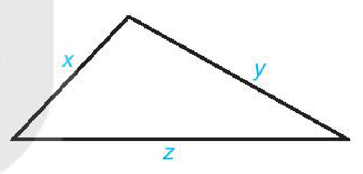

<!-- pdf:11 -->

# LUYỆN TẬP CHUNG (TRANG 10)

**Ví dụ 1:** Lập các tỉ lệ thức có thể được từ bốn số: $15; 18; 20; 24$.

**Giải.** Từ bốn số đã cho ta lập được đẳng thức: $15 \cdot 24 = 18 \cdot 20$ (vì đều bằng $360$).

Từ đẳng thức này ta lập được bốn tỉ lệ thức sau: $\dfrac{15}{18} = \dfrac{20}{24}$; $\dfrac{15}{20} = \dfrac{18}{24}$; $\dfrac{24}{18} = \dfrac{20}{15}$; $\dfrac{24}{20} = \dfrac{18}{15}$.

**Ví dụ 2:** Tìm $x$ và $y$ sao cho $\dfrac{x}{y} = \dfrac{3}{2}$ và $x + y = 15$.
<!-- ocr-ok: đã đối chiếu ảnh trang PDF 11, nhãn Ví dụ 2 in chữ trắng trên nền tím kèm công thức -->

**Giải.** Từ $\dfrac{x}{y} = \dfrac{3}{2}$ suy ra $\dfrac{x}{3} = \dfrac{y}{2}$.

Theo tính chất của dãy tỉ số bằng nhau, ta có $\dfrac{x}{3} = \dfrac{y}{2} = \dfrac{x + y}{3 + 2} = \dfrac{15}{5} = 3$.

Suy ra $x = 3 \cdot 3 = 9$ và $y = 3 \cdot 2 = 6$.

**Ví dụ 3:** Tính độ dài các cạnh của một tam giác, biết độ dài các cạnh của nó tỉ lệ với $2; 3; 4$ và cạnh lớn nhất dài hơn cạnh nhỏ nhất $6\text{ cm}$.

**Giải.** Gọi $x, y, z\text{ (cm)}$ lần lượt là độ dài ba cạnh của tam giác (theo thứ tự từ nhỏ đến lớn). Theo đề bài, ta có $\dfrac{x}{2} = \dfrac{y}{3} = \dfrac{z}{4}$ và $z - x = 6$.

Theo tính chất của dãy tỉ số bằng nhau, ta có:

$\dfrac{x}{2} = \dfrac{y}{3} = \dfrac{z}{4} = \dfrac{z - x}{4 - 2} = \dfrac{6}{2} = 3.$

Suy ra $x = 3 \cdot 2 = 6$, $y = 3 \cdot 3 = 9$ và $z = 3 \cdot 4 = 12$.

Vậy độ dài ba cạnh của tam giác đó là $6\text{ cm}$, $9\text{ cm}$ và $12\text{ cm}$.

## BÀI TẬP

6.11. Lập các tỉ lệ thức có thể được từ đẳng thức $3x = 4y$ ($x, y \ne 0$).

6.12. Hãy lập tất cả các tỉ lệ thức có thể được từ bốn số: $5; 10; 25; 50$.

6.13. Tìm $x$ và $y$, biết:
<!-- ocr-ok: đã đối chiếu ảnh trang PDF 11, đề bài tập chứa kí hiệu biến số -->

a) $\dfrac{x}{y} = \dfrac{5}{3}$ và $x + y = 16$; $\qquad$ b) $\dfrac{x}{y} = \dfrac{9}{4}$ và $x - y = -15$.

6.14. Tỉ số của số học sinh của hai lớp 7A và 7B là $0,95$. Hỏi mỗi lớp có bao nhiêu học sinh, biết số học sinh của một lớp nhiều hơn lớp kia là $2$ em?

6.15. Người ta định làm một con đường trong $15$ ngày. Một đội công nhân $45$ người làm trong $10$ ngày mới được một nửa công việc. Hỏi phải bổ sung thêm bao nhiêu người nữa để có thể hoàn thành công việc đúng hạn (biết năng suất lao động của mỗi người như nhau)?

6.16. Tìm ba số $x, y, z$, biết rằng: $\dfrac{x}{2} = \dfrac{y}{3} = \dfrac{z}{4}$ và $x + 2y - 3z = -12$.

## 📷 Danh sách hình trong bài

| Mã hình | Trang PDF | Vị trí trong bài | Chú thích gốc |
| --- | :---: | --- | --- |
| H7-toan-ltc-c06-01-01 | 11 | Ví dụ 3 | (sách không đánh số, tam giác có độ dài ba cạnh x, y, z) |
