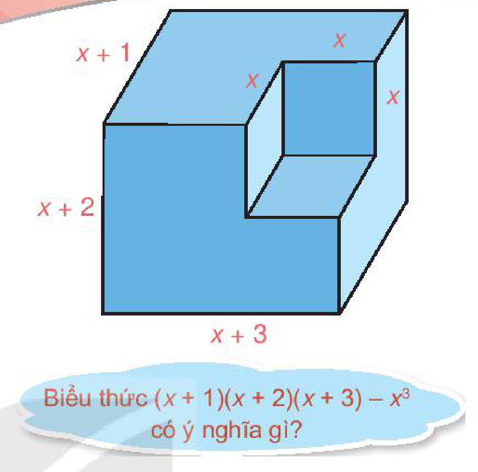
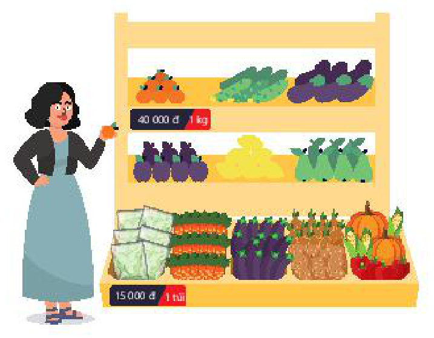

<!-- pdf:23 -->

# BÀI 24: BIỂU THỨC ĐẠI SỐ

> **Chương VII: BIỂU THỨC ĐẠI SỐ VÀ ĐA THỨC MỘT BIẾN** *(ĐẠI SỐ)*
>
> Chương này sẽ đưa các em vào ngưỡng cửa của Đại số – một lĩnh vực mới của Toán học phổ thông. Trong Đại số, người ta dùng chữ đại diện cho các số, do đó có thể giải được hàng loạt bài toán tương tự nhau.
>
> Muốn học tốt Đại số, các em phải có kĩ năng biến đổi các biểu thức đại số mà trước hết là thực hiện các phép toán trên các đa thức một biến.

*Biểu thức $(x + 1)(x + 2)(x + 3) - x^3$ có ý nghĩa gì?*

## 🔤 Khái niệm, thuật ngữ

- Biểu thức số
- Biểu thức đại số
- Giá trị của biểu thức

## 🎯 Kiến thức, kĩ năng

- Nhận biết biểu thức số và biểu thức đại số.
- Tính giá trị của biểu thức đại số.

## 🔴 Mở đầu

Giả sử một ô tô đi với vận tốc không đổi $50\text{ km/h}$. Khi đó, *biểu thức biểu thị quãng đường ô tô đi được trong $t$ (giờ)* là $50 \cdot t\text{ (km)}$.

Ta có thể tính quãng đường ô tô đi được trong thời gian tuỳ ý bằng cách thay $t$ bởi một số thích hợp. Chẳng hạn, nếu $t = 2$ giờ thì quãng đường ô tô đi được là $50 \cdot 2 = 100\text{ (km)}$.

Trong tình huống trên, ta đã dùng chữ $t$ để thay cho một số. Nhờ đó ta có thể phát biểu và giải được nhiều bài toán có nội dung tương tự nhau.

Trong bài này ta sẽ bước đầu tìm hiểu về phương pháp *dùng chữ thay số*.

<!-- pdf:24 -->

**Biểu thức đại số**

Ta đã biết những số và chữ được nối với nhau bởi dấu của các phép tính (cộng, trừ, nhân, chia, nâng lên luỹ thừa) làm thành một *biểu thức*. Người ta thường phân biệt biểu thức số và biểu thức chứa chữ.

> Từ “đại” trong “đại số” không phải là “to lớn” mà có nghĩa là “đại diện” hay “thay thế cho”.

**HĐ1:** Trong các biểu thức sau, em hãy chỉ ra biểu thức số, biểu thức chứa chữ.

a) $23 + 8 \cdot 9$;

b) $3a + 7$;

c) $(3^4 - 5) : 8$;

d) $\left(\dfrac{3}{x} - y^2\right) + 2$.

**HĐ2:** Hãy viết biểu thức biểu thị chu vi của hình chữ nhật có chiều rộng là $x\text{ (cm)}$ và chiều dài hơn chiều rộng $3\text{ cm}$.

> Biểu thức không chứa chữ gọi là **biểu thức số**. Biểu thức chỉ chứa số hoặc chỉ chứa chữ hoặc chứa cả số và chữ gọi chung là **biểu thức đại số**.
>
> Trong một biểu thức đại số, các chữ (nếu có) dùng để thay thế hay đại diện cho những số nào đó được gọi là các **biến số** (gọi tắt là các **biến**).

**Chú ý:**

- Để cho gọn, khi viết các biểu thức đại số, ta không viết dấu nhân giữa các biến, cũng như giữa biến và số. Chẳng hạn, $a \cdot b$ và $2 \cdot a$ tương ứng có thể viết là $ab$ và $2a$.
- Thông thường ta không viết thừa số $1$ trong một tích. Chẳng hạn, $1xy$ viết là $xy$; $(-1)ab$ viết là $-ab$.
- Với các biến, ta cũng có thể áp dụng các quy tắc và tính chất của các phép tính như đối với các số. Chẳng hạn:
  $x + x = 2x$; $x \cdot x \cdot x = x^3$; $x + y = y + x$;
  $x(y + z) = xy + xz$; $-(x + y - z) = -x - y + z$; $\dots$

> Một biểu thức đại số có thể chứa nhiều biến khác nhau.

**Luyện tập:**

Hãy chỉ ra các biến của mỗi biểu thức đại số sau:

a) $3x^2 - 1$;

b) $3a + b$.

> **Giá trị của biểu thức đại số**
>
> Nếu thay $p = 5$ và $q = 7$ vào biểu thức $A = 3p - q$ rồi thực hiện phép tính, ta được:
> $A = 3 \cdot 5 - 7 = 8$.
> Khi đó, ta nói: $8$ là **giá trị của biểu thức** $A$ tại $p = 5$ và $q = 7$ hay khi $p = 5$ và $q = 7$ thì **giá trị của biểu thức** $A$ là $8$.

<!-- pdf:25 -->

> Muốn tính giá trị của một biểu thức đại số tại những giá trị cho trước của các biến, ta thay giá trị đã cho của mỗi biến vào biểu thức rồi thực hiện các phép tính.

**Ví dụ:**

Bác Hoà mua một túi rau và một số cam. Biết rằng mỗi kilôgam cam có giá $40$ nghìn đồng và mỗi túi rau có giá $15$ nghìn đồng.

a) Hãy viết biểu thức biểu thị tổng số tiền bác Hoà phải trả nếu số cam bác Hoà mua là $x$ kilôgam.

b) Giả sử số cam bác Hoà mua là $2,5$ kilôgam. Sử dụng kết quả câu a, em hãy tính xem bác Hoà phải trả tất cả bao nhiêu tiền.

**Giải:**

a) Số tiền bác Hoà phải trả cho $x$ kilôgam cam là $40x$ (nghìn đồng).

Tiền rau là $15$ nghìn đồng. Vậy biểu thức biểu thị tổng số tiền bác Hoà phải trả là:

$40x + 15$ (nghìn đồng).

b) Thay $x = 2,5$ vào biểu thức $40x + 15$, ta được:

$40 \cdot 2,5 + 15 = 115$ (nghìn đồng).

Vậy bác Hoà phải trả tất cả $115$ nghìn đồng.

**Vận dụng:**

Một người đi ô tô với vận tốc $40\text{ km/h}$ trong $x$ giờ, sau đó tiếp tục đi bộ với vận tốc $5\text{ km/h}$ trong $y$ giờ.

a) Hãy viết biểu thức biểu thị tổng quãng đường người đó đi được.

b) Tính giá trị của biểu thức trong câu a khi $x = 2,5$ (giờ) và $y = 0,5$ (giờ).

## BÀI TẬP

7.1. Viết biểu thức đại số biểu thị:

a) Nửa tổng của $x$ và $y$;

b) Tổng của $x$ và $y$ nhân với tích của $x$ và $y$.
<!-- ocr-ok: đã đối chiếu ảnh trang PDF 25, câu ngắn chứa nhiều biến $x, y$ trong LaTeX -->

7.2. Viết biểu thức đại số biểu thị diện tích của hình thang có hai đáy là $a$ và $b$, chiều cao là $h$ ($a$, $b$ và $h$ có cùng đơn vị đo).

7.3. Tính giá trị của biểu thức:

a) $4x + 3$ tại $x = 5,8$;

b) $y^2 - 2y + 1$ tại $y = 2$;

c) $(2m + n)(m - n)$ tại $m = 5,4$ và $n = 3,2$.

7.4. Một bác nông dân sử dụng hai chiếc máy bơm để tưới nước cho vườn cây. Máy bơm thứ nhất mỗi giờ bơm được $5\text{ m}^3$ nước. Máy bơm thứ hai mỗi giờ bơm được $3,5\text{ m}^3$ nước.

a) Viết biểu thức đại số biểu thị lượng nước bơm được của hai máy, nếu máy bơm thứ nhất chạy trong $x$ giờ và máy bơm thứ hai chạy trong $y$ giờ.

b) Sử dụng kết quả câu a, tính lượng nước bơm được của cả hai máy khi $x = 2$ (giờ), $y = 3$ (giờ).

## 📷 Danh sách hình trong bài

| Mã hình | Trang PDF | Vị trí trong bài | Chú thích gốc |
| --- | :---: | --- | --- |
| H7-toan-b24-01 | 23 | Mở đầu Chương VII | Biểu thức $(x + 1)(x + 2)(x + 3) - x^3$ có ý nghĩa gì? |
| H7-toan-b24-02 | 23 | Mở đầu | (sách không đánh số, ô tô taxi chạy trên đường phố với vận tốc không đổi) |
| H7-toan-b24-03 | 25 | Ví dụ | (sách không đánh số, bác Hoà mua rau giá $15\,000\text{ đ/1 túi}$ và cam giá $40\,000\text{ đ/1 kg}$) |
