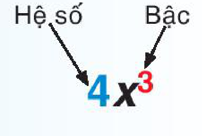

<!-- pdf:26 -->

# BÀI 25: ĐA THỨC MỘT BIẾN

## 🔤 Khái niệm, thuật ngữ

- Đơn thức (một biến)
- Đa thức (một biến)
- Bậc của một đa thức
- Hệ số cao nhất
- Hệ số tự do
- Nghiệm của đa thức

## 🎯 Kiến thức, kĩ năng

- Nhận biết đơn thức (một biến) và bậc của đơn thức.
- Nhận biết đa thức (một biến) và các hạng tử của nó.
- Thu gọn và sắp xếp đa thức.
- Nhận biết bậc, hệ số cao nhất, hệ số tự do của một đa thức.
- Tính giá trị của một đa thức khi biết giá trị của biến.
- Nhận biết nghiệm của một đa thức.

## 🔴 Mở đầu

*Bài toán:* Độ cao $H$ (mét) của một vật (so với mặt đất) khi ném lên từ một điểm trên mặt đất được biểu thị bởi biểu thức $H = -5x^2 + 15x$, trong đó $x$ (giây) là thời gian tính từ thời điểm ném vật. Hỏi sau bao lâu kể từ khi được ném lên, vật sẽ rơi trở lại mặt đất?

Dễ thấy biểu thức $H$ có vai trò quan trọng trong bài toán trên.

Trong bài này chúng ta sẽ bước đầu tìm hiểu về các biểu thức tương tự như biểu thức $H$, đó là các *đa thức một biến*.

## 1. ĐƠN THỨC MỘT BIẾN

Chúng ta bắt đầu bằng những biểu thức đơn giản nhất, đó là các *đơn thức một biến*. Biến có thể là một chữ cái tuỳ ý. Nhưng để dễ nhận biết, ta chỉ xét các biểu thức với biến $x$.

> **Sơ lược về đơn thức một biến**
>
> 1. Các biểu thức như $-0,5x$; $3x^2$; $-\dfrac{3}{4}x^5$ là những ví dụ về *đơn thức một biến*. Chúng đều là tích của một số với một luỹ thừa của $x$.
>
> **Đơn thức một biến** (gọi tắt là **đơn thức**) là biểu thức đại số có dạng tích của một số thực với một luỹ thừa của biến, trong đó số thực gọi là **hệ số**, số mũ của luỹ thừa của biến gọi là **bậc** của đơn thức. Chẳng hạn:
> - Biểu thức $4x^3$ là một đơn thức, trong đó $4$ là hệ số, số mũ $3$ của $x$ là bậc của đơn thức đó.
> - Đơn thức $-0,5x$ có hệ số là $-0,5$ và có bậc là $1$ (vì $x = x^1$).
> - Một số khác $0$ là một đơn thức bậc $0$.
>
> **Chú ý:** Số $0$ cũng được coi là một đơn thức. Đơn thức này không có bậc.

> Số $2$ là đơn thức bậc $0$ vì có thể coi rằng $2 = 2x^0$.

> ❓ Cho biết hệ số và bậc của mỗi đơn thức sau:
> a) $2x^6$;
> b) $-\dfrac{1}{5}x^2$;
> c) $-8$;
> d) $3^2x$.

<!-- pdf:27 -->

<!-- term: Cộng, trừ và nhân các đơn thức một biến -->
> 2. Với các đơn thức một biến, ta có thể:
> - *Cộng (hay trừ) hai đơn thức cùng bậc* bằng cách cộng (hay trừ) các hệ số với nhau và giữ nguyên luỹ thừa của biến. Tổng nhận được là một đơn thức. Chẳng hạn:
>   $-3x^4 + x^4 = (-3 + 1)x^4 = -2x^4$;
>   $3,7x^2 - 1,2x^2 = (3,7 - 1,2)x^2 = 2,5x^2$.
> - *Nhân hai đơn thức tuỳ ý* bằng cách nhân hai hệ số với nhau và nhân hai luỹ thừa của biến với nhau. Tích nhận được cũng là một đơn thức. Chẳng hạn:
>   $(0,5x) \cdot (6x^2) = (0,5 \cdot 6) \cdot (x \cdot x^2) = 3x^3$;
>   $(-6x^3) \cdot \left(\dfrac{2}{3}x^2\right) = \left[(-6) \cdot \dfrac{2}{3}\right](x^3 \cdot x^2) = -4x^5$.

> ❓ Khi nhân một đơn thức bậc $3$ với một đơn thức bậc $2$, ta được đơn thức bậc mấy?

**Luyện tập 1:**

Tính:

a) $5x^3 + x^3$;

b) $\dfrac{7}{4}x^5 - \dfrac{3}{4}x^5$;

c) $(-0,25x^2) \cdot (8x^3)$.

## 2. KHÁI NIỆM ĐA THỨC MỘT BIẾN

**Đa thức một biến là gì?**

- Các biểu thức $A = 6x^3 - 5x^2 - 4x^3 + 7$ và $B = 2x^4 - 3x^2 + x + 1$ có chung một đặc điểm: chúng đều là *tổng của những đơn thức* với biến $x$. Đó là những ví dụ về *đa thức một biến*. Một cách tổng quát:

> - **Đa thức một biến** (gọi tắt là **đa thức**) là tổng của những đơn thức của cùng một biến; mỗi đơn thức trong tổng gọi là một **hạng tử** của đa thức đó.
> - Số $0$ cũng được coi là một đa thức, gọi là **đa thức không**.

**Chú ý:** Ta thường kí hiệu đa thức bằng một chữ cái in hoa. Đôi khi còn viết thêm kí hiệu biến trong ngoặc đơn. Chẳng hạn:

$A = A(x) = 6x^3 - 5x^2 - 4x^3 + 7$.

> Một đơn thức cũng là một đa thức.

> ❓ Mỗi số thực có phải là một đa thức không? Tại sao?

**Ví dụ 1:**

Đa thức $2x^3 - 5x^2 + 7$ có ba hạng tử là $2x^3$; $-5x^2$ và $7$.

**Luyện tập 2:**

Hãy liệt kê các hạng tử của đa thức $B = 2x^4 - 3x^2 + x + 1$.

<!-- pdf:28 -->

## 3. ĐA THỨC MỘT BIẾN THU GỌN

> **Đa thức thu gọn**
>
> Xét hai đa thức $A = 6x^3 - 5x^2 - 4x^3 + 7$ và $B = 2x^4 - 3x^2 + x + 1$, ta thấy:
> - Trong đa thức $A$ có hai đơn thức cùng bậc là $6x^3$ và $-4x^3$.
> - Trong đa thức $B$ không có hai đơn thức nào cùng bậc.
>
> Ta gọi các đa thức *không chứa hai đơn thức nào cùng bậc* là các **đa thức thu gọn**.
>
> Ví dụ 2 dưới đây sẽ cho thấy: nếu cho một đa thức có chứa những đơn thức cùng bậc (đa thức chưa thu gọn) thì ta có thể đưa nó về dạng thu gọn.

**Ví dụ 2:**

Thu gọn đa thức $A = 6x^3 - 5x^2 - 4x^3 + 7$.

**Giải:**

$A = 6x^3 - 5x^2 - 4x^3 + 7 = 6x^3 - 4x^3 - 5x^2 + 7$ ($\leftarrow$ Đổi chỗ hai đơn thức)

$= (6x^3 - 4x^3) - 5x^2 + 7$ ($\leftarrow$ Nhóm hai đơn thức bậc $3$)

$= (6 - 4)x^3 - 5x^2 + 7$ ($\leftarrow$ Cộng hai đơn thức cùng bậc)

$= 2x^3 - 5x^2 + 7$.

Kết quả, ta được đa thức thu gọn $2x^3 - 5x^2 + 7$.

**Luyện tập 3:**

Thu gọn đa thức $P = 2x^3 - 5x^2 + 4x^3 + 4x + 9 + x$.

## 4. SẮP XẾP ĐA THỨC MỘT BIẾN

<!-- term: Sắp xếp đa thức một biến -->
> **Sắp xếp đa thức theo luỹ thừa giảm của biến**
>
> Dưới đây, ta chỉ xét các đa thức khác đa thức *không*.
> - Để thuận lợi cho việc tính toán các đa thức một biến, người ta thường viết chúng dưới dạng thu gọn và sắp xếp các hạng tử của nó theo luỹ thừa giảm của biến.
>   Chẳng hạn, sắp xếp các hạng tử của đa thức $P = 5x^2 - 2x + 1 - 3x^4$ theo luỹ thừa giảm của biến, ta được $P = -3x^4 + 5x^2 - 2x + 1$.
> - Trong đa thức $P$ ta thấy có các đơn thức bậc $4$ và bậc $2$, nhưng khuyết đơn thức bậc $3$. Tuy nhiên khi cần, ta cũng có thể viết:
>   $P = -3x^4 + 0x^3 + 5x^2 - 2x + 1$.
>   Ở đây, ta coi rằng hệ số của luỹ thừa bậc $3$ là $0$.

**Luyện tập 4:**

Thu gọn (nếu cần) và sắp xếp mỗi đa thức sau theo luỹ thừa giảm của biến:

a) $A = 3x - 4x^4 + x^3$;

b) $B = -2x^3 - 5x^2 + 2x^3 + 4x + x^2 - 5$;

c) $C = x^5 - \dfrac{1}{2}x^3 + \dfrac{3}{4}x - x^5 + 6x^2 - 2$.

**Chú ý:** Người ta cũng có thể sắp xếp đa thức theo luỹ thừa tăng của biến. Chẳng hạn, ta có thể sắp xếp các hạng tử của đa thức $P$ trên đây như sau: $P = 1 - 2x + 5x^2 - 3x^4$.

<!-- pdf:29 -->

## 5. BẬC VÀ CÁC HỆ SỐ CỦA MỘT ĐA THỨC

**Bậc, hệ số cao nhất và hệ số tự do của một đa thức**

Xét đa thức $P = -3x^4 + 5x^2 - 2x + 1$. Đó là một đa thức thu gọn. Hãy quan sát các hạng tử (các đơn thức) của đa thức $P$ và trả lời các câu hỏi sau:

**HĐ1:** Trong đa thức $P$, bậc của hạng tử $5x^2$ là $2$ (số mũ của $x^2$). Hãy xác định bậc của các hạng tử trong $P$.

**HĐ2:** Trong đa thức $P$, hạng tử nào có bậc cao nhất? Tìm hệ số và bậc của hạng tử đó.

**HĐ3:** Trong đa thức $P$, hạng tử nào có bậc bằng $0$?

Hạng tử có *bậc cao nhất* và hạng tử bậc $0$ có vai trò đặc biệt trong một đa thức. Ta có định nghĩa:

> Trong một đa thức thu gọn và khác đa thức *không*:
> - Bậc của hạng tử có bậc cao nhất gọi là **bậc của đa thức** đó.
> - Hệ số của hạng tử có bậc cao nhất gọi là **hệ số cao nhất** của đa thức đó.
> - Hệ số của hạng tử bậc $0$ gọi là **hệ số tự do** của đa thức đó.

**Chú ý:**

- Đa thức *không* là đa thức không có bậc.
- Trong một đa thức thu gọn, hệ số cao nhất phải khác $0$ (các hệ số khác có thể bằng $0$).
- Muốn tìm bậc của một đa thức chưa thu gọn, ta phải thu gọn đa thức đó.

> ❓ Một số khác $0$ cũng là một đa thức. Vậy bậc của nó bằng bao nhiêu?

**Ví dụ 3:**

Tìm bậc, hệ số cao nhất và hệ số tự do của đa thức $P = -x^3 - 2x^2 + x^3 + 4x + 5$.

**Giải:**

Trước hết ta thu gọn $P$:

$P = -x^3 - 2x^2 + x^3 + 4x + 5 = (-x^3 + x^3) - 2x^2 + 4x + 5 = -2x^2 + 4x + 5$.

Trong dạng thu gọn của $P$, hạng tử có bậc cao nhất là $-2x^2$ nên bậc của $P$ là $2$, hệ số cao nhất là $-2$; hạng tử bậc $0$ là $5$ nên hệ số tự do là $5$.

> Gọi $5$ là hệ số tự do vì trong $P$, hạng tử $5$ không chứa biến.

**Luyện tập 5:**

Xác định bậc, hệ số cao nhất và hệ số tự do của mỗi đa thức sau:

a) $5x^2 - 2x + 1 - 3x^4$;

b) $1,5x^2 - 3,4x^4 + 0,5x^2 - 1$.

<!-- pdf:30 -->

## 6. NGHIỆM CỦA ĐA THỨC MỘT BIẾN

**Giá trị và nghiệm của một đa thức**

Xét đa thức $G(x) = x^2 - 4$. Giá trị của biểu thức $G(x)$ tại $x = 3$ còn gọi là **giá trị của đa thức** $G(x)$ tại $x = 3$ và được kí hiệu là $G(3)$. Như vậy, ta có $G(3) = 3^2 - 4 = 5$.

**HĐ4:** Tính các giá trị $G(-2)$; $G(-1)$; $G(0)$; $G(1)$; $G(2)$.

**HĐ5:** Với giá trị nào của $x$ thì $G(x)$ có giá trị bằng $0$?

> Nếu tại $x = a$, đa thức $F(x)$ có giá trị bằng $0$, tức là $F(a) = 0$, thì ta gọi $a$ (hoặc $x = a$) là một **nghiệm** của đa thức $F(x)$.

**Ví dụ 4:**

a) $x = -3$ và $x = 0$ là hai nghiệm của đa thức $A(x) = 2x^2 + 6x$ vì $A(0) = 0$ và $A(-3) = 2 \cdot (-3)^2 + 6 \cdot (-3) = 0$.

b) Đa thức $B(x) = x^2 + 1$ không có nghiệm vì tại giá trị bất kì của $x$, ta luôn có $x^2 \ge 0$ nên $B(x) = x^2 + 1 \ge 1 > 0$.

> Một đa thức có thể không có nghiệm hoặc có nhiều nghiệm.

**Nhận xét:**

Nếu một đa thức có hệ số tự do bằng $0$ thì $x = 0$ là một nghiệm của đa thức đó.

Chẳng hạn, trong ví dụ trên cho thấy đa thức $A(x) = 2x^2 + 6x$ có hệ số tự do bằng $0$ và có nghiệm $x = 0$.

**Luyện tập 6:**

1. Tính giá trị của đa thức $F(x) = 2x^2 - 3x - 2$ tại $x = -1$; $x = 0$; $x = 1$; $x = 2$. Từ đó hãy tìm một nghiệm của đa thức $F(x)$.

2. Tìm nghiệm của đa thức $E(x) = x^2 + x$.

**Vận dụng:**

Trở lại *bài toán mở đầu*, hãy thực hiện các yêu cầu sau:

a) Xác định bậc, hệ số cao nhất và hệ số tự do của đa thức $H(x) = -5x^2 + 15x$.

b) Tại sao $x = 0$ là một nghiệm của đa thức $H(x)$? Kết quả đó nói lên điều gì?

c) Tính giá trị của $H(x)$ khi $x = 1$; $x = 2$ và $x = 3$ để tìm nghiệm khác $0$ của $H(x)$. Nghiệm ấy có ý nghĩa gì? Từ đó hãy trả lời câu hỏi của bài toán.

<!-- pdf:31 -->

## BÀI TẬP

7.5.

a) Tính $\left(\dfrac{1}{2}x^3\right) \cdot (-4x^2)$. Tìm hệ số và bậc của đơn thức nhận được.

b) Tính $\dfrac{1}{2}x^3 - \dfrac{5}{2}x^3$. Tìm hệ số và bậc của đơn thức nhận được.

7.6. Cho hai đa thức:

$A(x) = x^3 + \dfrac{3}{2}x - 7x^4 + \dfrac{1}{2}x - 4x^2 + 9$ và $B(x) = x^5 - 3x^2 + 8x^4 - 5x^2 - x^5 + x - 7$.

a) Thu gọn và sắp xếp hai đa thức trên theo luỹ thừa giảm của biến.

b) Tìm bậc, hệ số cao nhất và hệ số tự do của mỗi đa thức đã cho.

7.7. Cho hai đa thức:

$P(x) = 5x^3 + 2x^4 - x^2 + 3x^2 - x^3 - 2x^4 - 4x^3$ và $Q(x) = 3x - 4x^3 + 8x^2 - 5x + 4x^3 + 5$.

a) Thu gọn và sắp xếp hai đa thức trên theo luỹ thừa giảm của biến.

b) Sử dụng kết quả câu a để tính $P(1)$, $P(0)$, $Q(-1)$ và $Q(0)$.

7.8. Người ta dùng hai máy bơm để bơm nước vào một bể chứa nước. Máy thứ nhất bơm mỗi giờ được $22\text{ m}^3$ nước. Máy thứ hai bơm mỗi giờ được $16\text{ m}^3$ nước. Sau khi cả hai máy chạy trong $x$ giờ, người ta tắt máy thứ nhất và để máy thứ hai chạy thêm $0,5$ giờ nữa thì bể nước đầy.
<!-- ocr-ok: đã đối chiếu ảnh trang PDF 31, OCR đọc sai chữ bể và câu chứa nhiều số đo trong LaTeX -->

Hãy viết đa thức (biến $x$) biểu thị dung tích của bể ($\text{m}^3$), biết rằng trước khi bơm, trong bể có $1,5\text{ m}^3$ nước. Tìm hệ số cao nhất và hệ số tự do của đa thức đó.
<!-- ocr-ok: đã đối chiếu ảnh trang PDF 31, câu chứa nhiều kí hiệu trong LaTeX -->

7.9. Viết đa thức $F(x)$ thoả mãn đồng thời các điều kiện sau:
<!-- ocr-ok: đã đối chiếu ảnh trang PDF 31, đúng nguyên văn đề bài 7.9 -->

- Bậc của $F(x)$ bằng $3$.
- Hệ số của $x^2$ bằng hệ số của $x$ và bằng $2$.
- Hệ số cao nhất của $F(x)$ bằng $-6$ và hệ số tự do bằng $3$.

7.10. Kiểm tra xem:

a) $x = -\dfrac{1}{8}$ có phải là nghiệm của đa thức $P(x) = 4x + \dfrac{1}{2}$ không?

b) Trong ba số $1$; $-1$ và $2$, số nào là nghiệm của đa thức $Q(x) = x^2 + x - 2$?

7.11. Mẹ cho Quỳnh $100$ nghìn đồng. Quỳnh mua một bộ dụng cụ học tập có giá $37$ nghìn đồng và một cuốn sách tham khảo môn Toán với giá $x$ (nghìn đồng).

a) Hãy tìm đa thức (biến $x$) biểu thị số tiền Quỳnh còn lại (đơn vị: nghìn đồng). Tìm bậc của đa thức đó.

b) Sau khi mua sách thì Quỳnh tiêu vừa hết số tiền mẹ cho. Hỏi giá tiền của cuốn sách là bao nhiêu?

## 💡 Em có biết?

<!-- term: Nhị thức bậc nhất -->
- Mỗi đa thức bậc nhất với biến $x$ đều có thể viết dưới dạng $ax + b$ ($a$, $b$ là các số cho trước và $a \ne 0$). Do đó ta còn gọi đa thức bậc nhất là *nhị thức bậc nhất* (gọi là nhị thức vì đa thức này có hai hạng tử).

<!-- term: Tam thức bậc hai -->
- Mỗi đa thức bậc hai với biến $x$ đều có thể viết dưới dạng $ax^2 + bx + c$ ($a$, $b$ và $c$ là các số cho trước và $a \ne 0$). Do đó ta còn gọi đa thức bậc hai là *tam thức bậc hai* (gọi là tam thức vì đa thức này có ba hạng tử).

## 📷 Danh sách hình trong bài

| Mã hình | Trang PDF | Vị trí trong bài | Chú thích gốc |
| --- | :---: | --- | --- |
| H7-toan-b25-01 | 26 | Mục 1 | (sách không đánh số, sơ đồ chỉ hệ số $4$ và bậc $3$ của đơn thức $4x^3$) |
| H7-toan-b25-02 | 30 | Mục 6, Vận dụng | (sách không đánh số, người đánh bóng gôn minh hoạ quỹ đạo độ cao $H(x) = -5x^2 + 15x$) |
