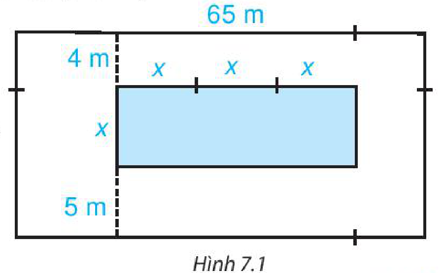

<!-- pdf:32 -->

# BÀI 26: PHÉP CỘNG VÀ PHÉP TRỪ ĐA THỨC MỘT BIẾN

## 🔤 Khái niệm, thuật ngữ

- Tổng, hiệu của hai đa thức

## 🎯 Kiến thức, kĩ năng

- Thực hiện các phép tính cộng, trừ hai đa thức.
- Nhận biết các tính chất của phép cộng đa thức.
- Vận dụng các tính chất của phép cộng đa thức trong tính toán.

## 🔴 Mở đầu

Xét hai biểu thức số $A = 5 \cdot 7^2 + 2$ và $B = 7^2 - 12 \cdot 7$. Dựa vào tính chất các phép toán đối với các số, ta có:

$A + B = (5 \cdot 7^2 + 2) + (7^2 - 12 \cdot 7) = (5 \cdot 7^2 + 7^2) - 12 \cdot 7 + 2 = (5 + 1) \cdot 7^2 - 12 \cdot 7 + 2 = 6 \cdot 7^2 - 12 \cdot 7 + 2$.

Tương tự, ta cũng có thể thực hiện các phép tính cộng và trừ hai đa thức; kết quả của mỗi phép tính đó cũng là một đa thức. Trong bài này chúng ta sẽ tìm hiểu cách *cộng và trừ đa thức*.

## 1. CỘNG HAI ĐA THỨC MỘT BIẾN

> **Tổng của hai đa thức**
>
> Cho hai đa thức: $P = x^4 + 3x^3 - 5x^2 + 7x$ và $Q = -x^3 + 4x^2 - 2x + 1$.
> Giả sử ta cần tìm *tổng*: $P + Q = (x^4 + 3x^3 - 5x^2 + 7x) + (-x^3 + 4x^2 - 2x + 1)$.
> Ta có thể trình bày phép cộng này theo một trong hai cách sau:
> - *Cách 1.* Bỏ dấu ngoặc rồi nhóm các hạng tử cùng bậc:
>   $(x^4 + 3x^3 - 5x^2 + 7x) + (-x^3 + 4x^2 - 2x + 1)$
>   $= x^4 + 3x^3 - 5x^2 + 7x - x^3 + 4x^2 - 2x + 1$ ($\leftarrow$ Bỏ dấu ngoặc)
>   $= x^4 + (3x^3 - x^3) + (4x^2 - 5x^2) + (7x - 2x) + 1$ ($\leftarrow$ Nhóm các hạng tử cùng bậc)
>   $= x^4 + 2x^3 - x^2 + 5x + 1$.
>   Vậy $P + Q = x^4 + 2x^3 - x^2 + 5x + 1$.

<!-- pdf:33 -->

> - *Cách 2.* Đặt tính cộng sao cho các hạng tử cùng bậc đặt thẳng cột với nhau rồi cộng theo từng cột:
>   $\begin{array}{r@{\;}r@{\;}r@{\;}r@{\;}r@{\;}r} & x^4 & +\,3x^3 & -\,5x^2 & +\,7x & \\ + & & -\,x^3 & +\,4x^2 & -\,2x & +\,1 \\ \hline P + Q = & x^4 & +\,2x^3 & -\,x^2 & +\,5x & +\,1 \end{array}$

> Nếu một đa thức khuyết một hạng tử bậc nào đó thì hãy để một khoảng trống ứng với hạng tử đó.

> ❓ Tìm tổng của hai đa thức: $x^3 - 5x + 2$ và $x^3 - x^2 + 6x - 4$.

<!-- term: Tính chất của phép cộng đa thức -->
**Chú ý:** Phép cộng đa thức cũng có các tính chất như phép cộng các số thực. Cụ thể là:
- Tính chất *giao hoán*: $A + B = B + A$.
- Tính chất *kết hợp*: $(A + B) + C = A + (B + C)$.
- Cộng với đa thức không: $A + 0 = 0 + A = A$.

**Luyện tập 1:**

Cho hai đa thức $M = 0,5x^4 - 4x^3 + 2x - 2,5$ và $N = 2x^3 + x^2 + 1,5$.

Hãy tính tổng $M + N$ (trình bày theo hai cách).

**Vận dụng 1:**

Đặt tính cộng để tìm tổng của ba đa thức sau:

$A = 2x^3 - 5x^2 + x - 7$;

$B = x^2 - 2x + 6$;

$C = -x^3 + 4x^2 - 1$.

## 2. TRỪ HAI ĐA THỨC MỘT BIẾN

> **Hiệu của hai đa thức**
>
> Cho hai đa thức $P = x^4 + 3x^3 - 5x^2 + 7x$ và $Q = -x^3 + 4x^2 - 2x + 1$.
> Đối với phép trừ: $P - Q = (x^4 + 3x^3 - 5x^2 + 7x) - (-x^3 + 4x^2 - 2x + 1)$, ta cũng có hai cách trình bày, tương tự như phép cộng hai đa thức.
> Cụ thể, hãy thực hiện các hoạt động sau:
> - **HĐ1:** Tìm hiệu $P - Q$ bằng cách bỏ dấu ngoặc rồi nhóm các hạng tử cùng bậc và thu gọn.
> - **HĐ2:** Tìm hiệu $P - Q$ bằng cách đặt tính trừ: đặt đa thức $Q$ dưới đa thức $P$ sao cho các hạng tử cùng bậc thẳng cột với nhau rồi trừ theo từng cột.

**Luyện tập 2:**

Cho hai đa thức:

$M = 0,5x^4 - 4x^3 + 2x - 2,5$ và $N = 2x^3 + x^2 + 1,5$.

Hãy tính hiệu $M - N$ (trình bày theo hai cách).

<!-- pdf:34 -->

**Chú ý:** Tương tự như các số, đối với các đa thức $P$, $Q$, $R$, ta cũng có:

Nếu $Q + R = P$ thì $R = P - Q$.

Nếu $R = P - Q$ thì $Q + R = P$.

**Vận dụng 2:**

Cho đa thức $A = x^4 - 3x^2 - 2x + 1$. Tìm các đa thức $B$ và $C$ sao cho:

$A + B = 2x^5 + 5x^3 - 2$;

$A - C = x^3$.

## BÀI TẬP

7.12. Tìm tổng của hai đa thức sau bằng cách nhóm các hạng tử cùng bậc:

$x^2 - 3x + 2$ và $4x^3 - x^2 + x - 1$.

7.13. Tìm hiệu sau theo cách đặt tính trừ: $(-x^3 - 5x + 2) - (3x + 8)$.

7.14. Cho hai đa thức $A = 6x^4 - 4x^3 + x - \dfrac{1}{3}$ và $B = -3x^4 - 2x^3 - 5x^2 + x + \dfrac{2}{3}$.

Tính $A + B$ và $A - B$.

7.15. Cho các đa thức $A = 3x^4 - 2x^3 - x + 1$; $B = -2x^3 + 4x^2 + 5x$ và $C = -3x^4 + 2x^2 + 5$.

Tính $A + B + C$; $A - B + C$ và $A - B - C$.

7.16. Bạn Nam được phân công mua một số sách làm quà tặng trong buổi tổng kết cuối năm học của lớp. Nam dự định mua ba loại sách với giá bán như bảng sau. Giả sử Nam cần mua $x$ cuốn sách khoa học, $x + 8$ cuốn sách tham khảo và $x + 5$ cuốn truyện tranh.

| Loại sách | Giá bán một cuốn (đồng) |
| --- | :---: |
| Truyện tranh | $15\,000$ |
| Sách tham khảo | $12\,500$ |
| Sách khoa học | $21\,500$ |

a) Viết các đa thức biểu thị số tiền Nam phải trả cho từng loại sách.

b) Tìm đa thức biểu thị tổng số tiền Nam phải trả để mua số sách đó.

7.17. Trên một mảnh đất hình chữ nhật có chiều dài $65\text{ m}$, người ta định làm một bể bơi có chiều rộng là $x$ mét, chiều dài gấp $3$ lần chiều rộng. Sơ đồ và kích thước cụ thể (tính bằng mét) được cho trong Hình 7.1. Tìm đa thức (biến $x$):

a) Biểu thị diện tích của bể bơi.

b) Biểu thị diện tích mảnh đất.

c) Biểu thị diện tích phần đất xung quanh bể bơi.

## 📷 Danh sách hình trong bài

| Mã hình | Trang PDF | Vị trí trong bài | Chú thích gốc |
| --- | :---: | --- | --- |
| H7-toan-b26-01 | 34 | Bài tập 7.17 | Hình 7.1 |
