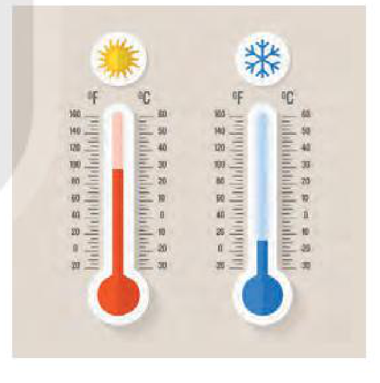

<!-- pdf:35 -->

# LUYỆN TẬP CHUNG (TRANG 34)

**Ví dụ 1:**

Ba bạn Lan, Bình và Dung rủ nhau đến cửa hàng sách để mua sách cũ được bán đồng giá (nghĩa là các cuốn sách cũ trong cửa hàng đó đều được bán với cùng một giá). Lan mua $5$ cuốn, Bình mua $3$ cuốn, Dung mua $6$ cuốn. Gọi $x$ (đồng) là giá bán một cuốn sách cũ.

a) Tìm đa thức biểu thị tổng số tiền cả ba bạn phải trả.

b) Nếu mỗi cuốn sách cũ đều có giá là $30\,000$ đồng thì tổng số tiền cả ba bạn phải trả là bao nhiêu?

**Giải:**

a) Lan mua $5$ cuốn sách nên phải trả $5x$ (đồng).

Bình mua $3$ cuốn nên phải trả $3x$ (đồng).

Dung mua $6$ cuốn nên phải trả $6x$ (đồng).

Vậy đa thức biểu thị tổng số tiền cả ba bạn phải trả là:

$T(x) = 5x + 3x + 6x = (5 + 3 + 6)x = 14x$.

b) Nếu mỗi cuốn sách cũ có giá $30\,000$ đồng thì tổng số tiền cả ba bạn phải trả là giá trị của đa thức $T(x) = 14x$ tại $x = 30\,000$. Giá trị đó là:

$T(30\,000) = 14 \cdot 30\,000 = 420\,000$ (đồng).

**Ví dụ 2:**

Cho hai đa thức $F = x^3 - x^2 - 3x - 5$ và $G = 3x^2 - 2x - 1$.

a) Gọi $H(x)$ là tổng của hai đa thức $F$ và $G$. Tìm $H(x)$.

b) Tìm hệ số cao nhất và hệ số tự do của $H(x)$.

c) Trong tập hợp $\{-3; -2; -1; 0; 1; 2; 3\}$, những số nào là nghiệm của $H(x)$?

**Giải:**

a) Ta có: $H(x) = (x^3 - x^2 - 3x - 5) + (3x^2 - 2x - 1) = x^3 - x^2 - 3x - 5 + 3x^2 - 2x - 1 = x^3 + (-x^2 + 3x^2) + (-3x - 2x) + (-5 - 1) = x^3 + 2x^2 - 5x - 6$.

b) Hệ số cao nhất của $H(x)$ là $1$; hệ số tự do của $H(x)$ là $-6$.

c) Để tính giá trị của $H(x)$ tại các giá trị đã cho của $x$ ta lập bảng sau:

| $x$ | $-3$ | $-2$ | $-1$ | $0$ | $1$ | $2$ | $3$ |
| :---: | :---: | :---: | :---: | :---: | :---: | :---: | :---: |
| $x^3$ | $-27$ | $-8$ | $-1$ | $0$ | $1$ | $8$ | $27$ |
| $2x^2$ | $18$ | $8$ | $2$ | $0$ | $2$ | $8$ | $18$ |
| $-5x$ | $15$ | $10$ | $5$ | $0$ | $-5$ | $-10$ | $-15$ |
| $H(x) = x^3 + 2x^2 - 5x - 6$ | $0$ | $4$ | $0$ | $-6$ | $-8$ | $0$ | $24$ |

Trong đó, số ghi trong mỗi ô thuộc dòng cuối bằng tổng các số ở cùng cột và thuộc ba dòng không tô màu phía trên, cộng thêm $-6$.

<!-- pdf:36 -->

Dựa vào bảng trên ta được:

$H(-3) = 0$; $H(-2) = 4$; $H(-1) = 0$; $H(0) = -6$; $H(1) = -8$; $H(2) = 0$; $H(3) = 24$.

Từ đó suy ra $x = -3$; $x = -1$ và $x = 2$ là ba nghiệm của đa thức $H(x)$.

## BÀI TẬP

7.18. Cho các đơn thức: $2x^6$; $-5x^3$; $-3x^5$; $x^3$; $\dfrac{3}{5}x^2$; $-\dfrac{1}{2}x^2$; $8$; $-3x$. Gọi $A$ là tổng của các đơn thức đã cho.

a) Hãy thu gọn tổng $A$ và sắp xếp các hạng tử để được một đa thức.

b) Tìm hệ số cao nhất, hệ số tự do và hệ số của $x^2$ của đa thức thu được.

7.19. Một bể chứa nước có dạng hình hộp chữ nhật được thiết kế với kích thước theo tỉ lệ:

Chiều cao : chiều rộng : chiều dài $= 1 : 2 : 3$.

Trong bể hiện còn $0,7\text{ m}^3$ nước. Gọi chiều cao của bể là $x$ (mét).
<!-- ocr-ok: đã đối chiếu ảnh trang PDF 36, OCR đọc sai chữ bể và câu chứa công thức LaTeX -->

Hãy viết đa thức biểu thị số mét khối nước cần phải bơm thêm vào bể để bể đầy nước. Xác định bậc của đa thức đó.

7.20. Ngoài thang nhiệt độ Celsius (độ C), nhiều nước còn dùng thang nhiệt độ Fahrenheit, gọi là độ F để đo nhiệt độ trong dự báo thời tiết. Muốn tính xem $x^\circ\text{C}$ tương ứng với bao nhiêu độ F, ta dùng công thức:

$T(x) = 1,8x + 32$.

Chẳng hạn, $0^\circ\text{C}$ tương ứng với $T(0) = 32\ (^\circ\text{F})$.

a) Hỏi $0^\circ\text{F}$ tương ứng với bao nhiêu độ C?

b) Nhiệt độ vào một ngày mùa hè ở Hà Nội là $35^\circ\text{C}$. Nhiệt độ đó tương ứng với bao nhiêu độ F?

c) Nhiệt độ vào một ngày mùa đông ở New York (Mỹ) là $41^\circ\text{F}$. Nhiệt độ đó tương ứng với bao nhiêu độ C?

7.21. Cho hai đa thức $P = -5x^4 + 3x^3 + 7x^2 + x - 3$ và $Q = 5x^4 - 4x^3 - x^2 + 3x + 3$.

a) Xác định bậc của mỗi đa thức $P + Q$ và $P - Q$.

b) Tính giá trị của mỗi đa thức $P + Q$ và $P - Q$ tại $x = 1$; $x = -1$.

c) Đa thức nào trong hai đa thức $P + Q$ và $P - Q$ có nghiệm là $x = 0$?

7.22. Một xe khách đi từ Hà Nội lên Yên Bái (trên đường cao tốc Hà Nội – Lào Cai) với vận tốc $60\text{ km/h}$. Sau đó $25$ phút, một xe du lịch cũng đi từ Hà Nội lên Yên Bái (đi cùng đường với xe khách) với vận tốc $85\text{ km/h}$. Cả hai xe đều không nghỉ dọc đường.

a) Gọi $D(x)$ là đa thức biểu thị quãng đường xe du lịch đi được và $K(x)$ là đa thức biểu thị quãng đường xe khách đi được kể từ khi xuất phát cho đến khi xe du lịch đi được $x$ giờ. Tìm $D(x)$ và $K(x)$.

b) Chứng tỏ rằng đa thức $f(x) = K(x) - D(x)$ có nghiệm là $x = 1$. Hãy giải thích ý nghĩa nghiệm $x = 1$ của đa thức $f(x)$.

## 📷 Danh sách hình trong bài

| Mã hình | Trang PDF | Vị trí trong bài | Chú thích gốc |
| --- | :---: | --- | --- |
| H7-toan-ltc-c07-01-01 | 36 | Bài tập 7.20 | (sách không đánh số, nhiệt kế so sánh thang nhiệt độ Fahrenheit $^\circ\text{F}$ và Celsius $^\circ\text{C}$) |
