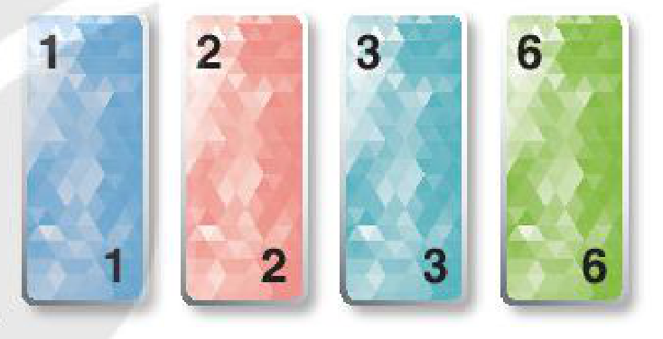
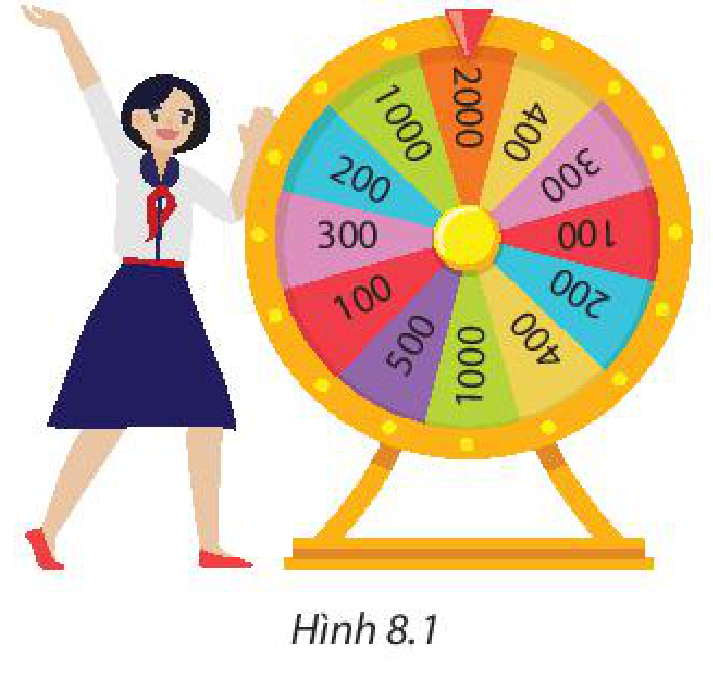

<!-- pdf:48 -->

# BÀI 29: LÀM QUEN VỚI BIẾN CỐ

> **Chương VIII: LÀM QUEN VỚI BIẾN CỐ VÀ XÁC SUẤT CỦA BIẾN CỐ** *(XÁC SUẤT)*
>
> Trong cuộc sống, ta thường gặp những sự kiện, hiện tượng mà ta không thể nói trước là có xảy ra hay không xảy ra. Trong chương này các em sẽ bước đầu làm quen với những sự kiện, hiện tượng như vậy và việc đo lường khả năng xảy ra của chúng.
>
> *Việt Nam có xác suất $4,44\%$ dành vé dự World Cup 2022 (Theo VnExpress ngày 16-6-2021)*

## 🔤 Khái niệm, thuật ngữ

- Biến cố
- Biến cố ngẫu nhiên
- Biến cố chắc chắn
- Biến cố không thể

## 🎯 Kiến thức, kĩ năng

- Làm quen với khái niệm biến cố ngẫu nhiên, biến cố chắc chắn, biến cố không thể trong một số ví dụ đơn giản.

## 🔴 Mở đầu

> Phó chủ tịch UBND tỉnh Quảng Nam trả lời phỏng vấn: “Dự báo chính xác thời điểm xảy ra sạt lở đất do mưa lớn tại huyện Nam Trà My là không thể”. *(Theo VnExpress, ngày 10-11-2020)*

> - Có các sự kiện, hiện tượng ta không thể biết trước được nó có xảy ra hay không, như hiện tượng “xảy ra sạt lở đất sau mưa lớn”.
> - Nhưng cũng có các sự kiện, hiện tượng ta có thể biết trước được chắc chắn nó có xảy ra hay không xảy ra đấy!

Trong bài học này, chúng ta cùng tìm hiểu về các sự kiện, hiện tượng đó nhé!

<!-- pdf:49 -->

**Biến cố**

Đọc các sự kiện, hiện tượng sau và thực hiện HĐ1, HĐ2.

1. Mức nước lũ trên sông Hồng trong tháng Bảy sang năm trên mức báo động $3$.
2. Ngày mai, Mặt Trời mọc ở phía tây.
3. Có sáu cơn bão đổ bộ vào nước ta trong năm tới.
4. Khi gieo hai con xúc xắc thì số chấm xuất hiện trên cả hai con xúc xắc đều là $6$.
5. Khi gieo một con xúc xắc thì số chấm xuất hiện trên con xúc xắc bé hơn $7$.

**HĐ1:** Tìm các sự kiện, hiện tượng *không thể* biết trước được chắc chắn có xảy ra hay không xảy ra.

**HĐ2:** Tìm các sự kiện, hiện tượng *có thể* biết trước được chắc chắn có xảy ra hay không xảy ra.

> - Các hiện tượng, sự kiện trong tự nhiên, cuộc sống được gọi chung là **biến cố**.
> - **Biến cố chắc chắn** là biến cố biết trước được luôn xảy ra.
> - **Biến cố không thể** là biến cố biết trước được không bao giờ xảy ra.
> - **Biến cố ngẫu nhiên** là biến cố không thể biết trước được có xảy ra hay không.

> ❓ Trong HĐ1 và HĐ2, biến cố nào là biến cố chắc chắn, biến cố không thể, biến cố ngẫu nhiên?

**Ví dụ 1:**

Trong các biến cố sau, em hãy chỉ ra biến cố nào là biến cố chắc chắn, biến cố không thể, biến cố ngẫu nhiên.

$A$: “Trong điều kiện thường, nước đun đến $100\ ^\circ\text{C}$ sẽ sôi”.

$B$: “Tháng Hai năm sau có $31$ ngày”.

$C$: “Khi gieo hai con xúc xắc thì tổng số chấm xuất hiện trên hai con xúc xắc là $8$”.

**Giải:**

- Biến cố $A$ là biến cố chắc chắn vì nó luôn xảy ra.
- Biến cố $B$ là biến cố không thể vì nó không bao giờ xảy ra.
- Biến cố $C$ là biến cố ngẫu nhiên vì ta không biết trước nó có xảy ra hay không.
  Chẳng hạn, biến cố $C$ xảy ra nếu số chấm xuất hiện trên hai con xúc xắc là $(2; 6)$ và không xảy ra nếu số chấm xuất hiện trên hai con xúc xắc là $(5; 5)$.

<!-- pdf:50 -->

**Luyện tập 1:**

Chọn từ thích hợp (ngẫu nhiên, chắc chắn, không thể) thay vào dấu "?" để được câu đúng.

1. Vuông và Tròn mỗi người gieo một con xúc xắc.
   Biến cố “Tổng số chấm xuất hiện trên hai con xúc xắc là một số lớn hơn $1$” là biến cố .?.
   Biến cố “Tổng số chấm xuất hiện trên hai con xúc xắc bằng $7$” là biến cố .?.
2. Một túi đựng các quả cầu được ghi số $3; 6; 9; 12; 15; 18; 24$. Lấy ngẫu nhiên một quả cầu trong túi.
   Biến cố “Lấy được quả cầu có ghi số chia hết cho $3$” là biến cố .?.
   Biến cố “Lấy được quả cầu có ghi số chia hết cho $7$” là biến cố .?.

**Ví dụ 2:**

Trong một chiếc hộp có bốn tấm thẻ được ghi số $1; 2; 3; 6$. Rút ngẫu nhiên một tấm thẻ từ trong hộp. Xét ba biến cố sau:

$A$: “Rút được thẻ ghi số là số nguyên tố”.

$B$: “Rút được thẻ ghi số nhỏ hơn $7$”.

$C$: “Rút được thẻ ghi số lớn hơn $10$”.

Biến cố nào là biến cố chắc chắn, biến cố không thể, biến cố ngẫu nhiên?

**Giải:**

- Biến cố $B$ là biến cố chắc chắn vì ta luôn rút được thẻ ghi một trong các số $1; 2; 3; 6$, đều là các số nhỏ hơn $7$.
- Biến cố $C$ là biến cố không thể vì ta chỉ rút được thẻ ghi một trong các số $1; 2; 3; 6$, đều là các số nhỏ hơn $10$.
- Biến cố $A$ là biến cố ngẫu nhiên vì ta không chắc chắn sẽ rút được thẻ ghi số nào. Chẳng hạn, nếu ta rút được thẻ ghi số $2$ thì biến cố $A$ xảy ra; rút được thẻ ghi số $6$ thì biến cố $A$ không xảy ra.

**Luyện tập 2:**

Lan tham gia trò chơi *Vòng quay may mắn* như Hình 8.1. Xét ba biến cố sau:

$A$: “Lan quay vào ô có số điểm lớn hơn $500$ điểm”.

$B$: “Lan quay vào ô có số điểm nhỏ hơn $100$ điểm”.

$C$: “Lan quay vào ô có số điểm là số tròn trăm”.

Biến cố nào là biến cố chắc chắn, biến cố không thể, biến cố ngẫu nhiên?

<!-- pdf:51 -->

**Thử thách nhỏ:**

Cho hai chiếc túi kín $I$, $II$ đựng một số viên bi có cùng kích thước, trong đó tất cả các viên bi ở túi $I$ có màu đen. Người chơi lấy ngẫu nhiên từ mỗi túi một viên bi và sẽ thắng cuộc nếu trong hai viên bi lấy ra có viên bi màu đỏ. Trong túi $II$ cần có những viên bi màu gì để biến cố “Người chơi thắng” là:

a) Biến cố chắc chắn;

b) Biến cố không thể;

c) Biến cố ngẫu nhiên?

## BÀI TẬP

8.1. Minh lấy ngẫu nhiên một viên bi trong một túi đựng $5$ viên bi trắng và $5$ viên bi đen có cùng kích thước. Trong các biến cố sau, biến cố nào là biến cố chắc chắn, biến cố không thể hay biến cố ngẫu nhiên?

$A$: “Minh lấy được viên bi màu trắng”.

$B$: “Minh lấy được viên bi màu đen”.

$C$: “Minh lấy được viên bi màu trắng hoặc màu đen”.

$D$: “Minh lấy được viên bi màu đỏ”.

8.2. Có hai chiếc hộp, mỗi hộp đựng $6$ tấm thẻ ghi các số $1; 2; 3; 4; 5; 6$. Rút ngẫu nhiên một tấm thẻ từ mỗi hộp. Thay dấu “?” bằng các từ thích hợp trong các từ sau: chắc chắn, không thể, ngẫu nhiên.

| Biến cố | Loại biến cố |
| --- | :---: |
| Chênh lệch giữa hai số ghi trên hai tấm thẻ bé hơn $3$ | ? |
| Tổng các số ghi trên hai tấm thẻ bằng $7$ | ? |
| Tổng các số ghi trên hai tấm thẻ lớn hơn $1$ | ? |
| Chênh lệch giữa hai số ghi trên hai tấm thẻ bằng $6$ | ? |

8.3. Chọn ngẫu nhiên một số trong tập hợp $\{2; 3; 5; 6; 7; 8; 10\}$. Trong các biến cố sau, biến cố nào là biến cố chắc chắn, biến cố không thể hay biến cố ngẫu nhiên?

$A$: “Số được chọn là số nguyên tố”.

$B$: “Số được chọn là số bé hơn $11$”.

$C$: “Số được chọn là số chính phương”.

$D$: “Số được chọn là số chẵn”.

$E$: “Số được chọn là số lớn hơn $1$”.

## 📷 Danh sách hình trong bài

| Mã hình | Trang PDF | Vị trí trong bài | Chú thích gốc |
| --- | :---: | --- | --- |
| H7-toan-b29-01 | 50 | Luyện tập 1 | (sách không đánh số, Vuông và Tròn mỗi người gieo một con xúc xắc) |
| H7-toan-b29-02 | 50 | Ví dụ 2 | (sách không đánh số, bốn tấm thẻ được ghi số $1; 2; 3; 6$) |
| H7-toan-b29-03 | 50 | Luyện tập 2 | Hình 8.1 |
