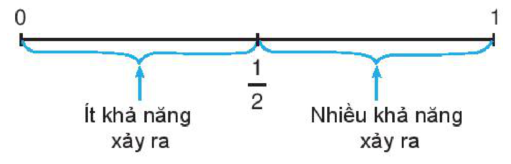
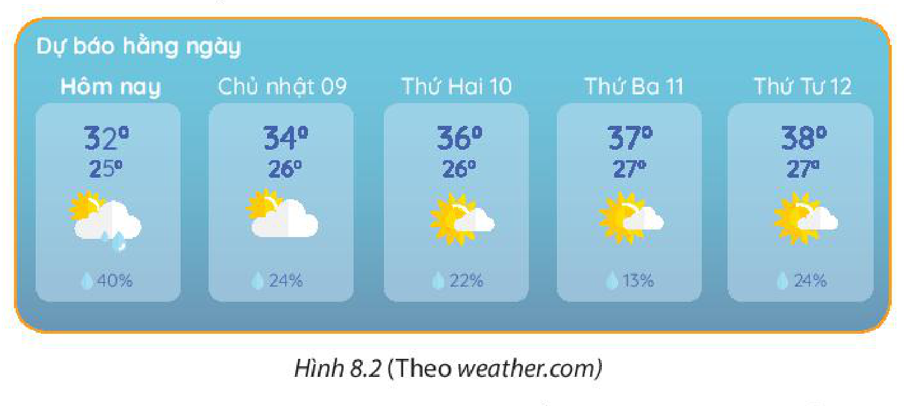
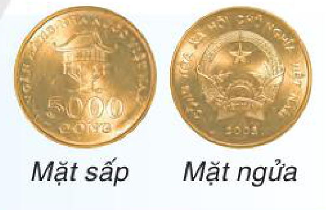
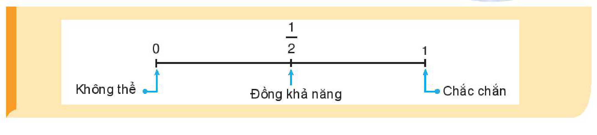
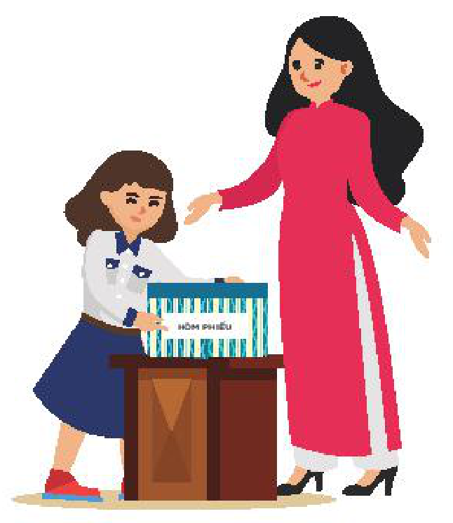
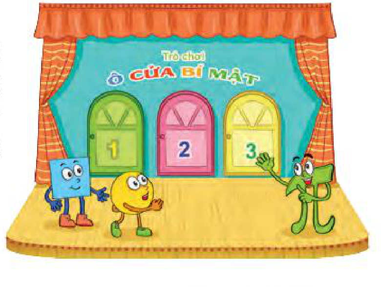

<!-- pdf:52 -->

# BÀI 30: LÀM QUEN VỚI XÁC SUẤT CỦA BIẾN CỐ

## 🔤 Khái niệm, thuật ngữ

- Xác suất của biến cố
- Đồng khả năng

## 🎯 Kiến thức, kĩ năng

- Làm quen với xác suất của biến cố ngẫu nhiên trong một số ví dụ đơn giản.

## 🔴 Mở đầu

> - Ngày mai chắc trời sẽ có mưa?
> - Chắc đến mức nào ạ?
> - Chắc đến $80\%$.

Trong cuộc sống ta thường gặp những câu mô tả khả năng xảy ra của biến cố ngẫu nhiên, chẳng hạn:
- Nhiều khả năng ngày mai trời sẽ có mưa.
- Ít khả năng xảy ra động đất ở Hà Nội.
- Nếu gieo hai con xúc xắc thì ít khả năng số chấm xuất hiện trên cả hai con xúc xắc đều là $6$.

Trong bài này, chúng ta sẽ làm quen với việc đo lường khả năng xảy ra của một biến cố bằng con số.

## 1. XÁC SUẤT CỦA BIẾN CỐ

**Xác suất là gì?**

**HĐ1:** Chọn cụm từ thích hợp (không thể, ít khả năng, nhiều khả năng, chắc chắn) thay vào dấu “?” trong các câu sau:

a) Tôi .?. đi bộ $20\text{ km}$ mà không nghỉ.

b) .?. có tuyết rơi ở Hà Nội vào mùa đông.

c) Anh An là một học sinh giỏi. Anh An .?. sẽ đỗ thủ khoa trong kì thi Trung học phổ thông quốc gia tới.

**HĐ2:** Một hộp đựng $20$ viên bi, trong đó $13$ viên màu đỏ và $7$ viên màu đen có cùng kích thước. Bạn Nam lấy ngẫu nhiên một viên bi từ trong hộp. Hỏi khả năng Nam lấy được viên bi màu nào lớn hơn?

Nếu có thể đo lường được khả năng xảy ra của biến cố “Lấy được viên bi đỏ” và biến cố “Lấy được viên bi đen” bằng một con số rồi so sánh hai số đó với nhau thì ta sẽ có câu trả lời rõ ràng cho câu hỏi trong HĐ2.

> Khả năng xảy ra của một biến cố được đo lường bởi một số nhận giá trị từ $0$ đến $1$, gọi là **xác suất của biến cố** đó.

<!-- pdf:53 -->

**Nhận xét:** Xác suất của một biến cố càng gần $1$ thì biến cố đó càng có nhiều khả năng xảy ra. Xác suất của một biến cố càng gần $0$ thì biến cố đó càng ít khả năng xảy ra.

**Ví dụ 1:**

- Người ta tính được xác suất để trúng giải độc đắc xổ số Vietlott 6/45 (một loại xổ số đang được lưu hành ở Việt Nam) là $0,0000001228$ hay $0,00001228\%$.
- Bản tin dự báo thời tiết ghi: Khả năng (hay xác suất) có mưa là $43\%$.
- Xác suất để xuất hiện mặt sấp khi gieo một đồng xu cân đối là $\dfrac{1}{2}$ hay $50\%$.

> Xác suất của một biến cố được viết dưới dạng phân số, số thập phân hoặc phần trăm.
<!-- ocr-ok: đã đối chiếu ảnh trang PDF 53, OCR mất dấu tiếng Việt trong hộp bóng thoại -->

**Ví dụ 2:**

Các chuyên gia bóng đá nhận định trong trận bóng đá ngày mai giữa đội $A$ và đội $B$, xác suất thắng của đội $A$ là $60\%$, xác suất thua là $35\%$ và xác suất hoà là $5\%$. Theo nhận định trên, đội nào có khả năng thắng cao hơn?

**Giải:**

Xác suất thua của đội $A$ là $35\%$, tức là xác suất thắng của đội $B$ là $35\%$. Xác suất thắng của đội $A$ lớn hơn xác suất thắng của đội $B$. Vậy đội $A$ có khả năng thắng cao hơn.

**Luyện tập 1:**

Hình 8.2 cho biết thông tin dự báo thời tiết tại thành phố Hà Nội trong $5$ ngày (từ 8-5-2021 đến 12-5-2021).

> Hôm nay khả năng có mưa là $40\%$ đấy!

Quan sát hình trên, em hãy cho biết ngày nào có khả năng (hay xác suất) mưa nhiều nhất, ít nhất.

<!-- pdf:54 -->

## 2. XÁC SUẤT CỦA MỘT SỐ BIẾN CỐ ĐƠN GIẢN

> **Xác suất của biến cố chắc chắn, biến cố không thể**
>
> Khả năng xảy ra của biến cố chắc chắn là $100\%$. Vậy biến cố chắc chắn có **xác suất bằng $1$**.
>
> Khả năng xảy ra của biến cố không thể là $0\%$. Vậy biến cố không thể có **xác suất bằng $0$**.

**Ví dụ 3:**

- Xác suất của biến cố $A$: “Ngày mai, Mặt Trời mọc ở phía Tây” bằng $0$ vì $A$ là biến cố không thể.
- Xác suất của biến cố $B$: “Tháng Ba có ít hơn $32$ ngày” bằng $1$ vì $B$ là biến cố chắc chắn.

**Luyện tập 2:**

Gieo đồng thời hai con xúc xắc. Tìm xác suất của các biến cố sau:
- Tổng số chấm xuất hiện trên hai con xúc xắc nhỏ hơn $13$.
- Tổng số chấm xuất hiện trên hai con xúc xắc bằng $1$.

> **Xác suất của các biến cố đồng khả năng**
>
> Gieo một đồng xu cân đối. Xét hai biến cố sau:
> $A$: “Đồng xu xuất hiện mặt ngửa”.
> $B$: “Đồng xu xuất hiện mặt sấp”.
>
> Do đồng xu cân đối nên biến cố $A$ và biến cố $B$ có khả năng xảy ra như nhau. Ta nói hai biến cố $A$ và $B$ là đồng khả năng.
>
> Vì chỉ xảy ra hoặc biến cố $A$ hoặc biến cố $B$ nên xác suất của biến cố $A$ và xác suất của biến cố $B$ bằng nhau và bằng $\dfrac{1}{2}$ (hay $50\%$).

> Nếu chỉ xảy ra hoặc $A$ hoặc $B$ và hai biến cố $A$, $B$ là đồng khả năng thì xác suất của chúng bằng nhau và bằng $0,5$.

<!-- pdf:55 -->

**Ví dụ 4:**

Trong buổi liên hoan, lớp 7A tổ chức trò chơi *Rút phiếu trúng thưởng*. Cô giáo đã chuẩn bị $10$ lá phiếu giống nhau ghi các số từ $1$ đến $10$, được gấp lại và đặt trong hộp. Mỗi bạn lần lượt rút ngẫu nhiên một lá phiếu và sẽ trúng thưởng nếu rút được phiếu ghi số $5$. Bạn Mai rút phiếu đầu tiên. Tìm xác suất để Mai rút được lá phiếu trúng thưởng.

**Giải:**

Xét $10$ biến cố sau:

$E_1$: “Rút được lá phiếu ghi số $1$”; $E_6$: “Rút được lá phiếu ghi số $6$”;

$E_2$: “Rút được lá phiếu ghi số $2$”; $E_7$: “Rút được lá phiếu ghi số $7$”;

$E_3$: “Rút được lá phiếu ghi số $3$”; $E_8$: “Rút được lá phiếu ghi số $8$”;

$E_4$: “Rút được lá phiếu ghi số $4$”; $E_9$: “Rút được lá phiếu ghi số $9$”;

$E_5$: “Rút được lá phiếu ghi số $5$”; $E_{10}$: “Rút được lá phiếu ghi số $10$”.

Vì Mai rút phiếu ngẫu nhiên nên khả năng xảy ra của mỗi biến cố $E_1, E_2, \dots, E_{10}$ là như nhau. Ta nói $10$ biến cố này đồng khả năng. Mặt khác, trong mỗi lượt rút phiếu luôn xảy ra duy nhất một trong các biến cố này nên xác suất của chúng bằng nhau và bằng $\dfrac{1}{10}$. Vậy xác suất để Mai rút được lá phiếu trúng thưởng là $\dfrac{1}{10}$.

> Trong một trò chơi hay thí nghiệm, nếu có $k$ biến cố **đồng khả năng** và luôn xảy ra duy nhất một biến cố trong $k$ biến cố này thì xác suất của mỗi biến cố đó đều bằng $\dfrac{1}{k}$.

**Luyện tập 3:**

Trong trò chơi *Ô cửa bí mật*, có ba ô cửa $1, 2, 3$ và người ta đặt phần thưởng sau một ô cửa. Người chơi sẽ chọn ngẫu nhiên một ô cửa trong ba ô cửa và nhận phần thưởng sau ô cửa đó. Tìm xác suất để người chơi chọn được ô cửa có phần thưởng.

**Luyện tập 4:**

Gieo một con xúc xắc được chế tạo cân đối.

Tìm xác suất để số chấm xuất hiện trên con xúc xắc là $2$.

<!-- pdf:56 -->

## BÀI TẬP

8.4. Mai và Việt mỗi người gieo một con xúc xắc. Tìm xác suất của các biến cố sau:

a) Tổng số chấm xuất hiện trên hai con xúc xắc lớn hơn $1$;

b) Tích số chấm xuất hiện trên hai con xúc xắc lớn hơn $36$.

8.5. Trước trận chung kết bóng đá World Cup năm $2010$ giữa hai đội Hà Lan và Tây Ban Nha, để dự đoán kết quả người ta bỏ cùng loại thức ăn vào hai hộp giống nhau, một hộp có gắn cờ Hà Lan, một hộp gắn cờ Tây Ban Nha và cho Paul chọn hộp thức ăn. Người ta cho rằng nếu Paul chọn hộp gắn cờ nước nào thì đội bóng của nước đó thắng. Paul chọn ngẫu nhiên một hộp. Tính xác suất để Paul dự đoán đội Tây Ban Nha thắng.

8.6. Một tổ học sinh của lớp 7B có $5$ bạn nam và $5$ bạn nữ. Giáo viên gọi ngẫu nhiên một bạn lên bảng để kiểm tra bài tập. Xét hai biến cố sau:

$A$: “Bạn được gọi là bạn nam” và $B$: “Bạn được gọi là bạn nữ”.

a) Hai biến cố $A$ và $B$ có đồng khả năng không? Vì sao?

b) Tìm xác suất của biến cố $A$ và biến cố $B$.

8.7. Gieo một con xúc xắc được chế tạo cân đối. Tìm xác suất của các biến cố sau:

$A$: “Số chấm xuất hiện trên con xúc xắc nhỏ hơn $7$”;

$B$: “Số chấm xuất hiện trên con xúc xắc là $0$”;

$C$: “Số chấm xuất hiện trên con xúc xắc là $6$”.

## 📷 Danh sách hình trong bài

| Mã hình | Trang PDF | Vị trí trong bài | Chú thích gốc |
| --- | :---: | --- | --- |
| H7-toan-b30-01 | 52 | Mở đầu | (sách không đánh số, Pi, Vuông và Tròn xem bản tin dự báo thời tiết ngày mai khả năng có mưa $80\%$) |
| H7-toan-b30-02 | 53 | Mục 1, Nhận xét | (sách không đánh số, sơ đồ đoạn thẳng từ $0$ qua $\dfrac{1}{2}$ đến $1$ biểu thị ít khả năng xảy ra và nhiều khả năng xảy ra) |
| H7-toan-b30-03 | 53 | Mục 1, Ví dụ 1 | (sách không đánh số, thẻ Thời tiết Hà Nội $27^\circ\text{C}$, khả năng có mưa $43\%$) |
| H7-toan-b30-04 | 53 | Mục 1, Luyện tập 1 | Hình 8.2 (Theo *weather.com*) |
| H7-toan-b30-05 | 54 | Mục 2 | Mặt sấp — Mặt ngửa |
| H7-toan-b30-06 | 54 | Mục 2 | (sách không đánh số, sơ đồ xác suất Không thể $0$ — Đồng khả năng $\dfrac{1}{2}$ — Chắc chắn $1$) |
| H7-toan-b30-07 | 55 | Mục 2, Ví dụ 4 | (sách không đánh số, cô giáo và bạn Mai rút phiếu từ hòm phiếu) |
| H7-toan-b30-08 | 55 | Mục 2, Luyện tập 3 | (sách không đánh số, sân khấu Trò chơi Ô cửa bí mật với ba ô cửa $1, 2, 3$) |
| H7-toan-b30-09 | 55 | Mục 2, Luyện tập 4 | (sách không đánh số, Vuông gieo một con xúc xắc) |
| H7-toan-b30-10 | 56 | Bài tập 8.5 | (sách không đánh số, bạch tuộc Paul chọn hộp thức ăn gắn cờ Hà Lan và Tây Ban Nha) |
