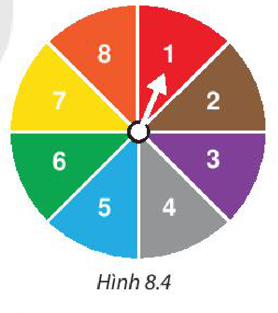

<!-- pdf:59 -->

# BÀI TẬP CUỐI CHƯƠNG VIII

8.12. Một túi đựng các quả cầu có cùng kích thước, được ghi số $5; 10; 15; 20; 30; 35; 40$. Lấy ngẫu nhiên một quả cầu trong túi. Chọn từ thích hợp (chắc chắn, không thể, ngẫu nhiên) thay vào dấu "?" trong các câu sau:
- Biến cố $A$: “Lấy được quả cầu ghi số là số chính phương” là biến cố .?.
- Biến cố $B$: “Lấy được quả cầu ghi số chia hết cho $3$” là biến cố .?.
- Biến cố $C$: “Lấy được quả cầu ghi số chia hết cho $5$” là biến cố .?.

8.13. Một thùng kín đựng $5$ quả bóng màu đỏ, $10$ quả bóng màu xanh, $20$ quả bóng màu vàng, có cùng kích thước. Ngọc lấy ngẫu nhiên một quả bóng trong thùng. Hỏi khả năng Ngọc lấy được quả bóng màu gì lớn nhất?

8.14. Một chiếc hộp đựng $7$ tấm thẻ như nhau được ghi số $2; 3; 4; 5; 6; 7; 8$. Rút ngẫu nhiên một tấm thẻ trong hộp. Tìm xác suất để rút được tấm thẻ:

a) Ghi số nhỏ hơn $10$.

b) Ghi số $1$.

c) Ghi số $8$.

8.15. Một tấm bìa cứng hình tròn được chia làm $8$ phần có diện tích bằng nhau và ghi số $1; 2; 3; 4; 5; 6; 7; 8$ như Hình 8.4, được gắn vào trục quay có mũi tên ở tâm.

Bạn Việt quay tấm bìa.

a) Tìm xác suất để mũi tên chỉ vào hình quạt:
- Ghi số lẻ.
- Ghi số $6$.

b) Biết rằng nếu mũi tên dừng ở hình quạt ghi số $1$ hoặc $2$ thì Việt nhận được $100$ điểm; dừng ở hình quạt ghi số $3$ hoặc $4$ thì Việt nhận được $200$ điểm; dừng ở hình quạt ghi số $5$ hoặc $6$ thì Việt nhận được $300$ điểm; dừng ở hình quạt ghi số $7$ hoặc $8$ thì Việt nhận được $400$ điểm.

Xét các biến cố sau:
- $A$: “Việt nhận được $100$ điểm”;
- $B$: “Việt nhận được $200$ điểm”;
- $C$: “Việt nhận được $300$ điểm”;
- $D$: “Việt nhận được $400$ điểm”.
- Các biến cố $A, B, C, D$ có đồng khả năng không? Vì sao?
- Tìm xác suất của các biến cố $A, B, C$ và $D$.

## 📷 Danh sách hình trong bài

| Mã hình | Trang PDF | Vị trí trong bài | Chú thích gốc |
| --- | :---: | --- | --- |
| H7-toan-bt-c08-01 | 59 | Bài tập 8.15 | Hình 8.4 |
