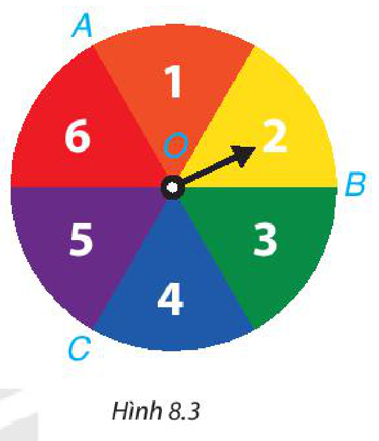
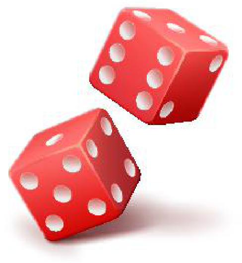

<!-- pdf:57 -->

# LUYỆN TẬP CHUNG (TRANG 56)

**Ví dụ:**

Một tấm bìa cứng hình tròn được chia làm sáu phần bằng nhau và ghi số $1; 2; 3; 4; 5; 6$ (H.8.3), được gắn vào trục quay có mũi tên ở tâm.

Bạn Nam quay tấm bìa.

a) Tìm xác suất của các biến cố sau:
- $A$: “Mũi tên dừng ở hình quạt ghi số bé hơn $7$”;
- $B$: “Mũi tên dừng ở hình quạt ghi số $0$”;
- $C$: “Mũi tên dừng ở hình quạt ghi số $2$”.

b) Biết rằng nếu mũi tên dừng ở hình quạt ghi số $1$ hoặc $2$ thì Nam nhận được $100$ điểm; dừng ở hình quạt ghi số $3$ hoặc $4$ thì Nam nhận được $200$ điểm; dừng ở hình quạt ghi số $5$ hoặc $6$ thì Nam nhận được $300$ điểm. Xét các biến cố sau:
- $E$: “Nam nhận được $100$ điểm”;
- $F$: “Nam nhận được $200$ điểm”;
- $G$: “Nam nhận được $300$ điểm”.
- Các biến cố $E, F, G$ có đồng khả năng không? Vì sao?
- Tìm xác suất của các biến cố $E, F, G$.

**Giải:**

a)
- Biến cố $A$ là biến cố chắc chắn, do đó có xác suất bằng $1$.
- Biến cố $B$ là biến cố không thể, do đó có xác suất bằng $0$.
- Vì $6$ hình quạt có diện tích bằng nhau nên $6$ biến cố sau đồng khả năng:
  “Mũi tên dừng ở hình quạt ghi số $1$”; “Mũi tên dừng ở hình quạt ghi số $2$”;
  “Mũi tên dừng ở hình quạt ghi số $3$”; “Mũi tên dừng ở hình quạt ghi số $4$”;
  “Mũi tên dừng ở hình quạt ghi số $5$”; “Mũi tên dừng ở hình quạt ghi số $6$”.
  Mặt khác, luôn xảy ra duy nhất một biến cố trong sáu biến cố này.
  Vậy xác suất của biến cố $C$ là $\dfrac{1}{6}$.

b)
- Biến cố $E$ xảy ra khi mũi tên dừng ở hình quạt $OAB$.
  Biến cố $F$ xảy ra khi mũi tên dừng ở hình quạt $OBC$.
  Biến cố $G$ xảy ra khi mũi tên dừng ở hình quạt $OCA$.
  Vì ba hình quạt này có diện tích bằng nhau nên ba biến cố $E, F, G$ là đồng khả năng.
- Vì luôn xảy ra duy nhất một biến cố trong ba biến cố này nên xác suất của biến cố $E, F, G$ bằng nhau và bằng $\dfrac{1}{3}$.

<!-- pdf:58 -->

## BÀI TẬP

8.8. Một túi đựng các tấm thẻ được ghi số $9; 12; 15; 18; 21; 24$. Rút ngẫu nhiên một tấm thẻ trong túi. Chọn từ thích hợp (chắc chắn, không thể, ngẫu nhiên) thay vào dấu “?” trong các câu sau:
- Biến cố $A$: “Rút được thẻ ghi số là số chẵn” là biến cố .?.
- Biến cố $B$: “Rút được thẻ ghi số chia hết cho $3$” là biến cố .?.
- Biến cố $C$: “Rút được thẻ ghi số chia hết cho $10$” là biến cố .?.

8.9. Vuông và Tròn mỗi người gieo một con xúc xắc.

Tìm xác suất để

a) Hiệu giữa số chấm xuất hiện trên hai con xúc xắc bằng $6$.

b) Số chấm xuất hiện trên hai con xúc xắc đều bé hơn $7$.

8.10. Trong một chiếc hộp có $15$ quả cầu màu xanh, $15$ quả cầu màu đỏ. Lấy ngẫu nhiên một quả cầu từ trong hộp. Xét hai biến cố sau:

$A$: “Lấy được quả cầu màu đỏ” và $B$: “Lấy được quả cầu màu xanh”.

a) Hai biến cố $A$ và $B$ có đồng khả năng không? Vì sao?

b) Tìm xác suất của biến cố $A$ và biến cố $B$.

8.11. Chọn ngẫu nhiên một số trong bốn số $11; 12; 13$ và $14$. Tìm xác suất để

a) Chọn được số chia hết cho $5$.

b) Chọn được số có hai chữ số.

c) Chọn được số nguyên tố.

d) Chọn được số chia hết cho $6$.

## 📷 Danh sách hình trong bài

| Mã hình | Trang PDF | Vị trí trong bài | Chú thích gốc |
| --- | :---: | --- | --- |
| H7-toan-ltc-c08-01 | 57 | Ví dụ | Hình 8.3 |
| H7-toan-ltc-c08-02 | 58 | Bài tập 8.9 | (sách không đánh số, hai con xúc xắc màu đỏ) |
