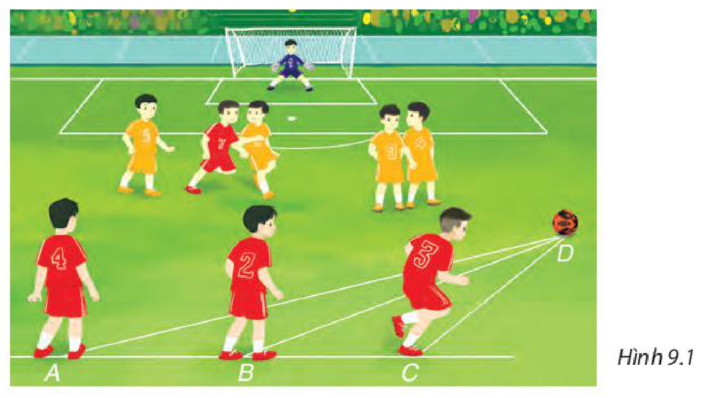
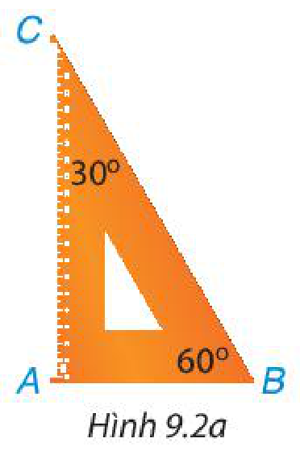
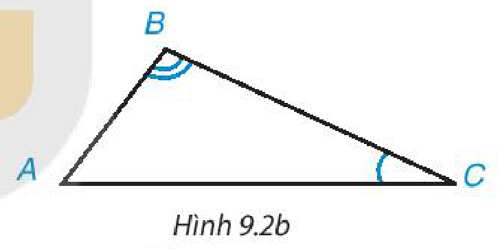
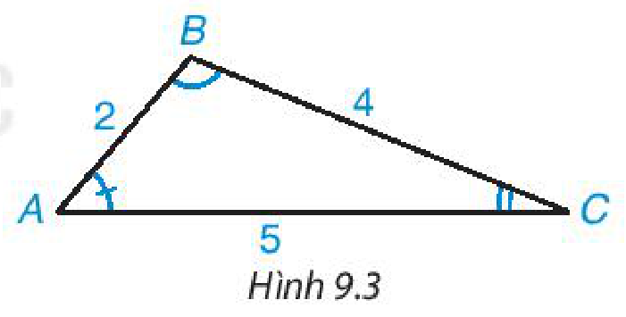
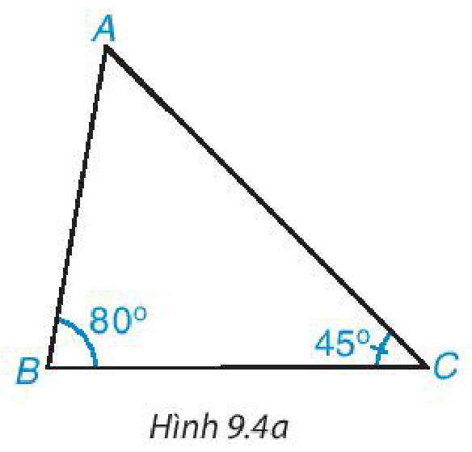
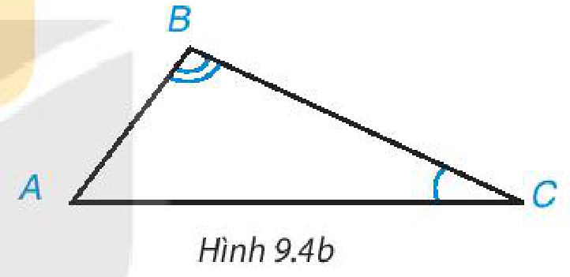
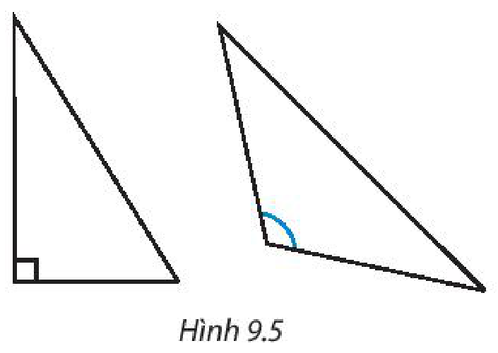
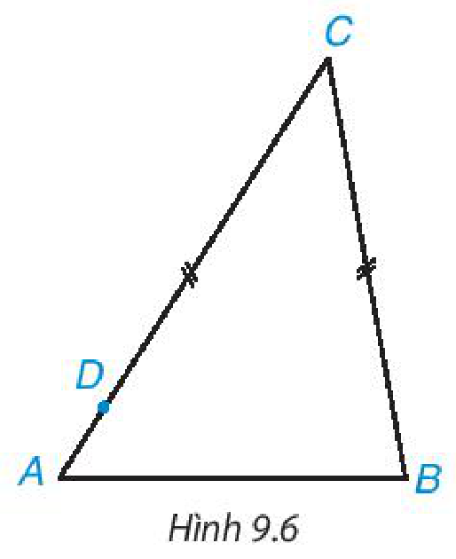
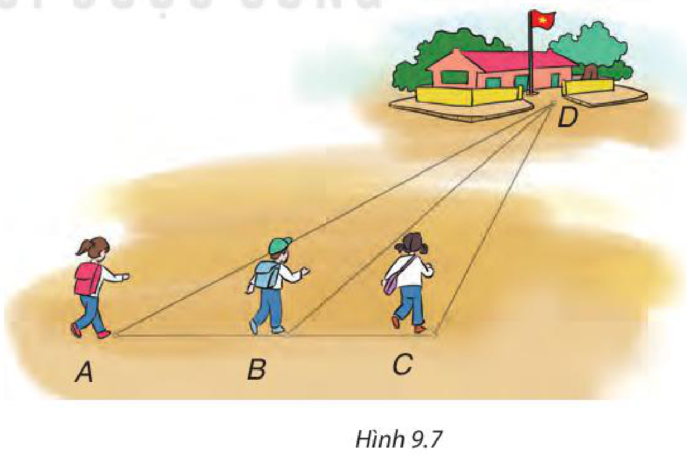

<!-- pdf:60 -->

# BÀI 31: QUAN HỆ GIỮA GÓC VÀ CẠNH ĐỐI DIỆN TRONG MỘT TAM GIÁC

> *Giới thiệu Chương IX — Quan hệ giữa các yếu tố trong một tam giác (Hình học phẳng):*
>
> Qua chương IV, các em đã biết được thế nào là hai tam giác bằng nhau, các trường hợp bằng nhau của tam giác và sự đặc biệt của chúng trong tam giác vuông.
>
> Trên cơ sở đó, trong chương IX các em sẽ tìm hiểu về quan hệ giữa các yếu tố trong một tam giác. Đó là quan hệ giữa góc, cạnh; quan hệ giữa các cạnh trong một tam giác. Ngoài các yếu tố về góc, cạnh, các em còn được tìm hiểu về sự đồng quy của các đường đặc biệt trong một tam giác.

## 🔤 Khái niệm, thuật ngữ

- Góc đối diện cạnh, cạnh đối diện góc trong tam giác
- Cạnh huyền

## 🎯 Kiến thức, kĩ năng

- Nhận biết hai định lí về cạnh và góc đối diện trong tam giác.
- Vận dụng vào tam giác vuông để nhận biết được cạnh lớn nhất trong tam giác vuông.

## 🔴 Mở đầu

Trong trận bóng đá, trái bóng đang ở vị trí $D$, ba cầu thủ đứng thẳng hàng tại vị trí $A, B, C$ trên sân với số áo lần lượt là $4, 2, 3$ như Hình 9.1. Theo em cầu thủ nào gần trái bóng nhất, cầu thủ nào xa trái bóng nhất? Tại sao? (Biết rằng góc $ACD$ là góc tù)

*Hình 9.1*

<!-- pdf:61 -->

## 1. GÓC ĐỐI DIỆN VỚI CẠNH LỚN HƠN TRONG MỘT TAM GIÁC

<!-- term: Góc đối diện với cạnh trong tam giác -->
<!-- term: Cạnh đối diện với góc trong tam giác -->
Ta đã biết trong tam giác cân $ABC$, $AB = AC$, góc đối diện với cạnh $AB$ (góc $C$), bằng góc đối diện với cạnh $AC$ (góc $B$). Hỏi trong một tam giác, nếu biết hai cạnh không bằng nhau thì có thể so sánh được hai góc đối diện với hai cạnh đó không?

**So sánh hai góc theo cạnh đối diện**

**HĐ1:** Quan sát ê ke có góc $60^\circ$ (H.9.2a). Kí hiệu đỉnh góc vuông là $A$, đỉnh góc $60^\circ$ là $B$ và đỉnh góc $30^\circ$ là $C$.

- Sắp xếp độ dài các cạnh theo thứ tự từ bé đến lớn. Sắp xếp độ lớn các góc theo thứ tự từ bé đến lớn.
- Góc lớn nhất đối diện với cạnh nào? Góc bé nhất đối diện với cạnh nào?

*Hình 9.2a*

**HĐ2:** Em hãy vẽ một tam giác $ABC$ có $AB = 3\text{ cm}$, $AC = 5\text{ cm}$. Quan sát hình vừa vẽ và dự đoán xem trong hai góc $B$ và $C$, góc nào lớn hơn.

Ta có thể chứng minh được định lí sau:

<!-- term: Quan hệ giữa góc và cạnh đối diện trong một tam giác -->
> **Định lí 1:**
>
> Trong một tam giác, góc đối diện với cạnh lớn hơn là góc lớn hơn.

| GT | $\triangle ABC, AC > AB.$ |
| :---: | --- |
| KL | $\widehat{B} > \widehat{C}.$ |

*Hình 9.2b*

**Ví dụ 1:**

Cho tam giác $ABC$ có $AB = 2\text{ cm}$, $BC = 4\text{ cm}$, $AC = 5\text{ cm}$ (H.9.3).

a) Hãy so sánh góc $A$ và góc $C$ của tam giác $ABC$.

b) Trong tam giác $ABC$, góc nào lớn nhất, góc nào nhỏ nhất?

*Hình 9.3*

<!-- term: Góc đối diện với cạnh trong tam giác -->
<!-- term: Cạnh đối diện với góc trong tam giác -->
- **Pi:** Góc $A$ đối diện cạnh $BC$, góc $B$ đối diện cạnh $AC$, góc $C$ đối diện cạnh $AB$.

**Giải:**

a) Trong tam giác $ABC$, vì $AB = 2\text{ cm}$, $BC = 4\text{ cm}$ nên $BC > AB$. Do đó, theo định lí 1 ta có: $\widehat{A} > \widehat{C}$.

b) Sắp xếp các cạnh từ lớn đến bé ta có: $AC > BC > AB$.

Từ đó, theo định lí 1 ta được: $\widehat{B} > \widehat{A} > \widehat{C}$.

Vậy trong tam giác $ABC$, góc $B$ lớn nhất, góc $C$ nhỏ nhất.

**Luyện tập 1:**

Cho tam giác $MNP$ có độ dài các cạnh: $MN = 3\text{ cm}$, $NP = 5\text{ cm}$, $MP = 7\text{ cm}$. Hãy xác định góc đối diện với từng cạnh rồi sắp xếp các góc của tam giác $MNP$ theo thứ tự từ bé đến lớn.

<!-- pdf:62 -->

## 2. CẠNH ĐỐI DIỆN VỚI GÓC LỚN HƠN TRONG MỘT TAM GIÁC

Cho tam giác $ABC$ có $\widehat{B} > \widehat{C}$. Liệu có thể so sánh được các cạnh đối diện tương ứng là $AC$ và $AB$ mà không cần đo độ dài các cạnh đó không?

**So sánh hai cạnh theo góc đối diện**

Quan sát tam giác $ABC$ trong Hình 9.4a.

**HĐ3:** Em hãy dự đoán xem giữa hai cạnh đối diện với hai góc $B$ và $C$ (tức là cạnh $AC$ và $AB$) thì cạnh nào lớn hơn.

**HĐ4:** Em hãy đo độ dài hai cạnh $AC$ và $AB$ để kiểm tra lại dự đoán của mình trong HĐ3.

*Hình 9.4a*

Người ta chứng minh được định lí sau:

<!-- term: Quan hệ giữa góc và cạnh đối diện trong một tam giác -->
> **Định lí 2:**
>
> Trong một tam giác, cạnh đối diện với góc lớn hơn là cạnh lớn hơn.

| GT | $\triangle ABC, \widehat{B} > \widehat{C}.$ |
| :---: | --- |
| KL | $AC > AB.$ |

*Hình 9.4b*

**Ví dụ 2:**

Trong tam giác $ABC$ trên Hình 9.4a, em hãy sắp xếp ba cạnh $AB$, $BC$ và $CA$ theo thứ tự độ dài từ lớn đến bé.

**Giải:**

Trong tam giác $ABC$ (H.9.4a) có $\widehat{B} = 80^\circ$, $\widehat{C} = 45^\circ$.

Vì tổng số đo các góc trong một tam giác bằng $180^\circ$ nên

$\widehat{A} = 180^\circ - (\widehat{B} + \widehat{C}) = 180^\circ - (80^\circ + 45^\circ) = 55^\circ.$

Từ đó trong tam giác $ABC$, ta có $\widehat{B} > \widehat{A} > \widehat{C}$. Theo định lí 2, ta được $AC > BC > AB$.

**Luyện tập 2:**

Cho tam giác $MNP$ có $\widehat{M} = 47^\circ$, $\widehat{N} = 53^\circ$. Hãy viết các cạnh của tam giác đó theo thứ tự độ dài từ bé đến lớn.

**Tranh luận:**

Cho tam giác $ABC$ có góc $A$ là góc tù.

- **Vuông:** Tam giác $ABC$ có cạnh $AB$ lớn nhất.
- **Tròn:** Không đúng, tam giác $ABC$ có cạnh $BC$ lớn nhất chứ!

Theo em, bạn nào nói đúng? Vì sao?

<!-- pdf:63 -->

**Nhận xét:** (H.9.5).

<!-- term: Cạnh huyền -->
- Trong tam giác vuông, góc vuông là góc lớn nhất nên cạnh đối diện với góc vuông (tức là cạnh huyền) là cạnh lớn nhất.
- Tương tự trong tam giác tù, cạnh đối diện với góc tù là cạnh lớn nhất.

*Hình 9.5*

**Vận dụng:**

Em hãy trả lời câu hỏi trong *tình huống mở đầu*.

## BÀI TẬP

9.1. Cho tam giác $ABC$ có $\widehat{A} = 105^\circ$, $\widehat{B} = 35^\circ$.

a) Tam giác $ABC$ là tam giác gì?

b) Tìm cạnh lớn nhất của tam giác $ABC$.

9.2. Trong Hình 9.6 có hai đoạn thẳng $BC$ và $DC$ bằng nhau, $D$ nằm giữa $A$ và $C$. Hỏi kết luận nào trong các kết luận sau là đúng? Tại sao?

a) $\widehat{A} = \widehat{B}$.

b) $\widehat{A} > \widehat{B}$.

c) $\widehat{A} < \widehat{B}$.

*Hình 9.6*

9.3. Trong tam giác cân có một góc bằng $96^\circ$, hỏi cạnh lớn nhất của tam giác cân đó là cạnh bên hay cạnh đáy? Vì sao?

9.4. Ba bạn Mai, Việt và Hà đi đến trường tại địa điểm $D$ lần lượt theo ba con đường $AD$, $BD$ và $CD$ (H.9.7). Biết rằng ba điểm $A, B, C$ cùng nằm trên một đường thẳng, $B$ nằm giữa $A$ và $C$, $\widehat{ACD}$ là góc tù. Hỏi bạn nào đi xa nhất, bạn nào đi gần nhất? Vì sao?

*Hình 9.7*

9.5. Ba địa điểm $A, B, C$ là ba đỉnh của một tam giác $ABC$ với $\widehat{A}$ tù, $AC = 500\text{ m}$. Đặt một loa truyền thanh tại một điểm nằm giữa $A$ và $B$ thì tại $C$ có thể nghe tiếng loa không nếu bán kính để nghe rõ tiếng của loa là $500\text{ m}$?

## 📷 Danh sách hình trong bài

| Mã hình | Trang PDF | Vị trí trong bài | Chú thích gốc |
| --- | :---: | --- | --- |
| H7-toan-b31-01 | 60 | Mở đầu | Hình 9.1 |
| H7-toan-b31-02 | 61 | Mục 1, HĐ1 | Hình 9.2a |
| H7-toan-b31-03 | 61 | Mục 1, Định lí 1 | Hình 9.2b |
| H7-toan-b31-04 | 61 | Mục 1, Ví dụ 1 | Hình 9.3 |
| H7-toan-b31-05 | 62 | Mục 2, HĐ3 | Hình 9.4a |
| H7-toan-b31-06 | 62 | Mục 2, Định lí 2 | Hình 9.4b |
| H7-toan-b31-07 | 63 | Mục 2, Nhận xét | Hình 9.5 |
| H7-toan-b31-08 | 63 | Bài tập 9.2 | Hình 9.6 |
| H7-toan-b31-09 | 63 | Bài tập 9.4 | Hình 9.7 |
