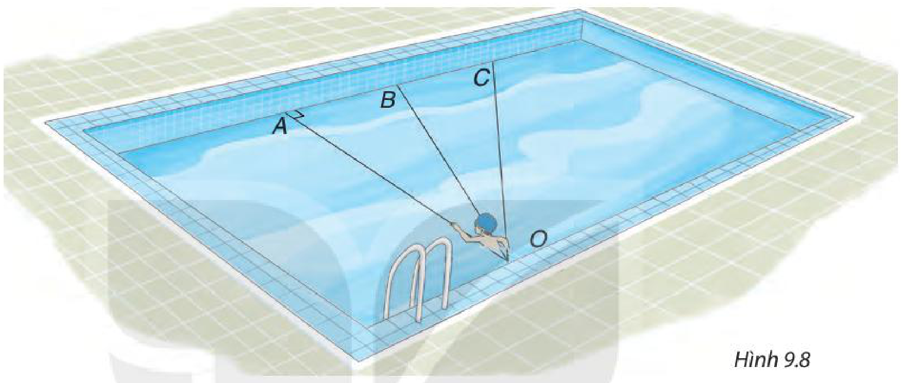
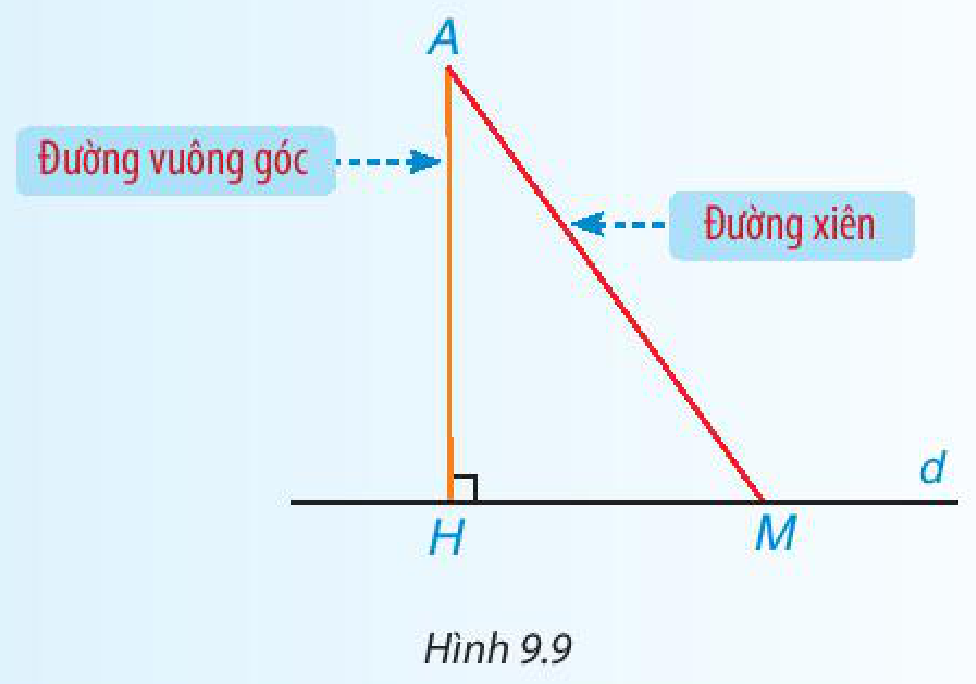
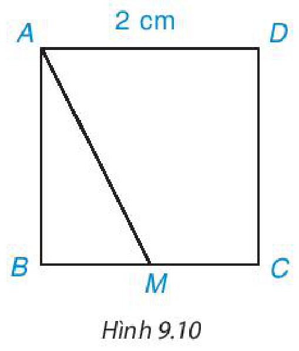
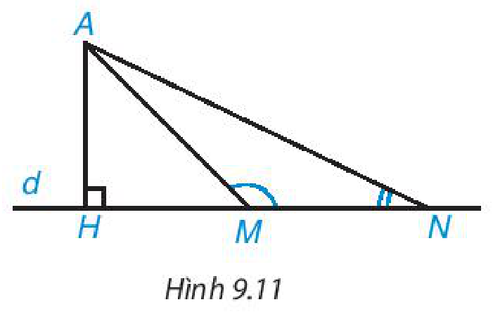
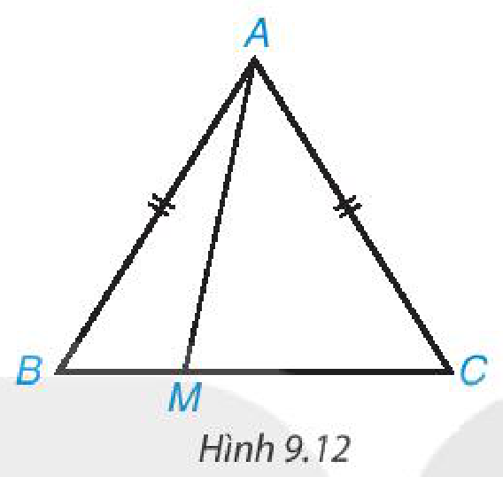
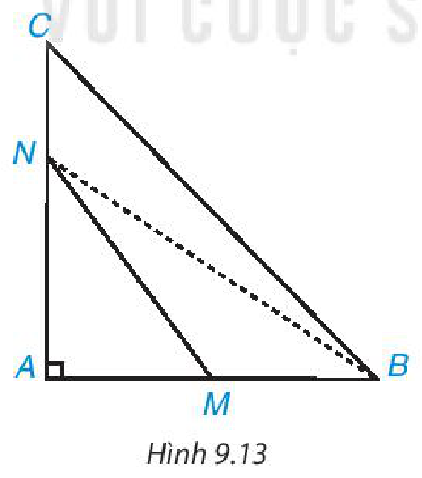

<!-- pdf:64 -->

# BÀI 32: QUAN HỆ GIỮA ĐƯỜNG VUÔNG GÓC VÀ ĐƯỜNG XIÊN

## 🔤 Khái niệm, thuật ngữ

- Đường vuông góc
- Đường xiên
- Khoảng cách từ một điểm đến một đường thẳng

## 🎯 Kiến thức, kĩ năng

- Nhận biết khái niệm đường vuông góc và đường xiên; khoảng cách từ một điểm đến một đường thẳng.
- Biết quan hệ giữa đường vuông góc và đường xiên.

## 🔴 Mở đầu

*Hình 9.8*

Bạn Nam tập bơi ở một bể bơi hình chữ nhật, trong đó có ba đường bơi $OA$, $OB$ và $OC$. Biết rằng $OA$ vuông góc với cạnh của bể bơi (H.9.8).

Nếu xuất phát từ điểm $O$ và bơi cùng tốc độ, để bơi sang bờ bên kia nhanh nhất thì bạn Nam nên chọn đường bơi nào?

**Khái niệm đường vuông góc và đường xiên**

<!-- term: Đường vuông góc và đường xiên -->
<!-- term: Đường vuông góc -->
<!-- term: Chân đường vuông góc -->
> Từ một điểm $A$ không nằm trên đường thẳng $d$, kẻ đường thẳng vuông góc với $d$ tại $H$ (H.9.9).
>
> Đoạn thẳng $AH$ gọi là *đoạn vuông góc* hay *đường vuông góc* kẻ từ điểm $A$ đến đường thẳng $d$. Ta gọi $H$ là *chân đường vuông góc* hạ từ $A$ xuống $d$.

<!-- term: Đường vuông góc và đường xiên -->
<!-- term: Đường xiên -->
> Lấy một điểm $M$ trên $d$ ($M$ khác $H$), kẻ đoạn thẳng $AM$. Đoạn thẳng $AM$ gọi là một *đường xiên* kẻ từ $A$ đến đường thẳng $d$.

*Hình 9.9*

<!-- pdf:65 -->

**So sánh đường vuông góc và đường xiên**

**HĐ:** Cho điểm $A$ không nằm trên đường thẳng $d$.

a) Hãy vẽ đường vuông góc $AH$ và một đường xiên $AM$ từ $A$ đến $d$.
<!-- ocr-ok: đã đối chiếu ảnh trang PDF 65, OCR đọc nhầm chữ "vẽ" thành "võ" -->

b) Em hãy giải thích vì sao $AH < AM$.

- **Tròn:** Dùng quan hệ giữa góc và cạnh đối diện trong tam giác $AHM$ để giải thích nhé!

Từ HĐ trên, ta suy ra định lí sau:

<!-- term: Quan hệ giữa đường vuông góc và đường xiên -->
> **Định lí:**
>
> Trong các đường xiên và đường vuông góc kẻ từ một điểm nằm ngoài một đường thẳng đến đường thẳng đó thì đường vuông góc là đường ngắn nhất.

**Chú ý:** Vì độ dài đoạn thẳng $AH$ là ngắn nhất trong các đoạn thẳng kẻ từ $A$ đến $d$ nên độ dài đoạn thẳng $AH$ được gọi là **khoảng cách** từ điểm $A$ đến đường thẳng $d$ (H.9.9).

- **Pi:** Khi điểm $A$ nằm trên đường thẳng $d$, người ta coi khoảng cách từ $A$ đến $d$ bằng $0$.

**Luyện tập:**

Cho hình vuông $ABCD$ có độ dài cạnh bằng $2\text{ cm}$, $M$ là một điểm trên cạnh $BC$ như Hình 9.10.

a) Hãy chỉ ra các đường vuông góc và đường xiên kẻ từ điểm $A$ đến đường thẳng $BC$.

b) So sánh hai đoạn thẳng $AB$ và $AM$.

c) Tìm khoảng cách từ điểm $C$ đến đường thẳng $AB$.

*Hình 9.10*

**Vận dụng:**

Em hãy trả lời câu hỏi trong *tình huống mở đầu*.

**Thử thách nhỏ:**

a) Quan sát Hình 9.11, ta thấy khi $M$ thay đổi trên $d$, $M$ càng xa $H$ thì độ dài $AM$ càng lớn, tức là nếu $HM < HN$ thì $AM < AN$. Hãy chứng minh khẳng định này nhờ quan hệ giữa góc và cạnh đối diện trong tam giác $AMN$.

b) Xét hình vuông $ABCD$ và một điểm $M$ tuỳ ý nằm trên các cạnh của hình vuông. Hỏi với vị trí nào của $M$ thì $AM$ lớn nhất? Vì sao?

*Hình 9.11*

<!-- pdf:66 -->

## BÀI TẬP

9.6. Chiều cao của tam giác ứng với một cạnh của nó có phải là khoảng cách từ đỉnh đối diện đến đường thẳng chứa cạnh đó không?

9.7. Cho hình vuông $ABCD$. Hỏi trong bốn đỉnh của hình vuông

a) Đỉnh nào cách đều hai điểm $A$ và $C$?

b) Đỉnh nào cách đều hai đường thẳng $AB$ và $AD$?

9.8. Cho tam giác cân $ABC$, $AB = AC$. Lấy điểm $M$ tuỳ ý nằm giữa $B$ và $C$ (H.9.12).

*Hình 9.12*

a) Khi $M$ thay đổi thì độ dài $AM$ thay đổi. Xác định vị trí của điểm $M$ để độ dài $AM$ nhỏ nhất.

b) Chứng minh rằng với mọi điểm $M$ thì $AM < AB$.

9.9. Cho tam giác $ABC$ vuông tại $A$. Hai điểm $M, N$ theo thứ tự nằm trên các cạnh $AB, AC$ ($M, N$ không phải là đỉnh của tam giác) (H.9.13). Chứng minh rằng $MN < BC$. (*Gợi ý.* So sánh $MN$ với $NB$, $NB$ với $BC$).

*Hình 9.13*

## 📷 Danh sách hình trong bài

| Mã hình | Trang PDF | Vị trí trong bài | Chú thích gốc |
| --- | :---: | --- | --- |
| H7-toan-b32-01 | 64 | Mở đầu | Hình 9.8 |
| H7-toan-b32-02 | 64 | Khái niệm đường vuông góc và đường xiên | Hình 9.9 |
| H7-toan-b32-03 | 65 | Luyện tập | Hình 9.10 |
| H7-toan-b32-04 | 65 | Thử thách nhỏ | Hình 9.11 |
| H7-toan-b32-05 | 66 | Bài tập 9.8 | Hình 9.12 |
| H7-toan-b32-06 | 66 | Bài tập 9.9 | Hình 9.13 |
