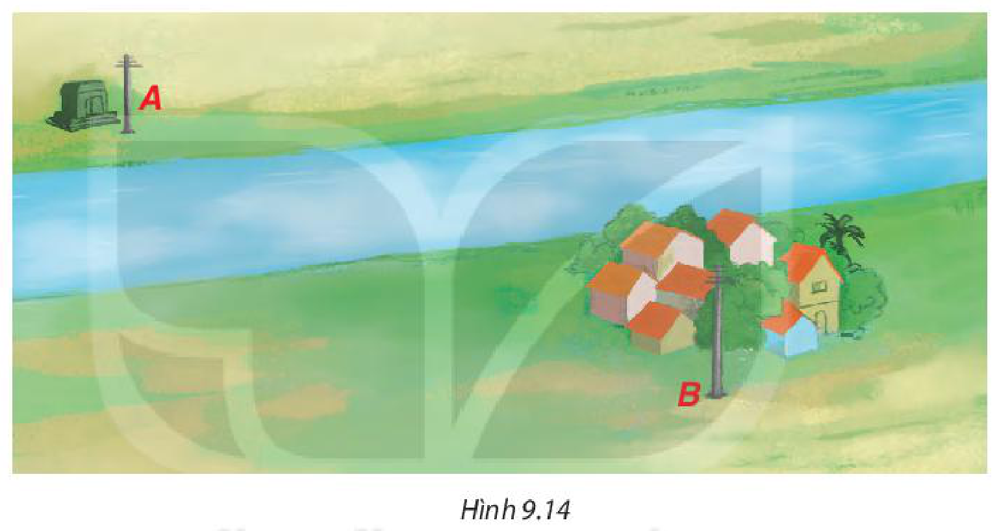
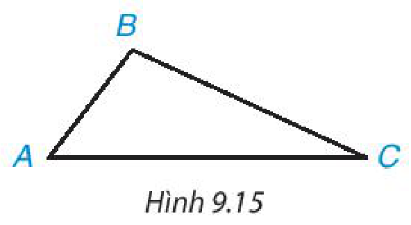
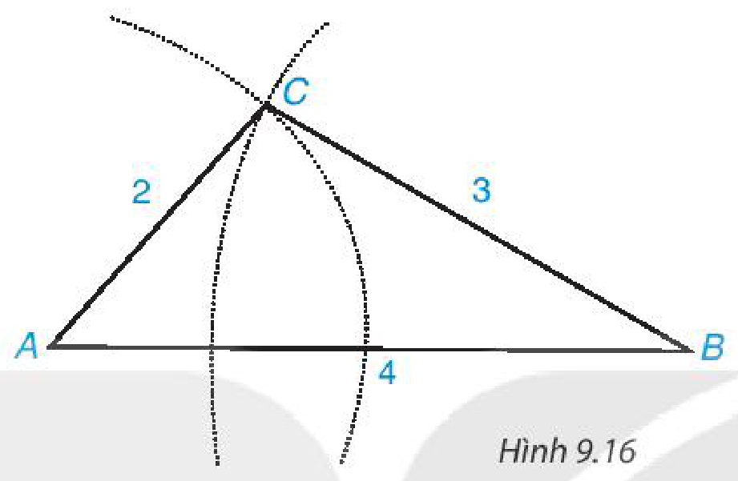
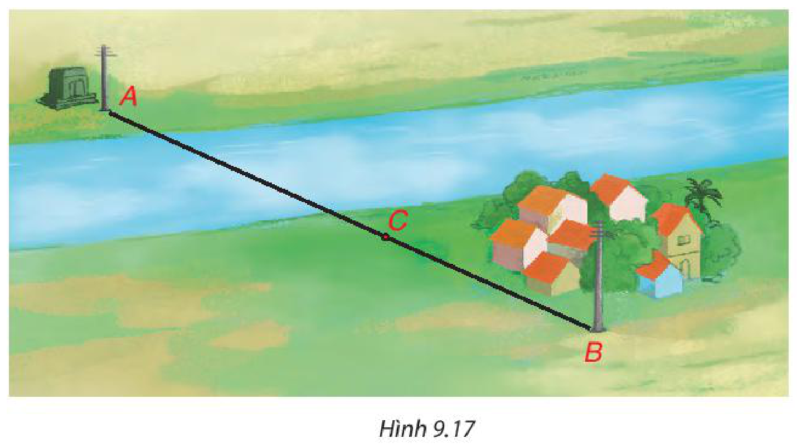
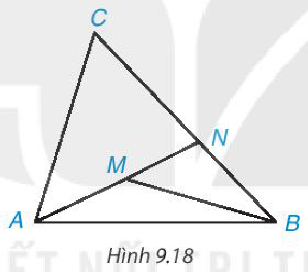

<!-- pdf:67 -->

# BÀI 33: QUAN HỆ GIỮA BA CẠNH CỦA MỘT TAM GIÁC

## 🔤 Khái niệm, thuật ngữ

- Bất đẳng thức tam giác

## 🎯 Kiến thức, kĩ năng

- Nhận biết liên hệ về độ dài của ba cạnh trong một tam giác.

## 🔴 Mở đầu

Một trạm biến áp và một khu dân cư ở hai bên bờ sông (H.9.14). Trên bờ sông phía khu dân cư, hãy tìm một địa điểm $C$ để dựng một cột điện kéo điện từ cột điện $A$ của trạm biến áp đến cột điện $B$ của khu dân cư sao cho tổng độ dài dây dẫn điện cần sử dụng là ngắn nhất.

*Hình 9.14*

**Bất đẳng thức tam giác**

**HĐ1:** Cho hai bộ ba thanh tre nhỏ có độ dài như sau:

Bộ thứ nhất: $10\text{ cm}$, $20\text{ cm}$, $25\text{ cm}$;

Bộ thứ hai: $5\text{ cm}$, $15\text{ cm}$, $25\text{ cm}$.

Em hãy ghép và cho biết bộ nào ghép được thành một tam giác.

- **Vuông:** Không phải ba độ dài nào cũng là độ dài ba cạnh của một tam giác.

**HĐ2:** Với bộ ba thanh tre ghép lại được thành một tam giác trong HĐ1, em hãy so sánh độ dài của thanh bất kì với tổng độ dài của hai thanh còn lại.

Ta có thể chứng minh được định lí sau:

<!-- term: Quan hệ giữa ba cạnh của một tam giác -->
> **Định lí:**
>
> Trong một tam giác, độ dài của một cạnh bất kì luôn nhỏ hơn tổng độ dài hai cạnh còn lại.

<!-- pdf:68 -->

| GT | $\triangle ABC$ |
| :---: | --- |
| KL | $AB < AC + BC,$ $AC < AB + BC,$ $BC < AB + AC.$ |

*Hình 9.15*

Ba hệ thức $AB < AC + BC$, $AC < AB + BC$, $BC < AB + AC$, gọi là các **bất đẳng thức tam giác**.

- **Pi:** Nếu ba độ dài $a, b, c$ không thoả mãn một bất đẳng thức tam giác thì chúng không phải là độ dài ba cạnh của một tam giác.

Từ Định lí trên, người ta suy ra được tính chất sau:

<!-- term: Quan hệ giữa ba cạnh của một tam giác -->
> Trong một tam giác, độ dài của một cạnh bất kì luôn lớn hơn hiệu độ dài hai cạnh còn lại.

<!-- term: Quan hệ giữa ba cạnh của một tam giác -->
**Nhận xét:** Nếu kí hiệu $a, b, c$ là độ dài ba cạnh tuỳ ý của một tam giác thì từ định lí và tính chất vừa nêu ta có:

$b - c < a < b + c.$

**Tranh luận:**

- **Vuông:** Ba đoạn thẳng có độ dài $1\text{ cm}$, $2\text{ cm}$, $4\text{ cm}$ ghép được thành một tam giác vì $2 < 4 + 1$.
- **Tròn:** Vuông sai rồi.

Ý kiến của em thì sao?

**Chú ý:**

Để kiểm tra ba độ dài có là độ dài ba cạnh của một tam giác hay không, ta chỉ cần so sánh độ dài lớn nhất có nhỏ hơn tổng hai độ dài còn lại hoặc độ dài nhỏ nhất có lớn hơn hiệu hai độ dài còn lại hay không.

**Ví dụ:**

Hãy kiểm tra ba độ dài nào sau đây không thể là độ dài ba cạnh của một tam giác. Với bộ ba còn lại, hãy vẽ tam giác nhận ba độ dài đó làm độ dài ba cạnh.

a) $2\text{ cm}$, $4\text{ cm}$, $7\text{ cm}$.

b) $2\text{ cm}$, $3\text{ cm}$, $4\text{ cm}$.

<!-- pdf:69 -->

**Giải:**

a) Ta có: $2 + 4 = 6 < 7$, ba độ dài $2\text{ cm}$, $4\text{ cm}$, $7\text{ cm}$ không thoả mãn một bất đẳng thức tam giác nên không là độ dài ba cạnh của một tam giác.

b) Ta có: $2 > 4 - 3 = 1$, ba độ dài $2\text{ cm}$, $3\text{ cm}$, $4\text{ cm}$ thoả mãn điều kiện trong chú ý trên nên đây có thể là độ dài ba cạnh của một tam giác.

Ta dùng thước và compa vẽ được tam giác $ABC$ có độ dài ba cạnh là $2\text{ cm}$, $3\text{ cm}$, $4\text{ cm}$ như Hình 9.16 nên ba độ dài $2\text{ cm}$, $3\text{ cm}$, $4\text{ cm}$ đúng là độ dài ba cạnh của một tam giác.

*Hình 9.16*

**Luyện tập:**

Hỏi ba độ dài nào sau đây không thể là độ dài ba cạnh của một tam giác? Vì sao? Hãy vẽ tam giác nhận ba độ dài còn lại làm độ dài ba cạnh.

a) $5\text{ cm}$, $4\text{ cm}$, $6\text{ cm}$.

b) $3\text{ cm}$, $6\text{ cm}$, $10\text{ cm}$.

- **Pi:** Em hãy dùng Chú ý trên để kiểm tra nhé!

**Vận dụng:**

Trở lại *tình huống mở đầu*, em hãy giải thích vì sao nếu dựng cột điện ở vị trí $C$ trên đoạn thẳng $AB$ thì tổng độ dài dây dẫn điện cần sử dụng là ngắn nhất (H.9.17).

*Hình 9.17*

<!-- pdf:70 -->

## BÀI TẬP

9.10. Cho các bộ ba đoạn thẳng có độ dài như sau:

a) $2\text{ cm}$, $3\text{ cm}$, $5\text{ cm}$;

b) $3\text{ cm}$, $4\text{ cm}$, $6\text{ cm}$;

c) $2\text{ cm}$, $4\text{ cm}$, $5\text{ cm}$.

Hỏi bộ ba nào không thể là độ dài ba cạnh của một tam giác? Vì sao? Với mỗi bộ ba còn lại, hãy vẽ một tam giác có độ dài ba cạnh được cho trong bộ ba đó.

9.11. a) Cho tam giác $ABC$ có $AB = 1\text{ cm}$ và $BC = 7\text{ cm}$. Hãy tìm độ dài cạnh $CA$ biết rằng đó là một số nguyên ($\text{cm}$).

b) Cho tam giác $ABC$ có $AB = 2\text{ cm}$, $BC = 6\text{ cm}$ và $BC$ là cạnh lớn nhất. Hãy tìm độ dài cạnh $CA$ biết rằng đó là một số nguyên ($\text{cm}$).

9.12. Cho điểm $M$ nằm bên trong tam giác $ABC$. Gọi $N$ là giao điểm của đường thẳng $AM$ và cạnh $BC$ (H.9.18).

*Hình 9.18*

a) So sánh $MB$ với $MN + NB$, từ đó suy ra $MA + MB < NA + NB$.

b) So sánh $NA$ với $CA + CN$, từ đó suy ra $NA + NB < CA + CB$.

c) Chứng minh $MA + MB < CA + CB$.

9.13. Cho tam giác $ABC$, điểm $D$ nằm giữa $B$ và $C$. Chứng minh rằng $AD$ nhỏ hơn nửa chu vi tam giác $ABC$.

## 📷 Danh sách hình trong bài

| Mã hình | Trang PDF | Vị trí trong bài | Chú thích gốc |
| --- | :---: | --- | --- |
| H7-toan-b33-01 | 67 | Mở đầu | Hình 9.14 |
| H7-toan-b33-02 | 68 | Bất đẳng thức tam giác, Định lí | Hình 9.15 |
| H7-toan-b33-03 | 69 | Ví dụ | Hình 9.16 |
| H7-toan-b33-04 | 69 | Vận dụng | Hình 9.17 |
| H7-toan-b33-05 | 70 | Bài tập 9.12 | Hình 9.18 |
