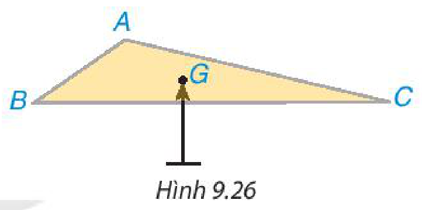
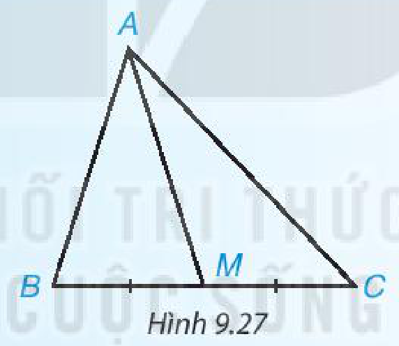
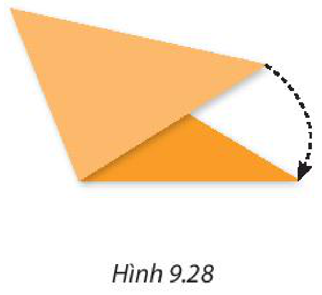
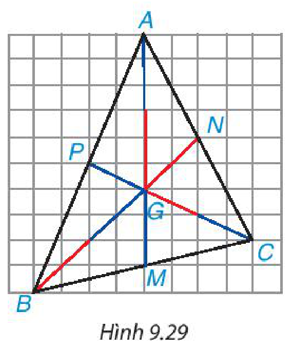
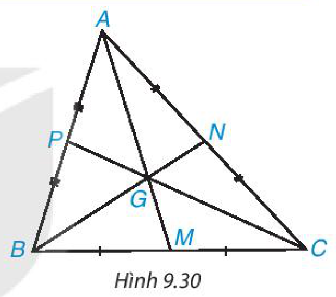
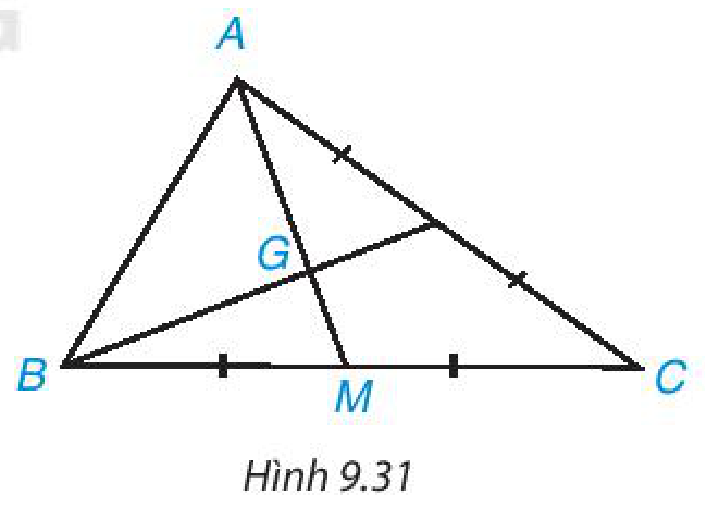
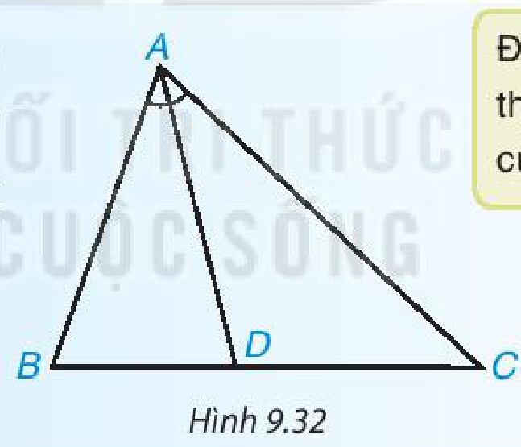
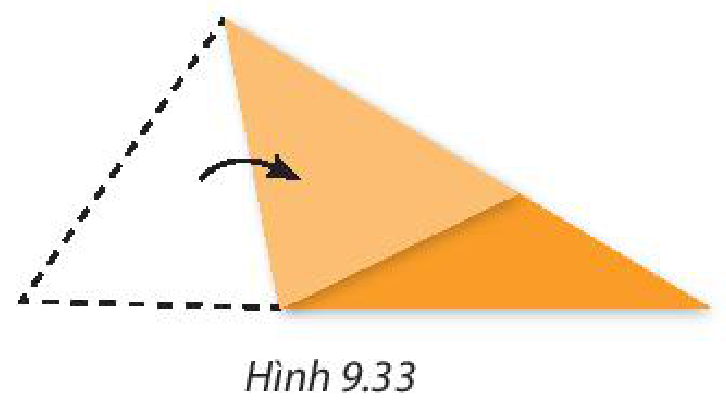
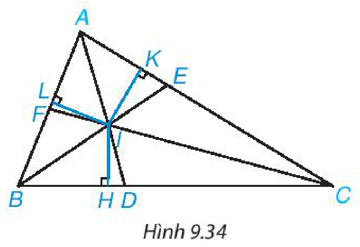
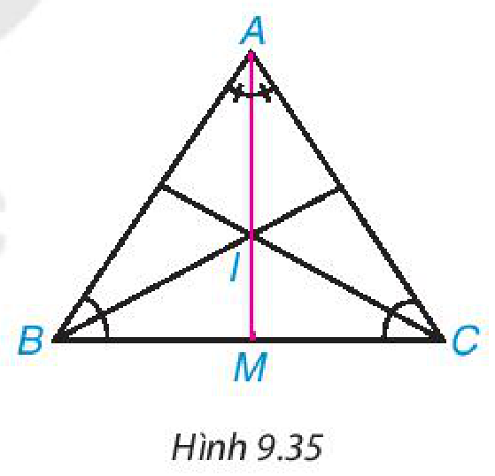

<!-- pdf:73 -->

# BÀI 34: SỰ ĐỒNG QUY CỦA BA ĐƯỜNG TRUNG TUYẾN, BA ĐƯỜNG PHÂN GIÁC TRONG MỘT TAM GIÁC

## 🔤 Khái niệm, thuật ngữ

- Đường trung tuyến
- Đường phân giác

## 🎯 Kiến thức, kĩ năng

- Nhận biết đường trung tuyến, đường phân giác của tam giác.
- Nhận biết sự đồng quy của ba đường trung tuyến trong một tam giác.
- Nhận biết sự đồng quy của ba đường phân giác trong một tam giác.

## 🔴 Mở đầu

Hình 9.26 mô phỏng một miếng bìa hình tam giác $ABC$ đặt thăng bằng trên giá nhọn tại điểm $G$. Điểm đó được xác định như thế nào và có gì đặc biệt?

*Hình 9.26*

## 1. SỰ ĐỒNG QUY CỦA BA ĐƯỜNG TRUNG TUYẾN TRONG MỘT TAM GIÁC

**Đường trung tuyến của tam giác**

> Đoạn thẳng $AM$ nối đỉnh $A$ của tam giác $ABC$ với trung điểm $M$ của cạnh $BC$ gọi là **đường trung tuyến** (xuất phát từ đỉnh $A$ hoặc ứng với cạnh $BC$) của tam giác $ABC$ (H.9.27).

*Hình 9.27*

- **Pi:** Đôi khi, đường thẳng $AM$ cũng được gọi là *đường trung tuyến* của tam giác $ABC$.

> ❓ Mỗi tam giác có mấy đường trung tuyến?

*Sự đồng quy của ba đường trung tuyến*

**HĐ1:** Hãy lấy một mảnh giấy hình tam giác, gấp giấy đánh dấu trung điểm của các cạnh. Sau đó, gấp giấy để được các nếp gấp đi qua đỉnh và trung điểm của cạnh đối diện (tức là các đường trung tuyến của tam giác). Mở tờ giấy ra, quan sát và cho biết ba nếp gấp (ba đường trung tuyến) có cùng đi qua một điểm không (H.9.28).

*Hình 9.28*

<!-- pdf:74 -->

**HĐ2:** Trên mảnh giấy kẻ ô vuông, mỗi chiều $10$ ô, hãy đếm dòng, đánh dấu các đỉnh $A, B, C$ rồi vẽ tam giác $ABC$ (H.9.29).

Vẽ hai đường trung tuyến $BN, CP$, chúng cắt nhau tại $G$; tia $AG$ cắt cạnh $BC$ tại $M$.

- $AM$ có phải là đường trung tuyến của tam giác $ABC$ không?
- Hãy xác định các tỉ số $\dfrac{GA}{MA}, \dfrac{GB}{NB}, \dfrac{GC}{PC}$.

*Hình 9.29*

Người ta chứng minh được định lí sau:

<!-- term: Sự đồng quy của ba đường trung tuyến -->
> **Định lí 1:**
>
> Ba đường trung tuyến của một tam giác cùng đi qua một điểm (hay đồng quy tại một điểm). Điểm đó cách mỗi đỉnh một khoảng bằng $\dfrac{2}{3}$ độ dài đường trung tuyến đi qua đỉnh ấy.

Chẳng hạn, trong tam giác $ABC$ (H.9.30), các đường trung tuyến $AM, BN, CP$ đồng quy tại điểm $G$ và ta có

$\dfrac{GA}{MA} = \dfrac{GB}{NB} = \dfrac{GC}{PC} = \dfrac{2}{3}.$

*Hình 9.30*

**Chú ý:** Điểm đồng quy của ba đường trung tuyến gọi là **trọng tâm** tam giác.

**Ví dụ 1:**

Cho tam giác $ABC$ với $AM$ là trung tuyến và $G$ là trọng tâm tam giác.

a) Chứng minh $GA = 2GM$.

b) Biết $GM = 2\text{ cm}$, tính $GA$.

**Giải:** (H.9.31)

a)

| GT | $\triangle ABC$ có trung tuyến $AM$, trọng tâm $G$. |
| :---: | --- |
| KL | $GA = 2GM.$ |
<!-- ocr-ok: đã đối chiếu ảnh trang PDF 74, bảng giả thiết kết luận -->

*Hình 9.31*

*Chứng minh*

Vì $G$ là trọng tâm tam giác $ABC$ nên $\dfrac{GA}{MA} = \dfrac{2}{3}$ hay $GA = \dfrac{2}{3}MA$.
<!-- ocr-ok: đã đối chiếu ảnh trang PDF 74, công thức phân số viết bằng LaTeX -->

Ta có $GM = MA - GA = MA - \dfrac{2}{3}MA = \dfrac{1}{3}MA$.

Vậy $GA = \dfrac{2}{3}MA = 2 \cdot \left(\dfrac{1}{3}MA\right) = 2GM$.

b) Khi $GM = 2\text{ cm}$ thì $GA = 4\text{ cm}$.

**Luyện tập 1:**

Trong tam giác $ABC$ ở Ví dụ 1, cho trung tuyến $BN$ và $GN = 1\text{ cm}$. Tính $GB$ và $NB$.

<!-- pdf:75 -->

**Tranh luận:**

- **Vuông:** Tớ tìm trọng tâm của một tam giác bằng cách lấy giao điểm của hai đường trung tuyến.
- **Tròn:** Tớ còn cách khác nữa cơ.
- **Pi:** Các em có những cách nào?

**Vận dụng 1:**

Trong *tình huống mở đầu*, người ta chứng minh được $G$ chính là trọng tâm của tam giác $ABC$. Em hãy cắt một mảnh bìa hình tam giác. Xác định trọng tâm của tam giác và đặt mảnh bìa đó lên một giá nhọn tại trọng tâm vừa xác định. Quan sát xem mảnh bìa có thăng bằng không.

## 2. SỰ ĐỒNG QUY CỦA BA ĐƯỜNG PHÂN GIÁC TRONG TAM GIÁC

**Đường phân giác của tam giác**

> Trong tam giác $ABC$, tia phân giác của góc $A$ cắt cạnh $BC$ tại điểm $D$ thì đoạn thẳng $AD$ được gọi là **đường phân giác** (xuất phát từ đỉnh $A$) của tam giác $ABC$ (H.9.32).

*Hình 9.32*

- **Pi:** Đôi khi ta cũng gọi đường thẳng $AD$ là *đường phân giác* của tam giác $ABC$.
<!-- ocr-ok: đã đối chiếu ảnh trang PDF 75, bóng thoại của Pi -->

> ❓ Mỗi tam giác có mấy đường phân giác?

*Sự đồng quy của ba đường phân giác*

**HĐ3:** Cắt một tam giác bằng giấy. Hãy gấp tam giác vừa cắt để được ba đường phân giác của nó. Mở tờ giấy ra, hãy quan sát và cho biết ba nếp gấp đó có cùng đi qua một điểm không (H.9.33).

*Hình 9.33*

<!-- pdf:76 -->

Ta có thể chứng minh được định lí sau:

<!-- term: Sự đồng quy của ba đường phân giác -->
> **Định lí 2:**
>
> Ba đường phân giác của một tam giác đồng quy tại một điểm. Điểm này cách đều ba cạnh của tam giác đó.

Chẳng hạn, trong tam giác $ABC$ (H.9.34), các đường phân giác $AD, BE, CF$ đồng quy tại $I$ và $IH = IK = IL$.

*Hình 9.34*

**Ví dụ 2:**

Chứng minh rằng trong tam giác $ABC$ cân tại $A$, giao điểm của ba đường phân giác nằm trên đường trung tuyến xuất phát từ đỉnh $A$ (H.9.35).

**Giải:**

| GT | $\triangle ABC, AB = AC,$ $I$ là giao điểm của ba đường phân giác. |
| :---: | --- |
| KL | $AI$ là đường trung tuyến của $\triangle ABC$. |

*Hình 9.35*

*Chứng minh*

Gọi $M$ là giao điểm của đường thẳng $AI$ và $BC$.

Hai tam giác $ABM$ và $ACM$ có:
<!-- ocr-ok: đã đối chiếu ảnh trang PDF 76, câu ngắn chứa kí hiệu tam giác -->

$AB = AC$ (gt),

$AM$ chung,

$\widehat{BAM} = \widehat{CAM}$ (do $AI$ là đường phân giác của góc $BAC$).

Do đó $\triangle ABM = \triangle ACM$ (c.g.c).

Suy ra $BM = CM$ hay $M$ là trung điểm của $BC$.

Vậy $AI$ là đường trung tuyến của tam giác $ABC$.

**Luyện tập 2:**

Cho tam giác $ABC$ có hai đường phân giác $AM, BN$ cắt nhau tại điểm $I$. Hỏi $CI$ có là đường phân giác của góc $C$ không?

**Vận dụng 2:**

Chứng minh rằng trong tam giác đều, điểm cách đều ba cạnh của tam giác là trọng tâm của tam giác đó.

<!-- pdf:77 -->

## BÀI TẬP

9.20. Cho tam giác $ABC$ với hai đường trung tuyến $BN, CP$ và trọng tâm $G$. Hãy tìm số thích hợp đặt vào dấu "$?$" để được các đẳng thức:

$BG = ?\,BN, \quad CG = ?\,CP;$

$BG = ?\,GN, \quad CG = ?\,GP.$

9.21. Chứng minh rằng:

a) Trong một tam giác cân, hai đường trung tuyến ứng với hai cạnh bên là hai đoạn thẳng bằng nhau.

b) Ngược lại, nếu tam giác có hai đường trung tuyến bằng nhau thì tam giác đó cân.

9.22. Cho tam giác $ABC$ có các đường trung tuyến $BM$ và $CN$ cắt nhau tại $G$. Biết góc $GBC$ lớn hơn góc $GCB$. Hãy so sánh $BM$ và $CN$.

9.23. Kí hiệu $I$ là điểm đồng quy của ba đường phân giác trong tam giác $ABC$. Tính góc $BIC$ khi biết góc $BAC$ bằng $120^\circ$.

9.24. Gọi $BE$ và $CF$ là hai đường phân giác của tam giác $ABC$ cân tại $A$. Chứng minh $BE = CF$.

9.25. Trong tam giác $ABC$, hai đường phân giác của các góc $B$ và $C$ cắt nhau tại $D$. Kẻ $DP$ vuông góc với $BC$, $DQ$ vuông góc với $CA$, $DR$ vuông góc với $AB$.

a) Hãy giải thích tại sao $DP = DR$.

b) Hãy giải thích tại sao $DP = DQ$.

c) Từ câu a và b suy ra $DR = DQ$. Tại sao $D$ nằm trên tia phân giác của góc $A$?

(Đây là một cách chứng minh Định lí 2)

- **Pi:** Mọi điểm trên tia phân giác của một góc cách đều hai cạnh của góc đó. Ngược lại, mọi điểm nằm bên trong góc, cách đều hai cạnh của góc thì nằm trên tia phân giác của góc đó.

## 📷 Danh sách hình trong bài

| Mã hình | Trang PDF | Vị trí trong bài | Chú thích gốc |
| --- | :---: | --- | --- |
| H7-toan-b34-01 | 73 | Mở đầu | Hình 9.26 |
| H7-toan-b34-02 | 73 | Mục 1, Đường trung tuyến của tam giác | Hình 9.27 |
| H7-toan-b34-03 | 73 | Mục 1, HĐ1 | Hình 9.28 |
| H7-toan-b34-04 | 74 | Mục 1, HĐ2 | Hình 9.29 |
| H7-toan-b34-05 | 74 | Mục 1, Định lí 1 | Hình 9.30 |
| H7-toan-b34-06 | 74 | Mục 1, Ví dụ 1 | Hình 9.31 |
| H7-toan-b34-07 | 75 | Mục 2, Đường phân giác của tam giác | Hình 9.32 |
| H7-toan-b34-08 | 75 | Mục 2, HĐ3 | Hình 9.33 |
| H7-toan-b34-09 | 76 | Mục 2, Định lí 2 | Hình 9.34 |
| H7-toan-b34-10 | 76 | Mục 2, Ví dụ 2 | Hình 9.35 |
