<!-- pdf:78 -->

# BÀI 35: SỰ ĐỒNG QUY CỦA BA ĐƯỜNG TRUNG TRỰC, BA ĐƯỜNG CAO TRONG MỘT TAM GIÁC

## 🔤 Khái niệm, thuật ngữ

- Đường trung trực
- Đường cao

## 🎯 Kiến thức, kĩ năng

- Nhận biết đường trung trực, đường cao của tam giác.
- Nhận biết sự đồng quy của ba đường trung trực trong một tam giác.
- Nhận biết sự đồng quy của ba đường cao trong một tam giác.

## 🔴 Mở đầu

Có thể coi ba ngôi nhà của ba anh em trong một khu vườn là ba đỉnh của một tam giác (không tù). Họ muốn khoan một giếng chung trong vườn cách đều ba ngôi nhà (H.9.36). Em có thể giúp họ chọn địa điểm để khoan giếng không?

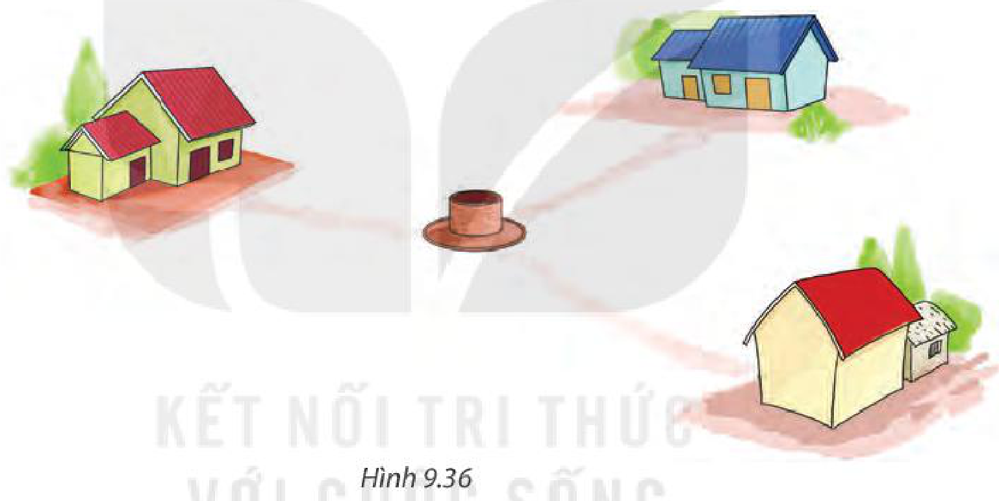
*Hình 9.36*

## 1. SỰ ĐỒNG QUY CỦA BA ĐƯỜNG TRUNG TRỰC TRONG MỘT TAM GIÁC

**Đường trung trực của tam giác**

> Trong một tam giác, đường trung trực của mỗi cạnh gọi là **đường trung trực của tam giác**. Trên Hình 9.37, $d$ là đường trung trực ứng với cạnh $BC$ của tam giác $ABC$.

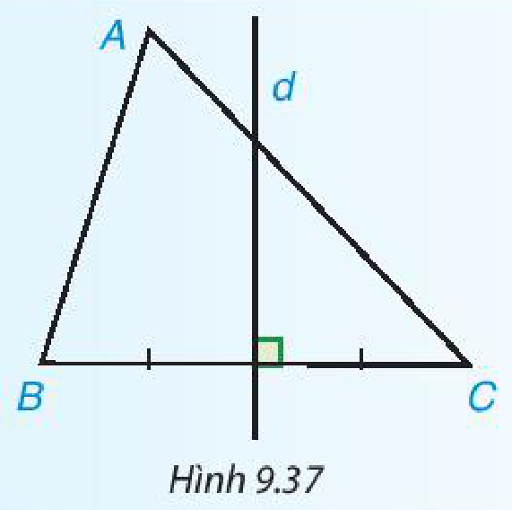
*Hình 9.37*

- **Pi:** $d$ đi qua $A$ khi tam giác $ABC$ cân tại $A$.
<!-- ocr-ok: đã đối chiếu ảnh trang PDF 78, bóng thoại của Pi -->

> ❓ Mỗi tam giác có mấy đường trung trực?

<!-- pdf:79 -->

*Sự đồng quy của ba đường trung trực*

**HĐ1:** Vẽ tam giác $ABC$ (không tù) và ba đường trung trực của các đoạn thẳng $BC, CA, AB$. Quan sát hình và cho biết ba đường trung trực đó có cùng đi qua một điểm không.

**HĐ2:** Dùng tính chất đường trung trực của một đoạn thẳng, hãy lập luận để suy ra tính chất nói ở HĐ1 bằng cách trả lời các câu hỏi sau:

Cho $O$ là giao điểm các đường trung trực của hai cạnh $BC$ và $CA$ (H.9.38).

a) Tại sao $OB = OC, OC = OA$?

b) Điểm $O$ có nằm trên đường trung trực của cạnh $AB$ không?

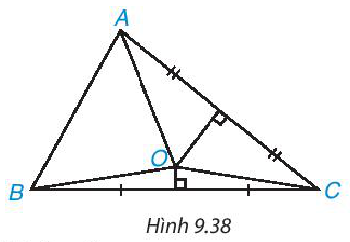
*Hình 9.38*

Từ HĐ2, ta có định lí sau:

<!-- term: Sự đồng quy của ba đường trung trực -->
> **Định lí 1:**
>
> Ba đường trung trực của một tam giác đồng quy tại một điểm. Điểm này cách đều ba đỉnh của tam giác.

Chẳng hạn, trong tam giác $ABC$ (H.9.39), các đường trung trực $d, m, n$ đồng quy tại $O$ và $OA = OB = OC$.

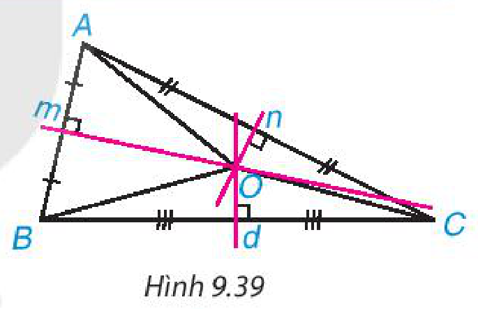
*Hình 9.39*

**Nhận xét:**

Vì giao điểm $O$ của ba đường trung trực trong tam giác $ABC$ cách đều ba đỉnh của tam giác đó ($OA = OB = OC$) nên có một đường tròn tâm $O$ đi qua ba đỉnh $A, B, C$ (H.9.40).

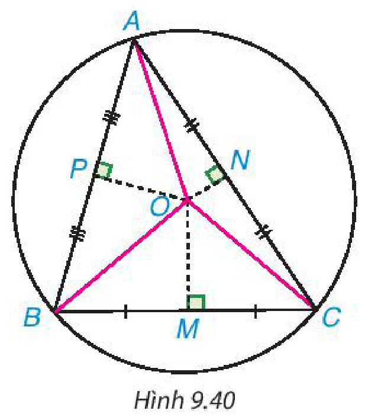
*Hình 9.40*

**Ví dụ 1:**

Cho tam giác $ABC$ cân tại $A$. Vẽ đường trung tuyến $AI$ của tam giác $ABC$.

a) Chứng minh $AI$ là đường trung trực của cạnh $BC$.

b) Điểm cách đều ba đỉnh của tam giác $ABC$ có nằm trên $AI$ không?

**Giải:** (H.9.41)

a)

| GT | $\triangle ABC$ có $AB = AC$, $AI$ là đường trung tuyến. |
| :---: | --- |
| KL | $AI$ là đường trung trực của cạnh $BC$. |

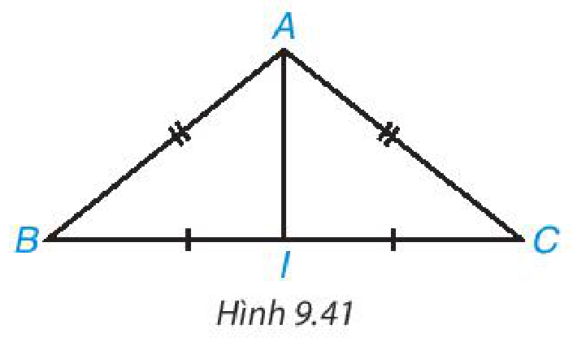
*Hình 9.41*

<!-- pdf:80 -->

*Chứng minh*

Hai tam giác $AIB$ và $AIC$ có:
<!-- ocr-ok: đã đối chiếu ảnh trang PDF 80, kí hiệu tam giác viết bằng LaTeX -->

$AB = AC$ (GT), $IB = IC$ (do $AI$ là trung tuyến); cạnh $AI$ chung.
<!-- ocr-ok: đã đối chiếu ảnh trang PDF 80, kí hiệu đoạn thẳng viết bằng LaTeX -->

Do đó $\triangle AIB = \triangle AIC$ (c.c.c).

Suy ra $\widehat{AIB} = \widehat{AIC}$, mà $\widehat{AIB}$ và $\widehat{AIC}$ là hai góc kề bù nên $\widehat{AIB} = \widehat{AIC} = 90^\circ$. Do đó $AI$ là đường trung trực của cạnh $BC$.

- **Pi:** Trong tam giác $ABC$ cân tại $A$, đường trung tuyến $AI$ cũng là đường trung trực của $BC$.

b) Do điểm cách đều ba đỉnh của tam giác $ABC$ nằm trên đường trung trực của $BC$ nên theo câu a, ta có điểm đó nằm trên trung tuyến $AI$.

**Luyện tập 1:**

Chứng minh rằng trong tam giác đều $ABC$, trọng tâm $G$ cách đều ba đỉnh của tam giác đó.

**Vận dụng 1:**

Em hãy trả lời câu hỏi trong *tình huống mở đầu*.

**Thử thách nhỏ:**

Sử dụng tính chất đường trung trực của một đoạn thẳng, hãy giải thích nếu điểm $Q$ cách đều ba đỉnh của tam giác $ABC$ thì $Q$ phải là giao điểm ba đường trung trực của tam giác $ABC$.

## 2. SỰ ĐỒNG QUY CỦA BA ĐƯỜNG CAO TRONG MỘT TAM GIÁC

**Đường cao của tam giác**

> Trong Hình 9.42, đoạn thẳng $AI$ kẻ từ đỉnh $A$, vuông góc với cạnh đối diện $BC$ là một **đường cao** của tam giác $ABC$. Ta còn nói $AI$ là đường cao xuất phát từ đỉnh $A$ (hay đường cao ứng với cạnh $BC$).

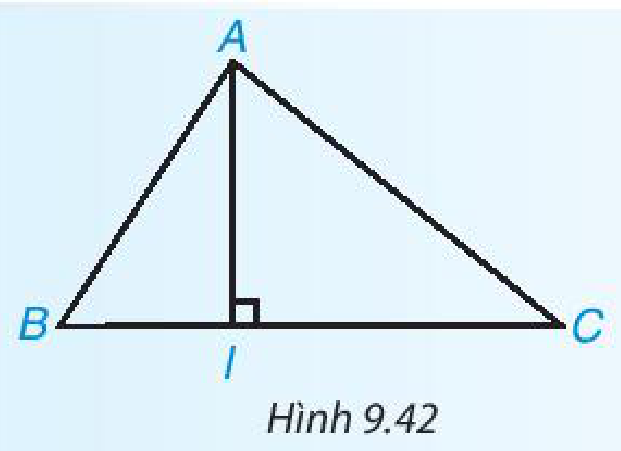
*Hình 9.42*

- **Pi:** Đôi khi ta cũng nói đường thẳng $AI$ là một đường cao của tam giác $ABC$.

> ❓ Mỗi tam giác có mấy đường cao?

*Sự đồng quy của ba đường cao*

**HĐ3:** Vẽ tam giác $ABC$ và ba đường cao của nó. Quan sát hình và cho biết, ba đường cao đó có cùng đi qua một điểm không.

<!-- pdf:81 -->

Ta có thể chứng minh được định lí sau:

<!-- term: Sự đồng quy của ba đường cao -->
> **Định lí 2:**
>
> Ba đường cao của một tam giác đồng quy tại một điểm.

Chẳng hạn, trong tam giác $ABC$ (H.9.43), các đường cao $AI, BJ, CK$ đồng quy tại $H$.

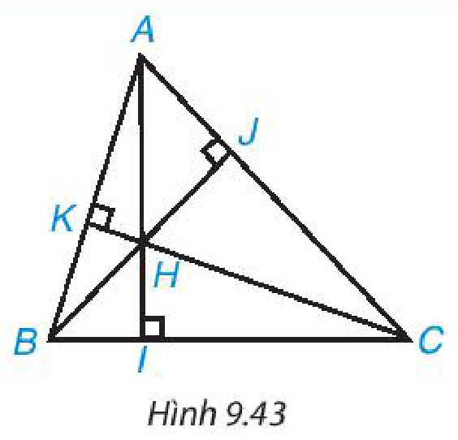
*Hình 9.43*

**Chú ý:**

a) Điểm đồng quy của ba đường cao của một tam giác gọi là **trực tâm** của tam giác đó.

b) Gọi $H$ là trực tâm của tam giác $ABC$ (H.9.44), ta có:

- Khi $ABC$ là tam giác nhọn thì $H$ nằm bên trong tam giác.
- Khi $ABC$ là tam giác vuông tại $A$ thì $H$ trùng với $A$ (kí hiệu là $H \equiv A$).
- Khi $ABC$ là tam giác tù thì $H$ nằm bên ngoài tam giác.

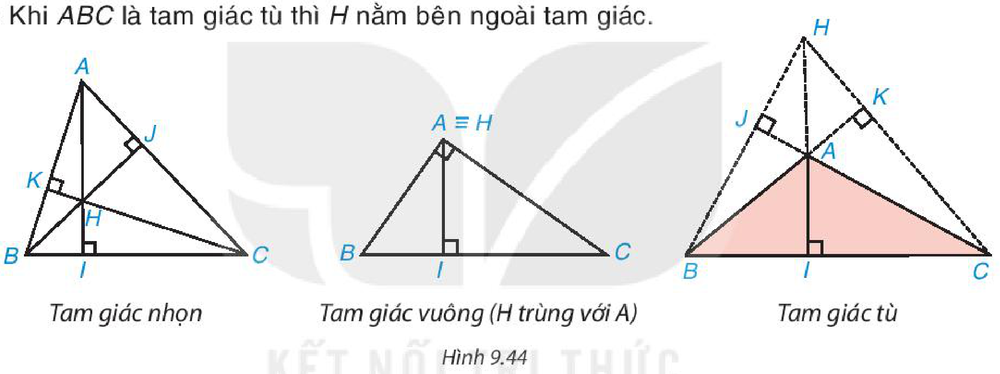
*Hình 9.44. Tam giác nhọn — Tam giác vuông ($H$ trùng với $A$) — Tam giác tù*

**Ví dụ 2:**

Chứng minh trong tam giác đều, trực tâm của nó cách đều ba đỉnh của tam giác.

**Giải:**

| GT | Tam giác đều $ABC$ có $H$ là trực tâm. |
| :---: | --- |
| KL | $H$ cách đều ba đỉnh tam giác $ABC$. |

*Chứng minh* (H.9.45)

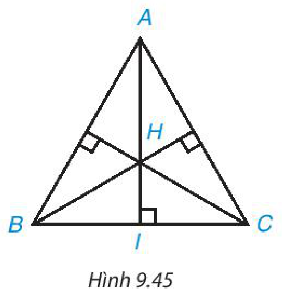
*Hình 9.45*

Trong tam giác $ABC$ cân tại $A$, kẻ đường cao $AI$.

Hai tam giác vuông $ABI$ và $ACI$ có: $AI$ chung, $AB = AC$ (gt).
<!-- ocr-ok: đã đối chiếu ảnh trang PDF 81, kí hiệu tam giác và đoạn thẳng viết bằng LaTeX -->

Do đó $\triangle ABI = \triangle ACI$ (cạnh huyền – cạnh góc vuông). Suy ra $BI = CI$.

Vậy đường cao $AI$ là đường trung trực của cạnh $BC$.

Vì tam giác đều cũng là tam giác cân tại mỗi đỉnh nên ba đường cao cũng là ba đường trung trực của nó. Vậy trực tâm $H$ của tam giác đều cũng là giao điểm của ba đường trung trực nên nó cách đều ba đỉnh của tam giác.

<!-- pdf:82 -->

**Luyện tập 2:**

a) Chứng minh rằng trong tam giác $ABC$ cân tại $A$, đường trung trực của cạnh $BC$ là đường cao và cũng là đường phân giác xuất phát từ đỉnh $A$ của tam giác đó.

b) Chứng minh rằng trong tam giác đều, điểm cách đều ba đỉnh cũng cách đều ba cạnh của tam giác.

- **Pi:** Trong tam giác cân tại $A$, đường cao xuất phát từ đỉnh $A$ đồng thời là đường trung trực, đường phân giác, đường trung tuyến của tam giác đó.

## BÀI TẬP

9.26. Gọi $H$ là trực tâm của tam giác $ABC$ không vuông. Tìm trực tâm của các tam giác $HBC, HCA, HAB$.

9.27. Cho tam giác $ABC$ có $\widehat{A} = 100^\circ$ và trực tâm $H$. Tính góc $BHC$.

9.28. Xét điểm $O$ cách đều ba đỉnh của tam giác $ABC$. Chứng minh rằng nếu $O$ nằm trên một cạnh của tam giác $ABC$ thì $ABC$ là một tam giác vuông.

9.29. a) Có một chi tiết máy (đường viền ngoài là đường tròn) bị gãy (H.9.46). Làm thế nào để xác định được bán kính của đường viền này?

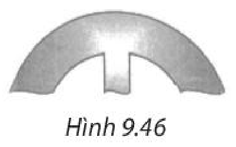
*Hình 9.46*

b) Trên bản đồ, ba khu dân cư được quy hoạch tại ba điểm $A, B, C$ không thẳng hàng. Hãy tìm trên bản đồ đó một điểm $M$ cách đều $A, B, C$ để quy hoạch một trường học.

9.30. Cho hai đường thẳng không vuông góc $b, c$ cắt nhau tại điểm $A$ và cho điểm $H$ không thuộc $b$ và $c$ (H.9.47). Hãy tìm điểm $B$ thuộc $b$, điểm $C$ thuộc $c$ sao cho tam giác $ABC$ nhận $H$ làm trực tâm.

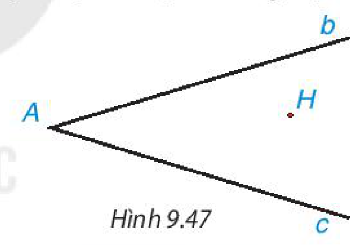
*Hình 9.47*

## 💡 Em có biết?

Ta có thể chứng minh trong tam giác $ABC$, ba đường cao $AI, BJ, CK$ đồng quy như sau:

Ở bên ngoài tam giác $ABC$, ghép thêm ba tam giác $CB'A, BAC'$ và $A'CB$ cùng bằng tam giác $ABC$ (H.9.48).

- Khi đó ba góc tại đỉnh $A$ bằng ba góc của tam giác $ABC$ nên có tổng số đo bằng $180^\circ$, suy ra ba điểm $B', C'$ và $A$ thẳng hàng.

Do $AB' = AC' = BC$ nên $A$ là trung điểm của $B'C'$.
<!-- ocr-ok: đã đối chiếu ảnh trang PDF 82, kí hiệu đoạn thẳng viết bằng LaTeX -->

- Đường thẳng $AB$ cắt hai đường thẳng $B'C'$ và $BC$ tạo thành hai góc so le trong bằng nhau nên $B'C' \parallel BC$. Vì đường cao $AI$ vuông góc với $BC$ nên nó vuông góc với $B'C'$, từ đó $AI$ là đường trung trực của cạnh $B'C'$.
- Tương tự, $BJ, CK$ lần lượt là trung trực của $A'C', A'B'$. Suy ra $A'B'C'$ là tam giác nhận $AI, BJ, CK$ là ba đường trung trực.

Ta đã biết ba đường trung trực của tam giác $A'B'C'$ đồng quy nên $AI, BJ, CK$ đồng quy.

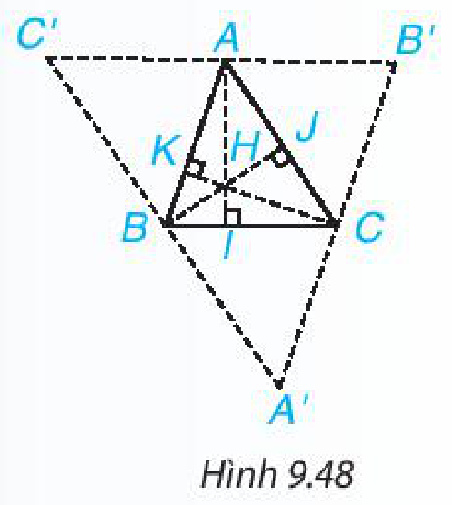
*Hình 9.48*

## 📷 Danh sách hình trong bài

| Mã hình | Trang PDF | Vị trí trong bài | Chú thích gốc |
| --- | :---: | --- | --- |
| H7-toan-b35-01 | 78 | Mở đầu | Hình 9.36 |
| H7-toan-b35-02 | 78 | Mục 1, Đường trung trực của tam giác | Hình 9.37 |
| H7-toan-b35-03 | 79 | Mục 1, HĐ2 | Hình 9.38 |
| H7-toan-b35-04 | 79 | Mục 1, Định lí 1 | Hình 9.39 |
| H7-toan-b35-05 | 79 | Mục 1, Nhận xét | Hình 9.40 |
| H7-toan-b35-06 | 79 | Mục 1, Ví dụ 1 | Hình 9.41 |
| H7-toan-b35-07 | 80 | Mục 2, Đường cao của tam giác | Hình 9.42 |
| H7-toan-b35-08 | 81 | Mục 2, Định lí 2 | Hình 9.43 |
| H7-toan-b35-09 | 81 | Mục 2, Chú ý | Hình 9.44 |
| H7-toan-b35-10 | 81 | Mục 2, Ví dụ 2 | Hình 9.45 |
| H7-toan-b35-11 | 82 | Bài tập 9.29 | Hình 9.46 |
| H7-toan-b35-12 | 82 | Bài tập 9.30 | Hình 9.47 |
| H7-toan-b35-13 | 82 | Em có biết? | Hình 9.48 |
