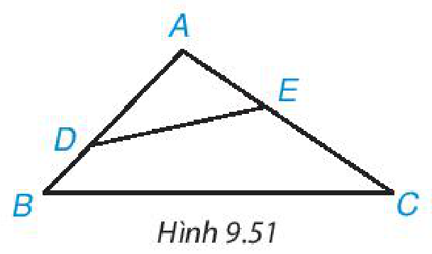
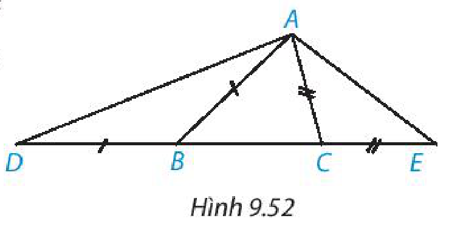
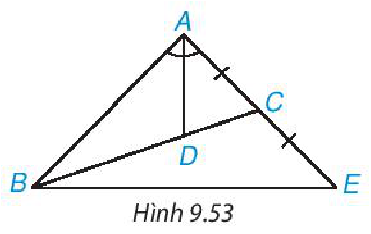
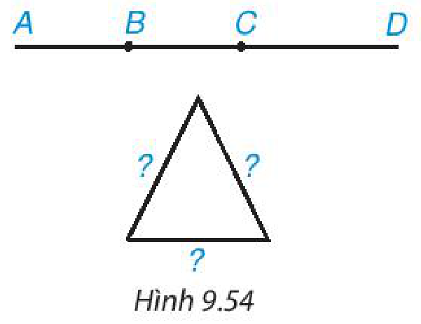

<!-- pdf:85 -->

# BÀI TẬP CUỐI CHƯƠNG IX

9.36. Cho tam giác $ABC$ có $\widehat{BAC}$ là một góc tù. Lấy điểm $D$ nằm giữa $A$ và $B$; lấy điểm $E$ nằm giữa $A$ và $C$ (H.9.51). Chứng minh $DE < BC$.
<!-- ocr-ok: đã đối chiếu ảnh trang PDF 85, kí hiệu điểm và góc viết bằng LaTeX -->

*Hình 9.51*

9.37. Cho tam giác $ABC$ ($AB > AC$). Trên đường thẳng chứa cạnh $BC$, lấy điểm $D$ và điểm $E$ sao cho $B$ nằm giữa $D$ và $C$, $C$ nằm giữa $B$ và $E$, $BD = BA$, $CE = CA$ (H.9.52).
<!-- ocr-ok: đã đối chiếu ảnh trang PDF 85, kí hiệu điểm và đoạn thẳng viết bằng LaTeX -->

a) So sánh $\widehat{ADE}$ và $\widehat{AED}$.

b) So sánh các đoạn thẳng $AD$ và $AE$.

*Hình 9.52*

9.38. Gọi $AI$ và $AM$ lần lượt là đường cao và đường trung tuyến xuất phát từ đỉnh $A$ của tam giác $ABC$. Chứng minh rằng:

a) $AI < \dfrac{1}{2}(AB + AC)$;

b) $AM < \dfrac{1}{2}(AB + AC)$.

- **Pi:** Lấy $D$ sao cho $M$ là trung điểm của $AD$ thì hai tam giác $ABM$ và $DCM$ bằng nhau đấy!
<!-- ocr-ok: đã đối chiếu ảnh trang PDF 85, bóng thoại của Pi -->

9.39. Cho tam giác $ABC$ có đường phân giác $AD$, $D$ nằm trên $BC$ sao cho $BD = 2DC$. Trên đường thẳng $AC$, lấy điểm $E$ sao cho $C$ là trung điểm của $AE$ (H.9.53). Chứng minh rằng tam giác $ABE$ cân tại $A$.

*Gợi ý.* $D$ là trọng tâm của tam giác $ABE$; tam giác này có đường phân giác $AD$ đồng thời là đường trung tuyến.

*Hình 9.53*

9.40. Một sợi dây thép dài $1,2\text{ m}$. Cần đánh dấu trên sợi dây thép đó hai điểm để khi uốn gập nó lại tại hai điểm đó sẽ tạo thành tam giác cân có một cạnh dài $30\text{ cm}$ (H.9.54). Em hãy mô tả các cách đánh dấu hai điểm trên sợi dây thép.

*Hình 9.54*

## 📷 Danh sách hình trong bài

| Mã hình | Trang PDF | Vị trí trong bài | Chú thích gốc |
| --- | :---: | --- | --- |
| H7-toan-bt-c09-01 | 85 | Bài 9.36 | Hình 9.51 |
| H7-toan-bt-c09-02 | 85 | Bài 9.37 | Hình 9.52 |
| H7-toan-bt-c09-03 | 85 | Bài 9.39 | Hình 9.53 |
| H7-toan-bt-c09-04 | 85 | Bài 9.40 | Hình 9.54 |
