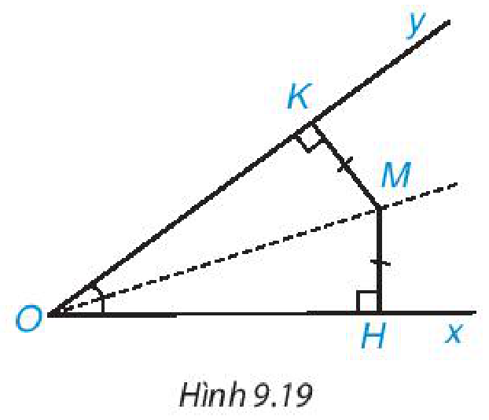
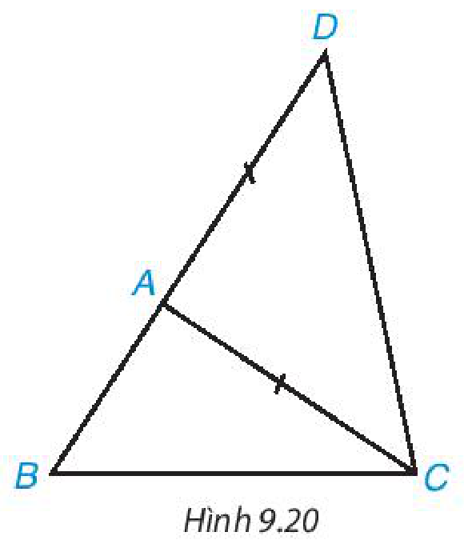
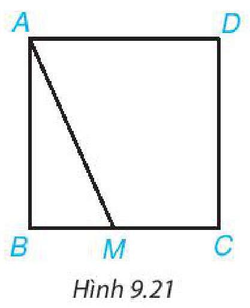
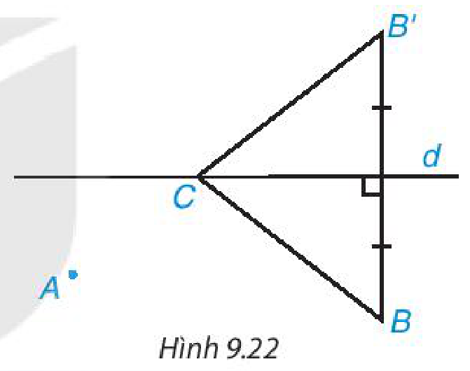
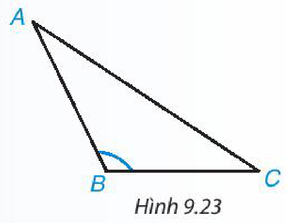
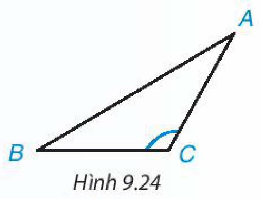
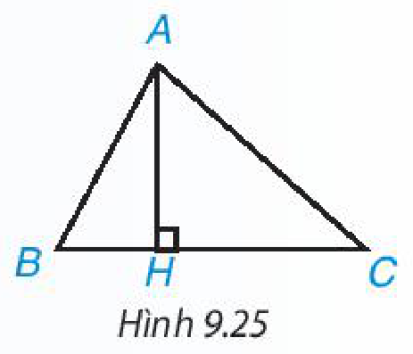

<!-- pdf:71 -->

# LUYỆN TẬP CHUNG (TRANG 70)

**Ví dụ 1:**

Cho $M$ là một điểm nằm bên trong góc $xOy$ mà khoảng cách từ $M$ đến hai cạnh $Ox$, $Oy$ của góc bằng nhau. Chứng minh rằng $M$ nằm trên tia phân giác của góc $xOy$.

**Giải:** (H.9.19)

| GT | $M$ nằm trong góc $xOy$, $MH \perp Ox, MK \perp Oy, MH = MK.$ |
| :---: | --- |
| KL | $M$ nằm trên tia phân giác của góc $xOy$. |
<!-- ocr-ok: đã đối chiếu ảnh trang PDF 71, bảng giả thiết kết luận chứa kí hiệu hình học LaTeX -->

*Hình 9.19*

*Chứng minh.* Hai tam giác vuông $OHM$ và $OKM$ có:

$OM$ chung,

$MH = MK$ (gt).

Vậy $\triangle OHM = \triangle OKM$ (cạnh huyền – cạnh góc vuông).

Do đó $\widehat{MOH} = \widehat{MOK}$, suy ra $OM$ là tia phân giác của góc $xOy$.

**Ví dụ 2:**

Cho tam giác $ABC$. Hãy chứng minh $AB + AC > BC$.

**Giải:** (H.9.20)

Trên tia đối của tia $AB$, lấy điểm $D$ sao cho $AD = AC$. Trong tam giác $BCD$, ta so sánh $BD$ và $BC$.

Do tia $CA$ nằm giữa hai cạnh $CB$ và $CD$ của góc $BCD$ nên
<!-- ocr-ok: đã đối chiếu ảnh trang PDF 71, câu chứa nhiều kí hiệu tia, cạnh và góc -->

$\widehat{BCD} > \widehat{ACD}. \qquad (1)$

Mặt khác, theo cách dựng, tam giác $ACD$ cân tại $A$ nên

$\widehat{ACD} = \widehat{ADC} = \widehat{BDC}. \qquad (2)$

Từ $(1)$ và $(2)$ suy ra $\widehat{BCD} > \widehat{BDC}$. $\quad (3)$

Trong tam giác $BCD$, từ $(3)$ suy ra:
<!-- ocr-ok: đã đối chiếu ảnh trang PDF 71, câu ngắn chứa kí hiệu tam giác và số thứ tự -->

$AB + AC = BD > BC$

(theo định lí về quan hệ giữa góc và cạnh đối diện trong một tam giác).

*Hình 9.20*

<!-- pdf:72 -->

## BÀI TẬP

9.14. Hãy giải thích: Nếu $M$ là một điểm tuỳ ý nằm trên cạnh $BC$ hoặc $CD$ của hình vuông $ABCD$ thì độ dài đoạn thẳng $AM$ luôn lớn hơn hoặc bằng độ dài cạnh của hình vuông đó (H.9.21).

*Hình 9.21*

9.15. Hỏi có tam giác nào với độ dài ba cạnh là $2,5\text{ cm}$; $3,4\text{ cm}$ và $6\text{ cm}$ không? Vì sao?

9.16. Tính chu vi của tam giác cân biết hai cạnh của nó có độ dài là $2\text{ cm}$ và $5\text{ cm}$.

9.17. Độ dài hai cạnh của một tam giác bằng $7\text{ cm}$ và $2\text{ cm}$. Tính độ dài cạnh còn lại biết rằng số đo của nó theo xentimét là một số tự nhiên lẻ.

9.18. Biết hai cạnh của tam giác có độ dài $a$ và $b$. Dựa vào bất đẳng thức tam giác, hãy giải thích tại sao chu vi của tam giác đó lớn hơn $2a$ và nhỏ hơn $2(a + b)$.

9.19. Hai khu vườn $A$ và $B$ nằm về một phía của con kênh $d$. Hãy xác định bên bờ kênh cùng phía với $A$ và $B$, một điểm $C$ để đặt máy bơm nước từ kênh tưới cho hai khu vườn sao cho tổng độ dài đường ống dẫn nước từ máy bơm đến hai khu vườn là ngắn nhất (HD: Gọi $B'$ là điểm sao cho $d$ là đường trung trực của $BB'$ (H.9.22). Khi đó $CB = CB'$. Xem Vận dụng, Bài 33).

*Hình 9.22*

## 💡 Em có biết?

Cho tam giác $ABC$. Ta có thể chứng minh bất đẳng thức tam giác $BC < AB + AC$ như sau:

Xét ba trường hợp:

- *Trường hợp 1:* Góc $B$ là góc tù (H.9.23) hoặc góc vuông.

Khi đó, trong tam giác $ABC$ có $\widehat{B}$ là góc lớn nhất nên cạnh đối diện với nó là $AC$ lớn nhất, từ đó $BC < AB + AC$.

*Hình 9.23*

- *Trường hợp 2:* Góc $C$ là góc tù (H.9.24) hoặc góc vuông.

Khi đó, $\widehat{C}$ là góc lớn nhất. Tương tự trên, ta có:

$BC < AB + AC.$

*Hình 9.24*

- *Trường hợp 3:* Cả hai góc $B$ và $C$ là góc nhọn.

Kẻ $AH$ vuông góc với $BC$ (H.9.25). Xét hai tam giác vuông $ABH$ và $ACH$ có:
<!-- ocr-ok: đã đối chiếu ảnh trang PDF 72, câu chứa nhiều kí hiệu đoạn thẳng và tam giác -->

$BH < AB, \quad HC < AC.$

Suy ra $BC = BH + HC < AB + HC < AB + AC$.

Vậy trong mọi trường hợp ta có $BC < AB + AC$.

*Hình 9.25*

## 📷 Danh sách hình trong bài

| Mã hình | Trang PDF | Vị trí trong bài | Chú thích gốc |
| --- | :---: | --- | --- |
| H7-toan-ltc-c09-01-01 | 71 | Ví dụ 1 | Hình 9.19 |
| H7-toan-ltc-c09-01-02 | 71 | Ví dụ 2 | Hình 9.20 |
| H7-toan-ltc-c09-01-03 | 72 | Bài tập 9.14 | Hình 9.21 |
| H7-toan-ltc-c09-01-04 | 72 | Bài tập 9.19 | Hình 9.22 |
| H7-toan-ltc-c09-01-05 | 72 | Em có biết? | Hình 9.23 |
| H7-toan-ltc-c09-01-06 | 72 | Em có biết? | Hình 9.24 |
| H7-toan-ltc-c09-01-07 | 72 | Em có biết? | Hình 9.25 |
