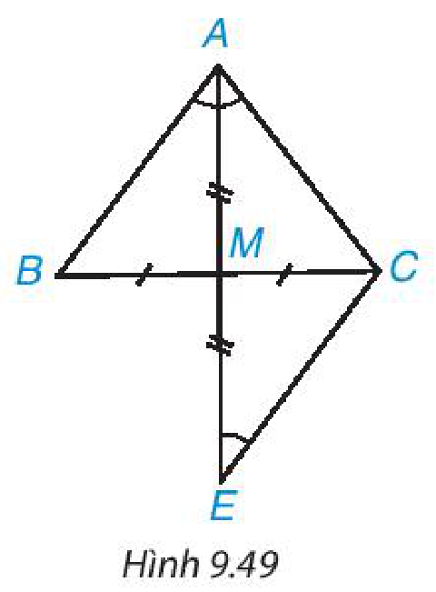
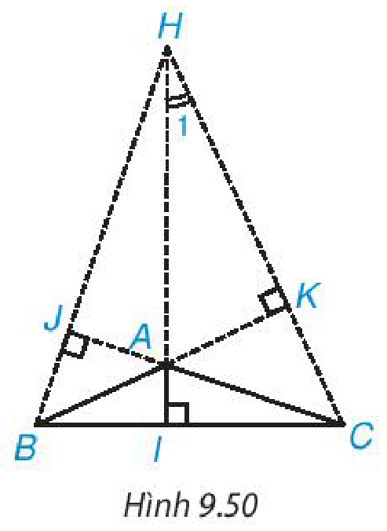

<!-- pdf:83 -->

# LUYỆN TẬP CHUNG (TRANG 82)

**Ví dụ 1:**

Chứng minh rằng tam giác $ABC$ có đường trung tuyến $AM$ cũng là đường phân giác thì $ABC$ là tam giác cân tại $A$.

**Giải:** (H.9.49)

| GT | $\triangle ABC, BM = CM$ $\widehat{BAM} = \widehat{CAM}.$ |
| :---: | --- |
| KL | $AB = AC.$ |

*Hình 9.49*

*Chứng minh*

Trên đường thẳng $AM$, lấy điểm $E$ sao cho $M$ nằm giữa $A, E$ và $AM = EM$.
<!-- ocr-ok: đã đối chiếu ảnh trang PDF 83, kí hiệu điểm và đoạn thẳng viết bằng LaTeX -->

Ta có $\triangle BAM = \triangle CEM$ (c.g.c), suy ra $AB = EC$ và $\widehat{BAM} = \widehat{CEM}$.
<!-- ocr-ok: đã đối chiếu ảnh trang PDF 83, kí hiệu tam giác và góc viết bằng LaTeX -->

Mặt khác $\widehat{BAM} = \widehat{CAM}$ (gt), suy ra $\widehat{CEM} = \widehat{CAM}$; từ đó tam giác $CAE$ cân tại $C$ tức là $CE = CA$. Ta đã có $AB = EC$, suy ra $AB = AC$.

**Ví dụ 2:**

Cho tam giác $ABC$ có $\widehat{BAC} = 135^\circ$, ba đường cao $AI, BJ, CK$ và trực tâm $H$ (H.9.50). Chứng minh rằng:

a) Tam giác $AKC$ vuông cân, từ đó suy ra $AK = CK$;

b) Hai tam giác $HAK$ và $BCK$ bằng nhau, từ đó suy ra $AH = BC$.

**Giải:**

| GT | $AI, BJ, CK$ là ba đường cao của $\triangle ABC$, $\widehat{BAC} = 135^\circ$, $H$ là trực tâm của $\triangle ABC$. |
| :---: | --- |
| KL | a) $\triangle AKC$ vuông cân, $AK = CK$. b) $\triangle HAK = \triangle BCK, AH = BC.$ |
<!-- ocr-ok: đã đối chiếu ảnh trang PDF 83, bảng giả thiết kết luận -->

*Hình 9.50*

*Chứng minh*

a) Ta có $\widehat{KAC}$ và $\widehat{CAB}$ là hai góc kề bù, $\widehat{BAC} = 135^\circ$, suy ra $\widehat{KAC} = 180^\circ - 135^\circ = 45^\circ$.
<!-- ocr-ok: đã đối chiếu ảnh trang PDF 83, kí hiệu góc và số đo viết bằng LaTeX -->

Tam giác $KAC$ vuông tại $K$ có:
<!-- ocr-ok: đã đối chiếu ảnh trang PDF 83, câu ngắn chứa kí hiệu tam giác -->

$\widehat{KAC} + \widehat{KCA} + \widehat{AKC} = 180^\circ$ (tổng ba góc trong tam giác),

hay $45^\circ + \widehat{KCA} + 90^\circ = 180^\circ$, suy ra $\widehat{KCA} = 45^\circ$.

Do đó, tam giác $KAC$ vuông cân tại $K$, suy ra $AK = CK$.

<!-- pdf:84 -->

b) Tam giác $AHK$ vuông tại $K$ nên $\widehat{HAK} + \widehat{H}_1 = 90^\circ$.

Tam giác $HIC$ vuông tại $I$ nên $\widehat{HCB} + \widehat{H}_1 = 90^\circ$. Do đó $\widehat{HAK} = \widehat{HCB}$.

Hai tam giác $HAK$ và $BCK$ có:
<!-- ocr-ok: đã đối chiếu ảnh trang PDF 84, câu ngắn chứa kí hiệu tam giác -->

$AK = CK$ (chứng minh câu a);

$\widehat{HAK} = \widehat{HCB}$;

$\widehat{AKH} = \widehat{BKC}$ ($= 90^\circ$).

Do đó, $\triangle HAK = \triangle BCK$ (g.c.g), suy ra $AH = BC$.

## BÀI TẬP

9.31. Chứng minh rằng tam giác có đường trung tuyến và đường cao xuất phát từ cùng một đỉnh trùng nhau là một tam giác cân.

9.32. Cho ba điểm phân biệt thẳng hàng $A, B, C$. Gọi $d$ là đường thẳng vuông góc với đường thẳng $AB$ tại $A$. Với điểm $M$ thuộc $d$, $M$ khác $A$, vẽ đường thẳng $CM$. Qua $B$ kẻ đường thẳng vuông góc với đường thẳng $CM$, cắt $d$ tại $N$. Chứng minh đường thẳng $BM$ vuông góc với đường thẳng $CN$.

9.33. Có một mảnh tôn hình tròn cần đục một lỗ ở tâm. Làm thế nào để xác định được tâm của mảnh tôn đó?

9.34. Cho tam giác $ABC$. Kẻ tia phân giác $At$ của góc tạo bởi tia $AB$ và tia đối của tia $AC$. Chứng minh rằng nếu đường thẳng chứa tia $At$ song song với đường thẳng $BC$ thì tam giác $ABC$ cân tại $A$.

9.35. Kí hiệu $S_{ABC}$ là diện tích tam giác $ABC$. Gọi $G$ là trọng tâm của tam giác $ABC$, $M$ là trung điểm của $BC$.

a) Chứng minh $S_{GBC} = \dfrac{1}{3}S_{ABC}$.

*Gợi ý.* Sử dụng $GM = \dfrac{1}{3}AM$ để chứng minh $S_{GBM} = \dfrac{1}{3}S_{ABM}$, $S_{GCM} = \dfrac{1}{3}S_{ACM}$.

b) Chứng minh $S_{GCA} = S_{GAB} = \dfrac{1}{3}S_{ABC}$.

*Nhận xét.* Từ bài tập trên ta có: $S_{GBC} = S_{GCA} = S_{GAB} = \dfrac{1}{3}S_{ABC}$, điều này giúp ta cảm nhận tại sao có thể đặt thăng bằng miếng bìa hình tam giác trên giá nhọn đặt tại trọng tâm của tam giác đó.

## 📷 Danh sách hình trong bài

| Mã hình | Trang PDF | Vị trí trong bài | Chú thích gốc |
| --- | :---: | --- | --- |
| H7-toan-ltc-c09-02-01 | 83 | Ví dụ 1 | Hình 9.49 |
| H7-toan-ltc-c09-02-02 | 83 | Ví dụ 2 | Hình 9.50 |
