<!-- pdf:86 -->

# BÀI 36: HÌNH HỘP CHỮ NHẬT VÀ HÌNH LẬP PHƯƠNG

> *Giới thiệu Chương X — Một số hình khối trong thực tiễn (Hình học trực quan):*
>
> Trong thực tế đời sống, chúng ta dễ gặp các hình như hộp đựng quà, bể cá cảnh, chiếc đèn lồng, khối rubik,... Đó là những hình ảnh về hình hộp chữ nhật, hình lập phương, hình lăng trụ đứng. Một số đặc điểm cùng với một số bài toán về tính diện tích, thể tích của chúng sẽ được giới thiệu trong chương này.

## 🔤 Khái niệm, thuật ngữ

- Hình hộp chữ nhật
- Hình lập phương

## 🎯 Kiến thức, kĩ năng

- Mô tả một số yếu tố cơ bản (đỉnh, cạnh, góc, đường chéo) của hình hộp chữ nhật, hình lập phương.
- Giải quyết một số vấn đề thực tiễn gắn với việc tính diện tích xung quanh, thể tích của hình hộp chữ nhật, hình lập phương.

## 🔴 Mở đầu

Hình hộp chữ nhật, hình lập phương là các hình chúng ta thường gặp trong đời sống thực tế và đã được làm quen ở Tiểu học. Trong bài này, chúng ta sẽ tìm hiểu thêm một số yếu tố cơ bản và những vấn đề thực tiễn gắn với việc tính diện tích, thể tích của chúng.

<!-- pdf:87 -->

## 1. HÌNH HỘP CHỮ NHẬT, HÌNH LẬP PHƯƠNG

**Một số yếu tố cơ bản của hình hộp chữ nhật, hình lập phương**

**HĐ1:** Hình nào dưới đây là đồ vật hoặc kiến trúc có dạng hình hộp chữ nhật, có dạng hình lập phương?

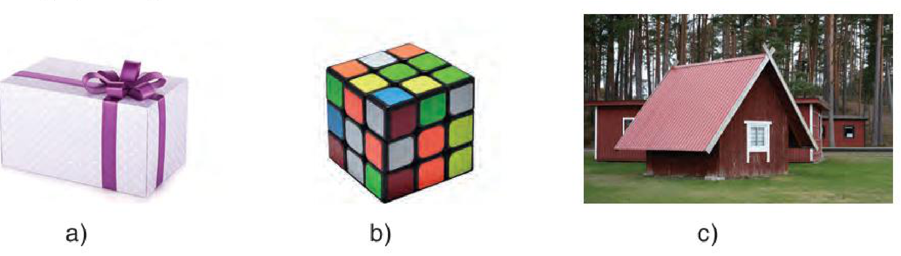

Em hãy tìm thêm một số hình ảnh có dạng hình hộp chữ nhật, hình lập phương trong thực tế.

**HĐ2:** Quan sát Hình 10.1.

(1) Nêu tên các đỉnh, cạnh, đường chéo của hình hộp chữ nhật $ABCD.A'B'C'D'$.

Hình hộp chữ nhật có bao nhiêu đỉnh? Có bao nhiêu cạnh? Có bao nhiêu đường chéo?

(2) Gọi tên các mặt bên, mặt đáy của hình hộp chữ nhật $ABCD.A'B'C'D'$.

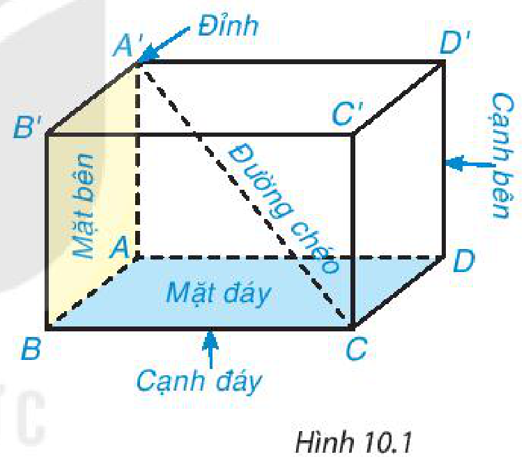
*Hình 10.1*

**HĐ3:** Quan sát Hình 10.2 và gọi tên đỉnh, cạnh, đường chéo, mặt đáy, mặt bên của hình lập phương $MNPQ.ABCD$.

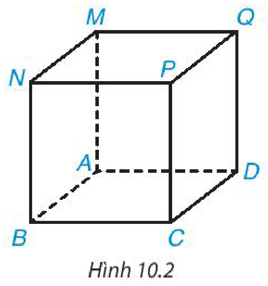
*Hình 10.2*

**Nhận xét:**

<!-- term: Hình hộp chữ nhật -->
Hình hộp chữ nhật có $6$ mặt là các hình chữ nhật, $8$ đỉnh, $12$ cạnh, $4$ đường chéo, các cạnh bên song song và bằng nhau.

<!-- term: Hình lập phương -->
Hình lập phương là hình hộp chữ nhật có $6$ mặt là các hình vuông.

<!-- pdf:88 -->

**Thực hành:**

Sử dụng bìa cứng, cắt và gấp một chiếc hộp có dạng hình hộp chữ nhật với kích thước như Hình 10.3 theo hướng dẫn sau:

*Bước 1.* Vẽ hình khai triển của hình hộp chữ nhật theo kích thước đã cho như Hình 10.4.

*Bước 2.* Cắt theo viền.
<!-- ocr-ok: đã đối chiếu ảnh trang PDF 88, OCR đọc nhầm "Cắt theo viền" thành "Oắt theo viên" -->

*Bước 3.* Gấp theo đường màu cam để được hình hộp chữ nhật (H.10.5).

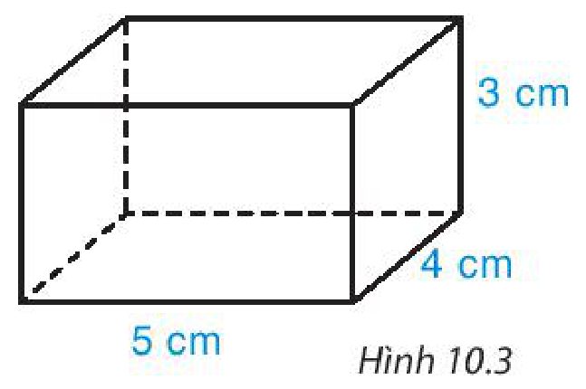
*Hình 10.3*

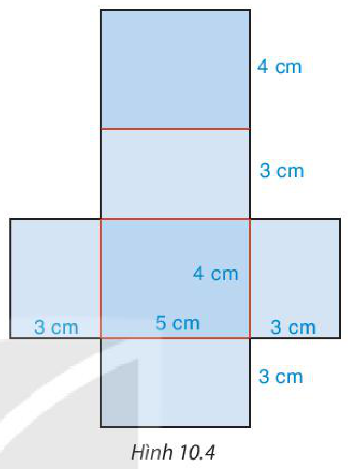
*Hình 10.4*

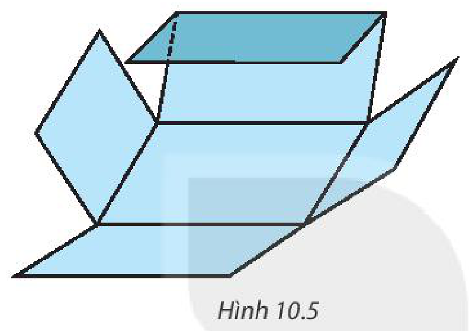
*Hình 10.5*

**Vận dụng 1:** Hãy cắt và gấp hình lập phương có cạnh $4\text{ cm}$.

## 2. DIỆN TÍCH XUNG QUANH VÀ THỂ TÍCH CỦA HÌNH HỘP CHỮ NHẬT, HÌNH LẬP PHƯƠNG

*Diện tích xung quanh của hình hộp chữ nhật, hình lập phương*

**HĐ4:** Quan sát hình hộp chữ nhật (H.10.6a) và hình khai triển của nó (H.10.6b). Hãy chỉ ra sự tương ứng giữa các mặt của hình hộp chữ nhật với các hình chữ nhật ở hình khai triển. Hình chữ nhật nào ở hình khai triển là các mặt bên, là các mặt đáy?

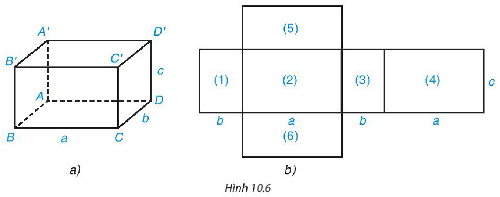
*Hình 10.6*

**HĐ5:** Tính tổng diện tích các hình chữ nhật $(1), (2), (3), (4)$. So sánh kết quả vừa tìm với tích của chu vi đáy và chiều cao của hình hộp chữ nhật.

<!-- pdf:89 -->

<!-- term: Diện tích xung quanh và thể tích của hình hộp chữ nhật, hình lập phương -->
<!-- term: Diện tích xung quanh của hình hộp chữ nhật -->
<!-- term: Diện tích xung quanh của hình lập phương -->
> - Diện tích xung quanh của hình hộp chữ nhật: $S_{\text{xq}} = 2(a + b)c$.
> - Diện tích xung quanh của hình lập phương: $S_{\text{xq}} = 4a^2$.

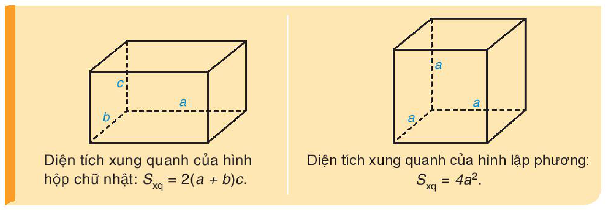

**Chú ý:** Khi tính diện tích, thể tích của một hình, các kích thước của nó phải cùng đơn vị độ dài.

**Ví dụ 1:**

Một chiếc khay nhựa đựng đồ có dạng hình hộp chữ nhật như Hình 10.7. Dựa vào kích thước trên hình (coi mép khay nhựa không đáng kể), em hãy tính:

a) Diện tích xung quanh của chiếc khay.

b) Diện tích nhựa để làm chiếc khay trên.

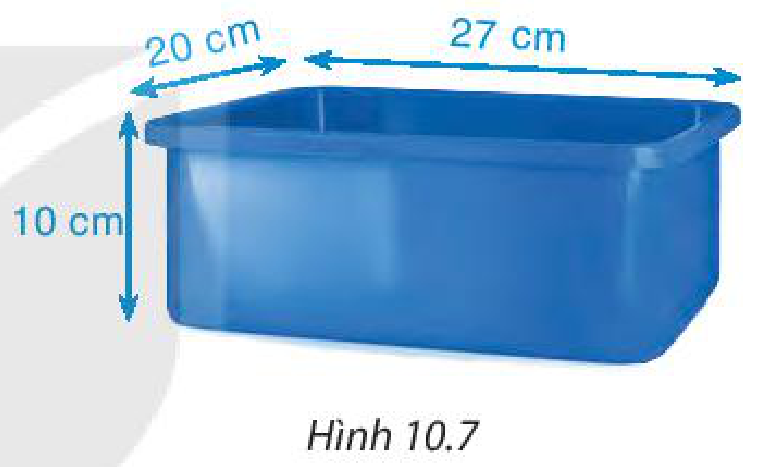
*Hình 10.7*

**Giải:**

a) Diện tích xung quanh của chiếc khay dạng hình hộp chữ nhật là:

$2 \cdot (27 + 20) \cdot 10 = 940\text{ (cm}^2\text{)}.$

b) Diện tích nhựa làm chiếc khay trên bằng tổng diện tích của các mặt xung quanh và mặt đáy. Diện tích mặt đáy của chiếc khay là:

$27 \cdot 20 = 540\text{ (cm}^2\text{)}.$

Diện tích nhựa để làm chiếc khay là:

$940 + 540 = 1\,480\text{ (cm}^2\text{)}.$

**Luyện tập 1:**

Bác Tú thuê thợ sơn xung quanh bốn mặt ngoài của thành bể nước có dạng hình hộp chữ nhật có chiều dài $3\text{ m}$, chiều rộng $2\text{ m}$, chiều cao $1,5\text{ m}$ với giá $20\,000\text{ đồng/m}^2$. Hỏi bác Tú phải trả chi phí là bao nhiêu?

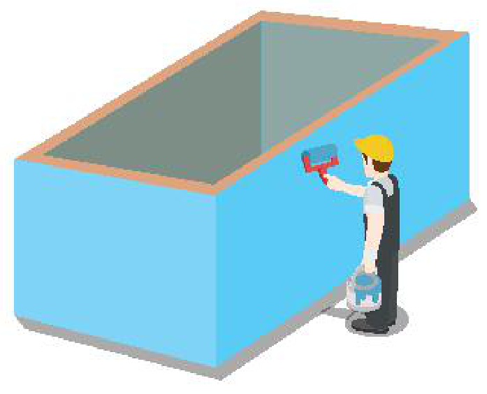

<!-- pdf:90 -->

*Thể tích của hình hộp chữ nhật, hình lập phương*

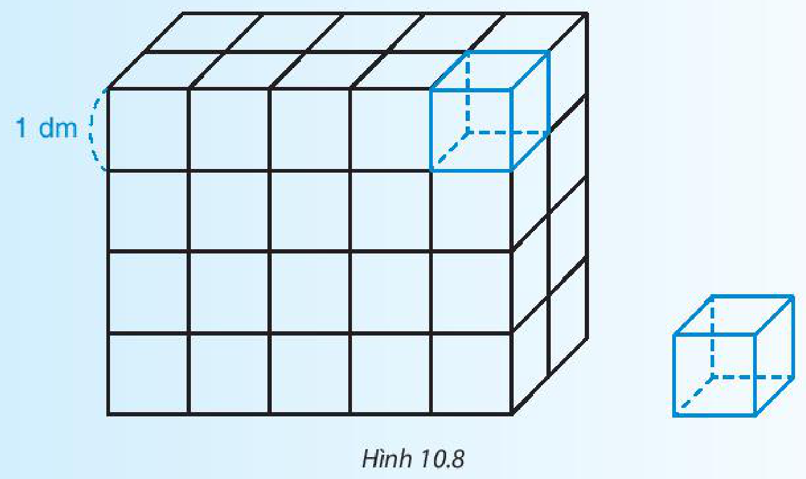
*Hình 10.8*

Người ta xếp các hộp đựng đồ chơi dạng hình lập phương nhỏ có cạnh $1\text{ dm}$ vào một chiếc hộp carton có dạng hình hộp chữ nhật (H.10.8). Ta thấy có $4$ lớp hình lập phương, mỗi lớp có $2 \cdot 5$ hình lập phương. Mỗi hình lập phương nhỏ cạnh $1\text{ dm}$ có thể tích là $1\text{ dm}^3$ nên thể tích của hình hộp chữ nhật là $2 \cdot 5 \cdot 4 = 40\text{ (dm}^3\text{)}$.

Ta có công thức tính thể tích hình hộp chữ nhật, hình lập phương:

<!-- term: Diện tích xung quanh và thể tích của hình hộp chữ nhật, hình lập phương -->
<!-- term: Thể tích hình hộp chữ nhật -->
<!-- term: Thể tích hình lập phương -->
> - Thể tích hình hộp chữ nhật $V = abc$.
> - Thể tích hình lập phương $V = a^3$.

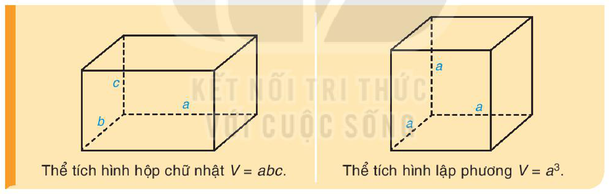

**Ví dụ 2:**

Tính thể tích hộp sữa có dạng hình hộp chữ nhật như Hình 10.9.

**Giải:**

Thể tích hộp sữa hình hộp chữ nhật là:

$V = 10 \cdot 10 \cdot 15 = 1\,500\text{ (cm}^3\text{)}.$

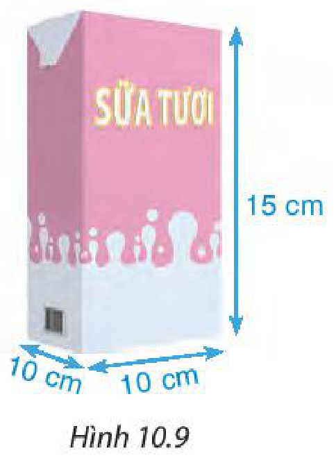
*Hình 10.9*

<!-- pdf:91 -->

**Luyện tập 2:**

Một hình lập phương có cạnh bằng $a\text{ cm}$, diện tích xung quanh bằng $100\text{ cm}^2$. Hỏi thể tích của hình lập phương đó bằng bao nhiêu?

**Vận dụng 2:**

Một chiếc thùng giữ nhiệt (H.10.10) có lòng trong có dạng một hình hộp chữ nhật với chiều dài $50\text{ cm}$, chiều rộng $30\text{ cm}$, chiều cao $30\text{ cm}$. Tính dung tích của thùng giữ nhiệt đó.

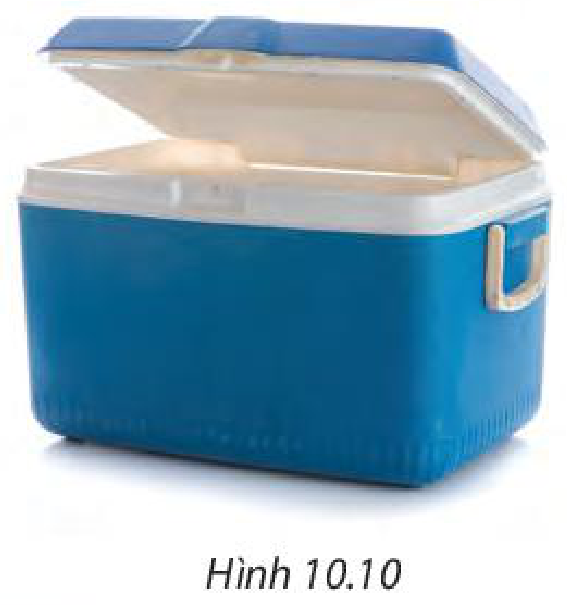
*Hình 10.10*

## BÀI TẬP

10.1. Có bao nhiêu hình lập phương nhỏ trong Hình 10.11?

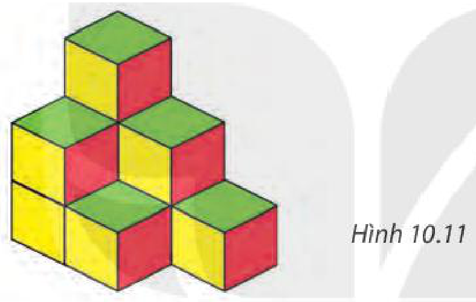
*Hình 10.11*

10.2. Gọi tên các đỉnh, cạnh, đường chéo, mặt của hình hộp chữ nhật trong Hình 10.12.
<!-- ocr-ok: đã đối chiếu ảnh trang PDF 91, dòng đề bài 10.2 nằm trên Hình 10.12 -->

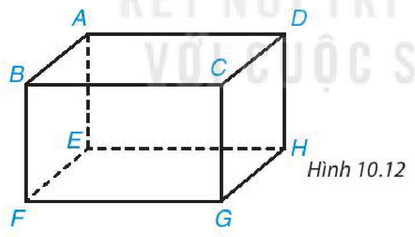
*Hình 10.12*

10.3. Vẽ lên một miếng bìa hình khai triển của hình hộp chữ nhật (tương tự hình bên) với kích thước tuỳ chọn. Cắt rời hình đã vẽ rồi gấp theo đường màu cam để được một hình hộp chữ nhật.

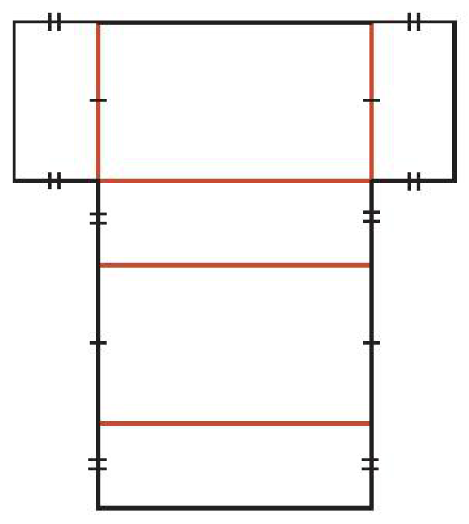

<!-- pdf:92 -->

10.4. Một xe đông lạnh có thùng hàng dạng hình hộp chữ nhật, kích thước lòng thùng hàng dài $5,6\text{ m}$, rộng $2\text{ m}$, cao $2\text{ m}$. Tính thể tích của lòng thùng hàng.

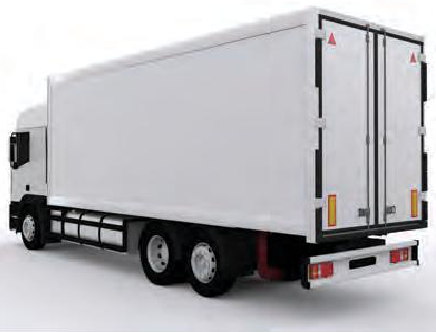

10.5. Một hộp sữa tươi có dạng hình hộp chữ nhật với dung tích $1\text{ lít}$, chiều cao $20\text{ cm}$, chiều dài $10\text{ cm}$.

a) Tính chiều rộng của hộp sữa.

b) Tính diện tích vật liệu dùng để làm vỏ hộp sữa? (Coi như phần mép hộp không đáng kể).

10.6. Một bể nước có dạng hình hộp chữ nhật với chiều dài $2\text{ m}$. Lúc đầu bể không có nước. Sau khi đổ vào bể $120$ thùng nước, mỗi thùng chứa $20\text{ lít}$ nước thì mực nước của bể dâng cao $0,8\text{ m}$.

a) Tính chiều rộng của bể nước.

b) Người ta đổ thêm $60$ thùng nước nữa thì đầy bể. Hỏi bể cao bao nhiêu mét?

## 📷 Danh sách hình trong bài

| Mã hình | Trang PDF | Vị trí trong bài | Chú thích gốc |
| --- | :---: | --- | --- |
| H7-toan-b36-01 | 87 | Mục 1, HĐ1 | (sách không đánh số, ba hình a, b, c: hộp quà, khối rubik, ngôi nhà) |
| H7-toan-b36-02 | 87 | Mục 1, HĐ2 | Hình 10.1 |
| H7-toan-b36-03 | 87 | Mục 1, HĐ3 | Hình 10.2 |
| H7-toan-b36-04 | 88 | Thực hành | Hình 10.3 |
| H7-toan-b36-05 | 88 | Thực hành | Hình 10.4 |
| H7-toan-b36-06 | 88 | Thực hành | Hình 10.5 |
| H7-toan-b36-07 | 88 | Mục 2, HĐ4 | Hình 10.6 |
| H7-toan-b36-08 | 89 | Mục 2, Khung kiến thức diện tích xung quanh | (sách không đánh số, khung công thức diện tích xung quanh của hình hộp chữ nhật và hình lập phương) |
| H7-toan-b36-09 | 89 | Mục 2, Ví dụ 1 | Hình 10.7 |
| H7-toan-b36-10 | 89 | Mục 2, Luyện tập 1 | (sách không đánh số, minh hoạ thợ sơn xung quanh thành bể nước) |
| H7-toan-b36-11 | 90 | Mục 2, Thể tích | Hình 10.8 |
| H7-toan-b36-12 | 90 | Mục 2, Khung kiến thức thể tích | (sách không đánh số, khung công thức thể tích hình hộp chữ nhật và hình lập phương) |
| H7-toan-b36-13 | 90 | Mục 2, Ví dụ 2 | Hình 10.9 |
| H7-toan-b36-14 | 91 | Vận dụng 2 | Hình 10.10 |
| H7-toan-b36-15 | 91 | Bài tập 10.1 | Hình 10.11 |
| H7-toan-b36-16 | 91 | Bài tập 10.2 | Hình 10.12 |
| H7-toan-b36-17 | 91 | Bài tập 10.3 | (sách không đánh số, hình khai triển của hình hộp chữ nhật) |
| H7-toan-b36-18 | 92 | Bài tập 10.4 | (sách không đánh số, xe đông lạnh có thùng hàng dạng hình hộp chữ nhật) |
| H7-toan-b36-19 | 92 | Bài tập 10.5 | (sách không đánh số, hộp sữa tươi dạng hình hộp chữ nhật) |
