<!-- pdf:95 -->

# BÀI 37: HÌNH LĂNG TRỤ ĐỨNG TAM GIÁC VÀ HÌNH LĂNG TRỤ ĐỨNG TỨ GIÁC

## 🔤 Khái niệm, thuật ngữ

- Hình lăng trụ đứng tam giác
- Hình lăng trụ đứng tứ giác

## 🎯 Kiến thức, kĩ năng

- Mô tả hình lăng trụ đứng tam giác, hình lăng trụ đứng tứ giác và tạo lập hình lăng trụ đứng tam giác, hình lăng trụ đứng tứ giác.
- Tính diện tích xung quanh, thể tích của hình lăng trụ đứng tam giác, hình lăng trụ đứng tứ giác.
- Giải quyết một số vấn đề thực tiễn gắn với việc tính thể tích, diện tích xung quanh của một hình lăng trụ đứng tam giác, hình lăng trụ đứng tứ giác.

## 🔴 Mở đầu

Trong thực tế, có nhiều vật dụng có hình dạng là hình lăng trụ đứng tam giác, hình lăng trụ đứng tứ giác. Chẳng hạn, ở hình vẽ bên, lịch để bàn, chiếc chặn giấy có dạng hình lăng trụ đứng tam giác. Bài học này giúp các em biết cách mô tả, tính diện tích xung quanh, thể tích của các hình đó.

## 1. HÌNH LĂNG TRỤ ĐỨNG TAM GIÁC, HÌNH LĂNG TRỤ ĐỨNG TỨ GIÁC

**Một số yếu tố cơ bản của hình lăng trụ đứng tam giác, tứ giác**

**HĐ1:** Trong thực tế, ta gặp những vật thể có hình dạng sau đây. Hãy quan sát và nhận xét một vài đặc điểm chung của các hình đó:

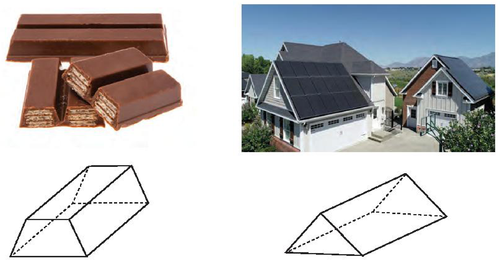

<!-- pdf:96 -->

<!-- term: Hình lăng trụ đứng tam giác -->
<!-- term: Hình lăng trụ đứng tứ giác -->
**HĐ2:** Một số yếu tố của hình lăng trụ đứng tứ giác được chỉ rõ trong Hình 10.19. Em hãy nêu các yếu tố tương tự của hình lăng trụ đứng tam giác trong Hình 10.20 và cho một vài nhận xét về các yếu tố đó.

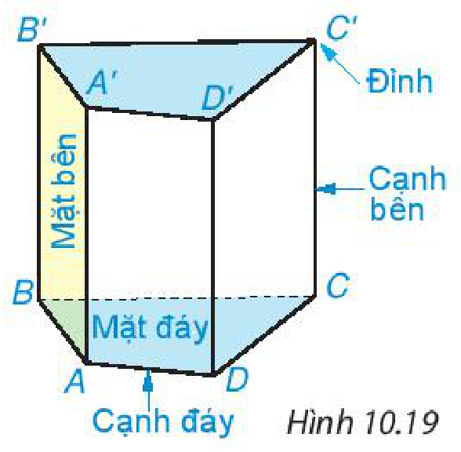
*Hình 10.19*

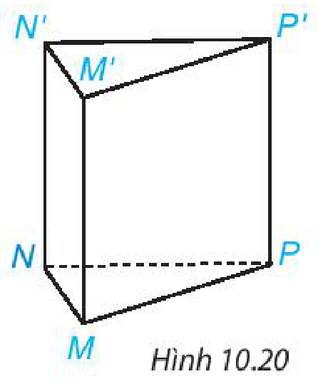
*Hình 10.20*

<!-- term: Hình lăng trụ đứng tứ giác -->
- **Tròn:** Hình hộp chữ nhật và hình lập phương cũng là các hình lăng trụ đứng tứ giác.

<!-- term: Hình lăng trụ đứng tam giác -->
<!-- term: Hình lăng trụ đứng tứ giác -->
<!-- term: Chiều cao của lăng trụ đứng -->
**Nhận xét:** Trong hình lăng trụ đứng tam giác (tứ giác):
- Hai mặt đáy song song với nhau.
- Các mặt bên là những hình chữ nhật.
- Các cạnh bên song song và bằng nhau.

<!-- term: Hình lăng trụ đứng tam giác -->
<!-- term: Hình lăng trụ đứng tứ giác -->
<!-- term: Chiều cao của lăng trụ đứng -->
Độ dài một cạnh bên gọi là chiều cao của lăng trụ đứng.

- **Pi:** Sàn nhà và trần nhà là hình ảnh của hai mặt song song.

**Ví dụ 1:**

Hãy cho biết đỉnh, cạnh đáy, cạnh bên, mặt đáy, mặt bên của hình lăng trụ đứng tam giác $ABC.A'B'C'$ trong Hình 10.21.

**Giải:** Các đỉnh: $A, B, C, A', B', C'$.

Các cạnh đáy: $AB, BC, CA, A'B', B'C', C'A'$.

Các cạnh bên: $AA', BB', CC'$.

Các mặt đáy là các tam giác $ABC$ và $A'B'C'$.

Các mặt bên là các hình chữ nhật $ABB'A', ACC'A', BCC'B'$.

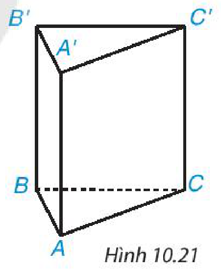
*Hình 10.21*

**Thực hành:**

Cắt và gấp một miếng bìa thành hình lăng trụ đứng tam giác theo hướng dẫn sau:

*Bước 1.* Vẽ hình khai triển theo mẫu và cắt theo viền (H.10.22).

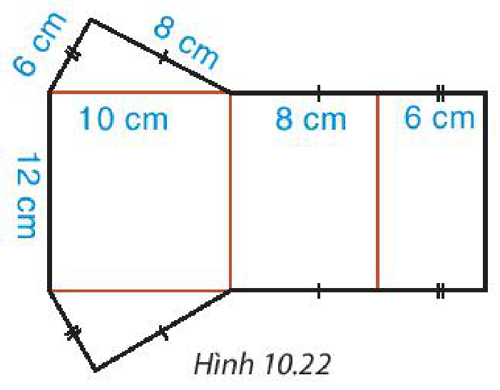
*Hình 10.22*

*Bước 2.* Gấp theo nét màu cam. Ta được hình lăng trụ (H.10.23).

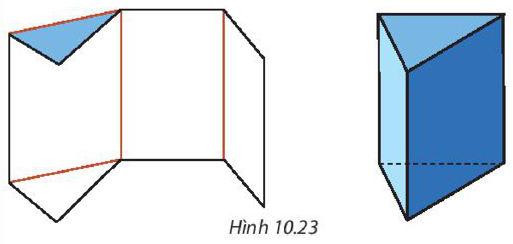
*Hình 10.23*

<!-- pdf:97 -->

## 2. DIỆN TÍCH XUNG QUANH VÀ THỂ TÍCH CỦA HÌNH LĂNG TRỤ ĐỨNG TAM GIÁC, HÌNH LĂNG TRỤ ĐỨNG TỨ GIÁC

*Diện tích xung quanh của hình lăng trụ đứng tam giác, hình lăng trụ đứng tứ giác*

**HĐ3:** Quan sát hình lăng trụ đứng tam giác $ABC.A'B'C'$ và hình khai triển của nó. Hãy chỉ ra sự tương ứng giữa các mặt bên với các hình chữ nhật của hình khai triển.

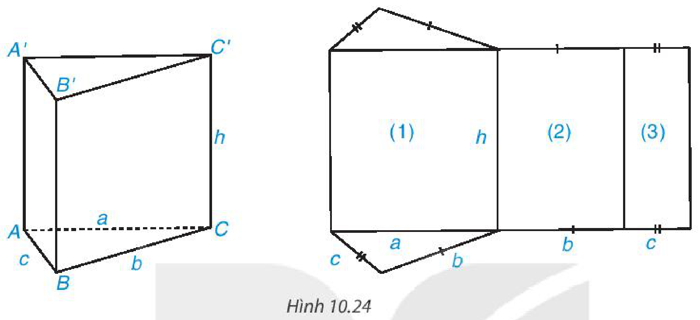
*Hình 10.24*

**HĐ4:** Tính tổng diện tích các hình chữ nhật $(1), (2), (3)$ và so sánh với tích của chu vi đáy với chiều cao của hình lăng trụ đứng ở hình trên.

<!-- term: Diện tích xung quanh và thể tích của hình lăng trụ đứng -->
<!-- term: Diện tích xung quanh của hình lăng trụ đứng -->
> Diện tích xung quanh của hình lăng trụ đứng tam giác, hình lăng trụ đứng tứ giác:
>
> $S_{\text{xq}} = C \cdot h,$
>
> trong đó $S_{\text{xq}}$ : Diện tích xung quanh của hình lăng trụ,
>
> $C$ : Chu vi một đáy của hình lăng trụ,
>
> $h$ : Chiều cao của lăng trụ.

**Ví dụ 2:**

Một quyển lịch để bàn (H.10.25) gồm các tờ lịch được đặt trên một giá đỡ bằng bìa có dạng hình lăng trụ đứng tam giác. Tính diện tích bìa dùng để làm giá đỡ của quyển lịch.

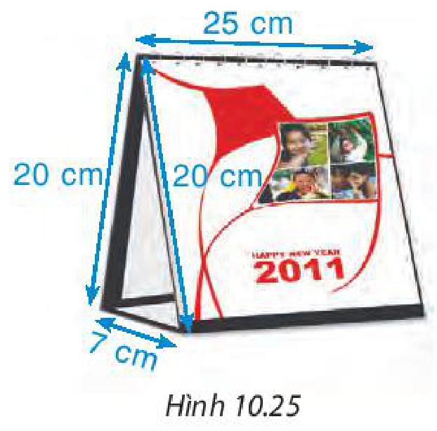
*Hình 10.25*

**Giải:**

Diện tích bìa dùng để làm giá đỡ của quyển lịch là diện tích xung quanh của hình lăng trụ đứng tam giác:

$S_{\text{xq}} = C \cdot h = (20 + 20 + 7) \cdot 25 = 47 \cdot 25 = 1\,175\text{ (cm}^2\text{)}.$

<!-- pdf:98 -->

**Luyện tập 1:** Một lều chữ $A$ dạng hình lăng trụ đứng có kích thước như Hình 10.26. Tính diện tích vải để làm hai mái và trải đáy của lều.

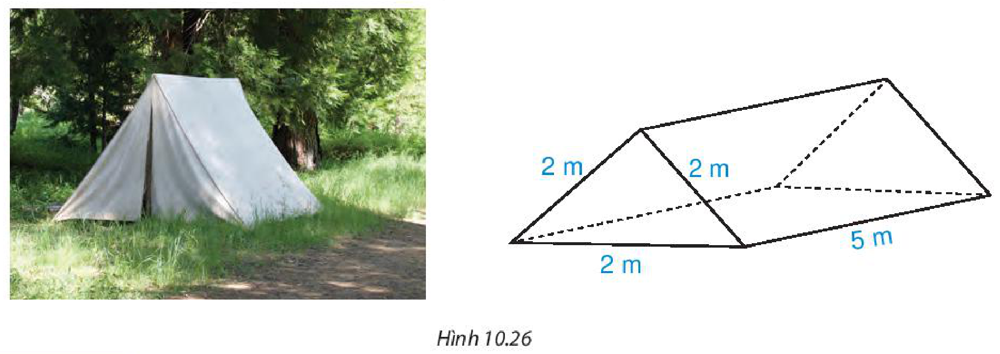
*Hình 10.26*

**Vận dụng:** Một khúc gỗ dùng để chặn bánh xe (giúp xe không bị trôi khi dừng đỗ) có dạng hình lăng trụ đứng, đáy là hình thang cân có kích thước như Hình 10.27. Người ta sơn xung quanh khúc gỗ này (không sơn hai đầu hình thang cân). Mỗi mét vuông sơn chi phí hết $20\,000$ đồng. Hỏi sơn xung quanh như vậy hết bao nhiêu tiền?

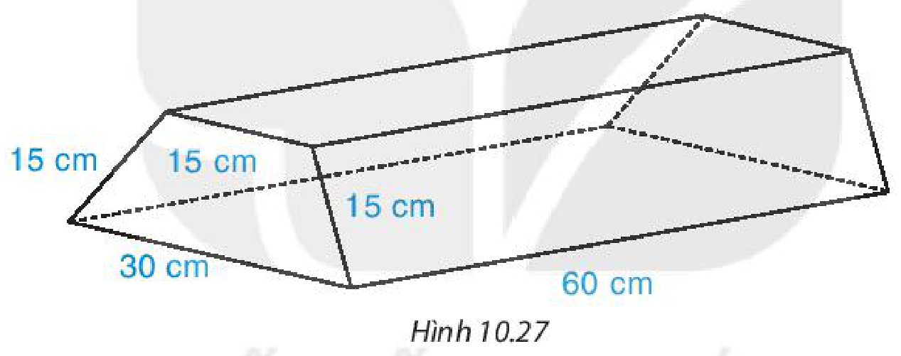
*Hình 10.27*

*Thể tích của hình lăng trụ đứng tam giác, lăng trụ đứng tứ giác*

<!-- term: Diện tích xung quanh và thể tích của hình lăng trụ đứng -->
<!-- term: Thể tích của hình lăng trụ đứng -->
> Tương tự như hình hộp chữ nhật, hình lập phương, thể tích của hình lăng trụ đứng tam giác, hình lăng trụ đứng tứ giác được tính bằng tích của diện tích đáy và chiều cao của nó.

<!-- term: Diện tích xung quanh và thể tích của hình lăng trụ đứng -->
<!-- term: Thể tích của hình lăng trụ đứng -->
> Thể tích của hình lăng trụ đứng tam giác, hình lăng trụ đứng tứ giác:
>
> $V = S_{\text{đáy}} \cdot h,$
>
> trong đó $V$: Thể tích của hình lăng trụ đứng,
>
> $S_{\text{đáy}}$: Diện tích một đáy của hình lăng trụ đứng,
>
> $h$: Chiều cao của hình lăng trụ đứng.

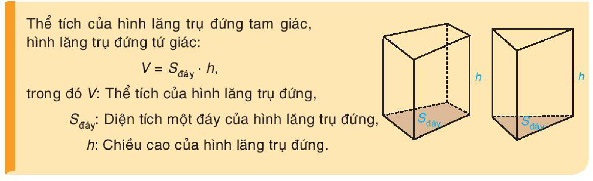

<!-- pdf:99 -->

**Ví dụ 3:**

Một lăng kính được làm bằng thuỷ tinh có dạng một hình lăng trụ đứng tam giác như Hình 10.28. Tính thể tích thuỷ tinh dùng để làm lăng kính.

**Giải:**

Diện tích tam giác đáy là $S_{\text{đáy}} = \dfrac{1}{2} \cdot 10 \cdot 8,7 = 43,5\text{ (cm}^2\text{)}$.

Thể tích thuỷ tinh dùng làm lăng kính là:

$V = S_{\text{đáy}} \cdot h = 43,5 \cdot 20 = 870\text{ (cm}^3\text{)}.$

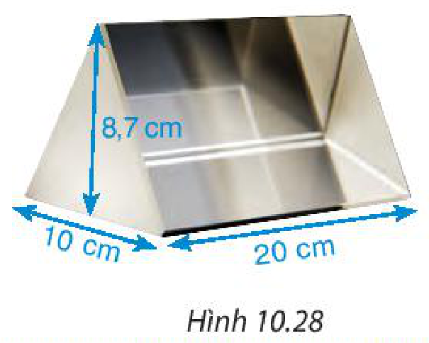
*Hình 10.28*

**Luyện tập 2:** Một chiếc khay đựng linh kiện bằng nhựa, có dạng hình lăng trụ đứng đáy là hình thang vuông với độ dài hai cạnh đáy là $30\text{ cm}$, $40\text{ cm}$ và các kích thước như Hình 10.29. Tính thể tích của khay.

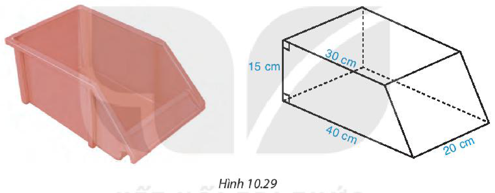
*Hình 10.29*

**Thử thách nhỏ:**

Một bể bơi có hình dạng và kích thước như Hình 10.30. Hình dạng của bể bơi được ghép bởi một hình hộp chữ nhật và một hình lăng trụ đứng tam giác. Khi bể bơi đầy ắp nước thì nó chứa bao nhiêu mét khối nước (bỏ qua độ dày của thành bể).

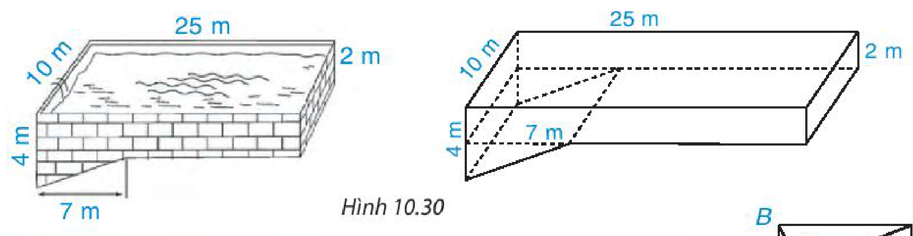
*Hình 10.30*

## BÀI TẬP

10.11. Quan sát và gọi tên các mặt đáy, mặt bên, cạnh đáy, cạnh bên của hình lăng trụ đứng tam giác ở Hình 10.31.

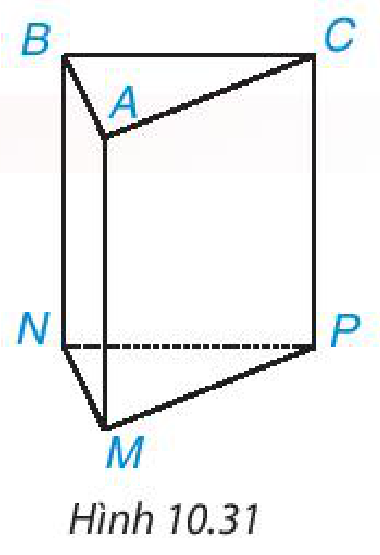
*Hình 10.31*

<!-- pdf:100 -->

10.12. Quan sát Hình 10.32 và cho biết cạnh nào trong các cạnh $(1), (2), (3)$ ghép với cạnh $AB$ để có được hình lăng trụ đứng.

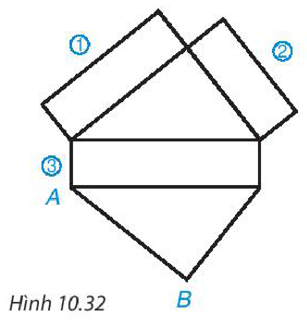
*Hình 10.32*

10.13. Tính diện tích xung quanh và thể tích của hình lăng trụ đứng trong Hình 10.33.

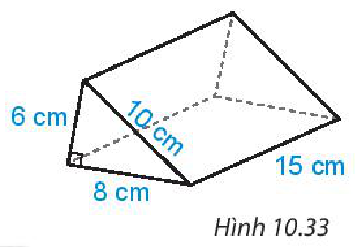
*Hình 10.33*

10.14. Thùng một chiếc máy nông nghiệp có dạng hình lăng trụ đứng tứ giác như Hình 10.34. Đáy của hình lăng trụ đứng này (mặt bên của thùng) là một hình thang vuông có độ dài đáy lớn $3\text{ m}$, đáy nhỏ $1,5\text{ m}$. Hỏi thùng có dung tích bao nhiêu mét khối?

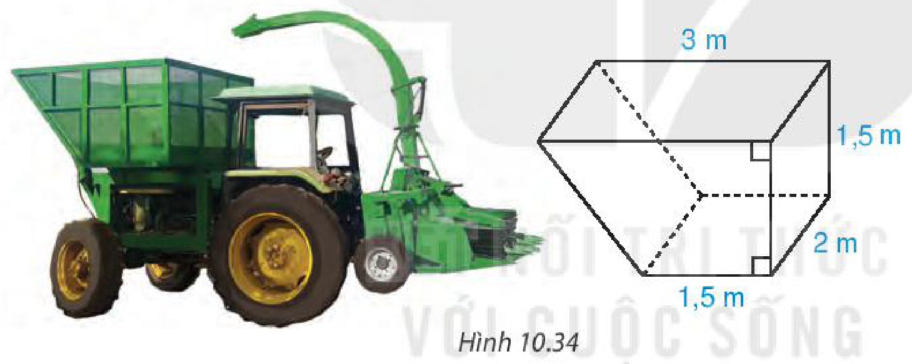
*Hình 10.34*

10.15. Một hình gồm hai hình lăng trụ đứng ghép lại với các kích thước như ở Hình 10.35. Tính thể tích của hình ghép.

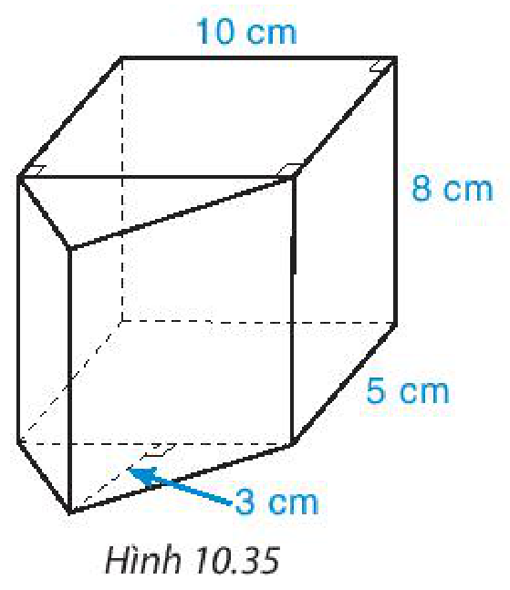
*Hình 10.35*

10.16. Một hộp đựng khẩu trang y tế được làm bằng bìa cứng có dạng một hình hộp chữ nhật, kích thước như Hình 10.36.

a) Hãy tính thể tích của hộp.

b) Tính diện tích bìa cứng dùng để làm hộp (bỏ qua mép dán).

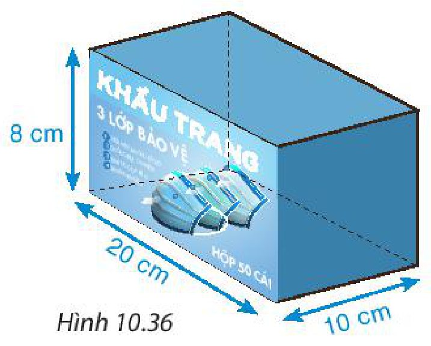
*Hình 10.36*

## 📷 Danh sách hình trong bài

| Mã hình | Trang PDF | Vị trí trong bài | Chú thích gốc |
| --- | :---: | --- | --- |
| H7-toan-b37-01 | 95 | Mở đầu | (sách không đánh số, lịch để bàn và chiếc chặn giấy dạng hình lăng trụ đứng tam giác) |
| H7-toan-b37-02 | 95 | Mục 1, HĐ1 | (sách không đánh số, các vật thể và hình vẽ minh hoạ ở HĐ1) |
| H7-toan-b37-03 | 96 | Mục 1, HĐ2 | Hình 10.19 |
| H7-toan-b37-04 | 96 | Mục 1, HĐ2 | Hình 10.20 |
| H7-toan-b37-05 | 96 | Mục 1, Ví dụ 1 | Hình 10.21 |
| H7-toan-b37-06 | 96 | Thực hành | Hình 10.22 |
| H7-toan-b37-07 | 96 | Thực hành | Hình 10.23 |
| H7-toan-b37-08 | 97 | Mục 2, HĐ3 | Hình 10.24 |
| H7-toan-b37-09 | 97 | Mục 2, Ví dụ 2 | Hình 10.25 |
| H7-toan-b37-10 | 98 | Mục 2, Luyện tập 1 | Hình 10.26 |
| H7-toan-b37-11 | 98 | Mục 2, Vận dụng | Hình 10.27 |
| H7-toan-b37-12 | 98 | Mục 2, Khung kiến thức thể tích | (sách không đánh số, hình lăng trụ đứng tứ giác và tam giác với diện tích đáy $S_{\text{đáy}}$, chiều cao $h$) |
| H7-toan-b37-13 | 99 | Mục 2, Ví dụ 3 | Hình 10.28 |
| H7-toan-b37-14 | 99 | Mục 2, Luyện tập 2 | Hình 10.29 |
| H7-toan-b37-15 | 99 | Thử thách nhỏ | Hình 10.30 |
| H7-toan-b37-16 | 99 | Bài tập 10.11 | Hình 10.31 |
| H7-toan-b37-17 | 100 | Bài tập 10.12 | Hình 10.32 |
| H7-toan-b37-18 | 100 | Bài tập 10.13 | Hình 10.33 |
| H7-toan-b37-19 | 100 | Bài tập 10.14 | Hình 10.34 |
| H7-toan-b37-20 | 100 | Bài tập 10.15 | Hình 10.35 |
| H7-toan-b37-21 | 100 | Bài tập 10.16 | Hình 10.36 |
