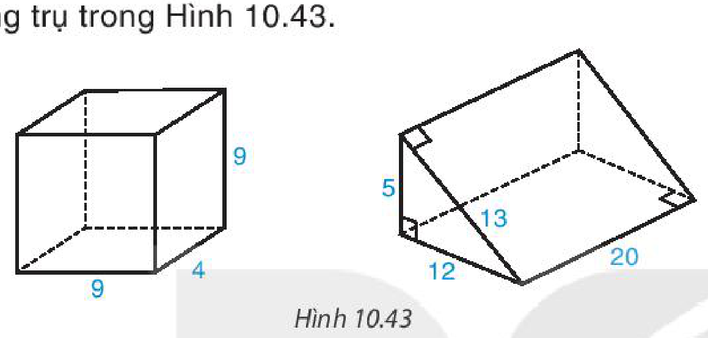
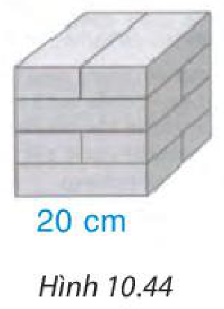

<!-- pdf:103 -->

# BÀI TẬP CUỐI CHƯƠNG X

10.20. Người ta làm một cái hộp có dạng hình hộp chữ nhật bằng bìa với chiều dài $20\text{ cm}$, chiều rộng $14\text{ cm}$ và chiều cao $15\text{ cm}$.

a) Tính thể tích của cái hộp.

b) Tính diện tích bìa dùng để làm cái hộp.

10.21. Tính thể tích, diện tích xung quanh, diện tích toàn phần của hình hộp chữ nhật và hình lăng trụ trong Hình 10.43.

*Hình 10.43*

10.22. Người ta xếp một số viên gạch dạng hình hộp chữ nhật tạo thành một khối hình lập phương cạnh $20\text{ cm}$ như Hình 10.44.

a) Tính diện tích xung quanh và diện tích toàn phần của khối gạch hình lập phương.

b) Tìm kích thước mỗi viên gạch.

*Hình 10.44*

10.23. Một căn phòng dạng hình hộp chữ nhật có chiều dài $5\text{ m}$, chiều rộng $4\text{ m}$ và chiều cao $3\text{ m}$. Người ta muốn lăn sơn tường và trần nhà. Hỏi diện tích cần lăn sơn là bao nhiêu mét vuông, biết rằng tổng diện tích các cửa bằng $5,8\text{ m}^2$?

10.24. Một bể cá dạng hình hộp chữ nhật làm bằng kính (không có nắp) có chiều dài $80\text{ cm}$, chiều rộng $50\text{ cm}$, chiều cao $45\text{ cm}$. Mực nước ban đầu trong bể cao $35\text{ cm}$.

a) Tính diện tích kính dùng để làm bể cá đó.

b) Người ta cho vào bể một hòn đá trang trí chìm hẳn trong nước thì mực nước của bể dâng lên thành $37,5\text{ cm}$. Tính thể tích hòn đá.

10.25. Một chiếc cốc có dạng hình trụ, chứa đầy nước. Hỏi nếu bỏ vào cốc $5$ viên đá dạng hình lập phương có cạnh $2\text{ cm}$ thì lượng nước trào ra ngoài là bao nhiêu?

## 📷 Danh sách hình trong bài

| Mã hình | Trang PDF | Vị trí trong bài | Chú thích gốc |
| --- | :---: | --- | --- |
| H7-toan-bt-c10-01 | 103 | Bài 10.21 | Hình 10.43 |
| H7-toan-bt-c10-02 | 103 | Bài 10.22 | Hình 10.44 |
