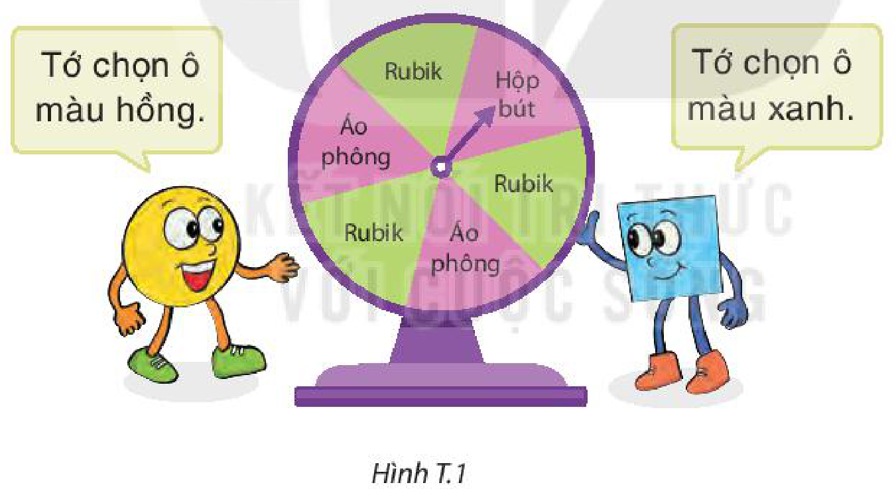

<!-- pdf:107 -->

# VÒNG QUAY MAY MẮN

## 🎯 Mục tiêu

- Làm quen với các biến cố và nhận ra được biến cố có xảy ra hay không.
- Cảm nhận được xác suất xảy ra mỗi biến cố nhiều hay ít.

> *Chuẩn bị:* Một miếng bìa cứng hình tròn được chia thành sáu phần bằng nhau, có ghi tên các phần thưởng, được gắn vào trục quay có mũi tên ở tâm như Hình T.1.
>
> *Luật chơi.* Quay miếng bìa, nếu mũi tên chỉ vào ô màu xanh thì Vuông thắng cuộc, nếu mũi tên chỉ vào ô màu hồng thì Tròn thắng cuộc. Người thắng cuộc nhận được phần thưởng ghi trong ô mũi tên chỉ vào.

*Hình T.1*

- **Tròn:** Tớ chọn ô màu hồng.
- **Vuông:** Tớ chọn ô màu xanh.

**CÁC BƯỚC THỰC HIỆN**

*Bước 1.* Em đọc luật chơi trên và thảo luận xem:

- Hai biến cố "Vuông thắng", "Tròn thắng" có đồng khả năng không?
- Xác suất Vuông, Tròn nhận được phần thưởng nào là cao nhất (rubik, áo phông hay hộp bút)?

*Bước 2.* Chia lớp thành từng cặp để chơi. Một bạn đóng vai Vuông, một bạn đóng vai Tròn. Mỗi cặp thực hiện chơi $10$ lần. Mỗi lần chơi xác định xem bạn nào thắng, phần thưởng là gì và ghi kết quả theo mẫu Bảng T.1.

<!-- pdf:108 -->

| Lần chơi | Người thắng | Phần thưởng |
| :---: | :---: | :---: |
| $1$ | Vuông | Áo phông |
| $\dots$ | $\dots$ | $\dots$ |
| $10$ | Tròn | Rubik |

*Bảng T.1*

*Bước 3.* Thống kê lại kết quả chơi của cả lớp theo mẫu Bảng T.2 và Bảng T.3.

| Kết quả | Vuông thắng | Tròn thắng |
| :---: | :---: | :---: |
| Số lần | $\dots$ | $\dots$ |

*Bảng T.2*

| Phần thưởng Vuông, Tròn nhận được | Rubik | Áo phông | Hộp bút |
| :---: | :---: | :---: | :---: |
| Số lần | $\dots$ | $\dots$ | $\dots$ |

*Bảng T.3*

*Bước 4.*

- Từ dữ liệu Bảng T.2, em hãy tính xác suất thực nghiệm của các sự kiện "Vuông thắng", "Tròn thắng".
- Từ dữ liệu Bảng T.3, em hãy cho biết phần thưởng nào Vuông và Tròn được nhận là nhiều nhất.
- So sánh kết quả thu được với nội dung thảo luận trong Bước 1 và rút ra kết luận.

## 📷 Danh sách hình trong bài

| Mã hình | Trang PDF | Vị trí trong bài | Chú thích gốc |
| --- | :---: | --- | --- |
| H7-toan-hd-thtn-04-01 | 107 | Mở đầu | Hình T.1 |
