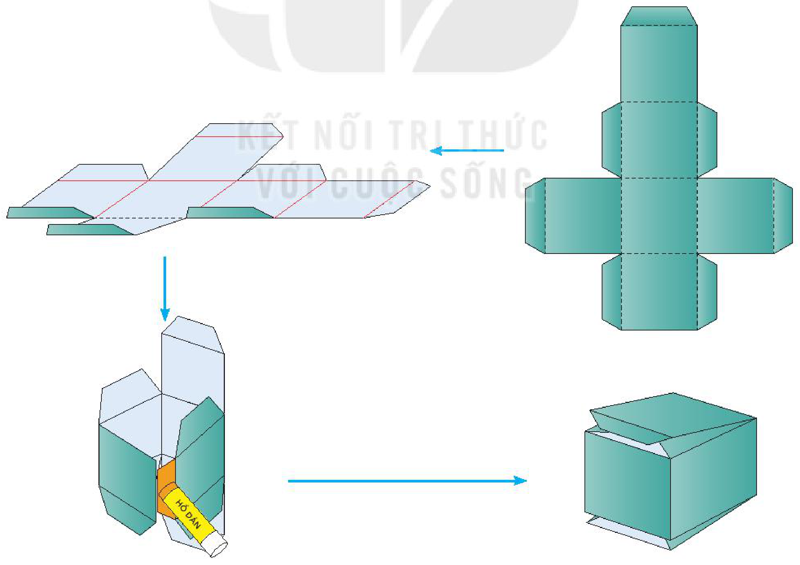
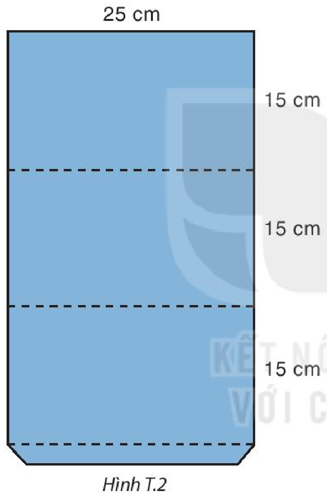
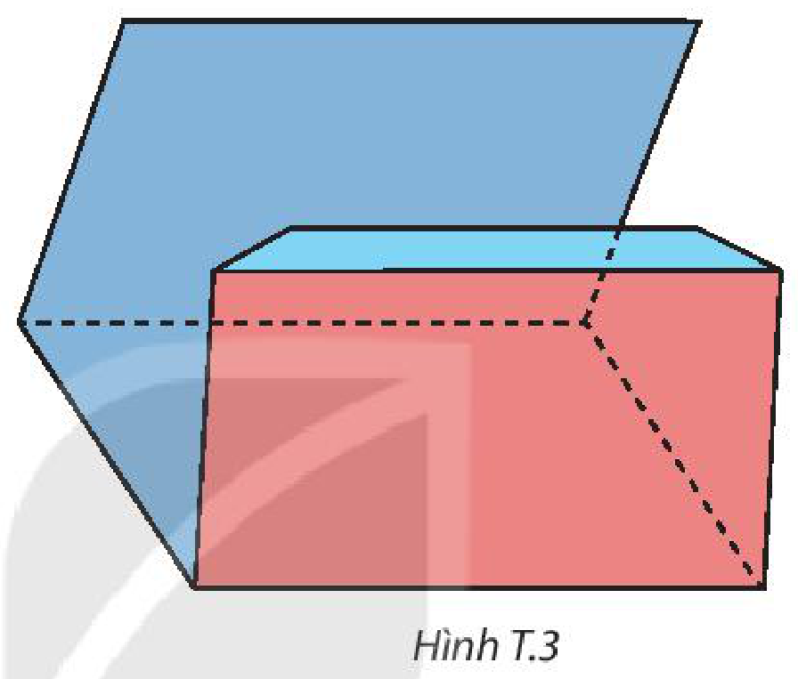
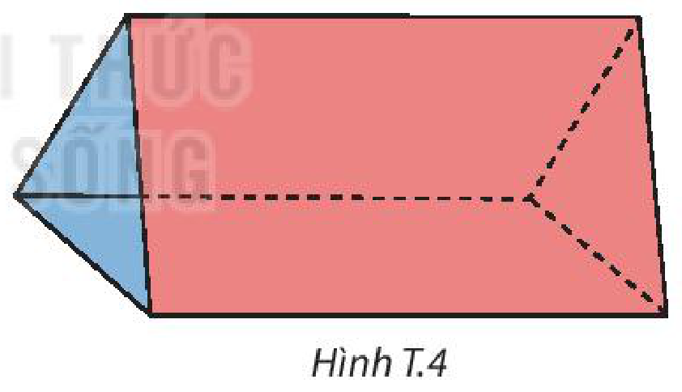
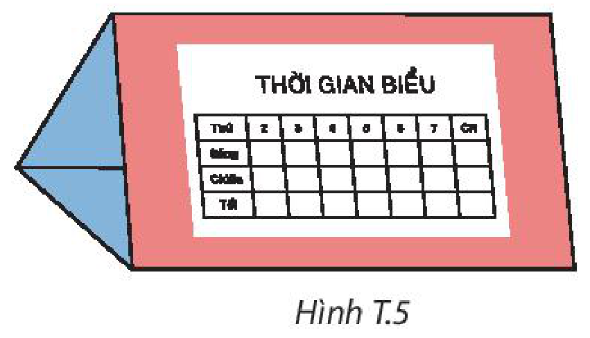

<!-- pdf:109 -->

# HỘP QUÀ VÀ CHÂN ĐẾ LỊCH ĐỂ BÀN CỦA EM

## 🎯 Mục tiêu

- Vận dụng các kiến thức đã học về một số hình khối trong thực tiễn vào giải quyết một số tình huống trong thực tiễn như mĩ thuật, thủ công,...

**HĐ1: CHIẾC HỘP ĐỰNG QUÀ**

*Chuẩn bị*

- Vật liệu: Một mảnh bìa carton hoặc một tờ bìa màu cứng.
- Dụng cụ: Bút, thước thẳng, kéo, keo dán hoặc băng dính.
- Địa điểm thực hiện: Ở lớp học hoặc ở nhà.

*Hướng dẫn thực hiện*

*Bước 1.* Vẽ rồi cắt hình khai triển của hình lập phương kèm theo mép của hộp.

*Bước 2.* Gấp theo các đường nét đứt.

*Bước 3.* Dán các mép của từng mặt vào với nhau (trừ nắp của hộp).

*Bước 4.* Gấp nắp dưới và nắp trên của hộp. Trang trí theo ý thích để được hộp đựng quà đẹp hơn.

<!-- pdf:110 -->

**HĐ2: CHÂN ĐẾ LỊCH ĐỂ BÀN**

*Chuẩn bị*

- Vật liệu: Bìa màu cứng.
- Dụng cụ: Kéo, thước, keo dán.
- Địa điểm thực hiện: Ở lớp học hoặc ở nhà.

*Hướng dẫn thực hiện*

*Bước 1.* Vẽ phác trên bìa cứng như Hình T.2. Sau đó, dùng kéo cắt theo đường viền.

*Hình T.2*

*Bước 2.* Gấp phần bìa vừa cắt theo các đường nét đứt (H.T.3).

*Hình T.3*

*Bước 3.* Dùng keo dán hai mép để được chân đế lịch để bàn (H.T.4).

*Hình T.4*

*Bước 4.* Em có thể dán thời gian biểu, thời khoá biểu, nhắc việc của bản thân,... lên mặt ngoài của chân đế (H.T.5).

*Hình T.5*

## 📷 Danh sách hình trong bài

| Mã hình | Trang PDF | Vị trí trong bài | Chú thích gốc |
| --- | :---: | --- | --- |
| H7-toan-hd-thtn-05-01 | 109 | HĐ1 | (sách không đánh số, sơ đồ bốn bước cắt, gấp và dán chiếc hộp đựng quà) |
| H7-toan-hd-thtn-05-02 | 110 | HĐ2, Bước 1 | Hình T.2 |
| H7-toan-hd-thtn-05-03 | 110 | HĐ2, Bước 2 | Hình T.3 |
| H7-toan-hd-thtn-05-04 | 110 | HĐ2, Bước 3 | Hình T.4 |
| H7-toan-hd-thtn-05-05 | 110 | HĐ2, Bước 4 | Hình T.5 |
