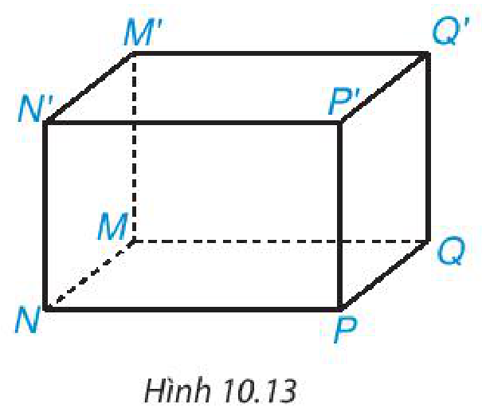
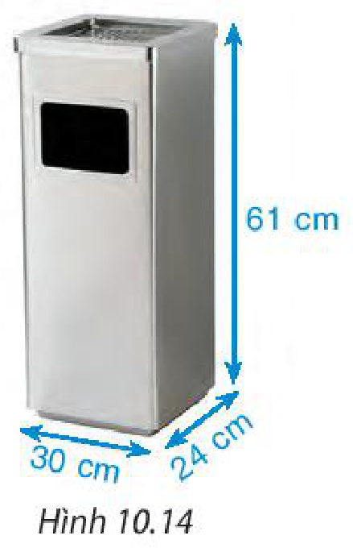
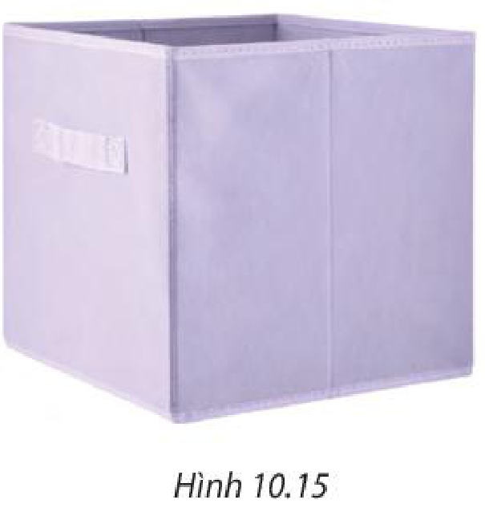
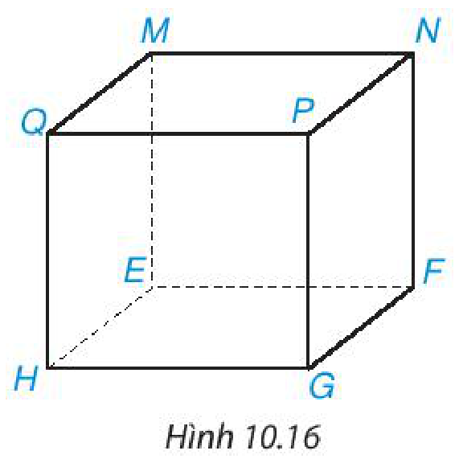
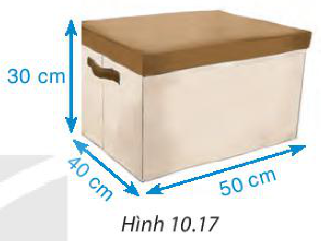
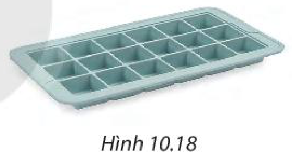

<!-- pdf:93 -->

# LUYỆN TẬP (TRANG 92)

**Ví dụ 1:**

Quan sát Hình 10.13 và kể tên các đỉnh, cạnh, đường chéo của hình hộp chữ nhật $MNPQ.M'N'P'Q'$.

**Giải:** Các đỉnh là: $M, N, P, Q, M', N', P', Q'$.

Các cạnh là: $MN, NP, PQ, QM, M'N', N'P', P'Q', Q'M', MM', NN', PP', QQ'$.

Các đường chéo: $MP', NQ', PM', QN'$.

*Hình 10.13*

**Ví dụ 2:**

Một chiếc thùng rác làm bằng inox có kích thước như Hình 10.14. Hỏi thể tích của thùng là bao nhiêu (coi độ dày của tấm inox không đáng kể)?

**Giải:**

Thể tích của thùng rác là:

$V = 30 \cdot 24 \cdot 61 = 43\,920\text{ (cm}^3\text{)}.$

*Hình 10.14*

**Ví dụ 3:**

Bạn Thanh làm một chiếc hộp đựng đồ hình lập phương cạnh $30\text{ cm}$ với khung bằng thép, đáy và các mặt xung quanh bọc vải (H.10.15). Hỏi diện tích vải dùng để làm chiếc hộp đó là bao nhiêu (coi phần các mép vải khâu nối không đáng kể)?

**Giải:**

Diện tích xung quanh của hình lập phương là:

$S_{\text{xq}} = 4 \cdot 30^2 = 3\,600\text{ (cm}^2\text{)}.$

Diện tích đáy của hình lập phương là:

$S_{\text{đáy}} = 30^2 = 900\text{ (cm}^2\text{)}.$

Diện tích vải bạn Thanh cần dùng để làm chiếc hộp đó là:

$3\,600 + 900 = 4\,500\text{ (cm}^2\text{)}.$

*Hình 10.15*

<!-- pdf:94 -->

## BÀI TẬP

10.7. Kể tên các đỉnh, cạnh và đường chéo của hình lập phương $MNPQ.EFGH$ ở Hình 10.16.

*Hình 10.16*

10.8. Một chiếc hộp đựng đồ đa năng có dạng hình hộp chữ nhật với khung bằng thép, bên ngoài phủ vải và kích thước như Hình 10.17.

a) Tính thể tích của hộp.

b) Tính diện tích vải phủ bề mặt ngoài của chiếc hộp.

*Hình 10.17*

10.9. Một chiếc khay làm đá để trong tủ lạnh có $18$ ngăn nhỏ hình lập phương với cạnh $2\text{ cm}$ (H.10.18). Hỏi tổng thể tích của toàn bộ các viên đá lạnh đựng đầy trong khay là bao nhiêu?

*Hình 10.18*

10.10. Một cái thùng hình lập phương cạnh $7\text{ dm}$ có chứa nước, độ sâu của nước là $4\text{ dm}$. Người ta thả $25$ viên gạch dạng hình hộp chữ nhật có chiều dài $2\text{ dm}$, chiều rộng $1\text{ dm}$ và chiều cao $0,5\text{ dm}$ vào thùng. Hỏi nước trong thùng dâng lên cách miệng thùng bao nhiêu đềximét (giả sử toàn bộ gạch ngập trong nước và chúng hút nước không đáng kể)?

## 📷 Danh sách hình trong bài

| Mã hình | Trang PDF | Vị trí trong bài | Chú thích gốc |
| --- | :---: | --- | --- |
| H7-toan-lt-c10-01-01 | 93 | Ví dụ 1 | Hình 10.13 |
| H7-toan-lt-c10-01-02 | 93 | Ví dụ 2 | Hình 10.14 |
| H7-toan-lt-c10-01-03 | 93 | Ví dụ 3 | Hình 10.15 |
| H7-toan-lt-c10-01-04 | 94 | Bài tập 10.7 | Hình 10.16 |
| H7-toan-lt-c10-01-05 | 94 | Bài tập 10.8 | Hình 10.17 |
| H7-toan-lt-c10-01-06 | 94 | Bài tập 10.9 | Hình 10.18 |
