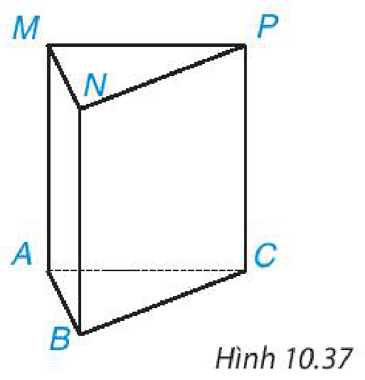
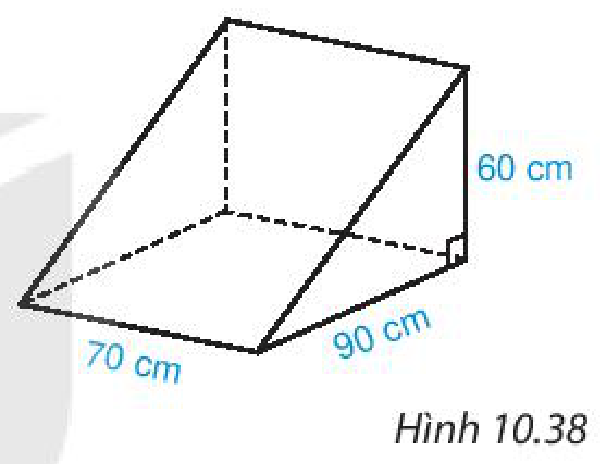
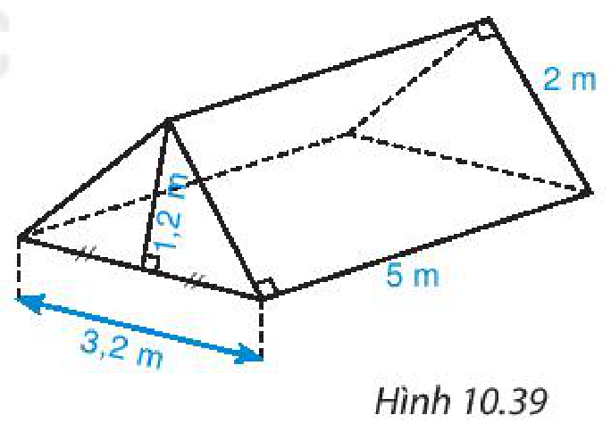
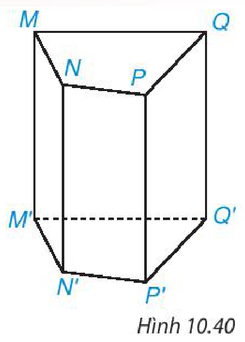
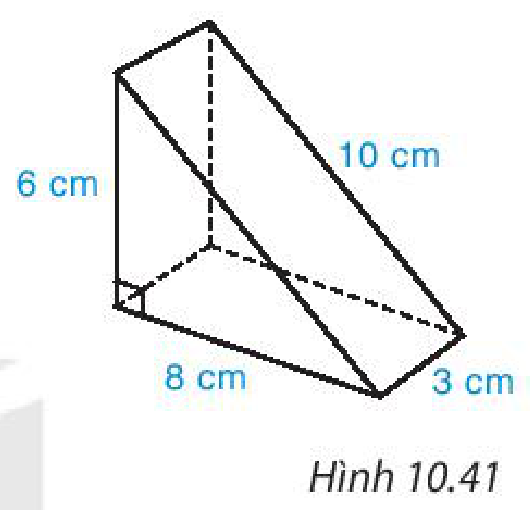
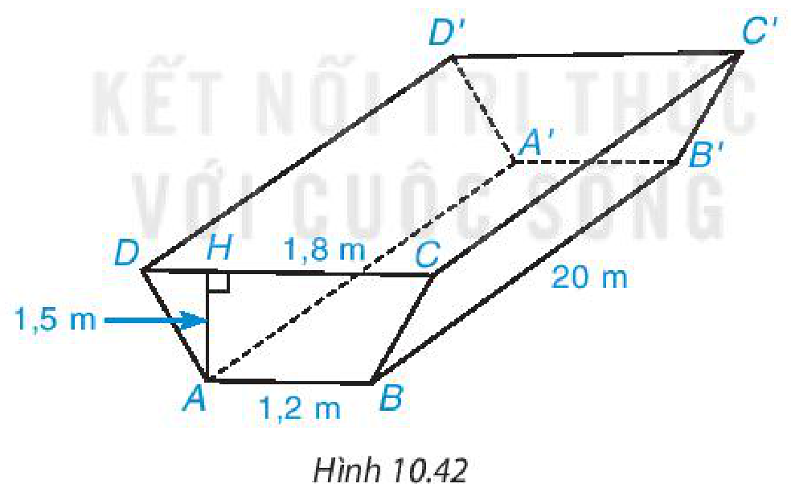

<!-- pdf:101 -->

# LUYỆN TẬP (TRANG 100)

**Ví dụ 1:**

Gọi tên đỉnh, cạnh, mặt bên, mặt đáy của hình lăng trụ đứng tam giác ở Hình 10.37.

**Giải:**

Các đỉnh của hình lăng trụ là: $A, B, C, M, N, P$.

Các cạnh của hình lăng trụ là: $AB, BC, CA, MN, NP, PM, AM, BN, CP$.

Các mặt bên của hình lăng trụ là các hình chữ nhật $ABNM, BCPN, ACPM$.

Các mặt đáy của hình lăng trụ là các tam giác $ABC$ và $MNP$.

*Hình 10.37*

**Ví dụ 2:**

Ông Khôi làm một khối gỗ hình lăng trụ đứng tam giác, kích thước như Hình 10.38, để chèn bánh xe. Tính thể tích của khối gỗ.

**Giải:**

Thể tích của khối gỗ là:

$V = S_{\text{đáy}} \cdot h = \dfrac{1}{2} \cdot 60 \cdot 90 \cdot 70 = 189\,000\text{ (cm}^3\text{)} = 0,189\text{ (m}^3\text{)}.$

*Hình 10.38*

**Ví dụ 3:**

Chi đội của bạn Trang dựng một lều ở trại hè có dạng lăng trụ đứng tam giác với kích thước như Hình 10.39.

a) Tính thể tích khoảng không bên trong lều.

b) Biết lều phủ vải bạt $4$ phía, trừ mặt tiếp đất. Tính diện tích vải bạt cần phải có để dựng lều.

*Hình 10.39*

**Giải:**

a) Diện tích đáy lăng trụ là: $S_{\text{đáy}} = (3,2 \cdot 1,2) : 2 = 1,92\text{ (m}^2\text{)}$.

Thể tích khoảng không bên trong lều là: $V = S_{\text{đáy}} \cdot h = 1,92 \cdot 5 = 9,6\text{ (m}^3\text{)}$.

b) Diện tích vải bạt cần có để dựng lều chính là diện tích toàn phần của lăng trụ trừ đi diện tích mặt bên có kích thước là $5\text{ m}$ và $3,2\text{ m}$.

Diện tích xung quanh lăng trụ là: $S_{\text{xq}} = C \cdot h = (2 + 2 + 3,2) \cdot 5 = 36\text{ (m}^2\text{)}$.

Diện tích toàn phần của hình lăng trụ là: $S_{\text{tp}} = S_{\text{xq}} + 2S_{\text{đáy}} = 36 + 2 \cdot 1,92 = 39,84\text{ (m}^2\text{)}$.

Diện tích mặt bên kích thước $5\text{ m}$ và $3,2\text{ m}$ là: $5 \cdot 3,2 = 16\text{ (m}^2\text{)}$.

Vậy diện tích vải bạt cần có để dựng lều là: $39,84 - 16 = 23,84\text{ (m}^2\text{)}$.

<!-- pdf:102 -->

## BÀI TẬP

10.17. Viết tên đỉnh, cạnh, mặt bên, mặt đáy của hình lăng trụ đứng tứ giác ở Hình 10.40.

*Hình 10.40*

10.18. Một cái bánh ngọt có dạng hình lăng trụ đứng tam giác, kích thước như Hình 10.41.

a) Tính thể tích cái bánh.

b) Nếu phải làm một chiếc hộp để đựng vừa khít cái bánh này thì diện tích vật liệu cần dùng là bao nhiêu (coi mép dán không đáng kể)?

*Hình 10.41*

10.19. Người ta đào một đoạn mương có dạng hình lăng trụ đứng tứ giác như Hình 10.42. Biết mương có chiều dài $20\text{ m}$, sâu $1,5\text{ m}$, bề mặt có chiều rộng $1,8\text{ m}$ và đáy mương rộng $1,2\text{ m}$. Tính thể tích đất phải đào lên.

*Hình 10.42*

## 📷 Danh sách hình trong bài

| Mã hình | Trang PDF | Vị trí trong bài | Chú thích gốc |
| --- | :---: | --- | --- |
| H7-toan-lt-c10-02-01 | 101 | Ví dụ 1 | Hình 10.37 |
| H7-toan-lt-c10-02-02 | 101 | Ví dụ 2 | Hình 10.38 |
| H7-toan-lt-c10-02-03 | 101 | Ví dụ 3 | Hình 10.39 |
| H7-toan-lt-c10-02-04 | 102 | Bài tập 10.17 | Hình 10.40 |
| H7-toan-lt-c10-02-05 | 102 | Bài tập 10.18 | Hình 10.41 |
| H7-toan-lt-c10-02-06 | 102 | Bài tập 10.19 | Hình 10.42 |
