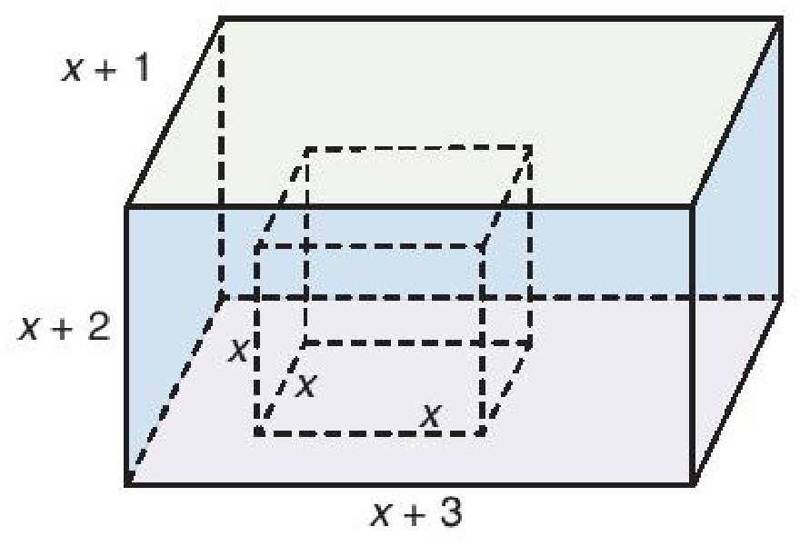
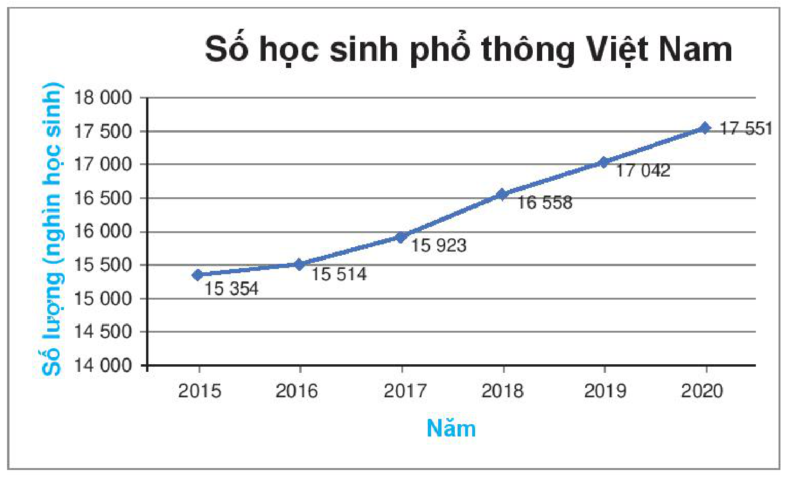
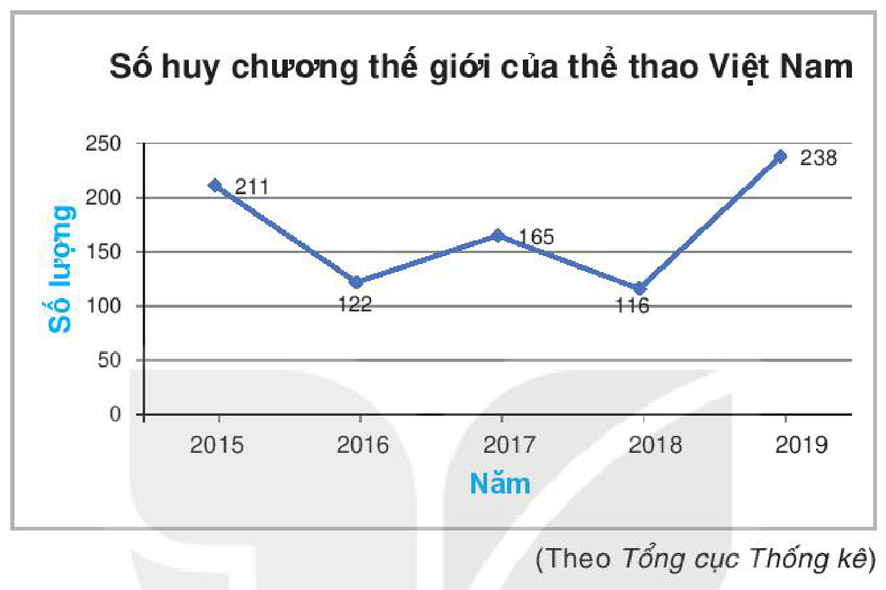
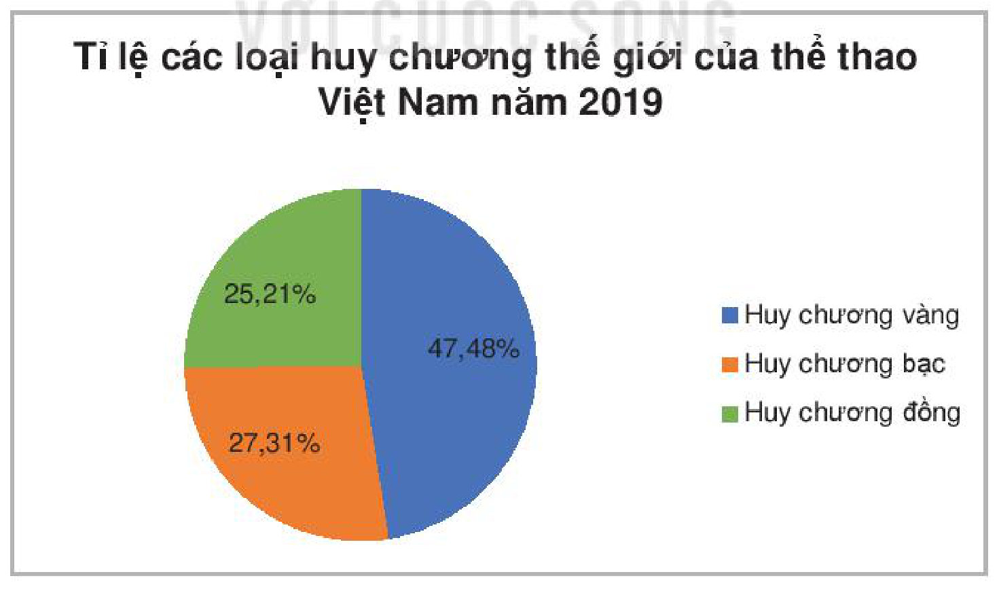
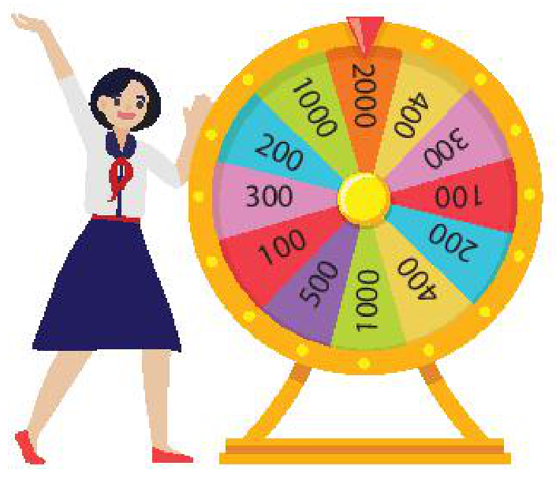

<!-- pdf:111 -->

# BÀI TẬP ÔN TẬP CUỐI NĂM

## SỐ VÀ ĐẠI SỐ

1. Tính giá trị của các biểu thức sau:

a) $\sqrt{25} + (2^2 \cdot 3)^2 \cdot \left(-\dfrac{1}{4}\right)^2 + 2020^0 + \left|-\dfrac{1}{4}\right|;$

b) $\dfrac{3^2 - 0,25 \cdot (7,5 - 5,1)}{-6,2 + 2 \cdot (0,5 + 1,6)}.$

2. Tính một cách hợp lí.

a) $\dfrac{5}{11} - \dfrac{10}{19} + 1,5 + \dfrac{17}{11} - \dfrac{9}{19}.$

b) $2\dfrac{3}{5} \cdot \left(-\dfrac{2}{3}\right) - 2\dfrac{1}{3} \cdot \left(-\dfrac{2}{3}\right) + \left(\dfrac{2}{3}\right)^2.$

3. a) Tìm $x$, biết $\dfrac{2}{5}x + \dfrac{3}{2} = \dfrac{3}{5} - \left(-\dfrac{1}{4}\right)$.

b) Có hay không số $x$ thoả mãn điều kiện: $|x| + \dfrac{1}{5} = -\left(\dfrac{1}{2} - \dfrac{1}{3}\right)$?

c) Hãy *ước tính* (không tra bảng hay dùng máy tính) số dương $x$ (lấy đến $1$ chữ số sau dấu phẩy) sao cho $x^2 = 13$. Sau đó dùng máy tính cầm tay (hoặc tra bảng) để tính $x$, chính xác đến hàng phần chục để kiểm tra xem con số em ước tính chênh lệch bao nhiêu so với kết quả tính bằng máy tính.

4. Hai người thợ cùng làm tổng cộng được $136$ sản phẩm (thời gian làm như nhau). Hỏi mỗi người thợ làm được bao nhiêu sản phẩm, biết rằng người thợ thứ nhất làm một sản phẩm mất $9$ phút, còn người thứ hai làm một sản phẩm mất $8$ phút?

5. Ba khối $6, 7, 8$ của một trường Trung học cơ sở tham gia quyên góp vở tặng các bạn vùng khó khăn. Biết rằng số vở quyên góp được của ba khối theo thứ tự tỉ lệ thuận với $8, 7, 6$ và số vở khối $8$ quyên góp được ít hơn số vở khối $6$ quyên góp được là $80$ quyển. Hỏi mỗi khối quyên góp được bao nhiêu quyển vở?

6. Cho hai đa thức $A = 6x^3 - 4x^2 - 12x - 7$ và $B = 2x^2 - 7$.

a) Xác định hệ số cao nhất và hệ số tự do trong mỗi đa thức đã cho.

b) Tính giá trị của đa thức $A + B$ tại $x = -2$.

c) Chứng minh rằng $x = 0$, $x = -1$ và $x = 2$ là ba nghiệm của đa thức $A - B$.

d) Thực hiện phép nhân $A \cdot B$ bằng hai cách.

e) Tìm đa thức $R$ có bậc nhỏ hơn $2$ sao cho hiệu $A - R$ chia hết cho $B$.

7. Người ta đổ đầy nước vào một cái bể hình hộp chữ nhật, sau đó nhấn chìm một khối lập phương (đặc) có độ dài các cạnh bằng $x\text{ (dm)}$ vào trong bể. Biết rằng chiều rộng, chiều dài và chiều cao của bể lần lượt bằng $x + 1$, $x + 3$ và $x + 2$ (xem hình bên).

a) Tìm đa thức biểu thị thể tích nước còn lại trong bể.

<!-- pdf:112 -->

b) Xác định bậc, hệ số cao nhất và hệ số tự do của đa thức trong câu a.

c) Sử dụng kết quả câu a để tính lượng nước còn lại trong bể (đơn vị: $\text{dm}^3$) khi $x = 7\text{ dm}$.

## HÌNH HỌC VÀ ĐO LƯỜNG

8. Cho tam giác $ABC$. Gọi $D$ là trung điểm của $AB$. Trên tia đối của tia $DC$, lấy điểm $M$ sao cho $DM = DC$.

a) Chứng minh rằng $\triangle ADM = \triangle BDC$. Từ đó suy ra $AM = BC$ và $AM \parallel BC$.

b) Gọi $E$ là trung điểm của $AC$. Trên tia đối của tia $EB$ lấy điểm $N$ sao cho $EN = EB$. Chứng minh rằng $AN \parallel BC$.

c) Chứng minh rằng ba điểm $M, A, N$ thẳng hàng và $A$ là trung điểm của đoạn $MN$.

9. Cho tam giác $ABC$ cân tại đỉnh $A$. Gọi $H$ là trung điểm của $BC$.

a) Chứng minh $AH \perp BC$.

b) Trên tia đối của tia $BC$ lấy điểm $M$; trên tia đối của tia $CB$ lấy điểm $N$ sao cho $BM = CN$. Chứng minh rằng $\triangle ABM = \triangle ACN$.

c) Gọi $I$ là điểm trên $AM$, $K$ là điểm trên $AN$ sao cho $BI \perp AM$; $CK \perp AN$. Chứng minh rằng tam giác $AIK$ cân tại $A$, từ đó suy ra $IK \parallel MN$.

10. Cho tam giác $ABC$ vuông tại $A$. Gọi $D$ là điểm thuộc cạnh $BC$ sao cho $BD = BA$ và $H$ là trung điểm của $AD$. Tia $BH$ cắt $AC$ tại $E$. Tia $DE$ cắt tia $BA$ tại $M$. Chứng minh rằng:
<!-- ocr-ok: đã đối chiếu ảnh trang PDF 112, nhiều kí hiệu điểm và đoạn thẳng viết bằng LaTeX -->

a) $\triangle ABH = \triangle DBH$;

b) Tam giác $AED$ cân;

c) $EM > ED$;

d) Tam giác $BCM$ là tam giác đều và $CE = 2EA$, biết $\widehat{ABC} = 60^\circ$.

**THỐNG KÊ VÀ XÁC SUẤT**

11. Bình thu thập số liệu về số học sinh phổ thông của cả nước từ năm $2015$ đến năm $2020$ và vẽ được biểu đồ sau:

<!-- pdf:113 -->

a) Số học sinh phổ thông cả nước từ năm $2015$ đến năm $2020$ có xu thế tăng hay giảm?

b) Hãy lập bảng thống kê về số lượng học sinh phổ thông của cả nước từ năm $2015$ đến năm $2020$.

c) Theo em, Bình đã dùng cách nào trong các cách thu thập dữ liệu đã học để có được số liệu trên?

12. Biểu đồ sau đây cho biết tổng số huy chương thế giới mà thể thao Việt Nam giành được trong các năm từ $2015$ đến $2019$:

*(Theo Tổng cục Thống kê)*

a) Lập bảng thống kê về số huy chương thế giới mà thể thao Việt Nam đạt được từ năm $2015$ đến năm $2019$.

b) Trong các năm trên, năm nào thể thao Việt Nam giành được ít huy chương thế giới nhất?

c) Tỉ lệ các loại huy chương thế giới của thể thao Việt Nam trong năm $2019$ được cho trong biểu đồ sau:

*(Theo Tổng cục Thống kê)*

Tính số lượng mỗi loại huy chương thế giới mà thể thao Việt Nam giành được trong năm $2019$.

<!-- pdf:114 -->

13. Trong trò chơi *Vòng quay may mắn*, người chơi sẽ quay một bánh xe hình tròn. Bánh xe được chia làm $12$ hình quạt bằng nhau như hình bên. Trong mỗi hình quạt có ghi số điểm mà người chơi sẽ nhận được. Có hai hình quạt ghi $100$ điểm; hai hình quạt ghi $200$ điểm; hai hình quạt ghi $300$ điểm; hai hình quạt ghi $400$ điểm; một hình quạt ghi $500$ điểm; hai hình quạt ghi $1\,000$ điểm và một hình quạt ghi $2\,000$ điểm. Khi bánh xe dừng lại, mũi tên (đặt cố định ở phía trên) chỉ vào hình quạt nào thì người chơi nhận được số điểm ghi trong hình quạt đó.

Bạn Mai tham gia trò chơi và quay một lần. Tính xác suất để mũi tên chỉ vào hình quạt:

a) Có số điểm nhỏ hơn $2\,000$;

b) Có số điểm nhỏ hơn $100$;

c) Có số điểm lớn hơn $300$;

d) Có số điểm là $2\,000$.

## 📷 Danh sách hình trong bài

| Mã hình | Trang PDF | Vị trí trong bài | Chú thích gốc |
| --- | :---: | --- | --- |
| H7-toan-on-tap-cuoi-nam-01 | 111 | Số và Đại số, Bài 7 | (sách không đánh số, khối lập phương cạnh $x$ nhấn chìm trong bể hình hộp chữ nhật kích thước $x + 1, x + 3, x + 2$) |
| H7-toan-on-tap-cuoi-nam-02 | 112 | Thống kê và Xác suất, Bài 11 | Số học sinh phổ thông Việt Nam |
| H7-toan-on-tap-cuoi-nam-03 | 113 | Thống kê và Xác suất, Bài 12 | Số huy chương thế giới của thể thao Việt Nam (Theo Tổng cục Thống kê) |
| H7-toan-on-tap-cuoi-nam-04 | 113 | Thống kê và Xác suất, Bài 12c | Tỉ lệ các loại huy chương thế giới của thể thao Việt Nam năm 2019 (Theo Tổng cục Thống kê) |
| H7-toan-on-tap-cuoi-nam-05 | 114 | Thống kê và Xác suất, Bài 13 | (sách không đánh số, bánh xe Vòng quay may mắn chia 12 hình quạt bằng nhau) |
