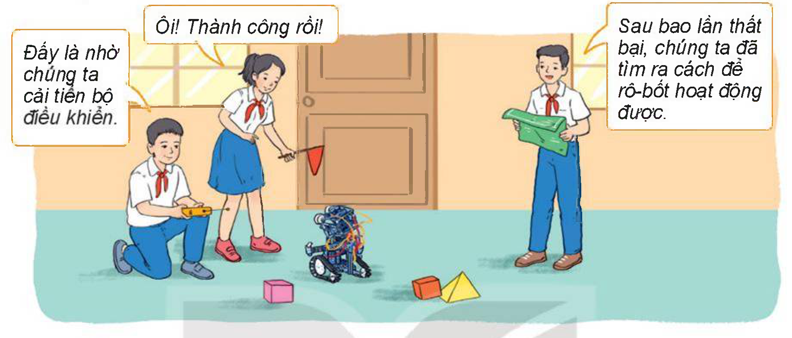
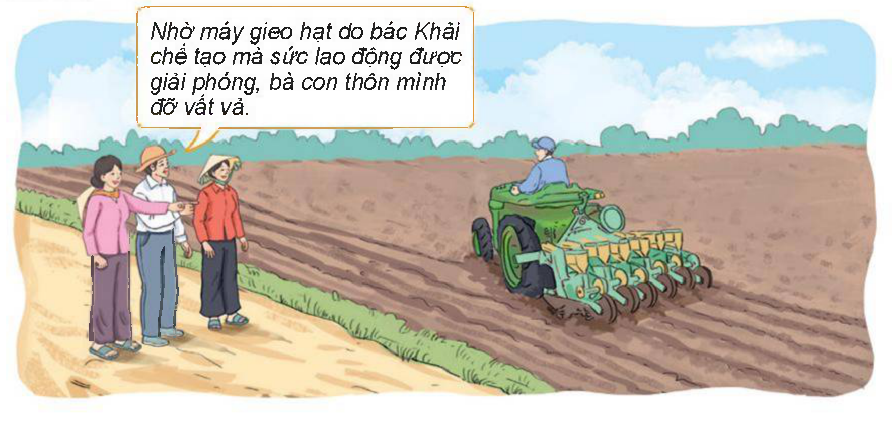

<!-- pdf:18 -->

# BÀI 3: LAO ĐỘNG CẦN CÙ, SÁNG TẠO

## 🎯 Mục tiêu:

- Nêu được khái niệm cần cù, sáng tạo trong lao động và một số biểu hiện của cần cù, sáng tạo trong lao động.
- Giải thích được ý nghĩa của cần cù, sáng tạo trong lao động.
- Thể hiện được sự cần cù, sáng tạo trong lao động của bản thân.
- Trân trọng những thành quả lao động; quý trọng và học hỏi những tấm gương cần cù, sáng tạo trong lao động; phê phán những biểu hiện chây lười, thụ động trong lao động.

## 🔴 Mở đầu

Lao động cần cù, sáng tạo là một trong những truyền thống quý báu của dân tộc Việt Nam, giúp con người không chỉ tạo ra những giá trị vật chất và tinh thần cho bản thân mà còn đóng góp vào sự phát triển của xã hội. Mỗi người cần kế thừa và phát huy truyền thống quý báu đó, lao động cần cù, sáng tạo không ngừng để góp phần xây dựng thành công đất nước giàu đẹp, văn minh.

> ❓ Em hãy tìm những câu ca dao, tục ngữ, thành ngữ nói về lao động cần cù, sáng tạo và cho biết ý nghĩa của những câu ca dao, tục ngữ, thành ngữ đó.

## KHÁM PHÁ

## 1. Khái niệm và biểu hiện của cần cù, sáng tạo trong lao động

Em hãy đọc câu chuyện, quan sát tranh và trả lời câu hỏi:

> MỘT TẤM GƯƠNG LAO ĐỘNG CẦN CÙ, SÁNG TẠO
>
> Niu-tơn (Newton, 1642 – 1727) là nhà vật lí, thiên văn học, toán học thiên tài, được mệnh danh là nhà khoa học vĩ đại và có tầm ảnh hưởng rất lớn trong lịch sử. Suốt cuộc đời của mình, ông đã không ngừng lao động, tìm tòi, sáng tạo và đóng góp cho khoa học, phục vụ cho sự tiến bộ của xã hội với những phát minh kiệt xuất như: định luật vạn vật hấp dẫn, ba định luật về chuyển động, phép tính vi phân, tích phân, kính viễn vọng phản xạ, đồng hồ mặt trời,...
>
> Vốn là người say mê nghiên cứu khoa học, hằng ngày ông thường giam mình trong phòng làm việc để đọc sách, loay hoay đục đẽo và chế tạo nhiều thứ. Có lần đến nhà dược sĩ Cờ-lác, ông xin được một chiếc hộp xinh xắn, về nhà, ông cặm cụi đến quên ăn, quên ngủ để tạo ra được một chiếc đồng hồ nước.

<!-- pdf:19 -->

> Là người yêu thích Toán học, Niu-tơn đã bỏ ra hai mươi năm lao động, cật lực để hoàn thành cuốn “Các nguyên lí Toán học của Triết học Tự nhiên”. Có thể nói mỗi câu chữ, mỗi trang sách đều là một phần trái tim, khối óc của ông.
> (Theo *Rasmus Hoài Nam, Isaac Newton – Nhà khoa học vĩ đại, NXB Thanh Niên, 2022*)

> - Đấy là nhờ chúng ta cải tiến bộ điều khiển.
> - Ôi! Thành công rồi!
> - Sau bao lần thất bại, chúng ta đã tìm ra cách để rô-bốt hoạt động được.
<!-- ocr-ok: đã đối chiếu ảnh p019.png, chữ trong bóng thoại của tranh -->

> ❓
> a) Hãy nêu những biểu hiện cần cù, sáng tạo trong lao động của Niu-tơn qua câu chuyện trên.
> b) Các bạn học sinh trong tranh đã lao động như thế nào, sáng tạo ra sao để chế tạo được rô-bốt?
> c) Em hiểu thế nào là lao động cần cù, sáng tạo? Hãy nêu các biểu hiện của cần cù, sáng tạo trong lao động.
> d) Em học hỏi được điều gì từ những tấm gương lao động cần cù, sáng tạo trên?

## 2. Ý nghĩa của cần cù, sáng tạo trong lao động

Em hãy quan sát bức tranh, kết hợp đọc những trường hợp dưới đây và trả lời câu hỏi:

> Nhờ máy gieo hạt do bác Khải chế tạo mà sức lao động được giải phóng, bà con thôn mình đỡ vất vả.

<!-- pdf:20 -->

> 1. Bạn Nam rất yêu thích Hoá học. Hằng ngày, mỗi khi rửa bát, bạn luôn suy nghĩ làm thế nào để tạo ra một loại nước rửa bát có nguồn gốc từ thiên nhiên. Bạn đã không ngừng tìm tòi, thử nghiệm chế tạo nước rửa bát từ những rác thải sinh hoạt có nguồn gốc thực vật như: vỏ hoa quả, gốc rau, củ quả. Qua quá trình nghiên cứu, bạn đã chế tạo thành công nước rửa bát từ vỏ bưởi. Đây là loại chất tẩy rửa an toàn, lành tính, không gây ô nhiễm môi trường.

> 2. Được bố mẹ giao cho chăm sóc thửa ruộng của gia đình chuyên trồng lúa, ngô, anh Dũng canh tác theo những phương thức cũ, không suy nghĩ tìm tòi để đổi mới, sáng tạo trong lao động, chưa cần cù chịu khó chăm sóc, tưới tiêu, làm cỏ, bón phân, nên năng suất cây trồng không cao, thu nhập thấp, kinh tế gia đình gặp nhiều khó khăn. Thấy anh Tuấn cùng xóm sớm hôm chăm nom ruộng vườn, tìm mua được giống mới, học hỏi phương pháp chăm sóc cây tiên tiến, tìm cách dẫn nước vào ruộng,... nên cây trồng nhà anh không chỉ đạt năng suất, sản lượng mà chất lượng lúa gạo cũng tăng, đem lại thu nhập cao và ổn định, anh Dũng nhận thấy mình phải chăm chỉ làm việc hơn và đổi mới, sáng tạo để cải thiện kinh tế cho gia đình.

> ❓
> a) Qua bức tranh và các trường hợp trên, em hãy cho biết những kết quả đã đạt được nhờ sự cần cù, sáng tạo trong lao động.
> b) Việc chưa cần cù, sáng tạo trong lao động khiến gia đình anh Dũng gặp khó khăn gì?
> c) Theo em, vì sao cần rèn luyện đức tính cần cù, sáng tạo trong lao động? Nêu những việc cần làm để rèn luyện đức tính cần cù, sáng tạo trong lao động.

> 1. **Lao động cần cù** là chăm chỉ, chịu khó làm việc một cách thường xuyên, phấn đấu hết mình vì công việc.

> **Lao động sáng tạo** là luôn luôn suy nghĩ, cải tiến để tìm tòi cái mới, tìm ra cách giải quyết tối ưu nhằm không ngừng nâng cao chất lượng, hiệu quả lao động.

<!-- term: Biểu hiện của lao động cần cù, sáng tạo -->
> 2. Biểu hiện của lao động cần cù: chăm chỉ, chịu khó làm việc một cách thường xuyên. Biểu hiện của lao động sáng tạo: luôn luôn suy nghĩ, tìm tòi, cải tiến phương pháp để lao động có hiệu quả; nghiêm khắc sửa chữa sai lầm, rút ra bài học kinh nghiệm cho bản thân.

<!-- term: Ý nghĩa của cần cù, sáng tạo trong lao động -->
> 3. Cần cù, sáng tạo trong lao động giúp con người:
> – Hoàn thiện và phát triển phẩm chất, năng lực của mỗi cá nhân để nâng cao hiệu quả lao động, góp phần xây dựng quê hương, đất nước.
> – Tạo ra được nhiều giá trị vật chất, tinh thần góp phần cải thiện và nâng cao đời sống.
> – Được mọi người yêu quý, tôn trọng.

> 4. Học sinh cần phải quý trọng và học hỏi những tấm gương cần cù, sáng tạo trong lao động; phê phán những biểu hiện chây lười, thụ động trong lao động.

<!-- pdf:21 -->

## ✏️ Luyện tập

1. Em tán thành hay không tán thành với những ý kiến nào dưới đây? Vì sao?

a) Lao động ở lĩnh vực nào cũng phải cần cù và sáng tạo.

b) Sáng tạo là khả năng bẩm sinh của con người, không thể rèn luyện mà có được.

c) Lao động chân tay thì không cần sáng tạo.

d) Trong lao động, việc nào dễ thì làm, việc khó thì bỏ qua.

2. Hành vi nào dưới đây thể hiện sự cần cù, sáng tạo trong lao động? Vì sao?

a) Bạn Đ luôn chủ động giúp mẹ làm bếp và thường xuyên cải biến các món ăn mới để cả nhà được ngon miệng.

b) Chị M thường tái chế phế liệu thành vật dụng để dùng trong sinh hoạt hằng ngày của gia đình mình.

c) Bạn Y làm những việc bố mẹ giao một cách qua loa cho xong.

3. Em hãy đọc tình huống và trả lời câu hỏi:

a) Anh A và chị B được phân công phụ trách dự án cải tiến nâng cấp phần mềm hệ thống kế toán của công ty. Anh A đưa nhiều ý tưởng thay đổi có tính đột phá nhưng chị B không ủng hộ vì cho rằng không cần phải thay đổi nhiều để khỏi mất công, không phải suy nghĩ.

*Em có nhận xét gì về việc làm của anh A và ý kiến của chị B?*

b) Là một công nhân may trong dây chuyền sản xuất áo sơ mi của xí nghiệp X, chị H cho rằng cần thực hiện đúng nhiệm vụ được phân công, không nên sáng tạo gì thêm để khỏi ảnh hưởng đến kết quả chung của cả dây chuyền.

*– Em có nhận xét gì về ý kiến của chị H?*

*– Nếu là chị H, em sẽ làm gì?*

4. Hãy kể về những việc em đã làm thể hiện sự cần cù, sáng tạo trong lao động và chia sẻ kinh nghiệm của bản thân với các bạn trong lớp.

5. Em hãy gửi một thông điệp bày tỏ sự trân trọng thành quả lao động của người thân hoặc những người xung quanh.

## 🚀 Vận dụng

1. Hãy viết bài chia sẻ về một tấm gương lao động cần cù, sáng tạo mà em biết. Em học tập được điều gì từ tấm gương đó?

2. Em và các bạn hãy thiết kế một sản phẩm thể hiện sự sáng tạo từ những vật liệu tái chế.

## 📷 Danh sách hình trong bài

| Mã hình | Trang PDF | Trang sách | Chú thích |
| --- | --- | --- | --- |
| H8-giao_duc_cong_dan-b03-01 | 19 | 17 | [Tranh minh hoạ mục 1: Các bạn học sinh kiên trì, sáng tạo chế tạo rô-bốt] |
| H8-giao_duc_cong_dan-b03-02 | 19 | 17 | [Tranh minh hoạ mục 2: Máy gieo hạt do bác Khải chế tạo giúp giải phóng sức lao động] |
