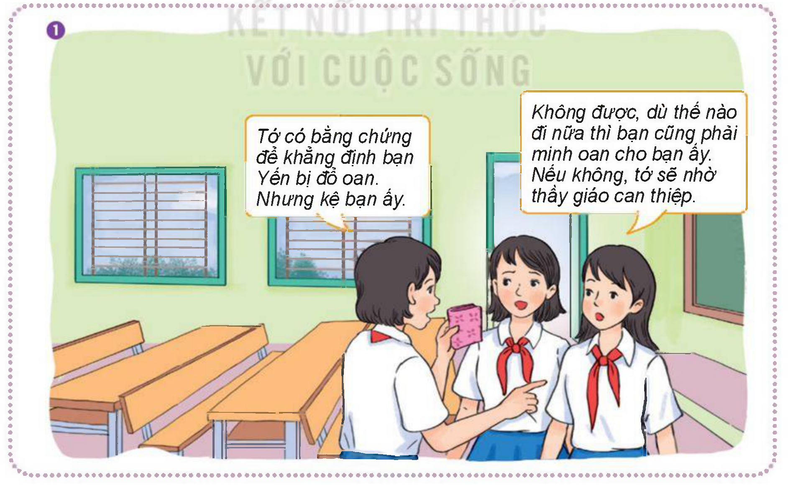
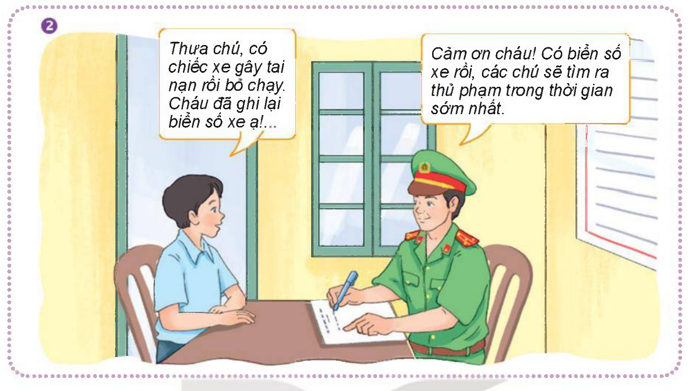
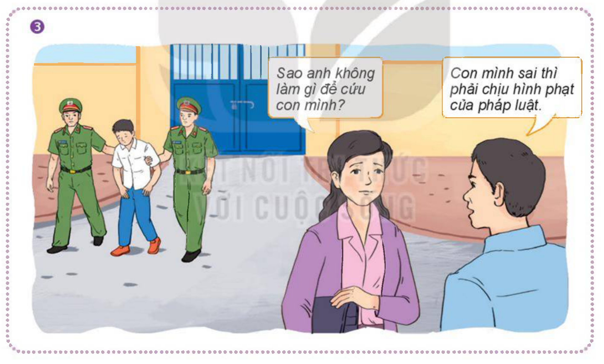

<!-- pdf:22 -->

# BÀI 4: BẢO VỆ LẼ PHẢI

## 🎯 Mục tiêu:

- Giải thích được một cách đơn giản về sự cần thiết phải bảo vệ lẽ phải.
- Thực hiện được việc bảo vệ lẽ phải bằng lời nói và hành động cụ thể, phù hợp với lứa tuổi.
- Khích lệ, động viên bạn bè có thái độ, hành vi bảo vệ lẽ phải, phê phán thái độ, hành vi không bảo vệ lẽ phải.

## 🔴 Mở đầu

Xã hội được thiết lập bởi những mối quan hệ đa dạng, phong phú giữa các cá nhân. Để duy trì trật tự chung, mỗi cộng đồng trong xã hội đều có những quy tắc, chuẩn mực giúp con người điều chỉnh hành vi của mình cho phù hợp với lợi ích của cộng đồng. Những quy tắc, chuẩn mực được cộng đồng thừa nhận là đúng đắn, hợp đạo lí sẽ trở thành lẽ phải.

Em hãy đọc câu ca dao dưới đây và trả lời câu hỏi:

> “Dù cho đất đổi trời thay
> Trăm năm vẫn giữ lòng ngay với đời”
> *(Ca dao)*

> ❓
> – Ý nghĩa của câu ca dao trên là gì?
> – Hãy nêu một số câu ca dao, tục ngữ khác về bảo vệ lẽ phải.

## KHÁM PHÁ

## 1. Sự cần thiết phải bảo vệ lẽ phải

Em hãy đọc câu chuyện dưới đây và trả lời câu hỏi:

> SỰ TRUNG THỰC HAY LÀ TÌNH BẠN
>
> Một lần, chánh án Pe-rin Lao-ri chủ trì phiên toà tại Mi-xi-xi-pi – nơi ông sinh sống thuở ấu thơ. Ông đã kết tội và tuyên án phạt tiền con trai của một goá phụ – người bạn rất thân thiết thời tiểu học của ông.
>
> Khi phiên toà kết thúc, ông nhận được lá thư từ người mẹ. Bà van xin ông hãy vì tình thân thời thơ ấu giữa họ mà tha thứ cho con trai bà. Bà giải thích rằng,

<!-- pdf:23 -->

> hiện tại bà là một goá phụ cùng đàn con với cuộc sống hằng ngày hết sức chật vật. Nếu cộng thêm số tiền phạt đứa con trai biếng nhác và quậy phá thì đó quả là gánh nặng quá lớn đối với bà.
>
> Pe-rin Lao-ri vẫn kí vào tờ giấy buộc thi hành án của toà. Nhưng trong lá thư viết cho người bạn cũ, ông thừa nhận lá thư của bà đã có tác động rất lớn đến ông. Và có lúc ông đã lưỡng lự giữa sự trung thực của bổn phận và tình cảm bạn bè. Nếu tha bổng mà không phạt tiền con trai bà, ông đã vi phạm lời hứa là sẽ nêu cao pháp luật và như vậy công lí sẽ bị tổn thương. Nhưng kèm theo bức thư, ông đã gửi cho bà một tấm séc bằng tiền của mình, đủ để cho bà nộp phạt và thanh toán án phí. Kết thúc bức thư, ông viết: “Tôi rất vui mừng khi gửi cho bạn tấm séc này vì nó cho tôi cơ hội để thể hiện sự công bằng cũng như sự cảm thông của mình”.
> (Theo *Phan Thế Phiệt, Chuyện Đông Tây kim cổ, NXB Văn nghệ Thành phố Hồ Chí Minh, 2004*)

> ❓
> a) Chánh án Pe-rin Lao-ri đã làm gì khi nhận được lá thư của người bạn thời thơ ấu? Việc làm đó của ông có ý nghĩa gì?
> b) Theo em, thế nào là bảo vệ lẽ phải?
> c) Nêu lí do của sự cần thiết phải bảo vệ lẽ phải.

## 2. Những việc cần làm để bảo vệ lẽ phải

Em hãy quan sát các hình ảnh dưới đây và trả lời câu hỏi:

> 1.
> - Tớ có bằng chứng để khẳng định bạn Yến bị đổ oan. Nhưng kệ bạn ấy.
> - Không được, dù thế nào đi nữa thì bạn cũng phải minh oan cho bạn ấy. Nếu không, tớ sẽ nhờ thầy giáo can thiệp.

<!-- pdf:24 -->

> 2.
> - Thưa chú, có chiếc xe gây tai nạn rồi bỏ chạy. Cháu đã ghi lại biển số xe ạ!...
> - Cảm ơn cháu! Có biển số xe rồi, các chú sẽ tìm ra thủ phạm trong thời gian sớm nhất.

> 3.
> - Sao anh không làm gì để cứu con mình?
> - Con mình sai thì phải chịu hình phạt của pháp luật.

> ❓
> a) Hãy chỉ ra những lời nói, việc làm thể hiện bảo vệ lẽ phải trong những bức tranh trên.
> b) Theo em, học sinh cần làm gì để bảo vệ lẽ phải?

<!-- pdf:25 -->

> 1. **Lẽ phải** là những điều đúng đắn, phù hợp với đạo lí và lợi ích chung của xã hội.

> **Bảo vệ lẽ phải** là công nhận, ủng hộ, tuân theo và bảo vệ những điều đúng đắn; biết điều chỉnh suy nghĩ, hành vi của mình theo lẽ phải; không chấp nhận và không làm những việc sai trái.

<!-- term: Ý nghĩa của việc bảo vệ lẽ phải -->
> 2. Việc bảo vệ lẽ phải giúp mỗi người có cách ứng xử phù hợp; góp phần đẩy lùi cái sai, cái xấu, để làm lành mạnh mối quan hệ xã hội, thúc đẩy xã hội ổn định, phát triển; củng cố niềm tin của con người vào cộng đồng, pháp luật và lương tri.

<!-- term: Trách nhiệm của học sinh trong việc bảo vệ lẽ phải -->
> 3. Học sinh cần thực hiện được việc bảo vệ lẽ phải bằng lời nói và hành động cụ thể, phù hợp với lứa tuổi; khích lệ, động viên bạn bè có thái độ, hành vi bảo vệ lẽ phải, phê phán thái độ, hành vi không bảo vệ lẽ phải.

## ✏️ Luyện tập

1. Em đồng tình hay không đồng tình với ý kiến nào dưới đây? Vì sao?

a) Để bảo vệ lẽ phải cần tôn trọng sự thật.

b) Cần kiên quyết bảo vệ những gì phù hợp với lợi ích của cộng đồng.

c) Người bảo vệ lẽ phải luôn phải chịu thiệt thòi.

d) Mỗi người tự bảo vệ lợi ích của mình chính là góp phần vào việc bảo vệ lợi ích của cộng đồng.

e) Trước việc làm sai trái, nếu mình không liên quan thì không cần lên tiếng.

2. Ai biết bảo vệ lẽ phải, ai chưa biết bảo vệ lẽ phải trong những trường hợp dưới đây? Vì sao?

a) Thấy bất kể việc gì có lợi cho mình, anh H cũng phải làm cho bằng được.

b) Trong các cuộc tranh luận, chị M kiên quyết bảo vệ đến cùng ý kiến của mình dù ý kiến đó là đúng hay sai.

c) Trong lớp, bạn B thường lớn tiếng phê bình khuyết điểm của bạn khác nhưng lại che giấu khuyết điểm của mình.

d) Anh S cùng các bạn thu thập chứng cứ và tố cáo một việc làm sai trái.

<!-- pdf:26 -->

3. Em hãy cùng các bạn trong nhóm sắm vai các nhân vật trong câu chuyện dưới đây và trả lời câu hỏi:

> NHƯNG NÓ PHẢI BẰNG HAI MÀY
>
> Làng kia có một tên lí trưởng nổi tiếng xử kiện giỏi. Một hôm, Cải với Ngô đánh nhau, rồi mang nhau ra làng kiện. Cải sợ kém thế, lót trước cho thầy lí năm đồng. Ngô giàu hơn, biện lễ những mười đồng. Khi xử kiện, thầy lí nói: “Thằng Cải đánh thằng Ngô đau hơn, phạt một chục roi”.
>
> Cải vội xoè năm ngón tay, ngẩng mặt nhìn thầy lí khẽ bẩm: “Xin xét lại, lẽ phải về con mà!”. Thầy lí cũng xoè năm ngón tay trái úp lên năm ngón tay phải, nói: “Ta biết mày phải... nhưng nó lại phải... bằng hai mày!”.
> (Nguyễn Văn Hùng tuyển chọn, *Truyện tiếu lâm Việt Nam đặc sắc, NXB Hải Phòng, 2008*)

*– Em có nhận xét gì về việc làm của các nhân vật trong truyện?*

*– Nếu là nhân vật Ngô hoặc Cải, em sẽ làm gì? Vì sao?*

*– Nếu là người xử kiện, em sẽ làm gì? Vì sao?*

4. Em sẽ xử lí như thế nào nếu ở trong các tình huống dưới đây?

a) Khi tranh luận với các bạn, em biết chắc chắn rằng ý kiến của mình là đúng nhưng đa số các bạn khác lại khẳng định là sai.

b) Em nghe thấy một bạn nói xấu bạn khác, trong khi em biết sự thật không phải như vậy.

c) Khi thấy người đàn ông có hành động sàm sỡ với một bé gái, em định lên tiếng thì bị ông ta đe doạ.

d) Bạn thân của em mắc khuyết điểm, bạn muốn em không nói với ai.

5. Em sẽ khuyên bạn điều gì trong những tình huống sau?

a) Người thân trong gia đình bạn em làm điều trái pháp luật.

b) Bạn em viết lên mạng xã hội một điều không đúng sự thật.

c) Bạn em mắc lỗi nhưng lại đổ lỗi cho một bạn khác trong lớp.

## 🚀 Vận dụng

1. “Trong thế giới này, chúng ta không chỉ xót xa vì những hành động và lời nói của người xấu mà còn cả vì sự im lặng đáng sợ của người tốt” (Martin Luther King).

Hãy viết một đoạn văn bình luận về ý kiến trên.

2. Hãy thiết kế một thông điệp về bảo vệ lẽ phải.

## 📷 Danh sách hình trong bài

| Mã hình | Trang PDF | Trang sách | Chú thích |
| --- | --- | --- | --- |
| H8-giao_duc_cong_dan-b04-01 | 23 | 21 | [Tranh 1 mục 2: Học sinh kiên quyết minh oan cho bạn bị đổ oan] |
| H8-giao_duc_cong_dan-b04-02 | 24 | 22 | [Tranh 2 mục 2: Học sinh cung cấp biển số xe gây tai nạn cho cơ quan công an] |
| H8-giao_duc_cong_dan-b04-03 | 24 | 22 | [Tranh 3 mục 2: Cha mẹ tôn trọng pháp luật khi con làm sai] |
