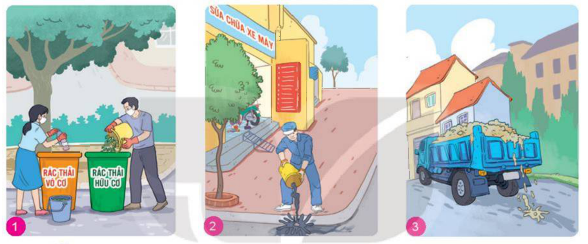
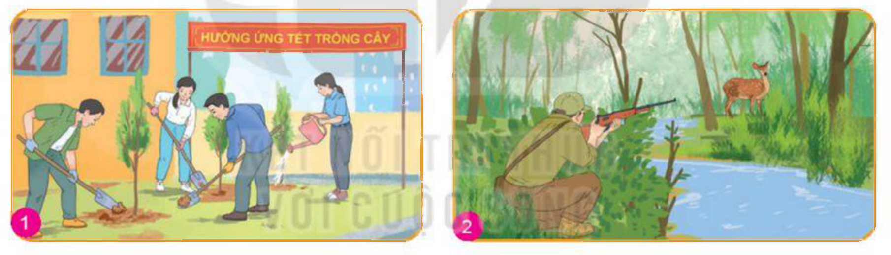
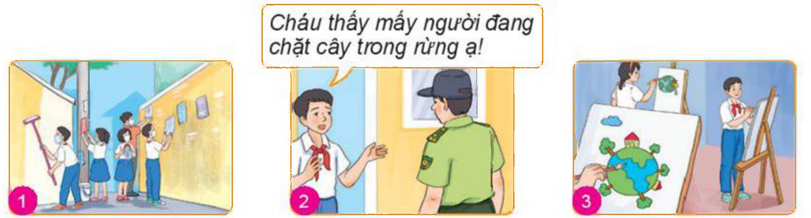

<!-- pdf:27 -->

# BÀI 5: BẢO VỆ MÔI TRƯỜNG VÀ TÀI NGUYÊN THIÊN NHIÊN

## 🎯 Mục tiêu:

- Giải thích được sự cần thiết phải bảo vệ môi trường và tài nguyên thiên nhiên.
- Nêu được một số quy định cơ bản của pháp luật về bảo vệ môi trường, tài nguyên thiên nhiên; một số biện pháp cần thiết để bảo vệ môi trường và tài nguyên thiên nhiên.
- Nêu được trách nhiệm của học sinh trong việc bảo vệ môi trường và tài nguyên thiên nhiên.
- Thực hiện được việc bảo vệ môi trường và tài nguyên thiên nhiên bằng những việc làm phù hợp với lứa tuổi.
- Phê phán, đấu tranh với những hành vi gây ô nhiễm môi trường và phá hoại tài nguyên thiên nhiên.

## 🔴 Mở đầu

Môi trường và tài nguyên thiên nhiên là điều kiện quan trọng, thiết yếu cho sự tồn tại, phát triển của con người và sinh vật. Hiện nay, môi trường nhiều nơi bị ô nhiễm nghiêm trọng, tài nguyên thiên nhiên bị cạn kiệt,... ảnh hưởng trực tiếp tới cuộc sống của con người và sinh vật. Vì vậy, bảo vệ môi trường và tài nguyên thiên nhiên là vấn đề cấp bách trong việc phát triển bền vững của mỗi quốc gia.

> ❓ Em hãy kể một số hoạt động góp phần bảo vệ môi trường và tài nguyên thiên nhiên mà em biết.

## KHÁM PHÁ

## 1. Sự cần thiết phải bảo vệ môi trường và tài nguyên thiên nhiên

### a) Sự cần thiết phải bảo vệ môi trường

Em hãy đọc thông tin dưới đây và trả lời câu hỏi:

<!-- term: Ô nhiễm môi trường -->
> Báo cáo hiện trạng môi trường Quốc gia giai đoạn 2016 – 2020 đã chỉ ra những ảnh hưởng to lớn của ô nhiễm môi trường đối với sức khoẻ con người. Báo cáo Gánh nặng Bệnh tật Toàn cầu (IMHE, 2017) đã chỉ ra các yếu tố nguy cơ gây tử vong và tàn tật tại Việt Nam, trong đó ô nhiễm môi trường không khí đứng thứ 6, tăng 1 bậc so với năm 2007, đứng sau các nguyên nhân như cao huyết áp, đường huyết, hút thuốc và sử dụng rượu bia. Theo cập nhật mới nhất năm 2019, ô nhiễm không khí đã tăng thêm 1 bậc lên thứ 5 trong bảng xếp hạng về nguy cơ gây tử vong và bệnh tật tại Việt Nam (IMHE, 2019).

<!-- pdf:28 -->

<!-- term: Ô nhiễm môi trường -->
> Ô nhiễm không khí, đặc biệt là ô nhiễm bụi mịn, đang trở thành vấn đề của các quốc gia đang phát triển như Việt Nam. Việc phơi nhiễm với hàm lượng bụi cao trong không khí, đặc biệt là bụi mịn, làm tăng nguy cơ mắc các bệnh như nhiễm khuẩn cấp tính đường hô hấp dưới, đột quỵ, đau tim, bệnh tắc nghẽn phổi mãn tính và ung thư phổi.
> Khí thải từ hoạt động giao thông và hoạt động công nghiệp chứa nhiều thành phần độc hại như CO, NO₂... có thể gây ung thư hoặc gây kích thích, một số chất độc khác còn có thể ngấm vào máu, gây ảnh hưởng nghiêm trọng tới sức khoẻ con người.
> Ảnh hưởng của ô nhiễm nguồn nước đối với sức khoẻ con người thông qua uống nước bị ô nhiễm hay ăn các loại rau quả, thuỷ hải sản được nuôi trồng trong nước bị ô nhiễm,... gây nên một số bệnh như: các bệnh về đường tiêu hoá, bệnh giun sán, các bệnh do muỗi truyền, các bệnh về mắt, ngoài da,...
> Ô nhiễm đất không chỉ ảnh hưởng đến sản xuất nông nghiệp và chất lượng nông sản mà còn ảnh hưởng tới sức khoẻ con người và động vật thông qua chuỗi thức ăn.
> Vì vậy, để bảo vệ sức khoẻ của chúng ta và thế hệ tương lai, mỗi người cần có ý thức bảo vệ môi trường bằng những hành động cụ thể.
> (Theo *Bộ Tài nguyên và Môi trường, Báo cáo Hiện trạng môi trường quốc gia giai đoạn 2016 – 2020, NXB Dân trí, 2021*)

> ❓
> a) Môi trường bị ô nhiễm đã ảnh hưởng tới động, thực vật và con người như thế nào? Em hãy lấy thêm ví dụ minh chứng cho việc ảnh hưởng của ô nhiễm môi trường tới đời sống và sản xuất của con người.
> b) Theo em, việc bảo vệ môi trường cần thiết như thế nào đối với cuộc sống của người dân và mỗi quốc gia?

### b) Sự cần thiết phải bảo vệ tài nguyên thiên nhiên

Em hãy đọc thông tin dưới đây và trả lời câu hỏi:

> Theo Tổ chức Nông Lương Liên hợp quốc (FAO), rừng có 5 vai trò chính gồm nuôi dưỡng đất, lưu trữ các-bon, cung cấp thực phẩm lành mạnh cho hàng triệu người, điều tiết nước và là nhà của khoảng 80% các giống loài sống trên cạn. Quản lí rừng bền vững kết hợp sử dụng hợp lí các nguồn tài nguyên từ rừng là cách tốt nhất chống lại sự biến đổi khí hậu và đóng góp vào sự thịnh vượng, hạnh phúc của các thế hệ hiện tại và tương lai. Ở Việt Nam, chất lượng rừng tự nhiên vẫn chưa cao, rừng phòng hộ chưa phát huy đầy đủ

<!-- pdf:29 -->

> chức năng, tỉ lệ cây xanh/người dân đô thị và nhiều khu vực nông thôn vẫn còn thấp, tại các đô thị lớn của Việt Nam tỉ lệ cây xanh/người ở mức từ 2 – 3 m²/người, bằng 1/5 đến 1/10 so với thế giới. Việc phục hồi và quản lí rừng bền vững không chỉ giúp giải quyết các vấn đề liên quan đến biến đổi khí hậu và đa dạng sinh học, mà còn mang đến tiềm năng sản xuất hàng hoá và dịch vụ để phát triển bền vững, thúc đẩy hoạt động kinh tế, tạo việc làm và cải thiện cuộc sống. Về sử dụng đất, thay đổi sử dụng đất và lâm nghiệp dự kiến đóng góp việc giảm nhẹ phát thải khí nhà kính từ 9,3 – 21,2 triệu tấn CO₂ thông qua các giải pháp: bảo vệ, bảo tồn và sử dụng bền vững rừng và đất lâm nghiệp; trồng rừng, phát triển rừng; khoanh nuôi phục hồi rừng tự nhiên;...
> (Theo *Tổng cục Thống kê, “Khôi phục rừng: con đường dẫn tới khôi phục kinh tế và hạnh phúc”, ngày 5 – 5 – 2021*)

> ❓
> a) Em hãy cho biết tài nguyên rừng có vai trò như thế nào đối với cuộc sống của con người.
> b) Theo em, việc bảo vệ và khai thác hợp lí tài nguyên thiên nhiên có ý nghĩa như thế nào đối với cuộc sống của người dân và sự phát triển của mỗi quốc gia?

## 2. Quy định cơ bản của pháp luật về bảo vệ môi trường, tài nguyên thiên nhiên

### a) Quy định cơ bản của pháp luật về bảo vệ môi trường

Em hãy đọc thông tin kết hợp quan sát các hình ảnh dưới đây để trả lời câu hỏi:

> 1/ Hiến pháp năm 2013
> Điều 63 *(trích)*
> 1. Nhà nước có chính sách bảo vệ môi trường; quản lí, sử dụng hiệu quả, bền vững các nguồn tài nguyên thiên nhiên; bảo tồn thiên nhiên, đa dạng sinh học; chủ động phòng, chống thiên tai, ứng phó với biến đổi khí hậu.

<!-- term: Luật Bảo vệ môi trường năm 2020 -->
> 2/ Luật Bảo vệ môi trường năm 2020
> Điều 4. Nguyên tắc bảo vệ môi trường *(trích)*
> 1. Bảo vệ môi trường là quyền, nghĩa vụ và trách nhiệm của mọi cơ quan, tổ chức, cộng đồng dân cư, hộ gia đình và cá nhân.
> Điều 6. Các hành vi bị nghiêm cấm trong hoạt động bảo vệ môi trường *(trích)*
> 1. Vận chuyển, chôn, lấp, đổ, thải, đốt chất thải rắn, chất thải nguy hại không đúng quy trình kĩ thuật, quy định của pháp luật về bảo vệ môi trường.

<!-- pdf:30 -->

<!-- term: Luật Bảo vệ môi trường năm 2020 -->
> 2. Xả nước thải, xả khí thải chưa được xử lí đạt quy chuẩn kĩ thuật môi trường ra môi trường.
> 3. Phát tán, thải ra môi trường chất độc hại, vi rút độc hại có khả năng lây nhiễm cho con người, động vật, vi sinh vật chưa được kiểm định, xác súc vật chết do dịch bệnh và tác nhân độc hại khác đối với sức khoẻ con người, sinh vật và tự nhiên.
> 9. Che giấu hành vi gây ô nhiễm môi trường, cản trở, làm sai lệch thông tin, gian dối trong hoạt động bảo vệ môi trường dẫn đến hậu quả xấu đối với môi trường.
> 12. Phá hoại, xâm chiếm trái phép di sản thiên nhiên.

> ❓
> a) Căn cứ vào các quy định của pháp luật, em hãy cho biết trong các bức tranh trên, chủ thể nào thực hiện đúng, chủ thể nào vi phạm các quy định của pháp luật về bảo vệ môi trường. Vì sao?
> b) Hãy kể thêm một số quy định của pháp luật về bảo vệ môi trường mà em biết.

### b) Quy định cơ bản của pháp luật về bảo vệ tài nguyên thiên nhiên

Em hãy đọc các thông tin, trường hợp dưới đây và trả lời câu hỏi:

> 1.
> 1/ Luật Lâm nghiệp năm 2017
> Điều 9. Các hành vi bị nghiêm cấm trong hoạt động lâm nghiệp *(trích)*
> 1. Chặt, phá, khai thác, lấn, chiếm rừng trái quy định của pháp luật.
> 2. Đưa chất thải, hoá chất độc, chất nổ, chất cháy, chất dễ cháy, công cụ, phương tiện vào rừng trái quy định của pháp luật; chăn, dắt, thả gia súc, vật nuôi vào phân khu bảo vệ nghiêm ngặt của rừng đặc dụng, rừng mới trồng.

<!-- pdf:31 -->

> 3. Săn, bắt, nuôi, nhốt, giết, tàng trữ, vận chuyển, buôn bán động vật rừng, thu thập mẫu vật các loài thực vật rừng, động vật rừng trái quy định của pháp luật.
> 4. Huỷ hoại tài nguyên rừng, hệ sinh thái rừng, công trình bảo vệ và phát triển rừng.
> 7. Khai thác tài nguyên thiên nhiên, tài nguyên khoáng sản, môi trường rừng trái quy định của pháp luật; xây dựng, đào, bới, đắp đập, ngăn dòng chảy tự nhiên và các hoạt động khác trái quy định của pháp luật làm thay đổi cấu trúc cảnh quan tự nhiên của hệ sinh thái rừng.
>
> 2/ Luật Khoáng sản năm 2010, sửa đổi, bổ sung năm 2018
> Điều 4. Nguyên tắc hoạt động khoáng sản *(trích)*
> 1. Hoạt động khoáng sản phải phù hợp với chiến lược, quy hoạch khoáng sản, phương án bảo vệ, thăm dò, khai thác và sử dụng khoáng sản trong quy hoạch tỉnh, gắn với bảo vệ môi trường, cảnh quan thiên nhiên, di tích lịch sử – văn hoá, danh lam thắng cảnh và các tài nguyên thiên nhiên khác; bảo đảm quốc phòng, an ninh, trật tự, an toàn xã hội.
> 2. Chỉ được tiến hành hoạt động khoáng sản khi được cơ quan quản lí nhà nước có thẩm quyền cho phép.
>
> 3/ Luật Thuỷ sản năm 2017
> Điều 5. Nguyên tắc hoạt động thuỷ sản *(trích)*
> 2. Khai thác nguồn lợi thuỷ sản phải căn cứ vào trữ lượng nguồn lợi thuỷ sản, gắn với bảo vệ, tái tạo và phát triển nguồn lợi thuỷ sản, không làm cạn kiệt nguồn lợi thuỷ sản, không ảnh hưởng đến đa dạng sinh học;
> Điều 7. Các hành vi bị nghiêm cấm trong hoạt động thuỷ sản
> 1. Huỷ hoại nguồn lợi thuỷ sản, hệ sinh thái thuỷ sinh, khu vực tập trung sinh sản, khu vực thuỷ sản còn non tập trung sinh sống, nơi cư trú của các loài thuỷ sản.
> 3. Lấn, chiếm, gây hại khu bảo vệ nguồn lợi thuỷ sản, khu bảo tồn biển.
> 4. Khai thác, nuôi trồng thuỷ sản, xây dựng công trình và hoạt động khác ảnh hưởng đến môi trường sống, nguồn lợi thuỷ sản trong phân khu bảo vệ nghiêm ngặt và phân khu phục hồi sinh thái của khu bảo tồn biển.
>
> 4/ Luật Tài nguyên nước năm 2012, sửa đổi, bổ sung năm 2018
> Điều 9. Các hành vi bị nghiêm cấm
> 1. Đổ chất thải, rác thải, đổ hoặc làm rò rỉ các chất độc hại vào nguồn nước và các hành vi khác gây ô nhiễm, suy thoái, cạn kiệt nguồn nước.
> 2. Xả nước thải, đưa các chất thải vào vùng bảo hộ vệ sinh khu vực lấy nước sinh hoạt; xả nước thải chưa qua xử lí hoặc xử lí chưa đạt tiêu chuẩn, quy chuẩn kĩ thuật vào nguồn nước.

<!-- pdf:32 -->

> 3. Xả khí thải độc hại trực tiếp vào nguồn nước; xả nước thải vào lòng đất thông qua các giếng khoan, giếng đào và các hình thức khác nhằm đưa nước thải vào trong lòng đất; gian lận trong việc xả nước thải.
> 4. Đặt vật cản, chướng ngại vật, xây dựng công trình kiến trúc, trồng cây trái phép gây cản trở thoát lũ, lưu thông nước ở các sông, suối, hồ, kênh, rạch.
> 5. Khai thác trái phép cát, sỏi trên sông, suối, kênh, rạch, hồ chứa; khai thác khoáng sản, khoan, đào, xây dựng nhà cửa, vật kiến trúc, công trình và các hoạt động khác trong hành lang bảo vệ nguồn nước gây sạt, lở bờ sông, suối, kênh, rạch, hồ chứa hoặc gây ảnh hưởng nghiêm trọng, uy hiếp đến sự ổn định, an toàn của sông, suối, kênh, rạch, hồ chứa.

> 2. Từ khi công ty T về khu vực làng chài X khai thác cát trái phép, môi trường nơi đây bị ảnh hưởng nghiêm trọng, cuộc sống của người dân gặp nhiều khó khăn. Tài nguyên cát nơi đây ngày một cạn kiệt; sông bị lệch dòng chảy, xói mòn, sạt lở, gây sụt lún, diện tích canh tác và nuôi trồng thuỷ sản bị thu hẹp. Đêm đêm, tiếng ồn lớn từ máy khai thác cát khiến nhiều người bị mất ngủ,... Trước thực trạng đó, Hải và một số người dân trong làng chài đã tố cáo hành vi của Công ty T. Chính quyền đã xử lí sai phạm của Công ty T theo đúng quy định của pháp luật.

> ❓
> a) Dựa vào thông tin 1, em hãy cho biết các chủ thể ở trường hợp 2 và hai bức tranh đã thực hiện đúng hay chưa đúng các quy định của pháp luật về bảo vệ tài nguyên thiên nhiên. Vì sao?
> b) Hãy kể thêm một số quy định của pháp luật về bảo vệ tài nguyên thiên nhiên mà em biết.

## 3. Một số biện pháp bảo vệ môi trường và tài nguyên thiên nhiên

Em hãy đọc các thông tin dưới đây và trả lời câu hỏi:

> 1. Ngày 1 – 4 – 2021, Thủ tướng Chính phủ đã phê duyệt đề án trồng 1 tỉ cây xanh giai đoạn 2021 – 2025 với mục tiêu đến hết năm 2025, cả nước trồng được 1 tỉ cây xanh, trong đó 690 triệu cây trồng phân tán ở các khu đô thị

<!-- pdf:33 -->

> và vùng nông thôn, 310 triệu cây trồng tập trung trong rừng phòng hộ, rừng đặc dụng và trồng mới rừng sản xuất, nhằm góp phần bảo vệ môi trường sinh thái, cải thiện cảnh quan và ứng phó với biến đổi khí hậu, phát triển kinh tế xã hội, nâng cao chất lượng cuộc sống người dân và sự phát triển bền vững của đất nước.
> (Trích *Quyết định số 524/QĐ/TTg ngày 1 – 4 – 2021 của Thủ tướng Chính phủ*)

<!-- term: Nông nghiệp hữu cơ -->
> 2. Nông nghiệp hữu cơ khai thác tổng hợp tất cả các yếu tố tự nhiên sẵn có như: độ phì của đất; sử dụng nguồn gen, giống cây trồng bản địa thích nghi, khai thác hợp lí nguồn nước, thời vụ và các nguồn phân hữu cơ. Việc ứng dụng tốt nông nghiệp hữu cơ chính là giải quyết rốt ráo, cơ bản nhất trong hạn chế tối đa các hoá chất gây độc hại cho cây trồng và môi trường sống như phân hoá học, thuốc trừ sâu, thuốc diệt cỏ, thuốc kích thích tăng trưởng, tăng trọng, hoá chất bảo quản...
> (Theo *Nông nghiệp hữu cơ nền tảng cho môi trường bền vững, Hải Thư, báo Nhân dân ngày 25 – 4 – 2016*)

> ❓
> a) Các biện pháp nêu ở thông tin trên có tác dụng bảo vệ môi trường và tài nguyên thiên nhiên như thế nào?
> b) Hãy kể thêm một số biện pháp khác để bảo vệ môi trường và tài nguyên thiên nhiên.
> c) Địa phương em đã có những việc làm nào để bảo vệ môi trường và tài nguyên thiên nhiên?

## 4. Trách nhiệm của học sinh trong việc bảo vệ môi trường và tài nguyên thiên nhiên

Em hãy đọc các quy định của pháp luật ở mục 2 kết hợp với quan sát các bức tranh dưới đây và trả lời câu hỏi:

> Cháu thấy mấy người đang chặt cây trong rừng ạ!

> ❓
> a) Các bạn trong tranh đã làm gì để bảo vệ môi trường và tài nguyên thiên nhiên?
> b) Em đã có những hành động và việc làm nào để bảo vệ môi trường và tài nguyên thiên nhiên?

<!-- pdf:34 -->

> 1. Môi trường và tài nguyên thiên nhiên có tầm quan trọng đặc biệt đối với đời sống của con người, là cơ sở để phát triển kinh tế, văn hoá, xã hội, tạo cho con người phương tiện sinh sống, phát triển trí tuệ, đạo đức, tinh thần.

<!-- term: Vai trò của bảo vệ môi trường và tài nguyên thiên nhiên -->
> 2. Bảo vệ môi trường sẽ giúp cho môi trường trong lành, sạch đẹp, bảo đảm cân bằng sinh thái; ngăn chặn, khắc phục các hậu quả xấu do con người và thiên nhiên gây ra. Bảo vệ tài nguyên thiên nhiên sẽ giúp cho nguồn tài nguyên thiên nhiên không bị cạn kiệt.

> 3. Bảo vệ môi trường và tài nguyên thiên nhiên là quyền, nghĩa vụ và trách nhiệm của mọi cơ quan, tổ chức, cộng đồng dân cư, hộ gia đình và cá nhân. Nhà nước có chính sách bảo vệ môi trường; quản lí, sử dụng hiệu quả, bền vững các nguồn tài nguyên thiên nhiên; bảo tồn thiên nhiên, đa dạng sinh học; chủ động phòng, chống thiên tai, ứng phó với biến đổi khí hậu;...

<!-- term: Quy định của pháp luật về bảo vệ môi trường và tài nguyên thiên nhiên -->
> 4. Pháp luật Việt Nam quy định:
> – Nghiêm cấm các hoạt động chặt, phá, lấn chiếm, đốt rừng; đưa chất cháy nổ, săn bắn, nuôi nhốt, giết, tàng trữ, buôn bán động vật rừng trái quy định; khai thác tài nguyên thiên nhiên trái quy định của pháp luật.
> – Chỉ được tiến hành hoạt động khoáng sản khi được cơ quan quản lí nhà nước có thẩm quyền cho phép.
> – Nghiêm cấm huỷ hoại nguồn lợi thuỷ sản, nơi cư trú của các loài thuỷ sản; khai thác, nuôi trồng thuỷ sản ảnh hưởng đến môi trường sống.
> – Nghiêm cấm đổ chất thải, chất độc hại làm ô nhiễm, suy thoái, cạn kiệt nguồn nước; xả thải khí độc hại trực tiếp vào nguồn nước, vào lòng đất; khai thác trái phép khoáng sản, cát, sỏi trên sông, suối, kênh rạch, gây sạt lở, biến dạng dòng chảy;...

<!-- term: Biện pháp bảo vệ môi trường và tài nguyên thiên nhiên -->
> 5. Để thực hiện hiệu quả các mục tiêu bảo vệ môi trường, tài nguyên thiên nhiên cần thực hiện đồng bộ các giải pháp bảo vệ môi trường, giảm thiểu và kiểm soát ô nhiễm môi trường tiến tới phục hồi môi trường các khu vực đã bị ô nhiễm như:
> – Chấp hành các quy định pháp luật về bảo vệ tài nguyên, môi trường.
> – Tích cực tham gia vào các phong trào, hoạt động bảo vệ môi trường tại địa phương.

<!-- pdf:35 -->

<!-- term: Biện pháp bảo vệ môi trường và tài nguyên thiên nhiên -->
> – Thường xuyên tổ chức tuyên truyền nâng cao nhận thức bảo vệ môi trường cho người dân, cộng đồng, doanh nghiệp, thực hiện tăng trưởng xanh, phát triển kinh tế ít chất thải, kinh tế tuần hoàn, trồng rừng,...
> – Nghiêm cấm mọi hoạt động làm suy kiệt nguồn tài nguyên, huỷ hoại môi trường.
> – Phê phán, đấu tranh với các hành vi gây ô nhiễm môi trường và phá hoại tài nguyên thiên nhiên.

## ✏️ Luyện tập

1. Em đồng tình hay không đồng tình với ý kiến nào dưới đây? Vì sao?

a) Muốn phát triển kinh tế thì phải chấp nhận môi trường bị ô nhiễm.

b) Sử dụng túi vải, giấy, một số loại lá,... để gói, đựng sản phẩm thay cho túi ni-lông là góp phần bảo vệ môi trường.

c) Để bảo vệ cây trồng thì phải phun thuốc trừ sâu hoá học diệt trừ hết các loại côn trùng.

d) Giáo dục, tuyên truyền, xây dựng ý thức trách nhiệm về bảo vệ môi trường chỉ là nhiệm vụ riêng của cán bộ quản lí môi trường.

2. Hành vi nào dưới đây thực hiện đúng, hành vi nào vi phạm pháp luật về bảo vệ tài nguyên thiên nhiên? Vì sao?

a) Săn, bắn, bẫy, bắt động vật quý hiếm để bán.

b) Khai thác rừng trồng theo quy hoạch của Nhà nước.

c) Dùng mìn, điện để đánh bắt cá.

d) Tố cáo hành vi khai thác khoáng sản trái phép.

e) Phá rừng nguyên sinh để trồng cà phê.

g) Sử dụng tiết kiệm điện, nước.

<!-- pdf:36 -->

3. Em hãy đọc tình huống dưới đây và trả lời câu hỏi:

a) Trên đường đi học về, H và Đ phát hiện một chiếc ô tô đang đổ phế thải xuống bờ mương thoát nước của xóm mình. H rủ Đ đi báo công an xã nhưng Đ từ chối vì cho rằng đó không phải là việc của mình.

*– Em hãy nhận xét về hành vi của các nhân vật trong tình huống trên.*

*– Nếu là H, em sẽ làm gì?*

b) Hưởng ứng Ngày Môi trường thế giới (ngày 5 – 6), Uỷ ban nhân dân xã T đã phát động cuộc thi “Sáng kiến tiết kiệm tài nguyên thiên nhiên”. Mỗi xóm sẽ chọn một sáng kiến xuất sắc để tham gia dự thi.

*Nếu là người dân trong xã T, em và gia đình sẽ đề xuất sáng kiến tiết kiệm tài nguyên nào? Vì sao?*

4. Em hãy đưa ra lời khuyên cho mỗi nhân vật trong các tình huống dưới đây:

a) Được huyện giao cho quản lí, chăm sóc khu rừng phòng hộ đầu nguồn nhưng do điều kiện khó khăn, bác B có ý định chặt một số cây gỗ quý bán lấy tiền để đóng học phí cho các con và sẽ trồng bổ sung cây con mới.

b) Thấy mọi người trong xóm vào núi đào vàng, Y hẹn V sáng hôm sau cùng tham gia.

5. Hãy kể những việc em đã làm để góp phần bảo vệ môi trường và tài nguyên thiên nhiên.

## 🚀 Vận dụng

1. Em hãy cùng bạn tham gia cuộc thi hùng biện về chủ đề: Bảo vệ môi trường và tài nguyên thiên nhiên.

2. Em hãy cùng các bạn thực hiện một dự án bảo vệ môi trường hoặc tài nguyên thiên nhiên ở nơi em sinh sống.

## 📷 Danh sách hình trong bài

| Mã hình | Trang PDF | Trang sách | Chú thích |
| --- | --- | --- | --- |
| H8-giao_duc_cong_dan-b05-01 | 30 | 28 | [Tranh 1, 2, 3 mục 2.a: Phân loại rác thải và các hành vi xả thải gây ô nhiễm môi trường] |
| H8-giao_duc_cong_dan-b05-02 | 32 | 30 | [Tranh 1, 2 mục 2.b: Hưởng ứng Tết trồng cây và hành vi săn bắn động vật rừng trái phép] |
| H8-giao_duc_cong_dan-b05-03 | 33 | 31 | [Tranh 1, 2, 3 mục 4: Các việc làm của học sinh bảo vệ môi trường và tài nguyên thiên nhiên] |
