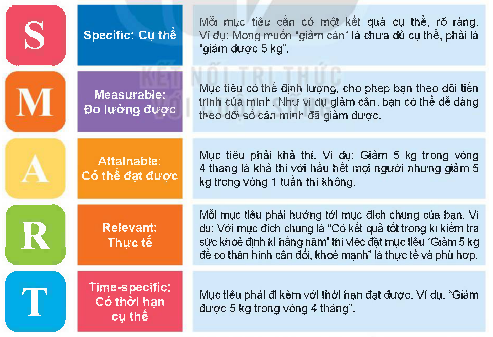
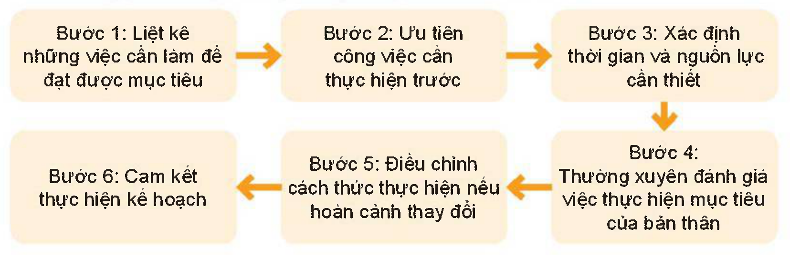
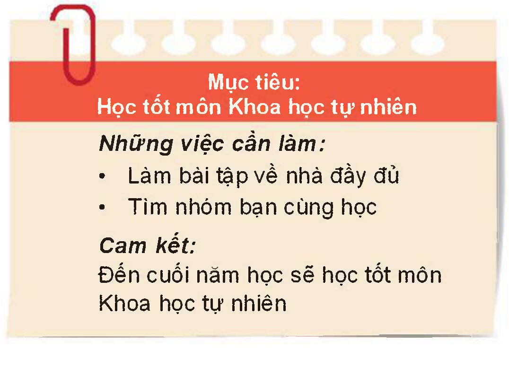

<!-- pdf:37 -->

# BÀI 6: XÁC ĐỊNH MỤC TIÊU CÁ NHÂN

## 🎯 Mục tiêu:

- Nhận biết được thế nào là mục tiêu cá nhân; các loại mục tiêu cá nhân.
- Hiểu vì sao phải xác định mục tiêu cá nhân.
- Nêu được cách xác định mục tiêu và lập kế hoạch thực hiện mục tiêu cá nhân.
- Xây dựng được mục tiêu cá nhân của bản thân và kế hoạch hành động nhằm đạt mục tiêu đó.

## 🔴 Mở đầu

Mục tiêu giống như chiếc la bàn định hướng cho cuộc sống. Khi nghĩ về những gì mình muốn đạt được và đặt mục tiêu hướng tới, ta sẽ trở nên tự chủ và tích cực hơn. Vì vậy, xác định mục tiêu cá nhân là một việc làm cần thiết để sống có mục đích, làm việc có kế hoạch, từ đó có khả năng thực hiện được ước mơ, đạt được thành công trong cuộc sống.

> ❓ Trong quá khứ, em đã từng đặt ra mục tiêu gì? Em đã làm gì để đạt được mục tiêu đó?

## KHÁM PHÁ

## 1. Khái niệm mục tiêu cá nhân và các loại mục tiêu cá nhân

Em hãy quan sát các bức tranh dưới đây và trả lời câu hỏi:

> - Năm lớp 9, mình sẽ tham gia đội tuyển bóng đá của trường.
> - Mỗi ngày, mình sẽ dành ít nhất 30 phút làm việc nhà giúp bố mẹ.

<!-- pdf:38 -->

> - Cuối năm, mình sẽ tiết kiệm được 500.000 đồng.
> - Hằng tháng, mình sẽ tham gia ít nhất một hoạt động tình nguyện.
> - Một tháng nữa, mình sẽ chinh phục giải ma-ra-tông 15 km.
> - Học hết trung học cơ sở, nhất định mình sẽ thuyết trình được bằng tiếng Anh.

> ❓
> a) Em hãy cho biết các bạn trong mỗi bức tranh có mong muốn gì. Các bạn có xác định khoảng thời gian để thực hiện mong muốn đó không? Từ đó, em hãy cho biết thế nào là mục tiêu cá nhân.
> b) Em hãy phân loại các mục tiêu nói trên theo thời gian (ngắn hạn, dài hạn) và theo lĩnh vực:
> – Phát triển bản thân;
> – Gia đình và bạn bè;
> – Tài chính cá nhân;
> – Sức khoẻ;
> – Học tập và nghề nghiệp;
> – Trao tặng và cống hiến xã hội.

## 2. Sự cần thiết phải xác định mục tiêu cá nhân

Em hãy đọc các trường hợp dưới đây và trả lời câu hỏi:

> 1. Bạn Hùng chưa biết bơi nên mỗi khi đi biển cùng gia đình hay bạn bè, Hùng đều rụt rè và ngại xuống nước. Bạn rất muốn biết bơi nhưng vẫn chưa làm được. Hè năm nay, Hùng đặt mục tiêu sẽ học bơi để biết bơi. Hùng xin bố đăng kí cho một lớp học bơi và còn rủ thêm một người bạn học cùng để nhắc nhở và hỗ trợ nhau tập luyện. Sau ba tháng hè, Hùng đã biết bơi và thấy tự tin hơn mỗi khi đi biển.

<!-- pdf:39 -->

> 2. Năm học trước, bạn Bình không có mục tiêu gì cụ thể, cũng không chú tâm học tập. Kết thúc năm học, Bình chỉ có kết quả học tập ở mức Đạt. Năm nay, Bình quyết tâm thay đổi. Ngay từ đầu năm học, bạn đã đặt mục tiêu rõ ràng là sẽ tập trung học tập để đạt kết quả loại Tốt. Để thực hiện mục tiêu đó, trên lớp Bình tập trung nghe giảng, tích cực phát biểu, lập nhóm học tập cùng các bạn, ở nhà bạn tự giác làm hết các bài tập trong sách, đọc thêm nhiều loại sách tham khảo,... Nhờ có mục tiêu rõ ràng và quyết tâm thực hiện, đến cuối năm học, tổng kết các môn học của Bình đạt loại Tốt.

> ❓
> a) Em hãy cho biết việc có một mục tiêu rõ ràng đã mang lại kết quả như thế nào cho các bạn trong trường hợp trên?
> b) Theo em, vì sao phải xác định mục tiêu cá nhân?

## 3. Cách xác định mục tiêu cá nhân và lập kế hoạch thực hiện mục tiêu cá nhân

**• Cách xác định mục tiêu cá nhân**

<!-- term: Nguyên tắc S.M.A.R.T -->
> - **S – Specific:** Cụ thể. Mỗi mục tiêu cần có một kết quả cụ thể, rõ ràng. Ví dụ: Mong muốn “giảm cân” là chưa đủ cụ thể, phải là “giảm được 5 kg”.
> - **M – Measurable:** Đo lường được. Mục tiêu có thể định lượng, cho phép bạn theo dõi tiến trình của mình. Như ví dụ giảm cân, bạn có thể dễ dàng theo dõi số cân mình đã giảm được.
> - **A – Attainable:** Có thể đạt được. Mục tiêu phải khả thi. Ví dụ: Giảm 5 kg trong vòng 4 tháng là khả thi với hầu hết mọi người nhưng giảm 5 kg trong vòng 1 tuần thì không.
> - **R – Relevant:** Thực tế. Mỗi mục tiêu phải hướng tới mục đích chung của bạn. Ví dụ: Với mục đích chung là “Có kết quả tốt trong kì kiểm tra sức khoẻ định kì hằng năm” thì việc đặt mục tiêu “Giảm 5 kg để có thân hình cân đối, khoẻ mạnh” là thực tế và phù hợp.
> - **T – Time-specific:** Có thời hạn cụ thể. Mục tiêu phải đi kèm với thời hạn đạt được. Ví dụ: “Giảm được 5 kg trong vòng 4 tháng”.
> (Theo *Damon Zahariades, Minh Trang dịch, Thiết lập mục tiêu cuộc đời, NXB Phụ nữ Việt Nam, 2020*)

<!-- pdf:40 -->

**• Các bước lập kế hoạch thực hiện mục tiêu cá nhân**

> - Bước 1: Liệt kê những việc cần làm để đạt được mục tiêu.
> - Bước 2: Ưu tiên công việc cần thực hiện trước.
> - Bước 3: Xác định thời gian và nguồn lực cần thiết.
> - Bước 4: Thường xuyên đánh giá việc thực hiện mục tiêu của bản thân.
> - Bước 5: Điều chỉnh cách thức thực hiện nếu hoàn cảnh thay đổi.
> - Bước 6: Cam kết thực hiện kế hoạch.

> ❓
> a) Em hãy viết lại những mục tiêu dưới đây theo nguyên tắc S.M.A.R.T:
> – Biết trượt pa-tanh
> – Tự tin thuyết trình trước tập thể lớp
> – Khám phá các di sản của địa phương nơi em sinh sống.
> b) Em hãy lập kế hoạch thực hiện các mục tiêu vừa xác định theo 6 bước nêu trên và cho biết cần chú ý những điều gì khi xây dựng kế hoạch đó.

> 1. **Mục tiêu cá nhân** là những kết quả cụ thể mà mỗi người mong muốn đạt được trong một khoảng thời gian nhất định.

<!-- term: Phân loại mục tiêu cá nhân -->
> 2. Phân loại mục tiêu cá nhân:
> – Mục tiêu cá nhân có thể được phân loại theo lĩnh vực: phát triển bản thân, gia đình, bạn bè, sức khoẻ, học tập, tài chính, cống hiến xã hội,...
> – Mục tiêu cá nhân có thể được phân loại theo thời gian: mục tiêu ngắn hạn và mục tiêu dài hạn.

> 3. Việc xác định mục tiêu cá nhân sẽ giúp mỗi người có động lực hơn trong cuộc sống, hoàn thiện bản thân, hướng đến những mục đích cao đẹp và thực hiện được những ước mơ của mình.

<!-- term: Nguyên tắc S.M.A.R.T -->
> 4. Cách xác định mục tiêu cá nhân:
> Một mục tiêu cá nhân cần phải cụ thể, đo lường được, có thể đạt được, có liên quan và có thời hạn xác định.

<!-- pdf:41 -->

<!-- term: Kế hoạch thực hiện mục tiêu cá nhân -->
> 5. Các bước lập kế hoạch thực hiện mục tiêu cá nhân:
> 1/ Liệt kê những việc cần làm để đạt được mục tiêu.
> 2/ Ưu tiên công việc cần thực hiện trước.
> 3/ Xác định thời gian và nguồn lực cần thiết.
> 4/ Thường xuyên đánh giá việc thực hiện mục tiêu của bản thân.
> 5/ Điều chỉnh cách thức thực hiện nếu hoàn cảnh thay đổi.
> 6/ Cam kết thực hiện kế hoạch.

## ✏️ Luyện tập

1. Em hãy phân loại các mục tiêu cá nhân dưới đây theo các lĩnh vực và theo thời gian.

a) Bạn T đặt mục tiêu năm 18 tuổi sẽ chinh phục đỉnh Phan-xi-păng, đỉnh núi cao nhất Việt Nam.

b) Anh K quyết tâm mỗi sáng sẽ dậy sớm chạy ba vòng quanh khu chung cư.

c) Chị M đặt mục tiêu trong tháng này sẽ đọc xong cuốn sách về kĩ năng làm việc nhóm và giải quyết vấn đề.

d) Bạn G đặt mục tiêu năm 24 tuổi sẽ trở thành nhà văn viết truyện cho thiếu nhi.

e) Mùa đông này, anh S sẽ quyên góp hai thùng quần áo ấm cho trẻ em nghèo.

2. Em hãy nhận xét mục tiêu và kế hoạch hành động của các bạn dưới đây và đưa ra góp ý để giúp bạn hoàn thiện:

a) Bạn K đặt mục tiêu cá nhân là có sức khoẻ tốt. Kế hoạch hành động của K là sẽ ăn đúng bữa và ăn nhiều rau xanh.

b) Bạn B lập mục tiêu và kế hoạch hành động như sau:

> **Mục tiêu:** Học tốt môn Khoa học tự nhiên
> **Những việc cần làm:**
> - Làm bài tập về nhà đầy đủ
> - Tìm nhóm bạn cùng học
> **Cam kết:** Đến cuối năm học sẽ học tốt môn Khoa học tự nhiên

<!-- pdf:42 -->

3. Đọc trường hợp và trả lời câu hỏi:

Hai bạn N và Y thảo luận, N cho rằng nhiệm vụ của học sinh đương nhiên là phải học tập tốt nên không cần đặt mục tiêu cho việc học. Y lại cho rằng học sinh vẫn cần phải đặt những mục tiêu cụ thể cho việc học, ngoài ra còn cần có những mục tiêu cho các lĩnh vực khác của cuộc sống như sức khoẻ, tài chính,...

*Em đồng tình với ý kiến của bạn nào? Hãy giải thích lí do vì sao.*

4. Em hãy xác định một mục tiêu học tập hoặc phát triển bản thân trong năm học này và lập kế hoạch để thực hiện mục tiêu đó.

## 🚀 Vận dụng

1. Em hãy áp dụng nguyên tắc S.M.A.R.T để viết 6 mục tiêu cho 6 lĩnh vực trong cuộc sống theo bảng gợi ý dưới đây:

| Lĩnh vực | Mục tiêu | Thời hạn (1 tuần, 1 tháng, 3 tháng, 1 năm, 5 năm,...) |
| --- | --- | --- |
| Phát triển bản thân | ... | ... |
| Gia đình và bạn bè | ... | ... |
| Tài chính | ... | ... |
| Sức khoẻ | ... | ... |
| Học tập và nghề nghiệp | ... | ... |
| Trao tặng và cống hiến xã hội | ... | ... |
<!-- ocr-ok: đã đối chiếu ảnh p042.png, bảng mẫu có các đường gạch chéo làm nhiễu OCR -->

2. Em hãy viết những mục tiêu mình muốn đạt được khi em 18 tuổi. Trong đó, em hãy chọn mục tiêu quan trọng nhất với mình và lập kế hoạch để thực hiện ngay từ bây giờ.

## 📷 Danh sách hình trong bài

| Mã hình | Trang PDF | Trang sách | Chú thích |
| --- | --- | --- | --- |
| H8-giao_duc_cong_dan-b06-01 | 37 | 35 | [Tranh 1, 2 mục 1: Một số mục tiêu cá nhân của học sinh] |
| H8-giao_duc_cong_dan-b06-02 | 38 | 36 | [Tranh 3, 4, 5, 6 mục 1: Một số mục tiêu cá nhân theo thời gian và lĩnh vực] |
| H8-giao_duc_cong_dan-b06-03 | 39 | 37 | [Sơ đồ mục 3: Cách xác định mục tiêu cá nhân theo nguyên tắc S.M.A.R.T] |
| H8-giao_duc_cong_dan-b06-04 | 40 | 38 | [Sơ đồ mục 3: 6 bước lập kế hoạch thực hiện mục tiêu cá nhân] |
| H8-giao_duc_cong_dan-b06-05 | 41 | 39 | [Hình minh hoạ câu 2.b mục Luyện tập: Mục tiêu và kế hoạch hành động của bạn B] |
