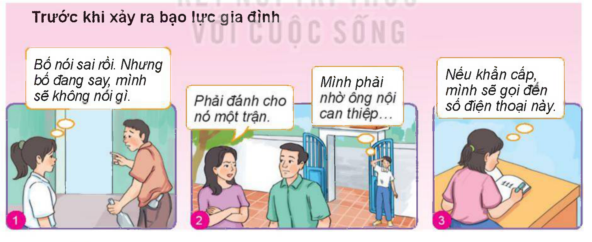
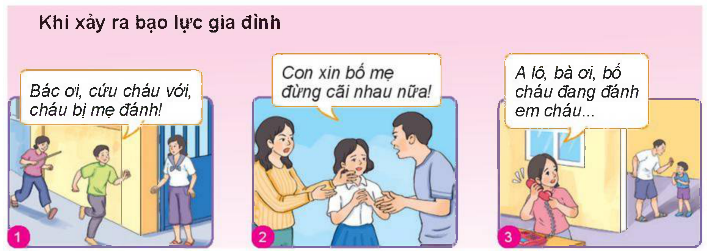
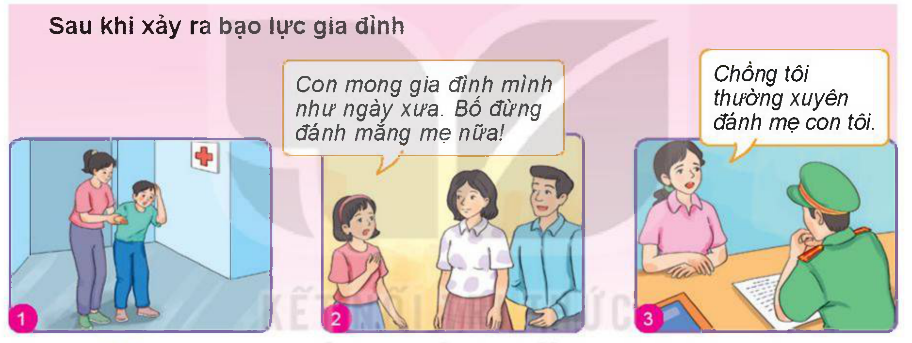
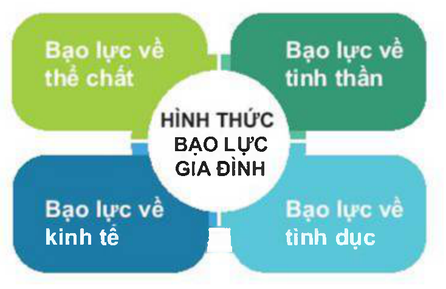

<!-- pdf:43 -->

# BÀI 7: PHÒNG, CHỐNG BẠO LỰC GIA ĐÌNH

## 🎯 Mục tiêu:

- Kể được các hình thức bạo lực gia đình phổ biến.
- Phân tích được tác hại của hành vi bạo lực gia đình đối với cá nhân, gia đình và xã hội.
- Nêu được một số quy định của pháp luật về phòng, chống bạo lực gia đình.
- Biết cách phòng, chống bạo lực gia đình.
- Phê phán các hành vi bạo lực gia đình trong gia đình và cộng đồng.

## 🔴 Mở đầu

Gia đình là nơi mỗi người được chăm sóc, nuôi dưỡng và yêu thương, góp phần hình thành và phát triển nhân cách. Tuy nhiên, không phải gia đình nào cũng đem lại cho con người niềm hạnh phúc ấy. Bạo lực gia đình đã và đang gây hậu quả nghiêm trọng, nhất là đối với phụ nữ và trẻ em.

> ❓ Hãy kể về một hành vi bạo lực gia đình mà em biết. Em có ý kiến gì về hành vi đó?

## KHÁM PHÁ

## 1. Bạo lực gia đình – các hình thức và hậu quả

Em hãy đọc các trường hợp và thông tin dưới đây để trả lời câu hỏi:

> 1. Bố bạn P chơi lô đề, cờ bạc nên gia đình bạn ngày càng khó khăn. Bố P cũng trở nên cục cằn, thô bạo hơn. Nhiều lần trong bữa ăn, ông mượn rượu để đánh mắng mẹ con bạn vô cớ khiến không khí gia đình trở nên nặng nề. Có lần, mẹ con bạn P bị đánh và bị đuổi ra khỏi nhà.

> 2. Những tháng ngày hạnh phúc của gia đình bạn H chấm dứt khi bố bạn kinh doanh thua lỗ. Mẹ bạn thường xuyên cằn nhằn về những khó khăn kinh tế và chê bố bạn kém cỏi so với hàng xóm, bạn bè. Dần dần, bố H im lặng như một cái bóng trong nhà khiến không khí gia đình ngày càng trở nên nặng nề, ngột ngạt.

<!-- pdf:44 -->

<!-- pdf:45 -->

> 3. Bác T có hai người con. Con cả bị bại liệt nên tâm trí và thân thể không được bình thường. Bao nhiêu hi vọng bác dành cho anh K – người con trai thứ hai. Anh K học giỏi, thành đạt, lấy vợ và ở lại thành phố. Vợ chồng bác bán đất ở quê mua nhà trên phố ở cùng với vợ chồng anh. Anh K được đứng tên trong giấy chứng nhận quyền sử dụng đất và ngôi nhà. Một thời gian sau, mâu thuẫn phát sinh, vợ chồng anh K đối xử tệ bạc với bố mẹ và anh cả. Hai bác phải đưa người con cả về quê ở nhờ nhà họ hàng.

> 4. Chị Y, 40 tuổi, sức khoẻ yếu, đã có hai con gái lớn nên không muốn sinh thêm con. Tuy nhiên, do chồng chị thúc giục, ép buộc, đe doạ nên chị buộc phải sinh con thứ ba. Trong quá trình mang thai, chị luôn căng thẳng mệt mỏi cả về thể chất lẫn tinh thần.

> 5. Theo số liệu thống kê của Bộ Văn hoá, Thể thao và Du lịch, trong giai đoạn 2009 – 2020, số vụ bạo lực gia đình đã phát hiện trên cả nước là 318.647 vụ. Số vụ bạo lực gia đình giảm dần qua các năm: năm 2009 là 53.206 vụ, giảm xuống còn 19.274 vụ trong năm 2015 và 7.831 vụ trong năm 2020. Riêng năm 2020, số vụ bạo lực thể chất là 4.198 vụ, bạo lực tinh thần là 3.100 vụ, bạo lực kinh tế là 582 vụ, bạo lực tình dục là 99 vụ. Bạo lực gia đình đã gây nên những hậu quả nặng nề, đặc biệt là đối với phụ nữ và trẻ em. Tính trung bình, phụ nữ bị chồng bạo lực thể xác và/hoặc tình dục mất khoảng 26% thu nhập hằng năm của họ cho các khoản chi phí liên quan đến bạo lực.
> (Theo *Báo cáo số 13/BC-BVHTTDL của Bộ Văn hoá, Thể thao và Du lịch về Kết quả 14 năm thi hành Luật Phòng, chống bạo lực gia đình, ngày 11 – 1 – 2022*)

> ❓
> a) Em hãy nêu những hình thức bạo lực gia đình trong các trường hợp trên. Hãy kể thêm những hình thức bạo lực gia đình khác mà em biết.
> b) Bạo lực gia đình gây ra tác hại gì cho cá nhân, gia đình và xã hội?

## 2. Một số quy định của pháp luật về phòng, chống bạo lực gia đình

Em hãy đọc thông tin dưới đây và trả lời câu hỏi:

<!-- term: Hành vi bạo lực gia đình -->
> Luật Phòng, chống bạo lực gia đình năm 2007 (sửa đổi, bổ sung năm 2022)
> Điều 3. Hành vi bạo lực gia đình *(trích)*
> 1. Hành vi bạo lực gia đình bao gồm:
> a) Hành hạ, ngược đãi, đánh đập, đe doạ hoặc hành vi cố ý khác xâm hại đến sức khoẻ, tính mạng;

<!-- pdf:46 -->

<!-- term: Hành vi bạo lực gia đình -->
> b) Lăng mạ, chì chiết hoặc hành vi cố ý khác xúc phạm danh dự, nhân phẩm;
> c) Cưỡng ép chứng kiến bạo lực đối với người, con vật nhằm gây áp lực thường xuyên về tâm lí;
> d) Bỏ mặc, không quan tâm; không nuôi dưỡng, chăm sóc thành viên gia đình là trẻ em, phụ nữ mang thai, phụ nữ đang nuôi con dưới 36 tháng tuổi, người cao tuổi, người khuyết tật, người không có khả năng tự chăm sóc; không giáo dục thành viên gia đình là trẻ em;
> đ) Kì thị, phân biệt đối xử về hình thể, giới, giới tính, năng lực của thành viên gia đình;...
> l) Cưỡng ép tảo hôn, kết hôn, li hôn hoặc cản trở kết hôn, li hôn hợp pháp;
> m) Cưỡng ép mang thai, phá thai, lựa chọn giới tính thai nhi;
> n) Chiếm đoạt, huỷ hoại tài sản chung của gia đình hoặc tài sản riêng của thành viên khác trong gia đình;...

> Điều 5. Những hành vi bị nghiêm cấm *(trích)*
> 1. Các hành vi bạo lực gia đình quy định tại khoản 1 Điều 3 của Luật này.
> 2. Kích động, xúi giục, lôi kéo, dụ dỗ, giúp sức, cưỡng ép người khác thực hiện hành vi bạo lực gia đình.
> 3. Sử dụng, truyền bá thông tin, hình ảnh, âm thanh nhằm kích động bạo lực gia đình.
> 4. Trả thù, đe doạ trả thù người giúp đỡ người bị bạo lực gia đình, người phát hiện, báo tin, ngăn chặn hành vi bạo lực gia đình.

<!-- term: Quyền và trách nhiệm của người bị bạo lực gia đình -->
> Điều 9. Quyền và trách nhiệm của người bị bạo lực gia đình *(trích)*
> 1. Người bị bạo lực gia đình có các quyền sau đây:
> a) Yêu cầu cơ quan, tổ chức, người có thẩm quyền bảo vệ sức khoẻ, tính mạng, nhân phẩm, quyền và lợi ích hợp pháp khác có liên quan đến vụ việc bạo lực gia đình;
> b) Yêu cầu cơ quan, người có thẩm quyền áp dụng biện pháp ngăn chặn, bảo vệ, cấm tiếp xúc theo quy định của Luật này;
> c) Được bố trí nơi tạm lánh, được giữ bí mật về nơi tạm lánh và thông tin khác theo quy định của Luật này;
> d) Được cung cấp dịch vụ y tế, tư vấn tâm lí, trợ giúp pháp lí và dịch vụ trợ giúp xã hội theo quy định của pháp luật;
> 2. Người bị bạo lực gia đình, người giám hộ hoặc người đại diện theo pháp luật của người bị bạo lực gia đình có trách nhiệm cung cấp đầy đủ, chính xác thông tin liên quan đến vụ việc bạo lực gia đình khi có yêu cầu của cơ quan, tổ chức, người có thẩm quyền.

<!-- pdf:47 -->

<!-- term: Trách nhiệm của người có hành vi bạo lực gia đình -->
> Điều 10. Trách nhiệm của người có hành vi bạo lực gia đình
> 1. Chấm dứt hành vi bạo lực gia đình.
> 2. Chấp hành yêu cầu, quyết định của cơ quan, tổ chức, người có thẩm quyền khi áp dụng biện pháp phòng ngừa, bảo vệ, hỗ trợ và xử lí vi phạm pháp luật trong phòng, chống bạo lực gia đình.
> 3. Kịp thời đưa người bị bạo lực gia đình đi cấp cứu, điều trị; chăm sóc người bị bạo lực gia đình trừ trường hợp người bị bạo lực gia đình từ chối.
> 4. Bồi thường thiệt hại, khắc phục hậu quả do mình gây ra cho người bị bạo lực gia đình và người tham gia phòng, chống bạo lực gia đình.

> Điều 41. Xử lí vi phạm pháp luật về phòng, chống bạo lực gia đình *(trích)*
> 1. Tổ chức, cá nhân có hành vi vi phạm pháp luật về phòng, chống bạo lực gia đình tuỳ theo tính chất, mức độ vi phạm mà bị xử lí kỉ luật, xử phạt vi phạm hành chính hoặc bị truy cứu trách nhiệm hình sự, nếu gây thiệt hại phải bồi thường theo quy định của pháp luật.

> ❓ Qua các trường hợp ở mục 1, em hãy cho biết ai vi phạm, ai là nạn nhân của hành vi vi phạm pháp luật về phòng, chống bạo lực gia đình.

## 3. Cách phòng, chống bạo lực gia đình

Em hãy quan sát các bức tranh dưới đây và trả lời câu hỏi:

**Trước khi xảy ra bạo lực gia đình**

> - Bố nói sai rồi. Nhưng bố đang say, mình sẽ không nói gì.
> - Phải đánh cho nó một trận. / Mình phải nhờ ông nội can thiệp...
> - Nếu khẩn cấp, mình sẽ gọi đến số điện thoại này.
<!-- ocr-ok: đã đối chiếu ảnh p047.png, chữ trong bóng thoại của tranh 1, 2, 3 -->

> ❓
> a) Các bạn trong những trường hợp trên đã làm gì để phòng tránh bạo lực gia đình?
> b) Theo em, còn có cách nào khác để phòng tránh bạo lực gia đình?

<!-- pdf:48 -->

**Khi xảy ra bạo lực gia đình**

> - Bác ơi, cứu cháu với, cháu bị mẹ đánh!
> - Con xin bố mẹ đừng cãi nhau nữa!
> - A lô, bà ơi, bố cháu đang đánh em cháu...
<!-- ocr-ok: đã đối chiếu ảnh p048.png, chữ trong bóng thoại của tranh 1, 2, 3 -->

> ❓
> a) Các bạn trong những bức tranh trên đã làm gì khi xảy ra bạo lực gia đình?
> b) Theo em, còn có cách xử lí nào khác khi xảy ra bạo lực gia đình?

**Sau khi xảy ra bạo lực gia đình**

> - Con mong gia đình mình như ngày xưa. Bố đừng đánh mắng mẹ nữa!
> - Chồng tôi thường xuyên đánh mẹ con tôi.

> ❓
> a) Nêu cách xử lí sau khi xảy ra bạo lực gia đình ở các trường hợp trên.
> b) Theo em, còn có cách xử lí nào khác sau khi xảy ra bạo lực gia đình?

> 1. Bạo lực gia đình thể hiện dưới các hình thức phổ biến sau:

> – **Bạo lực về thể chất**: là hành vi ngược đãi, đánh đập làm tổn thương tới sức khoẻ, tính mạng của thành viên gia đình.

> – **Bạo lực về tinh thần**: là những lời nói, thái độ, hành vi làm tổn thương tới danh dự, nhân phẩm, tâm lí của thành viên gia đình.

> – **Bạo lực về kinh tế**: là hành vi xâm phạm tới các quyền lợi về kinh tế của thành viên gia đình (quyền sở hữu tài sản, quyền tự do lao động,...).

> – **Bạo lực về tình dục**: là hành vi mang tính chất cưỡng ép trong các quan hệ tình dục giữa các thành viên gia đình, kể cả việc cưỡng ép sinh con.

<!-- pdf:49 -->

<!-- term: Tác hại của bạo lực gia đình -->
> 2. Bạo lực gia đình gây ảnh hưởng xấu đến hạnh phúc gia đình và trật tự xã hội, gây thương tích về thân thể, thậm chí gây tử vong; làm tổn thương về tinh thần đối với những người bị bạo lực;...

> 3. Việc phòng, chống bạo lực gia đình được Nhà nước quy định trong Luật Phòng, chống bạo lực gia đình và một số văn bản luật khác (Hiến pháp, Bộ luật Dân sự, Bộ luật Hình sự, Luật Hôn nhân và Gia đình, Luật Trẻ em hiện hành,...).

<!-- term: Cách phòng, chống bạo lực gia đình -->
> 4. Cách phòng, chống bạo lực gia đình:
> – Để phòng tránh bạo lực gia đình: Tôn trọng, bình đẳng, chia sẻ, yêu thương các thành viên trong gia đình; kiềm chế cảm xúc tiêu cực; rời khỏi nơi có nguy cơ xảy ra bạo lực gia đình, nói với người đáng tin cậy để nhờ can thiệp. Không nên dùng lời nói, thái độ tiêu cực để tỏ thái độ thách thức, nhờ người khác can thiệp bằng cách thức tiêu cực.
> – Khi xảy ra bạo lực gia đình: Cần bình tĩnh, kiềm chế cảm xúc, tìm đường thoát, chủ động nhờ người giúp đỡ. Không nên dùng lời nói, thái độ tiêu cực hoặc sử dụng hành vi bạo lực để đáp trả.
> – Để xử lí hậu quả của bạo lực gia đình: Nên thông báo sự việc với người thân, những người đáng tin cậy; nhờ sự trợ giúp từ bệnh viện, cơ sở tư vấn tâm lí, tổ hoà giải,... Không nên: giấu giếm, bao che cho đối phương; tự tìm cách giải quyết bằng những biện pháp tiêu cực.

> 5. Cần phê phán, đấu tranh chống những hành vi bạo lực trong gia đình và cộng đồng.

## ✏️ Luyện tập

1. Em đồng tình hay không đồng tình với ý kiến nào dưới đây? Vì sao?

a) Bạo lực gia đình chỉ gây nên đau đớn về thể xác cho nạn nhân.

b) Bạo lực gia đình gây nên những tổn hại về kinh tế cho gia đình và xã hội.

c) Người gây ra hành vi bạo lực gia đình chỉ bị xã hội lên án chứ không bị pháp luật trừng phạt.

d) Kích động người khác thực hiện hành vi bạo lực gia đình là vi phạm pháp luật.

e) Nạn nhân bị bạo lực gia đình có quyền im lặng khi cơ quan có thẩm quyền yêu cầu nói ra sự thật.

g) Cần lên án, tố cáo hành vi bạo lực gia đình dù mình không liên quan tới nạn nhân.

<!-- pdf:50 -->

2. Em hãy xếp các hành vi bạo lực gia đình dưới đây vào hình thức tương ứng:

> HÌNH THỨC BẠO LỰC GIA ĐÌNH: Bạo lực về thể chất – Bạo lực về tinh thần – Bạo lực về kinh tế – Bạo lực về tình dục.
<!-- ocr-ok: đã đối chiếu ảnh p050.png, chữ màu trắng trên nền màu trong sơ đồ Hình thức bạo lực gia đình -->

a) Mỗi khi làm gì sai, bạn Y lại bị bố đánh.

b) Chị X ngăn cản chồng cũ không được đến thăm con.

c) Đặt kì vọng quá lớn vào con trai, bố mẹ bạn C bắt con học quá nhiều, không có thời gian nghỉ ngơi, khiến bạn bị trầm cảm.

d) Mặc dù mới 14 tuổi, bạn Q đã bị bố mẹ bắt làm nhiều việc nặng nhọc, quá sức.

e) Mỗi lần tức giận, ông M lại đập phá đồ đạc trong nhà.

3. Em đồng tình hay không đồng tình với cách xử lí nào dưới đây? Vì sao?

a) Biết bố đang rất tức giận, bạn X vội vàng chạy sang nhà hàng xóm để đợi bố bình tĩnh trở lại.

b) Thường xuyên bị chồng hành hạ nhưng chị H vẫn nín nhịn vì sợ người ngoài chê cười.

c) Bạn Q ghi lại số điện thoại của ông bà, thầy giáo chủ nhiệm để gọi điện nhờ sự trợ giúp nếu bị bạo hành gia đình.

d) Chị T bị chồng coi thường vì không có việc làm và thu nhập ổn định nên chị đã cố gắng tự học và xin được việc làm ở một công ty.

4. Em sẽ làm gì nếu ở trong những tình huống dưới đây?

a) Đang học ở trường phổ thông dân tộc nội trú tỉnh, chị H bị bố mẹ ép nghỉ học để lấy chồng.

b) Nhiều lần chứng kiến chú hàng xóm đánh con nhỏ, bạn B rất thương em bé nhưng chưa biết làm thế nào để giúp em.

c) Bố mẹ li hôn. Bạn C sống cùng với bố và mẹ kế. Trước mặt bố, mẹ kế luôn ngọt ngào, nhưng khi bố vừa đi khỏi nhà, bạn đã bị mắng chửi, thậm chí bị đánh đập.

d) Bạn T ở cùng với bác họ. Hằng ngày, bác bắt bạn phải thức khuya dậy sớm, lao động nặng nhọc. Vì vậy, đã 14 tuổi mà T còi cọc chỉ như đứa trẻ lên mười.

## 🚀 Vận dụng

1. Thiết kế một áp phích với nội dung “Nói không với bạo lực gia đình”.

2. Em hãy cùng các bạn trong nhóm xây dựng và biểu diễn một tiểu phẩm về chủ đề "Phòng, chống bạo lực gia đình".

## 📷 Danh sách hình trong bài

| Mã hình | Trang PDF | Trang sách | Chú thích |
| --- | --- | --- | --- |
| H8-giao_duc_cong_dan-b07-01 | 47 | 44 | [Tranh 1, 2, 3 mục 3: Cách phòng tránh trước khi xảy ra bạo lực gia đình] |
| H8-giao_duc_cong_dan-b07-02 | 48 | 45 | [Tranh 1, 2, 3 mục 3: Cách xử lí khi xảy ra bạo lực gia đình] |
| H8-giao_duc_cong_dan-b07-03 | 48 | 45 | [Tranh 1, 2, 3 mục 3: Cách xử lí sau khi xảy ra bạo lực gia đình] |
| H8-giao_duc_cong_dan-b07-04 | 50 | 47 | [Sơ đồ câu 2 mục Luyện tập: Hình thức bạo lực gia đình] |
