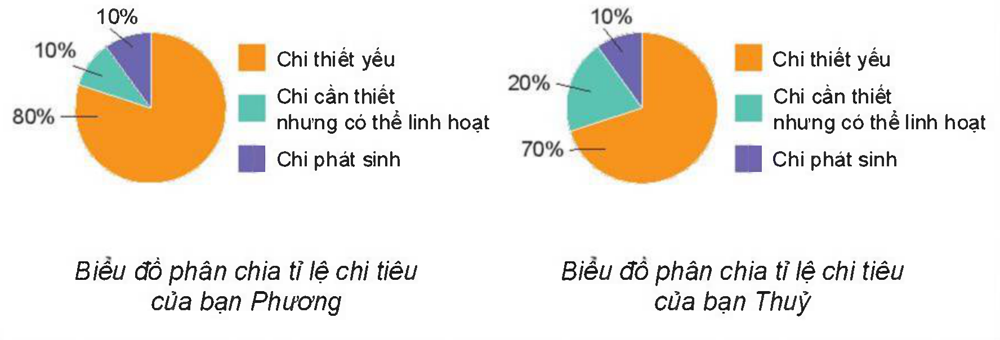

<!-- pdf:51 -->

# BÀI 8: LẬP KẾ HOẠCH CHI TIÊU

## 🎯 Mục tiêu:

- Nhận biết được sự cần thiết phải lập kế hoạch chi tiêu.
- Nêu được cách lập kế hoạch chi tiêu.
- Lập được kế hoạch chi tiêu và tạo thói quen chi tiêu hợp lí.
- Giúp đỡ bạn bè, người thân lập kế hoạch chi tiêu hợp lí.

## 🔴 Mở đầu

Trong cuộc sống, chúng ta luôn phải tính toán chi tiêu sao cho hợp lí, phù hợp với thu nhập, thực hiện được tiết kiệm để tổ chức cuộc sống của bản thân, gia đình ổn định và phát triển.

> ❓ Giả sử em được mẹ đưa cho 150.000 đồng để mua thức ăn cho cả nhà trong một ngày. Em hãy nêu phương án thực hiện nhiệm vụ này và giải thích vì sao em chọn như vậy.

## KHÁM PHÁ

## 1. Sự cần thiết phải lập kế hoạch chi tiêu

Em hãy đọc trường hợp dưới đây và trả lời câu hỏi:

> Lên lớp 8, bạn Phương được mẹ giao nhiệm vụ đi chợ, mua sắm các vật dụng cần thiết cho gia đình. Mẹ đưa một khoản tiền để chi tiêu trong một tuần và hướng dẫn bạn lên kế hoạch cụ thể mỗi khi mua sắm, tránh chi tiêu tuỳ tiện. Những ngày đầu, bạn nghĩ mỗi ngày chỉ mua vài thứ, không cần phải lập kế hoạch nên thích gì mua nấy, khiến sinh hoạt gia đình đảo lộn vì những thứ thiết yếu như rau, quả, thịt, trứng thì thiếu nhưng nước ngọt, bánh kem, khoai tây chiên thì lại nhiều. Mới năm ngày mà Phương đã tiêu hết tiền, phải xin mẹ thêm để đi chợ.

> ❓
> a) Việc bạn Phương chi tiêu tuỳ tiện đã dẫn đến khó khăn gì trong cuộc sống gia đình? Nếu mẹ không có đủ tiền để đưa thêm thì điều gì sẽ xảy ra?
> b) Em hãy dự đoán những khó khăn có thể xảy ra nếu Phương tiếp tục chi tiêu tuỳ tiện như vậy.
> c) Em hãy nêu lí do cần phải lập kế hoạch chi tiêu.

<!-- pdf:52 -->

## 2. Cách lập kế hoạch chi tiêu

Em hãy đọc tiếp trường hợp của bạn Phương và trả lời câu hỏi:

> Được mẹ hướng dẫn, Phương rủ bạn thân là Thuỷ cùng lập kế hoạch chi tiêu cho cá nhân theo từng bước.
> *Bước 1: Xác định mục tiêu và thời hạn thực hiện dựa trên nguồn lực hiện có*
> Đầu tiên, hai bạn xác định mục tiêu cân đối thu, chi từng tháng sao cho mức chi không vượt quá số tiền bố mẹ cho. Bên cạnh đó, hai bạn cùng đặt mục tiêu tiết kiệm được 50.000 đồng mỗi tháng để có một khoản tiền riêng chi cho những dịp đặc biệt.

<!-- term: Các khoản cần chi -->
> *Bước 2: Xác định các khoản cần chi*
> Hai bạn tiến hành ghi chép các khoản cần chi cá nhân bao gồm:
> – Khoản chi cố định đáp ứng nhu cầu thiết yếu như: ăn sáng, mua nước uống, sửa xe khi bị hỏng, mua vở, bút,...
> – Khoản chi cần thiết nhưng có thể linh hoạt: mua truyện, sách tham khảo, tiết kiệm dự phòng,...
> – Khoản chi phát sinh: quà mừng sinh nhật, liên hoan bạn bè,...
> Từ đó, xác định chính xác các định mức chi tiêu trong bản kế hoạch.

<!-- term: Quy tắc thu, chi -->
> *Bước 3: Thiết lập quy tắc thu, chi*
> Kế hoạch chi tiêu phải tuân thủ quy tắc cân đối thu, chi, các định mức chi không được vượt số tiền đang có. Mục tiêu tiết kiệm đòi hỏi phải thực hiện quy tắc: tiết kiệm chủ yếu dựa trên tiết giảm những khoản chi không thiết yếu, không cắt giảm các khoản chi thiết yếu làm ảnh hưởng đến sức khoẻ, kết quả học tập. Mỗi bạn tự xác định cho mình quy tắc phân chia thu nhập thành các khoản chi theo tỉ lệ nhất định.

> - *Biểu đồ phân chia tỉ lệ chi tiêu của bạn Phương:* Chi thiết yếu 80%; Chi cần thiết nhưng có thể linh hoạt 10%; Chi phát sinh 10%.
> - *Biểu đồ phân chia tỉ lệ chi tiêu của bạn Thuỷ:* Chi thiết yếu 70%; Chi cần thiết nhưng có thể linh hoạt 20%; Chi phát sinh 10%.

<!-- pdf:53 -->

> *Bước 4: Thực hiện kế hoạch chi tiêu*
> Sau khi lập được kế hoạch, điều quan trọng là phải chi tiêu cho hợp lí để thực hiện đúng kế hoạch đã vạch ra. Hai bạn nhắc nhau phải cân nhắc thật kĩ trước khi bỏ tiền mua một món đồ nào đó, tự đặt cho mình câu hỏi, mình có thật sự cần nó không rồi sau đó đưa ra quyết định.
> *Bước 5: Kiểm tra và điều chỉnh kế hoạch chi tiêu*
> Hai bạn chia sẻ: Trong quá trình thực hiện kế hoạch chi tiêu phải kiểm soát việc chi tiêu. Nếu có lí do đột xuất phải chi quá mức đã định thì phải cắt giảm các khoản chi không thiết yếu để bù lại. Nếu nhu cầu thực tế có thay đổi, phải cập nhật và điều chỉnh kế hoạch.

> ❓
> a) Em hãy nêu các bước và những điều cần chú ý khi lập kế hoạch chi tiêu.
> b) Hãy lập một kế hoạch chi tiêu cho bản thân và chia sẻ cách lập kế hoạch đó.

> 1. **Kế hoạch chi tiêu** xác định các khoản chi tiêu dựa trên những nguồn lực hiện có để thực hiện những mục tiêu tài chính của cá nhân, gia đình.

<!-- term: Ý nghĩa của việc lập kế hoạch chi tiêu -->
> 2. Lập kế hoạch chi tiêu giúp cân bằng được tài chính, tránh những khoản chi không cần thiết, thực hiện được tiết kiệm, góp phần tạo dựng cuộc sống ổn định, ấm no.

<!-- term: Các bước lập kế hoạch chi tiêu -->
> 3. Các bước lập kế hoạch chi tiêu:
> – Bước 1: Xác định mục tiêu và thời hạn thực hiện dựa trên nguồn lực hiện có.
> – Bước 2: Xác định các khoản cần chi.
> – Bước 3: Thiết lập quy tắc thu, chi.
> – Bước 4: Thực hiện kế hoạch chi tiêu.
> – Bước 5: Kiểm tra và điều chỉnh kế hoạch chi tiêu.

## ✏️ Luyện tập

1. Em tán thành hay không tán thành với những ý kiến nào dưới đây? Vì sao?

a) Lập kế hoạch chi tiêu chủ yếu để thực hiện mục tiêu tiết kiệm.

b) Đảm bảo các khoản chi thiết yếu là nội dung quan trọng trong kế hoạch chi tiêu.

c) Chỉ những người có thói quen chi tiêu tuỳ tiện mới cần lập kế hoạch chi tiêu.

d) Chỉ những người có ít tiền mới cần lập kế hoạch chi tiêu.

<!-- pdf:54 -->

2. Thói quen chi tiêu dưới đây hợp lí hay chưa hợp lí? Vì sao?

a) Xác định thứ tự ưu tiên những thứ cần mua.

b) Xác định giá tiền những thứ cần mua.

c) Liệt kê những thứ cần mua trước khi đi mua sắm.

d) Khảo giá những loại đồ muốn mua ở vài nơi để lựa chọn nơi nào có đồ cùng chất lượng nhưng giá rẻ hơn thì mua.

e) Chỉ chi tiêu cho những việc thực sự cần thiết.

g) Chỉ chọn những đồ đắt tiền để mua.

h) Chỉ chọn mua những đồ có giá rẻ nhất.

3. Em hãy đọc các trường hợp và thực hiện yêu cầu:

a) Trong dịp Tết, bạn H nhận được 1.000.000 đồng tiền mừng tuổi. Bạn lên kế hoạch chi tiêu từ khoản tiền này như: mua quà biếu bà nội, mua bộ sách học tiếng Anh, mua một chiếc áo bạn rất thích, trích một phần cho quỹ từ thiện,...

Chiều nay, đang ở khu vui chơi với ba người bạn thân, biết H có tiền, các bạn muốn H dùng 400.000 đồng mua vé cho cả nhóm tham gia nhiều trò chơi rất hấp dẫn.

*Theo em, bạn H nên quyết định như thế nào? Vì sao?*

b) Thấy một chiếc áo len giá 150.000 đồng bày bán ở cửa hàng, em rất muốn mua nhưng trong ví chỉ có số tiền mẹ vừa cho để mua sách học thêm tiếng Anh là 200.000 đồng.

*Hãy nêu phương án lựa chọn của em và giải thích vì sao.*

4. Thực hành lập kế hoạch chi tiêu:

a) Em hãy cùng người thân lập kế hoạch chi tiêu của gia đình trong một tháng và nhận xét việc thực hiện chi tiêu của gia đình mình.

b) Tiết kiệm được 300.000 đồng, bạn M muốn tạo bất ngờ trong ngày sinh nhật mẹ sắp tới. Em hãy giúp bạn M lập kế hoạch chi tiêu để tổ chức buổi sinh nhật thật ý nghĩa.

5. Em hãy kể những thói quen chi tiêu của mình và cho biết thói quen chi tiêu nào chưa hợp lí. Giải thích vì sao.

## 🚀 Vận dụng

1. Em hãy lập và thực hiện kế hoạch để khắc phục thói quen chi tiêu chưa hợp lí.

2. Em hãy viết bài chia sẻ về một thói quen chi tiêu hợp lí mà em tâm đắc.

## 📷 Danh sách hình trong bài

| Mã hình | Trang PDF | Trang sách | Chú thích |
| --- | --- | --- | --- |
| H8-giao_duc_cong_dan-b08-01 | 52 | 49 | Biểu đồ phân chia tỉ lệ chi tiêu của bạn Phương và Biểu đồ phân chia tỉ lệ chi tiêu của bạn Thuỷ |
