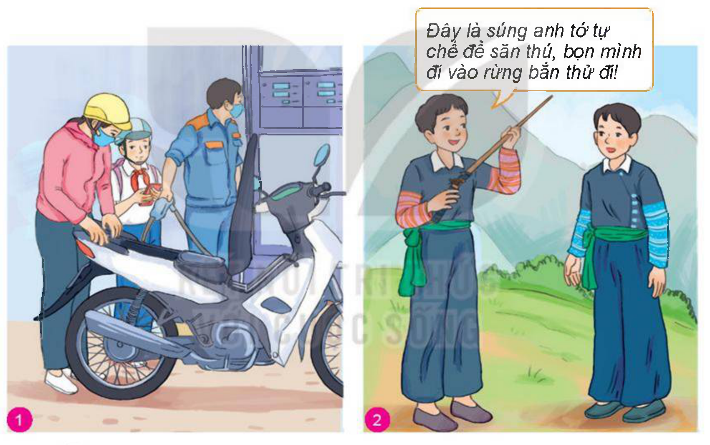
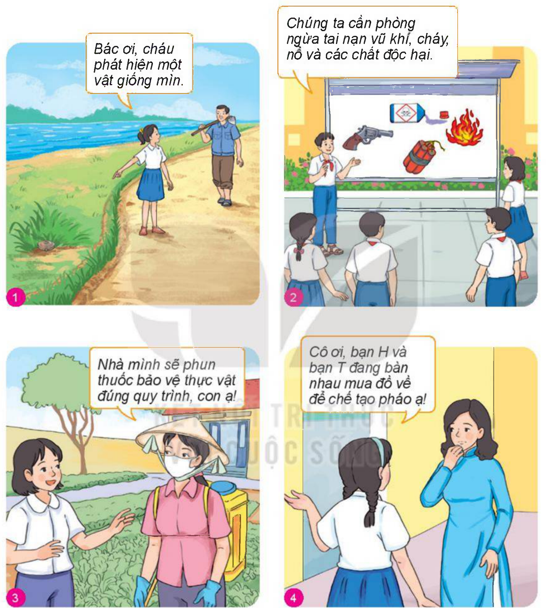

<!-- pdf:55 -->

# BÀI 9: PHÒNG NGỪA TAI NẠN VŨ KHÍ, CHÁY, NỔ VÀ CÁC CHẤT ĐỘC HẠI

## 🎯 Mục tiêu:

- Kể được tên một số tai nạn vũ khí, cháy, nổ và chất độc hại; nhận diện được một số nguy cơ dẫn đến tai nạn vũ khí, cháy, nổ và chất độc hại.
- Trình bày được hậu quả của tai nạn vũ khí, cháy, nổ và chất độc hại.
- Nêu được quy định cơ bản của pháp luật về phòng ngừa tai nạn vũ khí, cháy, nổ và các chất độc hại.
- Nhận biết được trách nhiệm của công dân trong việc phòng ngừa tai nạn vũ khí, cháy, nổ và các chất độc hại.
- Thực hiện được việc phòng ngừa tai nạn vũ khí, cháy, nổ và các chất độc hại.
- Nhắc nhở, tuyên truyền người thân, bạn bè chủ động phòng ngừa tai nạn vũ khí, cháy, nổ và các chất độc hại.

## 🔴 Mở đầu

Tai nạn vũ khí, cháy, nổ và các chất độc hại luôn là nỗi ám ảnh đối với con người vì nó gây ra những tổn thất to lớn cho cá nhân, gia đình và toàn xã hội. Do đó, mỗi chúng ta cần chủ động tìm hiểu, nâng cao nhận thức cho bản thân về tai nạn vũ khí, cháy, nổ và các chất độc hại, đồng thời có thái độ, hành vi tích cực trong cuộc sống góp phần phòng ngừa các loại tai nạn nguy hiểm này.

> ❓ Hãy kể về một vụ tai nạn vũ khí, cháy, nổ, các chất độc hại mà em biết và nêu những việc nên làm để phòng, tránh tai nạn đó.

## KHÁM PHÁ

## 1. Phân loại, nguy cơ, hậu quả của tai nạn vũ khí, cháy, nổ và các chất độc hại

Em hãy đọc các thông tin, trường hợp và quan sát các bức tranh dưới đây để trả lời câu hỏi:

> 1. Bố mẹ đi vắng, bạn M dùng ấm điện để đun nước nhưng mải chơi bỏ quên khiến ấm chập điện bốc cháy. Ngọn lửa nhanh chóng lan ra nhiều đồ đạc trong nhà khiến bạn rất sợ hãi. Sau đó, đám cháy đã được lực lượng cứu hoả và người dân xung quanh dập tắt. Tuy nhiên, nhiều tài sản có giá trị trong nhà đã bị thiêu rụi, bản thân bạn M cũng bị ngạt khói và bỏng 30% cơ thể.

<!-- pdf:56 -->

> 2. Gia đình ông C làm nghề thu mua phế liệu, trong đó có cả bom, đạn,... từ thời chiến tranh còn sót lại. Một lần, ông C cùng con trai đang cưa bom để lấy sắt thì bất ngờ quả bom phát nổ. Vụ nổ đã cướp đi sinh mạng của người con trai và một cháu bé đang chơi gần đó. Ông C cũng bị thương nặng.

> 3. Theo thống kê của Bộ Y tế, từ ngày 18 – 6 – 2022 đến ngày 17 – 7 – 2022, cả nước xảy ra 13 vụ ngộ độc thực phẩm làm 85 người ngộ độc. Trong đó, có 5 vụ ngộ độc do độc tố tự nhiên, 2 vụ ngộ độc do vi sinh vật và 5 vụ ngộ độc chưa xác định được nguyên nhân. Trong 7 tháng đầu năm 2022, cả nước xảy ra 27 vụ ngộ độc thực phẩm làm 357 người ngộ độc, 2 người tử vong.
> (Theo *Báo cáo Công tác y tế tháng 7 năm 2022 của Bộ Y tế*)

> Đây là súng anh tớ tự chế để săn thú, bọn mình đi vào rừng bắn thử đi!

> ❓
> a) Các thông tin, trường hợp trên đề cập đến những loại tai nạn nào? Theo em, còn có những loại tai nạn vũ khí, cháy, nổ và các chất độc hại nào khác?
> b) Hành vi của một số nhân vật trong các bức tranh trên có nguy cơ dẫn đến những tai nạn gì? Hãy kể thêm một số nguy cơ khác mà em biết.
> c) Trong các thông tin, trường hợp trên, tai nạn vũ khí, cháy, nổ và các chất độc hại đã gây ra những hậu quả gì? Hãy kể thêm một số hậu quả khác do tai nạn vũ khí, cháy, nổ và các chất độc hại gây ra.

<!-- pdf:57 -->

## 2. Quy định cơ bản của pháp luật về phòng ngừa tai nạn vũ khí, cháy, nổ và các chất độc hại

Em hãy đọc các thông tin, trường hợp dưới đây và trả lời câu hỏi:

> 1.
> 1/ Luật Phòng cháy và chữa cháy năm 2001 (sửa đổi, bổ sung 2013)
> Điều 13. Các hành vi bị nghiêm cấm *(trích)*
> 1. Cố ý gây cháy, nổ làm tổn hại đến tính mạng, sức khoẻ con người; gây thiệt hại tài sản của Nhà nước, cơ quan, tổ chức, cá nhân; ảnh hưởng xấu đến môi trường, an ninh và trật tự an toàn xã hội.
> 2. Cản trở các hoạt động phòng cháy và chữa cháy; chống người thi hành nhiệm vụ phòng cháy và chữa cháy.
> 3. Lợi dụng phòng cháy và chữa cháy để xâm hại tính mạng, sức khoẻ con người; xâm phạm tài sản của Nhà nước, cơ quan, tổ chức và cá nhân.
> 4. Báo cháy giả.
> 4a. Không báo cháy khi có điều kiện báo cháy; trì hoãn việc báo cháy.
> 5. Sản xuất, tàng trữ, vận chuyển, sử dụng, mua bán trái phép chất nguy hiểm về cháy, nổ.
> 5a. Mang hàng và chất dễ cháy, nổ trái phép vào nơi tập trung đông người.
>
> 2/ Luật Hoá chất năm 2007
> Điều 7. Các hành vi bị nghiêm cấm trong hoạt động hoá chất *(trích)*
> 1. Sản xuất, kinh doanh, vận chuyển, cất giữ, sử dụng, gửi, cho, tặng hoá chất nguy hiểm trái quy định.
> 3. Sử dụng hoá chất không thuộc danh mục được phép sử dụng, hoá chất không bảo đảm tiêu chuẩn, chất lượng, vượt quá hàm lượng cho phép để sản xuất và bảo quản thực phẩm, thuốc chữa bệnh, thức ăn gia súc, thuốc thú y, thuốc bảo vệ thực vật, phân bón, sản phẩm hoá chất tiêu dùng.
> 4. Sử dụng hoá chất độc để săn bắt động vật, thực hiện các hành vi xâm hại đến sức khoẻ con người, tài sản và môi trường.
>
> 3/ Luật Quản lí, sử dụng vũ khí, vật liệu nổ và công cụ hỗ trợ năm 2017
> Điều 5. Các hành vi bị nghiêm cấm trong quản lí, sử dụng vũ khí, vật liệu nổ, tiền chất thuốc nổ và công cụ hỗ trợ *(trích)*
> 1. Cá nhân sở hữu vũ khí, vật liệu nổ, công cụ hỗ trợ, trừ vũ khí thô sơ là hiện vật để trưng bày, triển lãm, đồ gia bảo.
> 2. Nghiên cứu, chế tạo, sản xuất, mua bán, xuất khẩu, nhập khẩu, tàng trữ, vận chuyển, sửa chữa, sử dụng trái phép hoặc chiếm đoạt vũ khí, vật liệu nổ, tiền chất thuốc nổ, công cụ hỗ trợ hoặc chi tiết, cụm chi tiết để lắp ráp vũ khí, công cụ hỗ trợ.
> 10. Chiếm đoạt, mua bán, trao đổi, tặng, cho, gửi, mượn, cho mượn, thuê, cho thuê, cầm cố phế liệu, phế phẩm vũ khí, vật liệu nổ, công cụ hỗ trợ.

<!-- pdf:58 -->

> 12. Che giấu, không tố giác, giúp người khác chế tạo, sản xuất, mang, mua bán, sửa chữa, xuất khẩu, nhập khẩu, tàng trữ, vận chuyển, sử dụng trái phép hoặc huỷ hoại vũ khí, vật liệu nổ, tiền chất thuốc nổ, công cụ hỗ trợ.
> 13. Đào bới, tìm kiếm, thu gom trái phép vũ khí, vật liệu nổ, công cụ hỗ trợ; phế liệu, phế phẩm vũ khí, vật liệu nổ, công cụ hỗ trợ.

> 2. Gần Tết, anh D được anh X rủ cùng mua vật liệu về nhà tự quấn pháo. Tuy nhiên, anh D thấy việc đó quá nguy hiểm nên đã từ chối. Anh cũng khuyên anh X không nên làm pháo.

> 3. Ngày 24 – 9 – 2022, Cơ quan Cảnh sát điều tra Công an tỉnh Kiên Giang đã khởi tố vụ án, khởi tố bị can, ra lệnh bắt tạm giam 10 đối tượng trong đường dây chế tạo, tàng trữ, mua bán vũ khí, công cụ hỗ trợ quy mô lớn trên địa bàn tỉnh. Qua khám xét, cơ quan điều tra đã thu giữ 84 khẩu súng các loại, hơn 300 viên đạn các loại, 1 máy tiện chuyên dụng và một số thiết bị, máy móc phục vụ việc chế tạo, cải tạo các loại súng bắn đạn bi, đạn thể thao thành súng có tính năng tương tự vũ khí quân dụng.
> (Theo *Quốc Trinh, Kiên Giang triệt xoá đường dây chế tạo, mua bán vũ khí quy mô lớn, Báo Nhân dân, ngày 24 – 9 – 2022*)

> 4. Hàng ăn của ông B rất đông khách nên ngày nào ông và các thành viên trong gia đình cũng phải dậy từ rất sớm để sơ chế các nguyên liệu. Thấy ông B và người thân vất vả, một người hàng xóm khuyên ông nên sử dụng hoá chất để làm sạch các đồ ăn từ nội tạng động vật nhằm tiết kiệm thời gian, công sức nhưng ông không đồng ý vì cho rằng các hoá chất sẽ ảnh hưởng không tốt tới sức khoẻ khách hàng, tự sơ chế dù vất vả nhưng sẽ đảm bảo vệ sinh an toàn thực phẩm.

> 5. Anh Q và nhóm bạn đang chơi đá cầu thì phát hiện khói bốc ra từ một ngôi nhà ở gần đó nên đã vội vàng hô hoán để mọi người xung quanh tới dập lửa. Thấy đám cháy ngày càng lan rộng, anh Q gọi cứu hoả và nhắc nhở mọi người nhường đường, dọn dẹp chướng ngại vật để xe cứu hoả dễ dàng tiến vào chữa cháy.

> ❓
> a) Dựa vào thông tin pháp luật, em hãy chỉ ra các chủ thể trong thông tin, trường hợp 2, 3, 4, 5 đã thực hiện quy định của pháp luật về phòng ngừa tai nạn vũ khí, cháy, nổ và các chất độc hại như thế nào.
> b) Em hãy nêu một số quy định khác của pháp luật về phòng ngừa tai nạn vũ khí, cháy, nổ và các chất độc hại.

<!-- pdf:59 -->

## 3. Trách nhiệm của công dân trong việc phòng ngừa tai nạn vũ khí, cháy, nổ và các chất độc hại

Em hãy quan sát các bức tranh dưới đây và trả lời câu hỏi:

> - Bác ơi, cháu phát hiện một vật giống mìn.
> - Chúng ta cần phòng ngừa tai nạn vũ khí, cháy, nổ và các chất độc hại.
> - Nhà mình sẽ phun thuốc bảo vệ thực vật đúng quy trình, con ạ!
> - Cô ơi, bạn H và bạn T đang bàn nhau mua đồ về để chế tạo pháo ạ!

> ❓
> a) Em hãy cho biết những nhân vật trong các bức tranh trên đã làm gì để phòng ngừa tai nạn vũ khí, cháy, nổ và các chất độc hại.
> b) Em hãy chỉ ra trách nhiệm của công dân trong việc phòng ngừa tai nạn vũ khí, cháy, nổ và các chất độc hại.
> c) Nêu những việc em cần làm để phòng ngừa tai nạn vũ khí, cháy, nổ và các chất độc hại.

<!-- pdf:60 -->

<!-- term: Nguy cơ dẫn đến tai nạn vũ khí, cháy, nổ và các chất độc hại -->
> 1. Có nhiều nguy cơ dẫn đến tai nạn vũ khí, cháy, nổ và các chất độc hại như: thiết bị điện quá tải; rò rỉ khí ga; thiết bị điện kém chất lượng; nắng nóng kéo dài; nguyên vật liệu xây dựng dễ cháy; trang, thiết bị phòng cháy, chữa cháy không đảm bảo; chế biến, bảo quản thực phẩm sai cách; cất giấu vũ khí trong nhà; sấm sét khi mưa giông,...

<!-- term: Quy định của pháp luật về phòng ngừa tai nạn vũ khí, cháy, nổ và các chất độc hại -->
> 2. Pháp luật Việt Nam quy định:
> – Cấm tàng trữ, vận chuyển, buôn bán, sử dụng trái phép các loại vũ khí, chất nổ, chất cháy, chất phóng xạ và các chất độc hại khác;
> – Chỉ những cơ quan, tổ chức, cá nhân được Nhà nước giao nhiệm vụ và cho phép mới được giữ, chuyên chở và sử dụng vũ khí, chất nổ, chất cháy, chất phóng xạ và chất độc hại;
> – Cơ quan, tổ chức, cá nhân có trách nhiệm bảo quản, chuyên chở và sử dụng vũ khí, chất nổ, chất cháy, chất phóng xạ và chất độc hại phải được huấn luyện về chuyên môn, có đủ phương tiện cần thiết và luôn tuân thủ quy định về an toàn.

<!-- term: Trách nhiệm của công dân trong phòng ngừa tai nạn vũ khí, cháy, nổ và các chất độc hại -->
> 3. Trách nhiệm của công dân trong phòng ngừa tai nạn vũ khí, cháy, nổ và các chất độc hại:
> – Tự giác tìm hiểu, nâng cao nhận thức và thực hiện nghiêm túc các quy định của pháp luật về phòng ngừa tai nạn vũ khí, cháy, nổ và các chất độc hại.
> – Tích cực tuyên truyền, vận động gia đình, bạn bè và mọi người xung quanh thực hiện tốt các quy định của pháp luật về phòng ngừa tai nạn vũ khí, cháy, nổ và các chất độc hại.
> – Tố cáo những hành vi vi phạm hoặc xúi giục người khác vi phạm các quy định của pháp luật về phòng ngừa tai nạn vũ khí, cháy, nổ và các chất độc hại.

## ✏️ Luyện tập

1. Em tán thành hay không tán thành với những ý kiến nào dưới đây? Vì sao?

a) Chỉ có những người thiếu hiểu biết mới gặp phải tai nạn vũ khí, cháy, nổ và các chất độc hại.

b) Phòng cháy, chữa cháy là trách nhiệm riêng của lực lượng cứu hoả.

c) Các tai nạn hoá chất độc hại có thể để lại hậu quả xấu đối với những thế hệ sau.

d) Thực hiện tốt các quy định của pháp luật về phòng ngừa tai nạn vũ khí, cháy, nổ và các chất độc hại là góp phần bảo vệ và phát triển đất nước.

2. Theo em, các trường hợp sau tiềm ẩn nguy cơ dẫn đến tai nạn vũ khí, cháy, nổ và các chất độc hại như thế nào?

a) Mọi người đều được phép tàng trữ, sử dụng vũ khí.

<!-- pdf:61 -->

b) Tàng trữ thuốc pháo, thuốc nổ trong nhà.

c) Sử dụng mọi hoá chất trong sản xuất, chế biến, bảo quản thực phẩm.

d) Không tắt quạt điện, ti vi khi ra khỏi nhà.

3. Theo em, những hành vi dưới đây có thể dẫn đến những hậu quả gì?

a) Chị C gọi vào số điện thoại cứu hoả để trêu đùa.

b) Bà Q hái nấm lạ trong rừng về nấu ăn.

c) Nhặt được vật thể lạ giống quả lựu đạn, anh D mang đi bán đồng nát.

d) Anh K mở bật lửa kiểm tra bình xăng xe máy.

4. Em hãy xử lí các tình huống dưới đây:

a) Cuối tuần, Đoàn thanh niên xã tổ chức hoạt động tuyên truyền phổ biến kiến thức pháp luật về phòng cháy, chữa cháy cho học sinh. Bạn A xin phép bố mẹ được tham gia, tuy nhiên bố mẹ bạn cho rằng đó không phải là hoạt động học tập nên không đồng ý.

*Nếu là bạn A, em sẽ thuyết phục bố mẹ như thế nào?*

b) Nghỉ hè, bạn T được mẹ đưa về quê chơi với ông bà và cậu út. Bạn thấy cậu út thường xuyên dùng thuốc trừ sâu phun cho rau và cây ăn quả. Cậu bảo, số rau và hoa quả đó trồng để bán nên cần phun nhiều thuốc để ngăn sâu bọ phá hoại.

*Nếu là bạn T, dựa vào những quy định của pháp luật, em sẽ nói gì với cậu út?*

c) Hai bạn M và P đang bắt cua ở con mương gần nhà thì vô tình mò được một vật có hình dáng giống khẩu súng được bao bọc kĩ. Bạn M muốn mang vật đó giao nộp cho cơ quan công an ngay. Tuy nhiên, bạn P lại muốn đem về nhà để hỏi ý kiến người lớn, nếu chắc chắn là súng thì giao nộp cũng không muộn.

*Nếu là bạn M, dựa vào những quy định của pháp luật, em sẽ làm gì?*

5. Em đã thực hiện việc phòng ngừa tai nạn vũ khí, cháy, nổ và các chất độc hại như thế nào? Đối với những việc thực hiện chưa tốt, hãy nêu cách khắc phục theo bảng gợi ý dưới đây:

| Việc đã thực hiện tốt | Việc chưa thực hiện tốt | Cách khắc phục những việc chưa thực hiện tốt |
| --- | --- | --- |
| ... | ... | ... |

## 🚀 Vận dụng

1. Em hãy viết một đoạn văn về tầm quan trọng của việc phòng ngừa tai nạn vũ khí, cháy, nổ, các chất độc hại và chia sẻ với các bạn trong lớp.

2. Em hãy cùng các bạn thiết kế một sản phẩm (tiểu phẩm, clip, tranh vẽ,...) tuyên truyền về phòng ngừa tai nạn vũ khí/ cháy/ nổ/ các chất độc hại.

## 📷 Danh sách hình trong bài

| Mã hình | Trang PDF | Trang sách | Chú thích |
| --- | --- | --- | --- |
| H8-giao_duc_cong_dan-b09-01 | 56 | 53 | [Tranh 1, 2 mục 1: Một số hành vi tiềm ẩn nguy cơ tai nạn cháy, nổ và vũ khí tự chế] |
| H8-giao_duc_cong_dan-b09-02 | 59 | 56 | [Tranh 1, 2, 3, 4 mục 3: Trách nhiệm của công dân trong việc phòng ngừa tai nạn vũ khí, cháy, nổ và các chất độc hại] |
