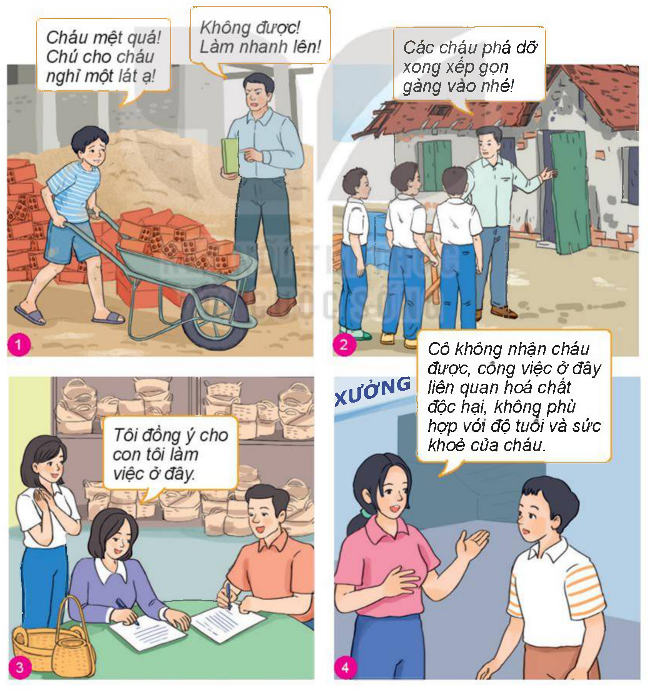

<!-- pdf:62 -->

# BÀI 10: QUYỀN VÀ NGHĨA VỤ LAO ĐỘNG CỦA CÔNG DÂN

## 🎯 Mục tiêu:

- Phân tích được tầm quan trọng của lao động đối với đời sống con người.
- Nêu được một số quy định của pháp luật về quyền, nghĩa vụ lao động của công dân và lao động chưa thành niên.
- Nêu được một số quyền và nghĩa vụ cơ bản của các bên tham gia hợp đồng lao động, lập được hợp đồng lao động có nội dung đơn giản giữa người sử dụng lao động và người lao động.
- Tích cực, chủ động tham gia lao động ở gia đình, trường, lớp và cộng đồng phù hợp lứa tuổi.

## 🔴 Mở đầu

**Lao động** là hoạt động có mục đích của con người nhằm tạo ra của cải vật chất và các giá trị tinh thần cho xã hội. Đó là hoạt động chủ yếu, quan trọng nhất của con người, là nhân tố quyết định sự tồn tại, phát triển của đất nước và nhân loại. Mỗi người cần nhận thức được vai trò quan trọng của lao động để thực hiện tốt quyền và nghĩa vụ lao động của bản thân, góp phần xây dựng đất nước giàu mạnh, văn minh.

> ❓ Em hãy kể một số hoạt động lao động mà em đã từng thực hiện ở gia đình, nhà trường hoặc cộng đồng và nêu ý nghĩa của các hoạt động đó.

## KHÁM PHÁ

## 1. Vai trò của lao động đối với đời sống con người

Em hãy đọc thông tin dưới đây và trả lời câu hỏi:

> Năm 1769, một thực nghiệm viên của trường đại học ở Luân Đôn là Giêm Oát đã sáng chế ra máy hơi nước, đến năm 1784 thì hoàn thiện trở thành động cơ nhiệt vạn năng chạy bằng than và nước. Việc hoàn thiện và sử dụng máy hơi nước vào sản xuất đã gây nên một sự chuyển biến lớn, tạo ra nguồn động lực mới làm giảm nhẹ sức lao động cơ bắp của con người, tạo điều kiện cho sự chuyển biến từ việc lao động bằng tay sang sử dụng máy móc. Đây là yếu tố cơ bản của công nghiệp hoá, đánh dấu bước nhảy vọt cách mạng trong lịch sử sản xuất của nhân loại, bước chuyển cơ bản từ nền văn minh nông nghiệp sang văn minh công nghiệp.

<!-- pdf:63 -->

> Đến đầu thế kỉ XIX, ở nước Anh, việc sử dụng máy hơi nước trở thành phổ biến trong các nhà máy. Do nguồn động lực mới là sức hơi nước, tổ chức sản xuất công trường thủ công hay công xưởng nhỏ không còn phù hợp nữa và được thay thế bằng các nhà máy. Vì vậy, việc sản xuất các vật phẩm đơn chiếc dần dần được thay thế bằng việc sản xuất hàng hoá theo tiêu chuẩn chung về chất lượng và về mẫu mã. Quy mô sản xuất lớn dần được hình thành, sản lượng hàng hoá ngày càng được tăng cao.
> Trên cơ sở sử dụng rộng rãi máy hơi nước, ngành giao thông vận tải cũng có những bước chuyển biến lớn. Từ đầu thế kỉ XIX, tàu thuỷ và xe lửa xuất hiện với đầu máy bằng hơi nước. Hệ thống đường sắt phát triển nhanh, mở rộng khả năng vận chuyển, nối liền các thành thị, các trung tâm công thương nghiệp. Nhờ đó, kinh tế phát triển rất nhanh, các thành phố trở nên sầm uất, thị trường thế giới nhộn nhịp.
> (Theo *Vũ Dương Ninh (Chủ biên), Lịch sử văn minh thế giới, NXB Giáo dục Việt Nam, 2020*)

> ❓
> a) Em hãy cho biết, trong thông tin trên, Giêm Oát đã lao động như thế nào? Việc lao động đó đã mang lại những ý nghĩa gì?
> b) Hãy phân tích tầm quan trọng của lao động đối với đời sống con người.

## 2. Một số quy định của pháp luật về quyền và nghĩa vụ lao động của công dân

Em hãy đọc các thông tin, trường hợp dưới đây và trả lời câu hỏi:

<!-- term: Quyền và nghĩa vụ lao động của công dân -->
> 1. Hiến pháp năm 2013
> Điều 15. *(trích)*
> 1. Quyền công dân không tách rời nghĩa vụ công dân.
> 2. Mọi người có nghĩa vụ tôn trọng quyền của người khác.
> 3. Công dân có trách nhiệm thực hiện nghĩa vụ đối với Nhà nước và xã hội,...
> Điều 35.
> 1. Công dân có quyền làm việc, lựa chọn nghề nghiệp, việc làm và nơi làm việc.
> 2. Người làm công ăn lương được bảo đảm các điều kiện làm việc công bằng, an toàn; được hưởng lương, chế độ nghỉ ngơi.
> 3. Nghiêm cấm phân biệt đối xử, cưỡng bức lao động, sử dụng nhân công dưới độ tuổi lao động tối thiểu.
> Điều 37. *(trích)*
> 1. Trẻ em được Nhà nước, gia đình và xã hội bảo vệ, chăm sóc và giáo dục; được tham gia vào các vấn đề về trẻ em. Nghiêm cấm xâm hại, hành hạ,

<!-- pdf:64 -->

> ngược đãi, bỏ mặc, lạm dụng, bóc lột sức lao động và những hành vi khác vi phạm quyền trẻ em.
> 2. Thanh niên được Nhà nước, gia đình và xã hội tạo điều kiện học tập, lao động, giải trí, phát triển thể lực, trí tuệ, bồi dưỡng đạo đức, truyền thống dân tộc, ý thức công dân; đi đầu trong công cuộc lao động sáng tạo và bảo vệ Tổ quốc.

> 2. Gia đình bạn C có truyền thống kinh doanh nhưng bạn không thích công việc này. Bạn quyết định sau khi tốt nghiệp trung học phổ thông sẽ đăng kí học nghề trang điểm để phát triển sự nghiệp riêng của mình. Khi biết chuyện, bố mẹ bạn cảm thấy không vui, tuy nhiên hai người vẫn tôn trọng quyết định của con trai, không ép buộc bạn phải từ bỏ nguyện vọng của mình.

> 3. Sau khi tốt nghiệp đại học, anh T tham gia ứng tuyển và được nhận vào làm việc tại một công ty. Anh cảm thấy rất vui vì từ nay đã có thể tự tạo ra thu nhập để nuôi sống bản thân và chăm lo cho bố mẹ.

> ❓
> a) Theo em, trong trường hợp 2 và 3, các nhân vật đã thực hiện quy định của pháp luật về quyền và nghĩa vụ lao động của công dân như thế nào?
> b) Em hãy nêu một số ví dụ thực hiện tốt quy định của pháp luật về quyền và nghĩa vụ lao động của công dân trong đời sống hằng ngày.

## 3. Một số quy định của pháp luật về lao động chưa thành niên

Em hãy đọc thông tin kết hợp quan sát các tranh dưới đây và trả lời câu hỏi:

> Bộ luật Lao động năm 2019
> Điều 143. Lao động chưa thành niên *(trích)*
> 1. **Lao động chưa thành niên** là người lao động chưa đủ 18 tuổi.

<!-- term: Nguyên tắc sử dụng lao động chưa thành niên -->
> Điều 144. Nguyên tắc sử dụng lao động chưa thành niên
> 1. Lao động chưa thành niên chỉ được làm công việc phù hợp với sức khoẻ để bảo đảm sự phát triển thể lực, trí lực, nhân cách.
> 2. Người sử dụng lao động khi sử dụng lao động chưa thành niên có trách nhiệm quan tâm chăm sóc người lao động về các mặt lao động, sức khoẻ, học tập trong quá trình lao động.

<!-- pdf:65 -->

<!-- term: Nguyên tắc sử dụng lao động chưa thành niên -->
> 3. Khi sử dụng lao động chưa thành niên, người sử dụng lao động phải có sự đồng ý của cha, mẹ hoặc người giám hộ; lập sổ theo dõi riêng, ghi đầy đủ họ tên, ngày tháng năm sinh, công việc đang làm, kết quả những lần kiểm tra sức khoẻ định kì và xuất trình khi cơ quan nhà nước có thẩm quyền yêu cầu.
> 4. Người sử dụng lao động phải tạo cơ hội để lao động chưa thành niên được học văn hoá, giáo dục nghề nghiệp, đào tạo, bồi dưỡng, nâng cao trình độ kĩ năng nghề.
>
> Điều 145. Sử dụng người chưa đủ 15 tuổi làm việc *(trích)*
> 1. Khi sử dụng người chưa đủ 15 tuổi làm việc, người sử dụng lao động phải tuân theo quy định sau đây:
> a) Phải giao kết hợp đồng lao động bằng văn bản với người chưa đủ 15 tuổi và người đại diện theo pháp luật của người đó;
> b) Bố trí giờ làm việc không ảnh hưởng đến thời gian học tập của người chưa đủ 15 tuổi;
> c) Phải có giấy khám sức khoẻ của cơ sở khám bệnh, chữa bệnh có thẩm quyền xác nhận sức khoẻ của người chưa đủ 15 tuổi phù hợp với công việc và tổ chức kiểm tra sức khoẻ định kì ít nhất một lần trong 06 tháng;
> d) Bảo đảm điều kiện làm việc, an toàn, vệ sinh lao động phù hợp với lứa tuổi.
>
> Điều 146. Thời giờ làm việc của người chưa thành niên
> 1. Thời giờ làm việc của người chưa đủ 15 tuổi không được quá 04 giờ trong 01 ngày và 20 giờ trong 01 tuần; không được làm thêm giờ, làm việc vào ban đêm.
> 2. Thời giờ làm việc của người từ đủ 15 tuổi đến chưa đủ 18 tuổi không được quá 08 giờ trong 01 ngày và 40 giờ trong 01 tuần. Người từ đủ 15 tuổi đến chưa đủ 18 tuổi có thể được làm thêm giờ, làm việc vào ban đêm trong một số nghề, công việc theo danh mục do Bộ trưởng Bộ Lao động – Thương binh và Xã hội ban hành.
>
> Điều 147. Công việc và nơi làm việc cấm sử dụng người lao động từ đủ 15 tuổi đến chưa đủ 18 tuổi *(trích)*
> 1. Cấm sử dụng người lao động từ đủ 15 tuổi đến chưa đủ 18 tuổi làm các công việc sau đây:
> a) Mang, vác, nâng các vật nặng vượt quá thể trạng của người chưa thành niên;
> b) Sản xuất, kinh doanh cồn, rượu, bia, thuốc lá, chất tác động đến tinh thần hoặc chất gây nghiện khác;
> c) Sản xuất, sử dụng hoặc vận chuyển hoá chất, khí ga, chất nổ;
> d) Bảo trì, bảo dưỡng thiết bị, máy móc;
> đ) Phá dỡ các công trình xây dựng;
> e) Nấu, thổi, đúc, cán, dập, hàn kim loại;

<!-- pdf:66 -->

> g) Lặn biển, đánh bắt thuỷ, hải sản xa bờ;
> h) Công việc khác gây tổn hại đến sự phát triển thể lực, trí lực, nhân cách của người chưa thành niên.
> 2. Cấm sử dụng người lao động từ đủ 15 tuổi đến chưa đủ 18 tuổi làm việc ở các nơi sau đây:
> a) Dưới nước, dưới lòng đất, trong hang động, trong đường hầm;
> b) Công trường xây dựng;
> c) Cơ sở giết mổ gia súc;
> d) Sòng bạc, quán bar, vũ trường, phòng hát karaoke, khách sạn, nhà nghỉ, cơ sở tắm hơi, cơ sở xoa bóp; điểm kinh doanh xổ số, dịch vụ trò chơi điện tử;
> đ) Nơi làm việc khác gây tổn hại đến sự phát triển thể lực, trí lực, nhân cách của người chưa thành niên.

> - Cháu mệt quá! Chú cho cháu nghỉ một lát ạ! / Không được! Làm nhanh lên!
> - Các cháu phá dỡ xong xếp gọn gàng vào nhé!
> - Tôi đồng ý cho con tôi làm việc ở đây.
> - Cô không nhận cháu được, công việc ở đây liên quan hoá chất độc hại, không phù hợp với độ tuổi và sức khoẻ của cháu.

<!-- pdf:67 -->

> ❓
> a) Em hãy cho biết các nhân vật trong những bức tranh trên đã thực hiện quy định của pháp luật về lao động chưa thành niên như thế nào.
> b) Hãy kể thêm những quy định của pháp luật về lao động vị thành niên.

## 4. Quyền và nghĩa vụ cơ bản của các bên khi tham gia hợp đồng lao động

### a) Quyền và nghĩa vụ cơ bản của người lao động

Em hãy đọc các thông tin, trường hợp dưới đây và trả lời câu hỏi:

<!-- term: Quyền và nghĩa vụ của người lao động -->
> 1. Bộ luật Lao động năm 2019
> Điều 5. Quyền và nghĩa vụ của người lao động
> 1. Người lao động có các quyền sau đây:
> a) Làm việc; tự do lựa chọn việc làm, nơi làm việc, nghề nghiệp, học nghề, nâng cao trình độ nghề nghiệp; không bị phân biệt đối xử, cưỡng bức lao động, quấy rối tình dục tại nơi làm việc;
> b) Hưởng lương phù hợp với trình độ, kĩ năng nghề trên cơ sở thoả thuận với người sử dụng lao động; được bảo hộ lao động, làm việc trong điều kiện bảo đảm về an toàn, vệ sinh lao động; nghỉ theo chế độ, nghỉ hằng năm có hưởng lương và được hưởng phúc lợi tập thể;
> c) Thành lập, gia nhập, hoạt động trong tổ chức đại diện người lao động, tổ chức nghề nghiệp và tổ chức khác theo quy định của pháp luật; yêu cầu và tham gia đối thoại, thực hiện quy chế dân chủ, thương lượng tập thể với người sử dụng lao động và được tham vấn tại nơi làm việc để bảo vệ quyền và lợi ích hợp pháp, chính đáng của mình; tham gia quản lí theo nội quy của người sử dụng lao động;
> d) Từ chối làm việc nếu có nguy cơ rõ ràng đe doạ trực tiếp đến tính mạng, sức khoẻ trong quá trình thực hiện công việc;
> đ) Đơn phương chấm dứt hợp đồng lao động;
> e) Đình công;
> g) Các quyền khác theo quy định của pháp luật.
> 2. Người lao động có các nghĩa vụ sau đây:
> a) Thực hiện hợp đồng lao động, thoả ước lao động tập thể và thoả thuận hợp pháp khác;
> b) Chấp hành kỉ luật lao động, nội quy lao động; tuân theo sự quản lí, điều hành, giám sát của người sử dụng lao động;
> c) Thực hiện quy định của pháp luật về lao động, việc làm, giáo dục nghề nghiệp, bảo hiểm xã hội, bảo hiểm y tế, bảo hiểm thất nghiệp và an toàn, vệ sinh lao động.

<!-- pdf:68 -->

> 2. Chị X làm công nhân ở một công ty hoá chất. Thời gian gần đây, chị và một số đồng nghiệp nhận thấy điều kiện lao động ở công ty không đảm bảo, trang thiết bị bảo hộ không đầy đủ khiến sức khoẻ của người lao động bị ảnh hưởng xấu nên đã làm đơn khiếu nại, đề nghị Ban Giám đốc công ty xem xét giải quyết. Chị X cũng dự định, nếu điều kiện làm việc không được cải thiện thì chị sẽ đơn phương chấm dứt hợp đồng lao động để tìm kiếm cho mình một công việc khác đảm bảo hơn.

> 3. Sau khi tham gia thi tuyển công chức, anh H được nhận vào làm việc tại một cơ quan nhà nước. Anh rất nghiêm túc, gương mẫu chấp hành kỉ luật, nội quy của cơ quan và hoàn thành tốt công việc nên được đồng nghiệp và người dân quý mến.

> ❓
> a) Theo em, các nhân vật trong trường hợp 2 và 3 đã thực hiện quyền và nghĩa vụ của người lao động như thế nào?
> b) Em hãy nêu một số ví dụ thực hiện tốt quy định của pháp luật về quyền và nghĩa vụ của người lao động trong cuộc sống.

### b) Quyền và nghĩa vụ cơ bản của người sử dụng lao động

Em hãy đọc các thông tin, trường hợp dưới đây và trả lời câu hỏi:

<!-- term: Quyền và nghĩa vụ của người sử dụng lao động -->
> 1. Bộ luật Lao động năm 2019
> Điều 6. Quyền và nghĩa vụ của người sử dụng lao động
> 1. Người sử dụng lao động có các quyền sau đây:
> a) Tuyển dụng, bố trí, quản lí, điều hành, giám sát lao động; khen thưởng và xử lí vi phạm kỉ luật lao động;
> b) Thành lập, gia nhập, hoạt động trong tổ chức đại diện người sử dụng lao động, tổ chức nghề nghiệp và tổ chức khác theo quy định của pháp luật;
> c) Yêu cầu tổ chức đại diện người lao động thương lượng với mục đích kí kết thoả ước lao động tập thể; tham gia giải quyết tranh chấp lao động, đình công; đối thoại, trao đổi với tổ chức đại diện người lao động về các vấn đề trong quan hệ lao động, cải thiện đời sống vật chất và tinh thần của người lao động;
> d) Đóng cửa tạm thời nơi làm việc;
> đ) Các quyền khác theo quy định của pháp luật.
> 2. Người sử dụng lao động có các nghĩa vụ sau đây:
> a) Thực hiện hợp đồng lao động, thoả ước lao động tập thể và thoả thuận hợp pháp khác; tôn trọng danh dự, nhân phẩm của người lao động;

<!-- pdf:69 -->

<!-- term: Quyền và nghĩa vụ của người sử dụng lao động -->
> b) Thiết lập cơ chế và thực hiện đối thoại, trao đổi với người lao động và tổ chức đại diện người lao động; thực hiện quy chế dân chủ ở cơ sở tại nơi làm việc;
> c) Đào tạo, đào tạo lại, bồi dưỡng nâng cao trình độ, kĩ năng nghề nhằm duy trì, chuyển đổi nghề nghiệp, việc làm cho người lao động;
> d) Thực hiện quy định của pháp luật về lao động, việc làm, giáo dục nghề nghiệp, bảo hiểm xã hội, bảo hiểm y tế, bảo hiểm thất nghiệp và an toàn, vệ sinh lao động; xây dựng và thực hiện các giải pháp phòng, chống quấy rối tình dục tại nơi làm việc;
> đ) Tham gia phát triển tiêu chuẩn kĩ năng nghề quốc gia, đánh giá, công nhận kĩ năng nghề cho người lao động.

> 2. Chị X đã làm việc tại công ty của ông M được gần 2 năm nhưng không được kí hợp đồng lao động và đóng bảo hiểm như thoả thuận khi tuyển dụng trước đó. Khi chị thắc mắc, ông M đã có những lời lẽ không hay xúc phạm chị và đuổi không cho chị tiếp tục làm việc tại công ty.

> 3. Bà K làm chủ một xí nghiệp sản xuất, chế biến thực phẩm. Hằng ngày, bà luôn quan tâm kiểm tra, giám sát công việc của các nhân viên trong xí nghiệp. Dưới sự quản lí, điều hành của bà, các nhân viên được bố trí công việc hợp lí, hoạt động sản xuất đạt hiệu quả tốt, chất lượng sản phẩm được người tiêu dùng đánh giá cao.

> ❓
> a) Các nhân vật trong trường hợp 2 và 3 đã thực hiện quyền và nghĩa vụ của người sử dụng lao động như thế nào?
> b) Em hãy nêu một số ví dụ thực hiện tốt quy định của pháp luật về quyền và nghĩa vụ của người sử dụng lao động trong cuộc sống.

### c) Hợp đồng lao động

Em hãy đọc thông tin dưới đây và trả lời câu hỏi:

> Bộ luật Lao động năm 2019
> Điều 13. Hợp đồng lao động *(trích)*
> 1. **Hợp đồng lao động** là sự thoả thuận giữa người lao động và người sử dụng lao động về việc làm có trả công, tiền lương, điều kiện lao động, quyền và nghĩa vụ của mỗi bên trong quan hệ lao động.

<!-- pdf:70 -->

<!-- term: Nội dung hợp đồng lao động -->
> Điều 21. Nội dung hợp đồng lao động *(trích)*
> 1. Hợp đồng lao động phải có những nội dung chủ yếu sau đây:
> a) Tên, địa chỉ của người sử dụng lao động và họ tên, chức danh của người giao kết hợp đồng lao động bên phía người sử dụng lao động;
> b) Họ tên, ngày tháng năm sinh, giới tính, nơi cư trú, số thẻ Căn cước công dân, Chứng minh nhân dân hoặc hộ chiếu của người giao kết hợp đồng lao động bên phía người lao động;
> c) Công việc và địa điểm làm việc;
> d) Thời hạn của hợp đồng lao động;
> đ) Mức lương theo công việc hoặc chức danh, hình thức trả lương, thời hạn trả lương, phụ cấp lương và các khoản bổ sung khác;
> e) Chế độ nâng bậc, nâng lương;
> g) Thời giờ làm việc, thời giờ nghỉ ngơi;
> h) Trang bị bảo hộ lao động cho người lao động;
> i) Bảo hiểm xã hội, bảo hiểm y tế và bảo hiểm thất nghiệp;
> k) Đào tạo, bồi dưỡng, nâng cao trình độ, kĩ năng nghề.

> ❓
> a) Theo em, vì sao người lao động và người sử dụng lao động phải giao kết hợp đồng lao động?
> b) Dựa vào các thông tin trên, em hãy lập một hợp đồng lao động đơn giản giữa người sử dụng lao động và người lao động.

> 1. Lao động là hoạt động chủ yếu của con người, là nhân tố quyết định sự tồn tại, phát triển của cá nhân, đất nước và nhân loại.

<!-- term: Quyền và nghĩa vụ lao động của công dân -->
> 2. Theo quy định của pháp luật:
> – Công dân có quyền làm việc, lựa chọn nghề nghiệp, việc làm và nơi làm việc để đáp ứng nhu cầu của bản thân, gia đình và cống hiến cho xã hội.
> – Công dân có nghĩa vụ lao động để nuôi sống bản thân, gia đình và góp phần phát triển đất nước.

<!-- term: Quyền và nghĩa vụ của người lao động -->
> – Người lao động có quyền làm việc, tự do lựa chọn việc làm, nơi làm việc, nghề nghiệp, không bị phân biệt đối xử, không bị cưỡng bức lao động, được hưởng lương phù hợp với trình độ, được gia nhập các tổ chức nghề nghiệp, tổ chức đại diện cho người lao động...; có nghĩa vụ thực hiện hợp đồng lao động, chấp hành kỉ luật lao động, tuân theo sự quản lí, điều hành của người sử dụng lao động.

<!-- pdf:71 -->

<!-- term: Quyền và nghĩa vụ của người sử dụng lao động -->
> – Người sử dụng lao động có quyền tuyển dụng, bố trí, quản lí, điều hành, giám sát lao động, khen thưởng và xử lí vi phạm kỉ luật lao động, đóng cửa tạm thời nơi làm việc...; có nghĩa vụ thực hiện hợp đồng lao động, thoả ước lao động tập thể và thoả thuận hợp pháp khác, tôn trọng danh dự và nhân phẩm của người lao động.

<!-- term: Nguyên tắc sử dụng lao động chưa thành niên -->
> – Cấm nhận trẻ em chưa đủ 13 tuổi vào làm việc (trừ một số công việc nghệ thuật, thể dục, thể thao theo luật định). Cấm sử dụng lao động chưa thành niên vào các công việc nặng nhọc, nguy hiểm, tiếp xúc với hoá chất độc hại, có môi trường lao động không phù hợp cho sự phát triển thể lực, trí lực, nhân cách của người chưa thành niên.

## ✏️ Luyện tập

1. Em đồng tình hay không đồng tình với những ý kiến nào sau đây? Vì sao?

a) Lao động là một trong những nhân tố quyết định sự tồn tại và phát triển của nhân loại.

b) Lao động chỉ tạo ra những giá trị vật chất cho đời sống con người.

c) Hoạt động lao động chỉ có ý nghĩa khi tạo ra những đóng góp to lớn cho xã hội.

d) Lao động giúp con người phát triển các mối quan hệ tích cực, tránh những thói hư tật xấu.

2. Em có nhận xét gì về việc làm của các nhân vật dưới đây?

a) Bà K trả công cho các lao động chưa thành niên rất thấp so với các lao động khác dù họ phải làm việc như nhau.

b) Bạn Q trốn lao động công ích ở trường để đi đá bóng.

c) Chị O đưa các lao động chưa thành niên ở cơ sở mình đi khám sức khoẻ định kì và tạo điều kiện để họ học tập, vui chơi, giải trí, rèn luyện bản thân.

d) H dành thời gian rảnh rỗi để làm đồ thủ công bán kiếm tiền mua đồ dùng học tập.

3. Hãy chỉ ra những vi phạm của người lao động, người sử dụng lao động theo quy định của Bộ luật Lao động năm 2019 trong những trường hợp dưới đây:

a) Thuê trẻ em 14 tuổi làm việc 8 giờ/ngày.

b) Tự ý nghỉ việc không báo trước.

c) Đơn phương chấm dứt hợp đồng lao động của nhân viên không lí do.

d) Thuê trẻ em 13 tuổi làm việc trong cơ sở sang chiết khí ga.

e) Không chấp hành kỉ luật lao động.

g) Không sử dụng trang bị bảo hộ lao động.

<!-- pdf:72 -->

4. Xử lí tình huống:

a) Vì hoàn cảnh gia đình khó khăn nên anh K (15 tuổi) muốn đi tìm việc làm thêm trong dịp hè để kiếm tiền phụ giúp bố mẹ. Anh không biết mình có thể làm được việc gì và kiếm được việc làm từ đâu cho phù hợp.

*Nếu là bạn của anh K, em sẽ khuyên anh như thế nào?*

b) Chủ nhật, bạn N sang nhà bạn H trả sách thì thấy H đang giận dỗi mẹ. Sau khi hỏi thăm, N mới biết H có thái độ như vậy là vì mẹ yêu cầu phải lau nhà xong mới được đi chơi. Bạn H rất ấm ức và cho rằng mình còn nhỏ nên không phải làm việc nhà.

*Nếu là bạn N, em sẽ nói gì với bạn H?*

c) Chị P (18 tuổi) xin vào làm thêm tại xưởng bánh kẹo của ông D với công việc chính là phân loại, đóng gói các loại bánh kẹo. Ông D trao đổi: chị sẽ đến xưởng làm việc 2,5 giờ/ngày, mỗi giờ ông sẽ trả cho chị 30 000 đồng, thời gian làm việc là 6 tháng và có thể gia hạn thêm nếu chị làm việc tốt. Chị P thấy thoả thuận bằng miệng không đảm bảo nên muốn lập một bản hợp đồng lao động để giao kết rõ ràng với ông D.

*Nếu là bạn của chị P, em sẽ khuyên chị nên lập hợp đồng lao động với nội dung như thế nào?*

5. Em đã chủ động thực hiện quyền và nghĩa vụ lao động của bản thân như thế nào? Hãy làm rõ theo bảng sau:

| Những việc đã làm tốt | Những việc chưa làm tốt | Phương hướng khắc phục những việc làm chưa tốt |
| --- | --- | --- |
| ... | ... | ... |
<!-- ocr-ok: đã đối chiếu ảnh p072.png, bảng mẫu nền màu có gạch chéo -->

## 🚀 Vận dụng

1. Em hãy cùng các bạn lập kế hoạch và thực hiện một hoạt động lao động phù hợp với lứa tuổi (vệ sinh môi trường, trồng cây, giúp đỡ người neo đơn, gia đình bạn có hoàn cảnh khó khăn,...) và báo cáo kết quả với cả lớp.

2. Hãy viết (khoảng nửa trang giấy) về một tấm gương thành công trong công việc và bài học rút ra từ tấm gương đó.

## 📷 Danh sách hình trong bài

| Mã hình | Trang PDF | Trang sách | Chú thích |
| --- | --- | --- | --- |
| H8-giao_duc_cong_dan-b10-01 | 66 | 63 | [Tranh 1, 2, 3, 4 mục 3: Thực hiện quy định của pháp luật về lao động chưa thành niên] |
