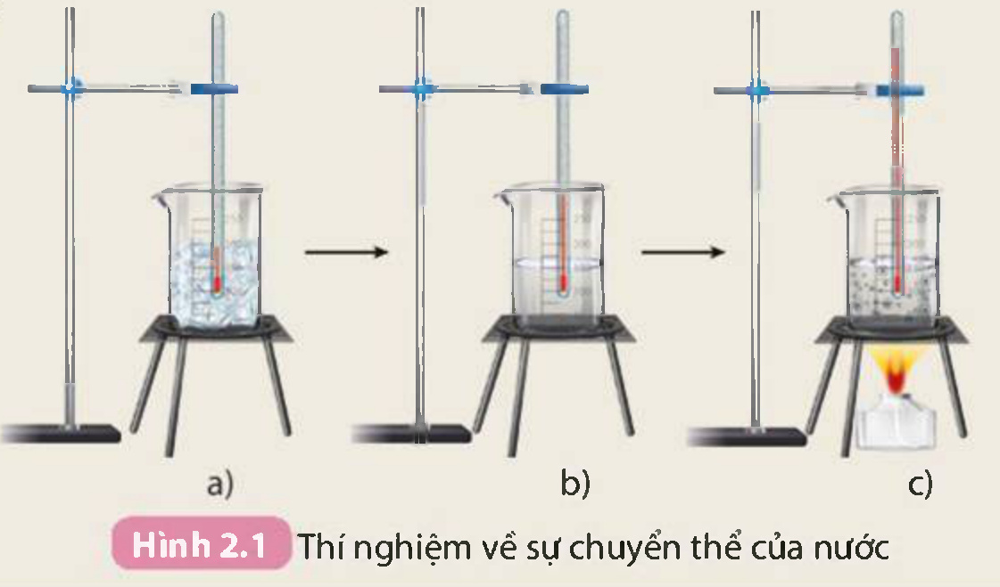
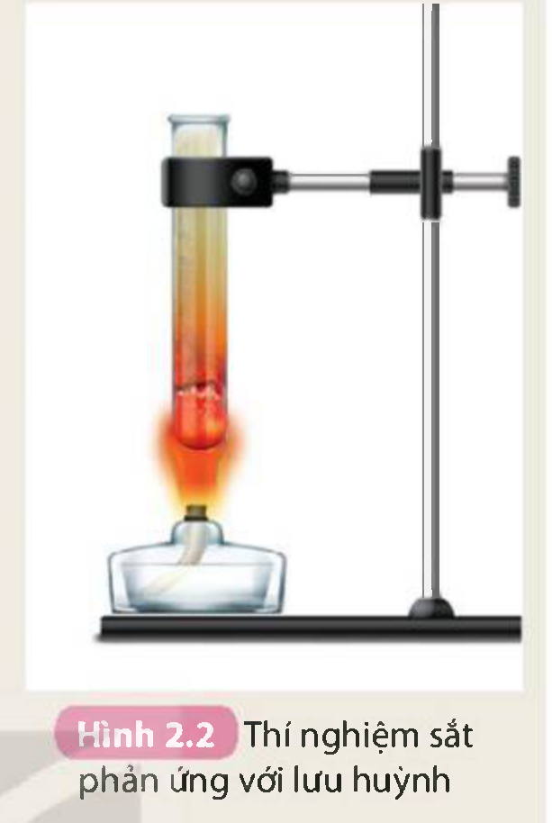
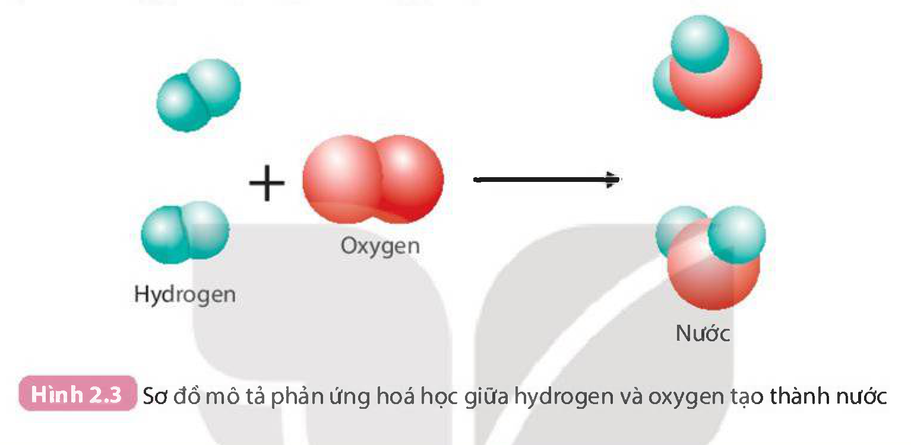
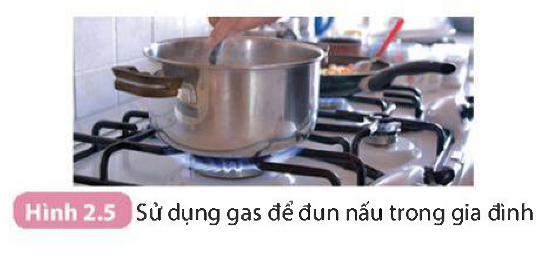

<!-- pdf:13 -->

# BÀI 2: PHẢN ỨNG HOÁ HỌC

## 🎯 Mục tiêu

- Nêu được khái niệm, đưa ra được ví dụ minh hoạ và phân biệt được biến đổi vật lí, biến đổi hoá học.
- Tiến hành được một số thí nghiệm về biến đổi vật lí và biến đổi hoá học.
- Nêu được khái niệm phản ứng hoá học, chất đầu và sản phẩm.
- Nêu được sự sắp xếp khác nhau của các nguyên tử trong phân tử chất đầu và sản phẩm.
- Chỉ ra được một số dấu hiệu chứng tỏ có phản ứng hoá học xảy ra.
- Nêu được khái niệm, đưa ra được ví dụ minh hoạ về phản ứng toả nhiệt, thu nhiệt và trình bày được các ứng dụng phổ biến của phản ứng toả nhiệt (đốt cháy than, xăng, dầu).

## 🔴 Mở đầu

Khi đốt nến, một phần nến chảy lỏng, một phần nến bị cháy. Cây nến ngắn dần. Vậy phần nến nào đã bị biến đổi thành chất mới?

## I. Biến đổi vật lí và biến đổi hoá học

> ✋ Thí nghiệm về biến đổi vật lí
>
> *Chuẩn bị:* nước đá viên; cốc thuỷ tinh $250\text{ mL}$, nhiệt kế, đèn cồn, kiềng sắt.
>
> *Tiến hành:* Thực hiện thí nghiệm như mô tả trong Hình 2.1.
>
> *Quan sát hiện tượng và thực hiện các yêu cầu sau:*
>
> 1. Xác định các giá trị nhiệt độ tương ứng với các bước thí nghiệm mô tả trong Hình 2.1.
> 2. Ở quá trình ngược lại, hơi nước ngưng tụ thành nước lỏng, nước lỏng đông đặc thành nước đá. Vậy trong quá trình chuyển thể, nước có biến đổi thành chất khác không?
>
> 
>
> Hình 2.1. Thí nghiệm về sự chuyển thể của nước

Các quá trình như hoà tan, đông đặc, nóng chảy,... các chất chỉ chuyển từ trạng thái này sang trạng thái khác, không tạo thành chất mới, đó là **biến đổi vật lí**.

<!-- pdf:14 -->

> ✋ Thí nghiệm về biến đổi hoá học
>
> *Chuẩn bị:* bột sắt (iron, $\ce{Fe}$) và bột lưu huỳnh (sulfur, $\ce{S}$) theo tỉ lệ $7 : 4$ về khối lượng; ống nghiệm chịu nhiệt, đèn cồn, đũa thuỷ tinh, thìa thuỷ tinh.
>
> *Tiến hành:*
>
> - Trộn đều hỗn hợp bột sắt và bột lưu huỳnh. Lần lượt cho vào hai ống nghiệm (1) và (2) mỗi ống 3 thìa hỗn hợp.
> - Đưa nam châm lại gần ống nghiệm (1). Quan sát hiện tượng.
> - Đun nóng mạnh đáy ống nghiệm (2) khoảng $30$ giây rồi ngừng đun. Để nguội và đưa nam châm lại gần ống nghiệm (2). Quan sát hiện tượng.
>
> *Trả lời câu hỏi:*
>
> 1. Sau khi trộn bột sắt và bột lưu huỳnh, hỗn hợp thu được có bị nam châm hút không?
> 2. Chất trong ống nghiệm (2) sau khi được đun nóng và để nguội có bị nam châm hút không?
> 3. Sau khi trộn bột sắt và bột lưu huỳnh, có chất mới được tạo thành không? Giải thích.
> 4. Sau khi đun nóng hỗn hợp bột sắt và bột lưu huỳnh, có chất mới được tạo thành không? Giải thích.
>
> 
>
> Hình 2.2. Thí nghiệm sắt phản ứng với lưu huỳnh

Các quá trình như đốt cháy nhiên liệu, phân huỷ chất (ví dụ: nung đá vôi,...), tổng hợp chất (ví dụ: quá trình quang hợp,...),... có sự tạo thành chất mới, đó là **biến đổi hoá học**.

Trong cơ thể người và động vật, sự trao đổi chất là một loạt các quá trình sinh hoá, đó là những quá trình phức tạp, bao gồm cả biến đổi vật lí và biến đổi hoá học.

> ❓ Lấy một số ví dụ trong đời sống về các quá trình xảy ra sự biến đổi vật lí, biến đổi hoá học.

## II. Phản ứng hoá học

### 1. Khái niệm

Quá trình biến đổi từ chất này thành chất khác được gọi là **phản ứng hoá học**. Chất ban đầu bị biến đổi trong phản ứng được gọi là **chất phản ứng** hay **chất tham gia**. Chất mới sinh ra được gọi là **sản phẩm**.

Phản ứng hoá học được biểu diễn bằng phương trình dạng chữ như sau: <!-- term: Phương trình dạng chữ -->

Tên các chất phản ứng $\longrightarrow$ Tên các chất sản phẩm

Ví dụ: Iron $+$ Sulfur $\longrightarrow$ Iron(II) sulfide
<!-- ocr-ok: đã đối chiếu ảnh trang gốc 14 (trang sách 12), OCR đọc sai chữ số La Mã II và cụm fi trong Iron(II) sulfide -->

Đọc là: iron tác dụng với sulfur tạo thành iron(II) sulfide.
<!-- ocr-ok: đã đối chiếu ảnh trang gốc 14 (trang sách 12), OCR đọc sai Iron(II) sulfide -->

Trong đó: iron và sulfur là chất phản ứng; iron(II) sulfide là sản phẩm.
<!-- ocr-ok: đã đối chiếu ảnh trang gốc 14 (trang sách 12), OCR đọc sai Iron(II) sulfide -->

Trong quá trình phản ứng, lượng chất phản ứng giảm dần, lượng sản phẩm tăng dần.

Phản ứng xảy ra hoàn toàn khi có ít nhất một chất phản ứng đã phản ứng hết.

<!-- pdf:15 -->

> ❓ Than (thành phần chính là carbon) cháy trong không khí tạo thành khí carbon dioxide.
>
> a) Hãy viết phương trình phản ứng dạng chữ của phản ứng này.
>
> Chất nào là chất phản ứng? Chất nào là sản phẩm?
>
> b) Trong quá trình phản ứng, lượng chất nào giảm dần? Lượng chất nào tăng dần?

### 2. Diễn biến phản ứng hoá học

Trong phản ứng hoá học, xảy ra sự phá vỡ các liên kết trong phân tử chất đầu, hình thành các liên kết mới, tạo ra các phân tử mới. Kết quả là chất này biến đổi thành chất khác.

Ví dụ: Phản ứng giữa hydrogen và oxygen tạo thành nước được mô tả như sau:

Hình 2.3. Sơ đồ mô tả phản ứng hoá học giữa hydrogen và oxygen tạo thành nước

> ❓ Quan sát Hình 2.3 và trả lời câu hỏi:
>
> 1. Trước và sau phản ứng, những nguyên tử nào liên kết với nhau?
> 2. Trong quá trình phản ứng, số nguyên tử H và số nguyên tử O có thay đổi không?

> 🔍 Các phản ứng hoá học chỉ xảy ra khi các chất phản ứng tiếp xúc với nhau. Nhiều phản ứng để xảy ra được cần phải có thêm điều kiện là đun nóng. Một số phản ứng muốn xảy ra nhanh hơn cần có thêm chất xúc tác,...

### 3. Hiện tượng kèm theo các phản ứng hoá học

Phản ứng hoá học xảy ra khi có chất mới được tạo thành với những tính chất mới, khác biệt với chất ban đầu. Những dấu hiệu có thể nhận ra có chất mới tạo thành là sự thay đổi về màu sắc, xuất hiện chất khí hoặc xuất hiện chất kết tủa,... Sự toả nhiệt và phát sáng cũng có thể là dấu hiệu cho biết phản ứng hoá học đã xảy ra (Hình 2.4).

Hình 2.4. Nến cháy kèm theo sự toả nhiệt và phát sáng

<!-- pdf:16 -->

> ✋ Dấu hiệu nhận biết có chất mới tạo thành
>
> *Chuẩn bị:* dung dịch hydrochloric acid ($\ce{HCl}$) loãng, sodium hydroxide ($\ce{NaOH}$), copper(II) sulfate ($\ce{CuSO4}$), barium chloride ($\ce{BaCl2}$), kẽm viên (zinc, $\ce{Zn}$); ống nghiệm, ống hút nhỏ giọt.
>
> *Tiến hành:*
>
> - Cho khoảng $3\text{ mL}$ dung dịch hydrochloric acid vào ống nghiệm (1) chứa kẽm viên và ống nghiệm (2) chứa $2\text{ mL}$ dung dịch barium chloride.
> - Cho khoảng $3\text{ mL}$ dung dịch sodium hydroxide vào ống nghiệm (3) chứa $2\text{ mL}$ dung dịch copper(II) sulfate.
>
> *Quan sát hiện tượng xảy ra và trả lời câu hỏi:*
>
> Ống nghiệm nào xảy ra phản ứng hoá học? Giải thích.

> ❓ 1. Trong phản ứng giữa oxygen và hydrogen, nếu oxygen hết thì phản ứng có xảy ra nữa không?
>
> 2. Nhỏ giấm ăn vào viên đá vôi. Dấu hiệu nào cho biết đã có phản ứng hoá học xảy ra?

## III. Năng lượng của phản ứng hoá học

### 1. Phản ứng toả nhiệt, phản ứng thu nhiệt

Đốt đèn cồn, cồn (ethanol) cháy. Khi đó, ethanol và khí oxygen trong không khí đã tác dụng với nhau tạo thành hơi nước và khí carbon dioxide, đồng thời giải phóng ra năng lượng dưới dạng nhiệt. Phản ứng đốt cháy cồn là phản ứng toả nhiệt.

Với phản ứng phân huỷ copper(II) hydroxide thành copper(II) oxide và hơi nước thì cần cung cấp năng lượng dưới dạng nhiệt bằng cách đun nóng. Khi ngừng cung cấp nhiệt, phản ứng cũng dừng lại. Đây là phản ứng thu nhiệt.

Như vậy, **phản ứng toả nhiệt** giải phóng năng lượng (dạng nhiệt) ra môi trường xung quanh và **phản ứng thu nhiệt** nhận năng lượng (dạng nhiệt) trong suốt quá trình phản ứng xảy ra.

> ❓ 1. Thức ăn được tiêu hoá chuyển thành các chất dinh dưỡng. Phản ứng hoá học giữa chất dinh dưỡng với oxygen cung cấp năng lượng cho cơ thể hoạt động là phản ứng toả nhiệt hay thu nhiệt? Lấy thêm ví dụ về loại phản ứng này.
>
> 2. Quá trình nung đá vôi (thành phần chính là $\ce{CaCO3}$) thành vôi sống ($\ce{CaO}$) và khí carbon dioxide ($\ce{CO2}$) cần cung cấp năng lượng (dạng nhiệt). Đây là phản ứng toả nhiệt hay thu nhiệt?

### 2. Ứng dụng của phản ứng toả nhiệt

Các phản ứng toả nhiệt có vai trò quan trọng trong cuộc sống vì chúng cung cấp năng lượng cho sinh hoạt và sản xuất, vận hành động cơ, thiết bị máy công nghiệp, phương tiện giao thông,...

Hình 2.5. Sử dụng gas để đun nấu trong gia đình

<!-- pdf:17 -->

> ✋ 1. Than, xăng, dầu,... là nhiên liệu hoá thạch, được sử dụng chủ yếu cho các ngành sản xuất và các hoạt động nào của con người? Em hãy sưu tầm hình ảnh và trình bày về ứng dụng của các nhiên liệu này trong đời sống.
>
> 2. Các nguồn nhiên liệu hoá thạch có phải là vô tận không? Đốt cháy nhiên liệu hoá thạch ảnh hưởng đến môi trường như thế nào? Hãy nêu ví dụ về việc tăng cường sử dụng các nguồn năng lượng thay thế để giảm việc sử dụng các nhiên liệu hoá thạch.

> 🔍 - Các phản ứng đốt cháy nhiên liệu đều cần cung cấp khí oxygen và thường thải ra khí carbon dioxide. Ngoài ra, khi than cháy ở nhiệt độ cao và thiếu không khí thường sinh ra thêm một lượng nhỏ khí carbon monoxide ($\ce{CO}$).
> - $\ce{CO}$ là chất khí rất độc, không màu, không mùi và không gây kích ứng nên rất nguy hiểm vì không cảm nhận được sự hiện diện của khí $\ce{CO}$ trong không khí. Khi khí $\ce{CO}$ trong không khí chiếm từ $0,001\%$ đến $0,01\%$ về thể tích, có thể dẫn đến đau thắt ngực, suy giảm thị lực và giảm chức năng não. Ở nồng độ khí $\ce{CO}$ cao hơn, có thể gây tử vong.

## 📌 Em đã học

- Biến đổi hoá học có sự tạo thành chất mới, còn biến đổi vật lí không có sự tạo thành chất mới.
- Trong phản ứng hoá học, liên kết giữa các nguyên tử thay đổi, làm cho phân tử này biến đổi thành phân tử khác. Kết quả là chất này biến đổi thành chất khác.
- Để nhận biết phản ứng hoá học xảy ra có thể dựa vào một trong các dấu hiệu sau: sự tạo thành chất khí; chất kết tủa; sự thay đổi màu sắc; sự thay đổi về nhiệt độ của môi trường;...
- Phản ứng toả nhiệt giải phóng năng lượng (dạng nhiệt) ra môi trường và phản ứng thu nhiệt nhận năng lượng (dạng nhiệt) từ môi trường trong suốt quá trình phản ứng.
- Các nhiên liệu như than, xăng, dầu,... được sử dụng trong các ngành sản xuất, phục vụ sinh hoạt,...

## ✏️ Em có thể

- Nhận biết được các biến đổi hoá học xảy ra trong cuộc sống hằng ngày.
- Sử dụng nhiệt của các phản ứng đốt cháy nhiên liệu để đun nấu, sưởi ấm,...

## 📷 Danh sách hình trong bài

| Mã hình | Trang PDF | Trang sách | Chú thích |
|---|---|---|---|
| H8-khoa_hoc_tu_nhien-b02-01 | 13 | 11 | Hình 2.1. Thí nghiệm về sự chuyển thể của nước |
| H8-khoa_hoc_tu_nhien-b02-02 | 14 | 12 | Hình 2.2. Thí nghiệm sắt phản ứng với lưu huỳnh |
| H8-khoa_hoc_tu_nhien-b02-03 | 15 | 13 | Hình 2.3. Sơ đồ mô tả phản ứng hoá học giữa hydrogen và oxygen tạo thành nước |
| H8-khoa_hoc_tu_nhien-b02-04 | 15 | 13 | Hình 2.4. Nến cháy kèm theo sự toả nhiệt và phát sáng |
| H8-khoa_hoc_tu_nhien-b02-05 | 16 | 14 | Hình 2.5. Sử dụng gas để đun nấu trong gia đình |
