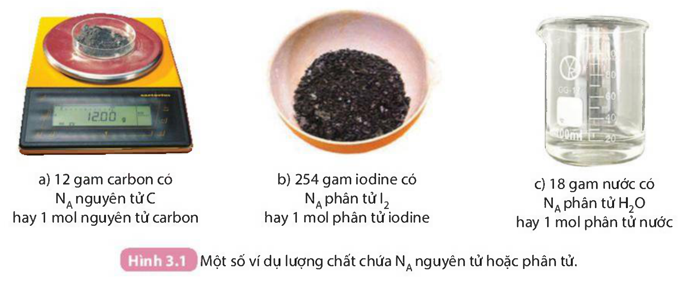

<!-- pdf:18 -->

# BÀI 3: MOL VÀ TỈ KHỐI CHẤT KHÍ

## 🎯 Mục tiêu

- Nêu được khái niệm mol, tính được khối lượng mol và chuyển đổi được giữa số mol và khối lượng.
- Nêu được khái niệm tỉ khối, viết được công thức tính tỉ khối của chất khí và so sánh được chất khí này nặng hay nhẹ hơn chất khí khác, công thức tính tỉ khối.
- Nêu được khái niệm thể tích mol của chất khí ở áp suất $1\text{ bar}$ và $25\text{ }^\circ\text{C}$.
- Sử dụng được công thức $n\text{ (mol)} = \frac{V\text{ (L)}}{24,79\text{ (L/mol)}}$ để chuyển đổi giữa số mol và thể tích chất khí ở điều kiện chuẩn: áp suất $1\text{ bar}$ ở $25\text{ }^\circ\text{C}$.

## 🔴 Mở đầu

Bằng phép đo thông thường, ta chỉ xác định được khối lượng chất rắn, chất lỏng hoặc thể tích của chất khí. Làm thế nào để biết lượng chất có bao nhiêu phân tử, nguyên tử?

## I. Mol

### 1. Khái niệm

Trong khoa học, $\frac{1}{12}$ khối lượng nguyên tử carbon được quy ước là đơn vị khối lượng nguyên tử (amu). Như vậy: khối lượng $1$ nguyên tử carbon là $12\text{ amu}$. Khối lượng này vô cùng nhỏ bé, không thể cân bằng các dụng cụ thông thường (khối lượng của $1$ nguyên tử carbon tính theo đơn vị gam là $0,000\,000\,000\,000\,000\,000\,000\,019\,926\text{ gam}$). Nhưng ta dễ dàng cân được $12\text{ gam}$ carbon. Các nhà khoa học đã tìm ra $12\text{ gam}$ carbon có chứa số nguyên tử là $602\,200\,000\,000\,000\,000\,000\,000 = 6,022 \cdot 10^{23}$. Số $6,022 \cdot 10^{23}$ được gọi là **số Avogadro**, được kí hiệu là $N_{\text{A}}$.

**Mol** *là lượng chất có chứa $N_{\text{A}}$ ($6,022 \cdot 10^{23}$) nguyên tử hoặc phân tử của chất đó.*

*a) $12\text{ gam}$ carbon có $N_{\text{A}}$ nguyên tử $\ce{C}$ hay $1\text{ mol}$ nguyên tử carbon; b) $254\text{ gam}$ iodine có $N_{\text{A}}$ phân tử $\ce{I2}$ hay $1\text{ mol}$ phân tử iodine; c) $18\text{ gam}$ nước có $N_{\text{A}}$ phân tử $\ce{H2O}$ hay $1\text{ mol}$ phân tử nước*
<!-- ocr-ok: đã đối chiếu ảnh trang gốc 18 (trang sách 16), các đại lượng và kí hiệu trong chú giải Hình 3.1 viết bằng LaTeX/mhchem -->

Hình 3.1. Một số ví dụ lượng chất chứa $N_{\text{A}}$ nguyên tử hoặc phân tử.

<!-- pdf:19 -->

> ❓ 1. Đọc thông tin Hình 3.1 và so sánh khối lượng của $1\text{ mol}$ nguyên tử carbon, $1\text{ mol}$ phân tử iodine và $1\text{ mol}$ phân tử nước.
>
> 2. Tính số nguyên tử, phân tử có trong mỗi lượng chất sau:
>
> a) $0,25\text{ mol}$ nguyên tử $\ce{C}$; b) $0,002\text{ mol}$ phân tử $\ce{I2}$; c) $2\text{ mol}$ phân tử $\ce{H2O}$.
>
> 3. Một lượng chất sau đây tương đương bao nhiêu mol nguyên tử hoặc mol phân tử?
>
> a) $1,2044 \cdot 10^{22}$ phân tử $\ce{Fe2O3}$; b) $7,5275 \cdot 10^{24}$ nguyên tử $\ce{Mg}$.

> 🔍 Số Avogadro lớn tới mức nào?
>
> Để hình dung số Avogadro lớn tới mức nào, ta hãy thử một phép toán: giả sử ta có $1\text{ mol}$ quả cam được xếp sát nhau thành một đường thẳng, đường kính mỗi quả cam đều bằng $6\text{ cm}$. Vậy chiều dài đường thẳng tạo thành từ $1\text{ mol}$ quả cam là: $6,022 \cdot 10^{23} \cdot 6 \approx 36 \cdot 10^{23}\text{ cm} = 36 \cdot 10^{18}\text{ km}$.
>
> Khoảng cách từ Trái Đất đến Mặt Trời là khoảng $150 \cdot 10^6\text{ km}$. Như vậy, đường thẳng tạo thành từ $1\text{ mol}$ quả cam này sẽ gấp khoảng $\frac{36 \cdot 10^{18}}{150 \cdot 10^6} = 240 \cdot 10^9$ khoảng cách từ Trái Đất đến Mặt Trời.
>
> Có thể thấy số Avogadro vô cùng lớn. Vì vậy, nó chỉ được sử dụng đối với hạt vi mô.

### 2. Khối lượng mol

**Khối lượng mol** (kí hiệu là $M$) của một chất là khối lượng của $N_{\text{A}}$ nguyên tử hoặc phân tử chất đó tính theo đơn vị gam.

Một số ví dụ về khối lượng mol nguyên tử và khối lượng mol phân tử được trình bày trong Bảng 3.1 và Bảng 3.2.

Bảng 3.1. Khối lượng một số nguyên tử và khối lượng mol nguyên tử tương ứng

| Nguyên tử | Kí hiệu hoá học | Khối lượng nguyên tử | Khối lượng mol nguyên tử |
|---|---|---|---|
| Carbon | $\ce{C}$ | $12\text{ amu}$ | $12\text{ g/mol}$ |
| Hydrogen | $\ce{H}$ | $1\text{ amu}$ | $1\text{ g/mol}$ |
| Oxygen | $\ce{O}$ | $16\text{ amu}$ | $16\text{ g/mol}$ |
<!-- ocr-ok: đã đối chiếu ảnh trang gốc 19 (trang sách 17), OCR đọc dính chữ và sai số trong Bảng 3.1 -->

Bảng 3.2. Khối lượng một số phân tử và khối lượng mol phân tử tương ứng

| Phân tử | Công thức hoá học | Số lượng nguyên tử trong phân tử | Khối lượng phân tử | Khối lượng mol phân tử |
|---|---|---|---|---|
| Hydrogen | $\ce{H2}$ | 2 nguyên tử $\ce{H}$ | $2 \cdot 1 = 2\text{ (amu)}$ | $2\text{ g/mol}$ |
| Nước | $\ce{H2O}$ | 2 nguyên tử $\ce{H}$, 1 nguyên tử $\ce{O}$ | $2 \cdot 1 + 1 \cdot 16 = 18\text{ (amu)}$ | $18\text{ g/mol}$ |
<!-- ocr-ok: đã đối chiếu ảnh trang gốc 19 (trang sách 17), OCR đọc sai kí hiệu H, O và công thức trong Bảng 3.2 -->

Khối lượng mol ($\text{g/mol}$) của một chất và khối lượng nguyên tử hoặc phân tử của chất đó ($\text{amu}$) bằng nhau về trị số, khác về đơn vị đo.

Gọi $n$ là số mol chất có trong $m$ gam. Khối lượng mol ($M$) được tính theo công thức:

$M = \frac{m}{n}\text{ (g/mol)}$

<!-- pdf:20 -->

> ❓ 1. Tính khối lượng mol của chất X, biết rằng $0,4\text{ mol}$ chất này có khối lượng là $23,4\text{ gam}$.
>
> 2. Tính số mol phân tử có trong $9\text{ gam}$ nước, biết rằng khối lượng mol của nước là $18\text{ g/mol}$.
>
> 3. Calcium carbonate có công thức hoá học là $\ce{CaCO3}$.
>
> a) Tính khối lượng phân tử của calcium carbonate.
>
> b) Tính khối lượng của $0,2\text{ mol}$ calcium carbonate.

### 3. Thể tích mol của chất khí

**Thể tích mol của chất khí** là thể tích chiếm bởi $N_{\text{A}}$ phân tử của chất khí đó.

Thể tích mol của các chất khí bất kì ở cùng điều kiện nhiệt độ và áp suất đều bằng nhau.

Như vậy, ở cùng điều kiện nhiệt độ và áp suất, hai bình khí có thể tích bằng nhau có cùng số mol khí.

Ở điều kiện chuẩn ($25\text{ }^\circ\text{C}$ và $1\text{ bar}$), $1\text{ mol}$ khí bất kì đều chiếm thể tích là $24,79\text{ lít}$. <!-- term: Điều kiện chuẩn -->

Vậy ở điều kiện này, $n\text{ mol}$ khí chiếm thể tích là: $V = 24,79 \cdot n\text{ (L)}$.

> 🔍 Thể tích mol của một số chất lỏng và chất rắn
>
> Thể tích mol của một số chất rắn và chất lỏng ở $25\text{ }^\circ\text{C}$ và $1\text{ bar}$ như sau:
>
> Đồng (copper): $7,2\text{ cm}^3\text{/mol}$;
>
> Nhôm (aluminium): $10,0\text{ cm}^3\text{/mol}$;
>
> Nước lỏng: $18,0\text{ cm}^3\text{/mol}$;
>
> Ethanol: $57,5\text{ cm}^3\text{/mol}$.
>
> Thể tích mol của chất rắn và chất lỏng thường rất nhỏ so với thể tích mol của chất khí ở cùng điều kiện, ít phụ thuộc vào nhiệt độ và áp suất.

> ❓ 1. Ở $25\text{ }^\circ\text{C}$ và $1\text{ bar}$, $1,5\text{ mol}$ khí chiếm thể tích bao nhiêu?
>
> 2. Một hỗn hợp gồm $1\text{ mol}$ khí oxygen với $4\text{ mol}$ khí nitrogen. Ở $25\text{ }^\circ\text{C}$ và $1\text{ bar}$, hỗn hợp khí này có thể tích là bao nhiêu?
>
> 3. Tính số mol khí chứa trong bình có thể tích $500\text{ mililít}$ ở $25\text{ }^\circ\text{C}$ và $1\text{ bar}$.
<!-- ocr-ok: đã đối chiếu ảnh trang gốc 20 (trang sách 18), OCR đọc sai mililít thành mihlít -->

## II. Tỉ khối chất khí

Để xác định khí A nặng hơn hay nhẹ hơn khí B bao nhiêu lần, ta dựa vào tỉ số giữa khối lượng mol của khí A ($M_{\text{A}}$) và khối lượng mol của khí B ($M_{\text{B}}$). Tỉ số này được gọi là **tỉ khối của khí A đối với khí B**, được biểu diễn bằng công thức: $d_{\text{A/B}} = \frac{M_{\text{A}}}{M_{\text{B}}}$.

Để xác định một khí A nặng hơn hay nhẹ hơn không khí bao nhiêu lần, ta dựa vào tỉ số giữa khối lượng mol của khí A và “khối lượng mol” của không khí:

<!-- pdf:21 -->

- Coi không khí gồm $20\%$ oxygen và $80\%$ nitrogen về thể tích. Vậy trong $1\text{ mol}$ không khí có $0,2\text{ mol}$ oxygen và $0,8\text{ mol}$ nitrogen. Khối lượng mol của không khí là:

$M_{\text{kk}} = 0,2 \cdot 32 + 0,8 \cdot 28 \approx 29\text{ (g/mol)}$.

- Tỉ khối của khí A đối với không khí là: $d_{\text{A/kk}} = \frac{M_{\text{A}}}{29}$.

> ❓ 1. a) Khí carbon dioxide ($\ce{CO2}$) nặng hơn hay nhẹ hơn không khí bao nhiêu lần?
>
> b) Trong lòng hang sâu thường xảy ra quá trình phân huỷ chất vô cơ hoặc hữu cơ, sinh ra khí carbon dioxide. Hãy cho biết khí carbon dioxide tích tụ ở trên nền hang hay bị không khí đẩy bay lên trên.
>
> 2. a) Khí methane ($\ce{CH4}$) nặng hơn hay nhẹ hơn không khí bao nhiêu lần?
>
> b) Dưới đáy giếng thường xảy ra quá trình phân huỷ chất hữu cơ, sinh ra khí methane. Hãy cho biết khí methane tích tụ dưới đáy giếng hay bị không khí đẩy bay lên trên.

## 📌 Em đã học

- Mol là lượng chất có chứa $N_{\text{A}}$ ($6,022 \cdot 10^{23}$) nguyên tử hoặc phân tử chất đó.
- Khối lượng mol của một chất là khối lượng của $N_{\text{A}}$ nguyên tử hoặc phân tử chất đó tính theo đơn vị gam.
- Thể tích mol của chất khí là thể tích chiếm bởi $1\text{ mol}$ phân tử chất khí đó.
- Tỉ khối của khí A đối với khí B là tỉ lệ khối lượng mol giữa khí A và khí B.

## ✏️ Em có thể

- Cân hoặc đong một lượng chất có số mol xác định.
- Cảnh báo các nguy cơ mất an toàn khi nạo, vét giếng, thám hiểm hang động,...

## 📷 Danh sách hình trong bài

| Mã hình | Trang PDF | Trang sách | Chú thích |
|---|---|---|---|
| H8-khoa_hoc_tu_nhien-b03-01 | 18 | 16 | Hình 3.1. Một số ví dụ lượng chất chứa N_A nguyên tử hoặc phân tử. |
