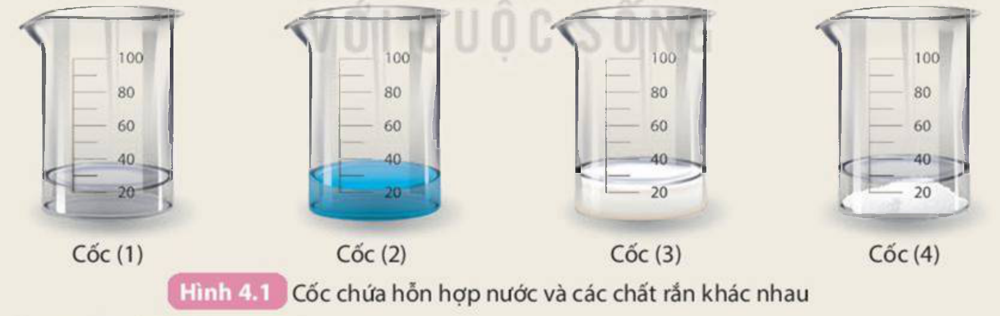

<!-- pdf:22 -->

# BÀI 4: DUNG DỊCH VÀ NỒNG ĐỘ

## 🎯 Mục tiêu

- Nêu được dung dịch là hỗn hợp đồng nhất của các chất đã tan trong nhau.
- Nêu được định nghĩa độ tan của một chất trong nước, nồng độ phần trăm, nồng độ mol.
- Tính được độ tan, nồng độ phần trăm; nồng độ mol theo công thức.
- Tiến hành được thí nghiệm pha một dung dịch theo một nồng độ cho trước.

## 🔴 Mở đầu

Các dung dịch thường có ghi kèm theo nồng độ xác định như nước muối sinh lí $0,9\%$, sulfuric acid $1\text{ mol/L}$,... Vậy nồng độ dung dịch là gì?

## I. Dung dịch, chất tan và dung môi

**Dung dịch** là hỗn hợp đồng nhất của chất tan và dung môi. Trong thực tế, dung môi thường là nước ở thể lỏng, chất tan có thể ở thể rắn, lỏng hoặc khí. Ở nhiệt độ, áp suất nhất định, dung dịch có thể hoà tan thêm chất tan đó được gọi là **dung dịch chưa bão hoà**, dung dịch không thể hoà tan thêm chất tan đó được gọi là **dung dịch bão hoà**. <!-- term: Dung môi --> <!-- term: Chất tan -->

> ✋ Nhận biết dung dịch, chất tan và dung môi
>
> *Chuẩn bị:* nước, muối ăn, sữa bột (hoặc bột sắn, bột gạo,...), copper(II) sulfate; cốc thuỷ tinh, đũa khuấy.
>
> *Tiến hành:*
>
> - Cho khoảng $20\text{ mL}$ nước vào bốn cốc thuỷ tinh, đánh số (1), (2), (3) và (4).
> - Cho vào cốc (1) 1 thìa (khoảng $3\text{ g}$) muối ăn hạt, cốc (2) 1 thìa copper(II) sulfate, cốc (3) 1 thìa sữa bột, cốc (4) 4 thìa muối ăn. Khuấy đều khoảng 2 phút, sau đó để yên.
>
> 
>
> *Cốc (1); Cốc (2); Cốc (3); Cốc (4)*
>
> Hình 4.1. Cốc chứa hỗn hợp nước và các chất rắn khác nhau
>
> *Quan sát và trả lời câu hỏi:*
>
> 1. Trong các cốc (1), (2), (3), cốc nào chứa dung dịch? Dựa vào dấu hiệu nào để nhận biết? Chỉ ra chất tan, dung môi trong dung dịch thu được.
> 2. Phần dung dịch ở cốc (4) có phải là dung dịch bão hoà ở nhiệt độ phòng không? Giải thích.

> ❓ Hãy nêu cách pha dung dịch bão hoà của sodium carbonate ($\ce{Na2CO3}$) trong nước.

<!-- pdf:23 -->

## II. Độ tan

Trong cùng điều kiện về nhiệt độ và áp suất, khả năng tan trong cùng một dung môi của các chất là khác nhau. Với cùng một lượng dung môi xác định, những chất tan tốt cần lượng lớn chất tan để tạo dung dịch bão hoà, còn những chất tan kém chỉ cần một lượng nhỏ chất tan đã thu được dung dịch bão hoà. Để đặc trưng cho khả năng tan của mỗi chất, người ta dùng khái niệm *độ tan*.

**Độ tan** của một chất trong nước là số gam chất đó hoà tan trong $100\text{ gam}$ nước để tạo thành dung dịch bão hoà ở nhiệt độ, áp suất xác định.

Độ tan của một chất trong nước được tính theo công thức: $S = \frac{m_{\text{ct}}}{m_{\text{nước}}} \cdot 100$.

Trong đó: $S$ là độ tan, đơn vị $\text{g/100 g}$ nước;

$m_{\text{ct}}$ là khối lượng chất tan, đơn vị là gam ($\text{g}$);

$m_{\text{nước}}$ là khối lượng nước, đơn vị là gam ($\text{g}$).

Độ tan của hầu hết các chất rắn như đường, muối ăn,... đều tăng khi nhiệt độ tăng.

> ❓ 1. Ở nhiệt độ $25\text{ }^\circ\text{C}$, khi cho $12\text{ gam}$ muối X vào $20\text{ gam}$ nước, khuấy kĩ thì còn lại $5\text{ gam}$ muối không tan. Tính độ tan của muối X.
>
> 2. Ở $18\text{ }^\circ\text{C}$, khi hoà tan hết $53\text{ gam}$ $\ce{Na2CO3}$ trong $250\text{ gam}$ nước thì được dung dịch bão hoà. Tính độ tan của $\ce{Na2CO3}$ trong nước ở nhiệt độ trên.

> 🔍 Ngày nóng, cá thường ngoi lên phía mặt nước để hô hấp vì độ tan của oxygen trong nước đã bị giảm đi khi nhiệt độ tăng.
>
> Trong sản xuất nước ngọt có gas, người ta nén khí carbon dioxide ở áp suất cao để tăng độ tan của khí này trong nước.
>
> Nói chung, độ tan của hầu hết chất khí giảm khi nhiệt độ tăng hoặc áp suất giảm.

## III. Nồng độ dung dịch

Để định lượng một dung dịch đặc hay loãng, người ta dùng đại lượng nồng độ. Có hai loại nồng độ dung dịch thường dùng là *nồng độ phần trăm* và *nồng độ mol*. <!-- term: Nồng độ dung dịch -->

### 1. Nồng độ phần trăm

**Nồng độ phần trăm** (kí hiệu $C\%$) của một dung dịch cho biết số gam chất tan có trong $100\text{ gam}$ dung dịch.

Nồng độ phần trăm được xác định bằng biểu thức: $C\% = \frac{m_{\text{ct}}}{m_{\text{dd}}} \cdot 100(\%)$.

Trong đó: $C\%$ là nồng độ phần trăm của dung dịch, đơn vị $\%$;

$m_{\text{ct}}$ là khối lượng chất tan, đơn vị là gam ($\text{g}$);

$m_{\text{dd}}$ là khối lượng dung dịch, đơn vị là gam ($\text{g}$).

Khối lượng dung dịch = khối lượng chất tan + khối lượng dung môi.

Ví dụ: Dung dịch nước oxy già chứa chất tan hydrogen peroxide ($\ce{H2O2}$). Tính khối lượng hydrogen peroxide có trong $20\text{ gam}$ dung dịch nước oxy già $3\%$.

<!-- pdf:24 -->

*Hướng dẫn giải:*

Khối lượng hydrogen peroxide có trong $20\text{ gam}$ dung dịch nước oxy già $3\%$:

$m_{\ce{H2O2}} = \frac{m_{\text{dd}} \cdot C\%}{100} = \frac{20 \cdot 3}{100} = 0,6\text{ (g)}$.

### 2. Nồng độ mol

**Nồng độ mol** (kí hiệu $C_{\text{M}}$) của một dung dịch cho biết số mol chất tan có trong $1\text{ lít}$ dung dịch.

Nồng độ mol được xác định bằng biểu thức:

$C_{\text{M}} = \frac{n_{\text{ct}}}{V_{\text{dd}}}$.

Trong đó: $C_{\text{M}}$ là nồng độ mol của dung dịch, có đơn vị là $\text{mol/L}$ và thường được biểu diễn là $\text{M}$;

$n_{\text{ct}}$ là số mol chất tan, đơn vị là $\text{mol}$;

$V_{\text{dd}}$ là thể tích dung dịch, đơn vị là lít ($\text{L}$).

Ví dụ: Hoà tan hoàn toàn $1,35\text{ gam}$ copper(II) chloride vào nước, thu được $50\text{ mL}$ dung dịch. Tính nồng độ mol của dung dịch copper(II) chloride thu được.

*Hướng dẫn giải:*

Bước 1: Tính số mol chất tan.

$n_{\ce{CuCl2}} = \frac{m_{\ce{CuCl2}}}{M_{\ce{CuCl2}}} = \frac{1,35}{135} = 0,01\text{ (mol)}$.

Bước 2: Tính nồng độ dung dịch copper(II) chloride.

Đổi đơn vị: $50\text{ mL} = 0,05\text{ L}$.

Nồng độ mol dung dịch copper(II) chloride là:

$C_{\text{M}(\ce{CuCl2})} = \frac{n_{\text{ct}}}{V_{\text{dd}}} = \frac{0,01}{0,05} = 0,2\text{ (mol/L)}$.

> ❓ 1. Tính khối lượng $\ce{H2SO4}$ có trong $20\text{ gam}$ dung dịch $\ce{H2SO4}$ $98\%$.
>
> 2. Trộn lẫn $2\text{ lít}$ dung dịch urea $0,02\text{ M}$ (dung dịch A) với $3\text{ lít}$ dung dịch urea $0,1\text{ M}$ (dung dịch B), thu được $5\text{ lít}$ dung dịch C.
>
> a) Tính số mol urea trong dung dịch A, B và C.
>
> b) Tính nồng độ mol của dung dịch C. Nhận xét về giá trị nồng độ mol của dung dịch C so với nồng độ mol của dung dịch A, B.

## IV. Thực hành pha chế dung dịch theo một nồng độ cho trước

> ✋ Pha $100\text{ gam}$ dung dịch muối ăn nồng độ $0,9\%$
>
> *Chuẩn bị:* muối ăn khan, nước cất; cốc thuỷ tinh, cân, ống đong.

<!-- pdf:25 -->

> *Tiến hành:*
>
> - Xác định khối lượng muối ăn ($m_1$) và nước ($m_2$) dựa vào công thức:
>
> $C\% = \frac{m_{\text{ct}}}{m_{\text{dd}}} \cdot 100(\%)$,
>
> - Cân $m_1\text{ gam}$ muối ăn rồi cho vào cốc thuỷ tinh.
> - Cân $m_2\text{ gam}$ nước cất, rót vào cốc, lắc đều cho muối tan hết.
>
> *Trả lời câu hỏi:*
>
> 1. Tại sao phải dùng muối ăn khan để pha dung dịch?
> 2. Dung dịch muối ăn nồng độ $0,9\%$ có thể được dùng để làm gì?

> 🔍 Oresol (viết tắt của Oral Rehydration Solution) là một loại dung dịch có tác dụng bù nước và điện giải. Trong Oresol có một số thành phần chính là: sodium chloride, sodium bicarbonate, potassium chloride, glucose. Nồng độ các chất trong một loại dung dịch Oresol được WHO và UNICEF khuyên dùng là ion sodium: $0,075\text{ mol/L}$; ion chloride: $0,065\text{ mol/L}$; ion potassium: $0,020\text{ mol/L}$; ion citrate: $0,010\text{ mol/L}$; glucose: $0,075\text{ mol/L}$,... <!-- term: Oresol -->

## 📌 Em đã học

- Dung dịch là hỗn hợp đồng nhất của chất tan và dung môi.
- Độ tan của một chất trong nước: $S = \frac{m_{\text{ct}}}{m_{\text{nước}}} \cdot 100$.
  ($S$ là độ tan, $m_{\text{ct}}$ là khối lượng chất tan, $m_{\text{nước}}$ là khối lượng nước).
- Nồng độ phần trăm: $C\% = \frac{m_{\text{ct}}}{m_{\text{dd}}} \cdot 100(\%)$.
  ($C\%$ là nồng độ phần trăm, $m_{\text{ct}}$ là khối lượng chất tan, $m_{\text{dd}}$ là khối lượng dung dịch).
- Nồng độ mol: $C_{\text{M}} = \frac{n_{\text{ct}}}{V_{\text{dd}}}$.
  ($C_{\text{M}}$ là nồng độ mol, $n_{\text{ct}}$ là số mol chất tan, $V_{\text{dd}}$ là thể tích dung dịch).

## ✏️ Em có thể

- Pha chế một dung dịch có nồng độ xác định để làm thí nghiệm.
- Pha chế dung dịch nước muối $0,9\%$ (có thể dùng thay nước muối sinh lí trong một số trường hợp).

## 📷 Danh sách hình trong bài

| Mã hình | Trang PDF | Trang sách | Chú thích |
|---|---|---|---|
| H8-khoa_hoc_tu_nhien-b04-01 | 22 | 20 | Hình 4.1. Cốc chứa hỗn hợp nước và các chất rắn khác nhau |
