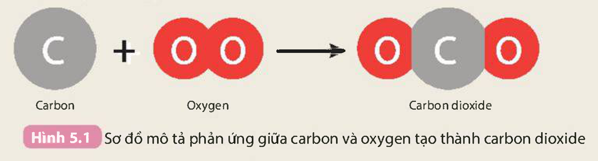

<!-- pdf:26 -->

# BÀI 5: ĐỊNH LUẬT BẢO TOÀN KHỐI LƯỢNG VÀ PHƯƠNG TRÌNH HOÁ HỌC

## 🎯 Mục tiêu

- Tiến hành được thí nghiệm để chứng minh: trong phản ứng hoá học khối lượng được bảo toàn.
- Phát biểu được định luật bảo toàn khối lượng.
- Nêu được khái niệm phương trình hoá học và các bước lập phương trình hoá học.
- Trình bày được ý nghĩa của phương trình hoá học.
- Lập được sơ đồ phản ứng hoá học dạng chữ và phương trình hoá học (dùng công thức hoá học) của một số phản ứng hoá học cụ thể.

## 🔴 Mở đầu

Khi các phản ứng hoá học xảy ra, lượng các chất phản ứng giảm dần, lượng các chất sản phẩm tăng dần. Vậy tổng khối lượng các chất trước và sau phản ứng có thay đổi không?

## I. ĐỊNH LUẬT BẢO TOÀN KHỐI LƯỢNG

### 1. Nội dung định luật bảo toàn khối lượng

> ✋ *Chuẩn bị:* Dung dịch barium chloride, sodium sulfate; cân điện tử, cốc thuỷ tinh.
>
> *Tiến hành:*
>
> - Trên mặt cân đặt 2 cốc: cốc (1) đựng dung dịch barium chloride, cốc (2) đựng dung dịch sodium sulfate. Ghi tổng khối lượng 2 cốc.
> - Đổ cốc (1) vào cốc (2), lắc nhẹ để hai dung dịch trộn lẫn với nhau. Quan sát thấy có một chất rắn màu trắng xuất hiện ở cốc (2). Phản ứng xảy ra như sau:
>
> Barium chloride $+$ Sodium sulfate $\longrightarrow$ Barium sulfate $+$ Sodium chloride
>
> Đặt 2 cốc trở lại mặt cân. Ghi khối lượng.
>
> *Thực hiện yêu cầu sau:*
>
> So sánh tổng khối lượng của các chất trước phản ứng với tổng khối lượng các chất sau phản ứng.

Vào thế kỉ XVIII, hai nhà khoa học là Lomonosov (Lô-mô-nô-xốp, người Nga) và Lavoisier (La-voa-đi-ê, người Pháp) đã tiến hành độc lập nhiều thí nghiệm được cân đo chính xác và đã đưa ra **định luật bảo toàn khối lượng**:  
*“Trong một phản ứng hoá học, tổng khối lượng của các chất sản phẩm bằng tổng khối lượng các chất tham gia phản ứng”.*

Điều này được giải thích rằng, trong các phản ứng hoá học, chỉ có liên kết giữa các nguyên tử thay đổi, còn số nguyên tử của mỗi nguyên tố hoá học vẫn giữ nguyên, vì vậy tổng khối lượng của các chất tham gia phản ứng bằng tổng khối lượng của các sản phẩm.

<!-- pdf:27 -->

> ❓ Carbon tác dụng với oxygen theo sơ đồ Hình 5.1:
>
> 
>
> Hình 5.1. Sơ đồ mô tả phản ứng giữa carbon và oxygen tạo thành carbon dioxide
>
> Giải thích tại sao khối lượng carbon dioxide bằng tổng khối lượng carbon và oxygen.

### 2. Áp dụng định luật bảo toàn khối lượng

Trong phản ứng: Barium chloride $+$ Sodium sulfate $\longrightarrow$ Barium sulfate $+$ Sodium chloride.

Theo định luật bảo toàn khối lượng, ta có:

$m_{\text{Barium chloride}} + m_{\text{Sodium sulfate}} = m_{\text{Barium sulfate}} + m_{\text{Sodium chloride}}$

Nếu biết khối lượng của ba chất, ta tính được khối lượng của chất còn lại.

Ví dụ: Biết khối lượng barium chloride và sodium sulfate đã phản ứng lần lượt là $20,8\text{ gam}$ và $14,2\text{ gam}$, khối lượng của barium sulfate tạo thành là $23,3\text{ gam}$, ta sẽ xác định được khối lượng của sodium chloride tạo thành là:

$20,8 + 14,2 - 23,3 = 11,7\text{ (g)}$.

*Tổng quát:* Nếu trong phản ứng có $n$ chất, khi biết khối lượng đã tham gia và tạo thành của $(n - 1)$ chất, ta sẽ xác định được khối lượng của chất còn lại.

> ❓ 1. Sau khi đốt cháy than tổ ong (thành phần chính là carbon) thì thu được xỉ than. Xỉ than nặng hơn hay nhẹ hơn than tổ ong? Giải thích.
>
> 2. Vôi sống (calcium oxide) phản ứng với một số chất có mặt trong không khí như sau:
>
> Calcium oxide $+$ Carbon dioxide $\longrightarrow$ Calcium carbonate
>
> Calcium oxide $+$ Nước $\longrightarrow$ Calcium hydroxide
>
> Khi làm thí nghiệm, một học sinh quên đậy nắp lọ đựng vôi sống (thành phần chính là $\ce{CaO}$), sau một thời gian thì khối lượng của lọ sẽ thay đổi như thế nào?

## II. PHƯƠNG TRÌNH HOÁ HỌC

### 1. Lập phương trình hoá học

Phản ứng hoá học giữa khí oxygen và khí hydrogen được biểu diễn bằng phương trình chữ như sau :

Khí hydrogen $+$ Khí oxygen $\longrightarrow$ Nước.

Thay tên các chất bằng công thức hoá học, được **sơ đồ của phản ứng**:

$\ce{H2 + O2} \dashrightarrow \ce{H2O}$

<!-- pdf:28 -->

Trong phản ứng hoá học, tổng số nguyên tử của mỗi nguyên tố trong các chất tham gia phản ứng luôn bằng tổng số nguyên tử của nguyên tố đó trong các chất sản phẩm. Sau khi cân bằng, tổng số nguyên tử của mỗi nguyên tố ở hai vế của sơ đồ phản ứng bằng nhau, ta được **phương trình hoá học**:

$\ce{2H2 + O2 -> 2H2O}$

Phương trình hoá học biểu diễn ngắn gọn phản ứng hoá học với chất tham gia phản ứng ở bên trái mũi tên chỉ chiều phản ứng và chất sản phẩm ở bên phải mũi tên.

**Các bước lập phương trình hoá học**

Lập phương trình hoá học được thực hiện qua ba bước, được mô tả thông qua ví dụ sau: Lập phương trình hoá học của phản ứng giữa nhôm (aluminium) và oxygen, tạo thành aluminium oxide.

*Bước 1: Viết sơ đồ của phản ứng:*

$\ce{Al + O2} \dashrightarrow \ce{Al2O3}$

*Bước 2: Cân bằng số nguyên tử của mỗi nguyên tố ở 2 vế:*

Số nguyên tử $\ce{Al}$ và $\ce{O}$ ở 2 vế đều không bằng nhau, nhưng $\ce{O}$ có số nguyên tử nhiều hơn nên ta bắt đầu từ nguyên tố này trước. Do $\ce{O2}$ có 2 nguyên tử $\ce{O}$ còn $\ce{Al2O3}$ có 3 nguyên tử $\ce{O}$ nên để cân bằng, ta đặt hệ số 2 trước $\ce{Al2O3}$ và hệ số 3 trước $\ce{O2}$:

$\ce{Al + 3O2} \dashrightarrow \ce{2Al2O3}$

Để cân bằng tiếp số nguyên tử $\ce{Al}$ ta cần đặt hệ số 4 trước $\ce{Al}$ ở vế trái.

*Bước 3: Viết phương trình hoá học của phản ứng:*

$\ce{4Al + 3O2 -> 2Al2O3}$

**Lưu ý:**

- Hệ số viết ngang với kí hiệu của các chất.
- Không thay đổi các chỉ số trong các công thức hoá học đã viết đúng. Ví dụ, oxygen phải viết ở dạng phân tử là $\ce{O2}$, do đó ta không viết $6\ce{O}$ mà phải viết $3\ce{O2}$.
- Nếu trong công thức hoá học, các chất ở 2 vế có những nhóm nguyên tử giống nhau (các nhóm nguyên tử này không bị biến đổi trong phản ứng mà chỉ chuyển từ chất này sang chất khác) thì coi nhóm nguyên tử này như một "nguyên tố” để cân bằng.

> ✋ Lập phương trình hoá học của các phản ứng sau:
>
> a) $\ce{Fe + O2} \dashrightarrow \ce{Fe3O4}$
>
> b) $\ce{Al + HCl} \dashrightarrow \ce{AlCl3 + H2}$
>
> c) $\ce{Al2(SO4)3 + NaOH} \dashrightarrow \ce{Al(OH)3 + Na2SO4}$
>
> d) $\ce{CaCO3 + HCl} \dashrightarrow \ce{CaCl2 + CO2 + H2O}$

<!-- pdf:29 -->

### 2. Ý nghĩa của phương trình hoá học

Phương trình hoá học cho biết trong phản ứng hoá học, lượng các chất tham gia phản ứng và các chất sản phẩm tuân theo một tỉ lệ xác định.

Ví dụ, xét phương trình hoá học: $\ce{4Al + 3O2 -> 2Al2O3}$

Cứ 4 nguyên tử $\ce{Al}$ phản ứng với 3 phân tử $\ce{O2}$, tạo ra 2 phân tử $\ce{Al2O3}$.

Số nguyên tử $\ce{Al}$ : Số phân tử $\ce{O2}$ : Số phân tử $\ce{Al2O3} = 4 : 3 : 2$.

Sau khi học về mol, ta biết thêm đó cũng là tỉ lệ số mol:

Số mol $\ce{Al}$ : Số mol $\ce{O2}$ : Số mol $\ce{Al2O3} = 4 : 3 : 2$.

Vậy, tỉ lệ về số mol của các chất đúng bằng tỉ lệ hệ số của chúng trong phương trình hoá học.

Từ tỉ lệ số mol, ta cũng xác định được tỉ lệ về khối lượng các chất:

Khối lượng $\ce{Al}$ : Khối lượng $\ce{O2}$ : Khối lượng $\ce{Al2O3} = (27 \cdot 4) : (32 \cdot 3) : (102 \cdot 2) = 9 : 8 : 17$.
<!-- ocr-ok: đã đối chiếu ảnh trang gốc 29 (trang sách 27), OCR đọc hỏng công thức và phép nhân tỉ lệ khối lượng -->

Nghĩa là cứ $9\text{ gam}$ $\ce{Al}$ phản ứng hết với $8\text{ gam}$ $\ce{O2}$ tạo ra $17\text{ gam}$ $\ce{Al2O3}$.

> ❓ 1. Sơ đồ của phản ứng hoá học khác với phương trình hoá học ở điểm nào?
>
> Nêu ý nghĩa của phương trình hoá học.
>
> 2. Lập phương trình hoá học và xác định tỉ lệ số phân tử của các chất trong sơ đồ phản ứng hoá học sau:
>
> $\ce{Na2CO3 + Ba(OH)2} \dashrightarrow \ce{BaCO3 + NaOH}$
>
> 3. Giả thiết trong không khí, sắt tác dụng với oxygen tạo thành gỉ sắt ($\ce{Fe2O3}$). Từ $5,6\text{ gam}$ sắt có thể tạo ra tối đa bao nhiêu gam gỉ sắt?

## 📌 Em đã học

- Trong một phản ứng hoá học, tổng khối lượng của các chất sản phẩm bằng tổng khối lượng các chất tham gia phản ứng.
- Phương trình hoá học gồm công thức hoá học của các chất trong phản ứng với hệ số thích hợp sao cho số nguyên tử của mỗi nguyên tố ở hai vế đều bằng nhau.
- Phương trình hoá học cho biết trong phản ứng hoá học, lượng các chất tham gia phản ứng và các chất sản phẩm tuân theo một tỉ lệ xác định.

## ✏️ Em có thể

Vận dụng phương trình hoá học và định luật bảo toàn khối lượng để xác định lượng chất ban đầu cần sử dụng hoặc lượng chất sản phẩm trong quá trình sản xuất và trong cuộc sống.

## 📷 Danh sách hình trong bài

| Mã hình | Trang PDF | Trang sách | Chú thích |
|---|---|---|---|
| H8-khoa_hoc_tu_nhien-b05-01 | 27 | 25 | Hình 5.1. Sơ đồ mô tả phản ứng giữa carbon và oxygen tạo thành carbon dioxide |
