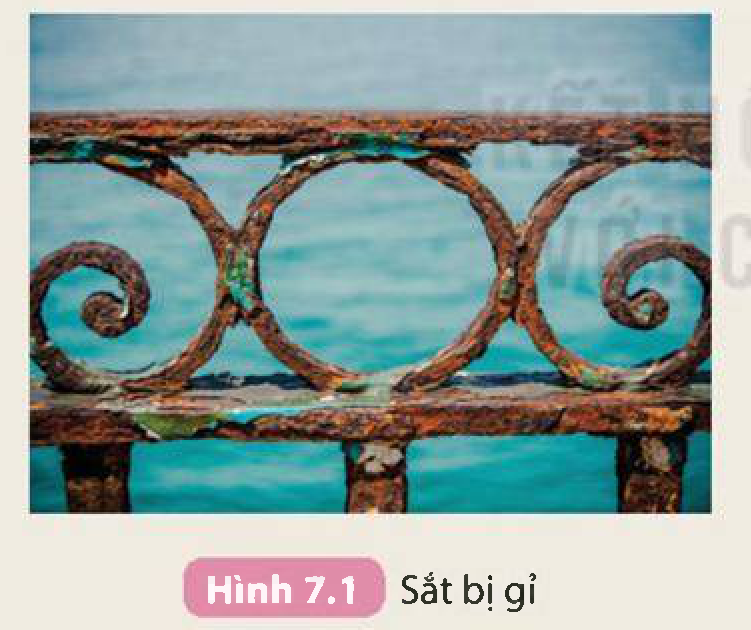
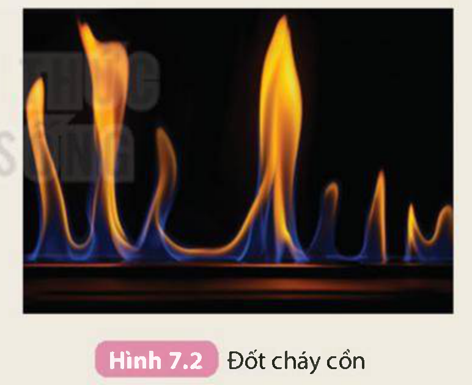
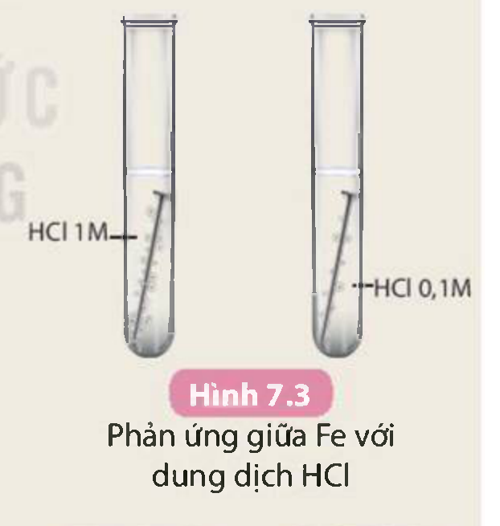
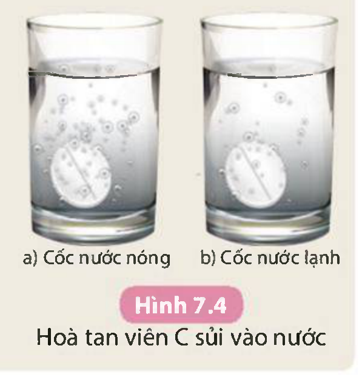
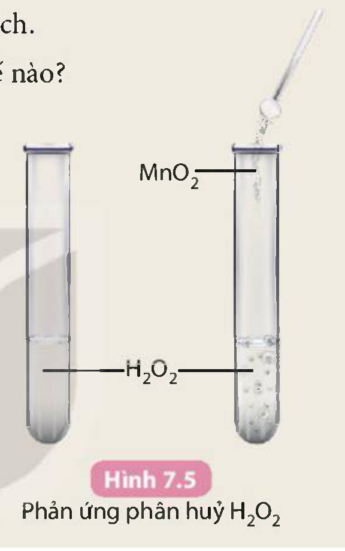

<!-- pdf:33 -->

# BÀI 7: TỐC ĐỘ PHẢN ỨNG VÀ CHẤT XÚC TÁC

## 🎯 Mục tiêu

- Nêu được khái niệm về tốc độ phản ứng (chỉ mức độ nhanh hay chậm của phản ứng hoá học).
- Trình bày được một số yếu tố ảnh hưởng đến tốc độ phản ứng và nêu được một số ứng dụng thực tế.
- Tiến hành được thí nghiệm và quan sát thực tiễn:
  + So sánh được tốc độ một số phản ứng hoá học;
  + Nêu được các yếu tố làm thay đổi tốc độ phản ứng;
  + Nêu được khái niệm về chất xúc tác.

## 🔴 Mở đầu

Có những phản ứng xảy ra rất nhanh, quan sát được ngay như phản ứng nổ, cháy,... và có những phản ứng xảy ra chậm, sau một khoảng thời gian mới quan sát được như phản ứng tạo gỉ sắt, tinh bột lên men rượu,... Vậy dùng đại lượng nào để đặc trưng cho sự nhanh, chậm của một phản ứng? Yếu tố nào ảnh hưởng đến sự nhanh, chậm này?

## I. Khái niệm tốc độ phản ứng

> ✋ So sánh tốc độ của một số phản ứng
>
> Phản ứng sắt bị gỉ, đốt cháy cồn được minh hoạ ở các Hình 7.1 và 7.2.
>
> 
>
> Hình 7.1. Sắt bị gỉ
>
> 
>
> Hình 7.2. Đốt cháy cồn
>
> *Quan sát các Hình 7.1 và 7.2, thảo luận nhóm và trả lời câu hỏi:*
>
> Phản ứng sắt bị gỉ xảy ra nhanh hơn hay chậm hơn phản ứng đốt cháy cồn?

**Tốc độ phản ứng** là đại lượng đặc trưng cho sự nhanh, chậm của phản ứng hoá học. Các phản ứng đốt cháy (cồn, than, củi, giấy,...) xảy ra ngay lập tức, kèm theo sự toả nhiệt và phát sáng. Cồn, than, củi, giấy,... biến đổi rất nhanh thành khí carbon dioxide và hơi nước. Dây thép, cửa sắt (chứa sắt) sau một thời gian có thể xuất hiện lớp gỉ màu nâu, xốp. Ta nói rằng, các phản ứng đốt cháy xảy ra với tốc độ rất nhanh, phản ứng của sắt với oxygen trong không khí ẩm xảy ra với tốc độ chậm hơn.

<!-- pdf:34 -->

> ❓ Một học sinh thực hiện thí nghiệm và ghi lại hiện tượng như sau:
>
> Cho cùng một lượng hydrochloric acid vào hai ống nghiệm đựng cùng một lượng đá vôi ở dạng bột (ống nghiệm (1)) và dạng viên (ống nghiệm (2)). Quan sát hiện tượng thấy rằng ở ống nghiệm (1) bọt khí xuất hiện nhiều hơn và đá vôi tan hết trước.
>
> Phản ứng giữa hydrochloric acid với đá vôi dạng bột xảy ra nhanh hơn hay chậm hơn so với phản ứng giữa hydrochloric acid với đá vôi dạng viên?

> 🔍 Trong một phản ứng, để xác định tốc độ của phản ứng, ta có thể đo sự thay đổi của thể tích chất khí, khối lượng chất rắn hoặc nồng độ chất tan trong một khoảng thời gian.

## II. Một số yếu tố ảnh hưởng đến tốc độ phản ứng

Tốc độ của phản ứng hoá học phụ thuộc vào các yếu tố như nhiệt độ, nồng độ, diện tích bề mặt tiếp xúc của các chất tham gia phản ứng,... Với các phản ứng có sản phẩm tạo thành là chất khí hoặc chất kết tủa, để so sánh tốc độ của phản ứng có thể dựa vào việc quan sát tốc độ thoát khí hoặc tốc độ xuất hiện chất kết tủa.

### 1. Ảnh hưởng của nồng độ đến tốc độ phản ứng

> ✋ *Chuẩn bị:* dung dịch $\ce{HCl}$ $0,1\text{ M}$, dung dịch $\ce{HCl}$ $1\text{ M}$, 2 đinh sắt giống nhau (khoảng $0,2\text{ g}$); ống nghiệm.
>
> *Tiến hành:*
>
> - Cho vào ống nghiệm (1) khoảng $5\text{ mL}$ dung dịch $\ce{HCl}$ $0,1\text{ M}$; ống nghiệm (2) khoảng $5\text{ mL}$ dung dịch $\ce{HCl}$ $1\text{ M}$.
> - Nhẹ nhàng đưa lần lượt 2 đinh sắt vào 2 ống nghiệm và quan sát sự thoát khí.
>
> *Trả lời câu hỏi:*
>
> - Phản ứng ở ống nghiệm nào xảy ra nhanh hơn?
> - Nồng độ ảnh hưởng đến tốc độ phản ứng như thế nào?
>
> 
>
> Hình 7.3. Phản ứng giữa $\ce{Fe}$ với dung dịch $\ce{HCl}$

### 2. Ảnh hưởng của nhiệt độ đến tốc độ phản ứng

> ✋ *Chuẩn bị:* viên C sủi, nước lạnh, nước nóng; cốc thuỷ tinh.
>
> *Tiến hành:*
>
> Lấy hai cốc nước, một cốc nước lạnh và một cốc nước nóng, cho đồng thời vào mỗi cốc một viên C sủi.
>
> *Quan sát hiện tượng và trả lời câu hỏi:*
>
> - Phản ứng ở cốc nào nào xảy ra nhanh hơn?
> - Nhiệt độ ảnh hưởng đến tốc độ phản ứng như thế nào?
>
> 
>
> *a) Cốc nước nóng; b) Cốc nước lạnh*
>
> Hình 7.4. Hoà tan viên C sủi vào nước

<!-- pdf:35 -->

### 3. Ảnh hưởng của diện tích bề mặt tiếp xúc đến tốc độ phản ứng

> ✋ *Chuẩn bị:* dung dịch $\ce{HCl}$ $0,1\text{ M}$, đá vôi (dạng viên), đá vôi (dạng bột hoặc đập nhỏ từ đá vôi dạng viên); ống nghiệm.
>
> *Tiến hành:*
>
> - Cân một lượng đá vôi (dạng bột) và đá vôi (dạng viên) bằng nhau (khoảng $1\text{ gam}$) cho vào 2 ống nghiệm (1) và (2).
> - Cho vào mỗi ống nghiệm khoảng $3\text{ mL}$ dung dịch $\ce{HCl}$ $0,1\text{ M}$, quan sát sự thoát khí.
>
> *Trả lời câu hỏi:*
>
> - Phản ứng ở ống nghiệm nào xảy ra nhanh hơn? Giải thích.
> - Kích thước hạt ảnh hưởng đến tốc độ phản ứng như thế nào?

### 4. Ảnh hưởng của chất xúc tác đến tốc độ phản ứng

> ✋ *Chuẩn bị:* nước oxy già (y tế) $\ce{H2O2}$ $3\%$, manganese dioxide ($\ce{MnO2}$, dạng bột); ống nghiệm.
>
> *Tiến hành:*
>
> - Cho khoảng $3\text{ mL}$ dung dịch $\ce{H2O2}$ $3\%$ vào hai ống nghiệm (1) và ống nghiệm (2).
> - Cho một ít bột manganese dioxide vào ống nghiệm (2) và quan sát sự thoát khí.
>
> *Trả lời câu hỏi:*
>
> Phản ứng ở ống nghiệm nào xảy ra nhanh hơn?
>
> 
>
> Hình 7.5. Phản ứng phân huỷ $\ce{H2O2}$

Khi tăng nồng độ, nhiệt độ hoặc diện tích bề mặt tiếp xúc của chất tham gia phản ứng, tốc độ phản ứng tăng lên.

Ngoài ra, có thể dùng chất xúc tác để tăng tốc độ phản ứng. Ví dụ: $\ce{MnO2}$ làm tăng tốc độ phản ứng phân huỷ $\ce{H2O2}$. Enzyme amylase có trong nước bọt và trong dịch tiết của hệ tiêu hoá giúp đẩy nhanh tốc độ phản ứng chuyển hoá tinh bột thành đường.

Sau phản ứng, khối lượng, tính chất hoá học của chất xúc tác không đổi. Enzyme amylase, manganese dioxide được gọi là **chất xúc tác**.

Các yếu tố ảnh hưởng đến tốc độ phản ứng được vận dụng nhiều trong đời sống và sản xuất. Ví dụ, để nung đá vôi thành vôi sống được nhanh hơn, cần đập nhỏ đá vôi; để thực phẩm giữ được lâu ta nên bảo quản chúng trong tủ lạnh;... Trong công nghiệp, các quá trình sản xuất hoá chất thường cần dùng chất xúc tác để đẩy nhanh tốc độ phản ứng.

<!-- pdf:36 -->

> ❓ 1. Than cháy trong bình khí oxygen nhanh hơn cháy trong không khí. Yếu tố nào ảnh hưởng đến tốc độ của phản ứng đốt cháy than?
>
> 2. Khi “bảo quản thực phẩm trong tủ lạnh để giữ thực phẩm tươi lâu hơn” là đã tác động vào yếu tố gì để làm chậm tốc độ phản ứng?
>
> 3. Trong quá trình sản xuất sulfuric acid có giai đoạn tổng hợp sulfur trioxide ($\ce{SO3}$). Phản ứng xảy ra như sau:
>
> $\ce{2SO2 + O2 -> 2SO3}$.
>
> Khi có mặt vanadium(V) oxide thì phản ứng xảy ra nhanh hơn.
>
> a) Vanadium(V) oxide đóng vai trò gì trong phản ứng tổng hợp sulfur trioxide?
>
> b) Sau phản ứng, khối lượng của vanadium(V) oxide có thay đổi không? Giải thích.

> 🔍 Theo quy định, trong ống xả thải (ống bô) của ô tô có một hộp chứa chất xúc tác, có chức năng thúc đẩy phản ứng chuyển hoá khí carbon monoxide thành carbon dioxide, các oxide của nitrogen thành nitrogen. Đây là các khí không độc hại. Biện pháp này góp phần giảm thiểu ô nhiễm môi trường từ phương tiện giao thông.

## 📌 Em đã học

- Tốc độ phản ứng là đại lượng đặc trưng cho sự nhanh, chậm của một phản ứng hoá học.
- Tốc độ phản ứng tăng khi làm tăng các yếu tố: nhiệt độ, nồng độ, diện tích bề mặt tiếp xúc,...
- Chất xúc tác là chất làm tăng tốc độ phản ứng nhưng sau phản ứng vẫn giữ nguyên về khối lượng và tính chất hoá học.

## ✏️ Em có thể

Vận dụng kiến thức về tốc độ phản ứng để thúc đẩy những phản ứng có lợi như lên men giấm, muối dưa hoặc giảm tốc độ phản ứng có hại như thức ăn bị ôi thiu, kim loại bị gỉ.

## 📷 Danh sách hình trong bài

| Mã hình | Trang PDF | Trang sách | Chú thích |
|---|---|---|---|
| H8-khoa_hoc_tu_nhien-b07-01 | 33 | 31 | Hình 7.1. Sắt bị gỉ |
| H8-khoa_hoc_tu_nhien-b07-02 | 33 | 31 | Hình 7.2. Đốt cháy cồn |
| H8-khoa_hoc_tu_nhien-b07-03 | 34 | 32 | Hình 7.3. Phản ứng giữa Fe với dung dịch HCl |
| H8-khoa_hoc_tu_nhien-b07-04 | 34 | 32 | Hình 7.4. Hoà tan viên C sủi vào nước |
| H8-khoa_hoc_tu_nhien-b07-05 | 35 | 33 | Hình 7.5. Phản ứng phân huỷ H2O2 |
