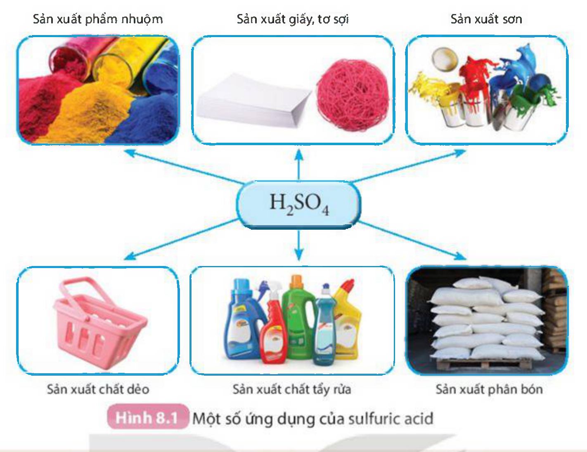
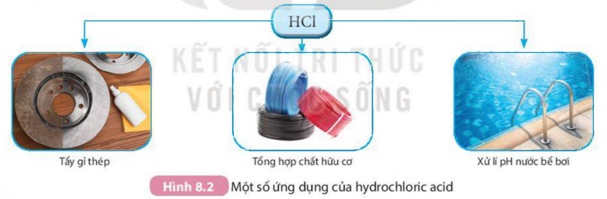
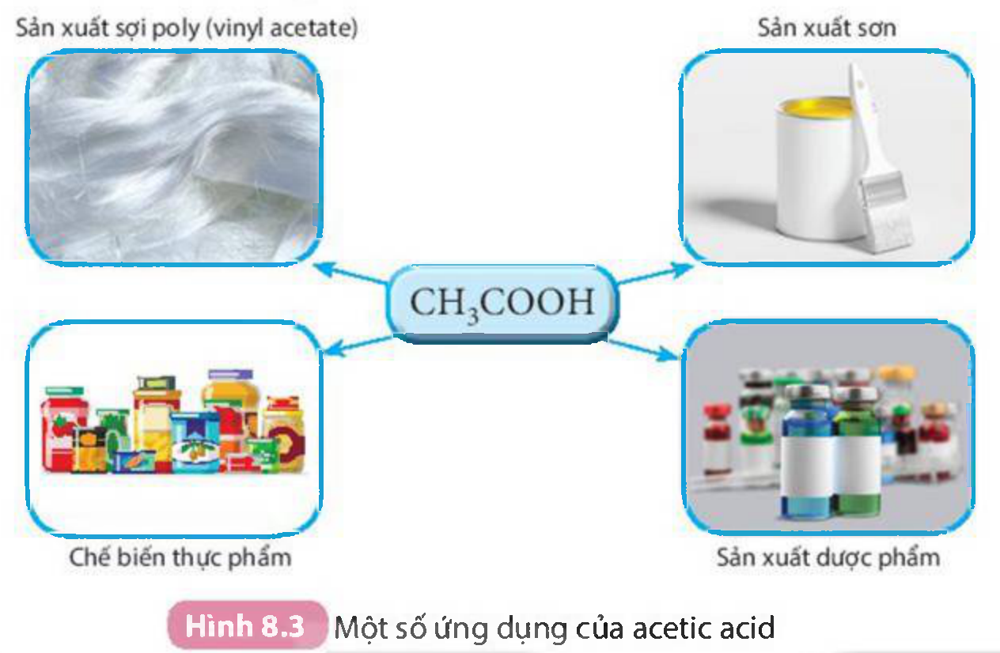

<!-- pdf:37 -->

# BÀI 8: ACID

## 🎯 Mục tiêu

- Nêu được khái niệm acid (tạo ra ion $\ce{H+}$).
- Tiến hành được thí nghiệm của hydrochloric acid (làm đổi màu chất chỉ thị; phản ứng với kim loại), nêu và giải thích được hiện tượng xảy ra trong thí nghiệm (viết phương trình hoá học) và rút ra nhận xét về tính chất của acid.
- Trình bày được một số ứng dụng của một số acid thông dụng ($\ce{HCl}$, $\ce{H2SO4}$, $\ce{CH3COOH}$).
<!-- ocr-ok: đã đối chiếu ảnh trang gốc 37 (trang sách 35), OCR đọc sai từ acid thành add -->

## 🔴 Mở đầu

Tại sao giấm ăn, nước quả chanh,... đều có vị chua và được dùng để loại bỏ cặn trong dụng cụ đun nước?

## I. Khái niệm acid

> ✋ Tìm hiểu khái niệm acid
>
> Bảng 8.1. Tên một số acid thông dụng, công thức hoá học và dạng tồn tại của acid trong dung dịch.
>
> | Tên acid | Công thức hoá học | Dạng tồn tại của acid trong dung dịch: Cation (ion dương) | Dạng tồn tại của acid trong dung dịch: Anion (ion âm) – Gốc acid |
> |---|---|---|---|
> | Hydrochloric acid | $\ce{HCl}$ | $\ce{H+}$ | $\ce{Cl-}$ |
> | Nitric acid | $\ce{HNO3}$ | $\ce{H+}$ | $\ce{NO3-}$ |
> | Sulfuric acid | $\ce{H2SO4}$ | $\ce{H+}$ | $\ce{SO4^2-}$ |
> <!-- ocr-ok: đã đối chiếu ảnh trang gốc 37 (trang sách 35), OCR đọc hỏng tiêu đề cột Anion (ion âm) Gốc acid và các công thức ion trong Bảng 8.1 -->
>
> *Quan sát Bảng 8.1 và thực hiện các yêu cầu:*
>
> 1. Công thức hoá học của các acid có đặc điểm gì giống nhau?
> 2. Dạng tồn tại của acid trong dung dịch có đặc điểm gì chung?
> 3. Đề xuất khái niệm về acid.

<!-- pdf:38 -->

Acid ban đầu được biết đến là những chất có vị chua như acetic acid có trong giấm ăn, citric acid có trong quả chanh, maleic acid có trong quả táo. Từ acid xuất phát từ tiếng Latin là acidus – nghĩa là vị chua. Khái niệm về acid được phát biểu như sau: **Acid** là những hợp chất trong phân tử có nguyên tử hydrogen liên kết với gốc acid. Khi tan trong nước, acid tạo ra ion $\ce{H+}$.

> ❓ Hãy cho biết gốc acid trong các acid sau: $\ce{H2SO4}$, $\ce{HCl}$, $\ce{HNO3}$.

## II. Tính chất hoá học

Acid thường tan được trong nước, dung dịch acid làm đổi màu giấy quỳ từ tím sang đỏ.

Khi dung dịch acid phản ứng với một số kim loại như magnesium, sắt, kẽm,... nguyên tử hydrogen của acid được thay thế bằng nguyên tử kim loại để tạo thành muối và giải phóng ra khí hydrogen$^{(*)}$:

$\ce{Mg + H2SO4 -> MgSO4 + H2}$

(Magnesium) (Sulfuric acid) (Magnesium sulfate) (Hydrogen)
<!-- ocr-ok: đã đối chiếu ảnh trang gốc 38 (trang sách 36), OCR đọc dính chữ Sulfuricacid -->

> ✋ Tính chất của dung dịch hydrochloric acid
>
> *Chuẩn bị:* dung dịch $\ce{HCl}$ $1\text{ M}$, giấy quỳ tím; hai ống nghiệm mỗi ống đựng một trong các kim loại $\ce{Fe}$, $\ce{Zn}$, ống hút nhỏ giọt.
>
> *Tiến hành:*
>
> - Nhỏ $1 - 2$ giọt dung dịch $\ce{HCl}$ vào mẩu giấy quỳ tím.
> - Cho khoảng $3\text{ mL}$ dung dịch $\ce{HCl}$ vào mỗi ống nghiệm đã chuẩn bị ở trên.
>
> *Mô tả hiện tượng xảy ra và viết phương trình hoá học.*

> ❓ Cho dung dịch $\ce{HCl}$ tác dụng với kim loại $\ce{Mg}$. Viết phương trình hoá học của phản ứng xảy ra.

## III. Một số acid thông dụng

### 1. Sulfuric acid

Sulfuric acid ($\ce{H2SO4}$) là chất lỏng không màu, không bay hơi, sánh như dầu ăn, nặng gần gấp hai lần nước. Sulfuric acid tan vô hạn trong nước và toả rất nhiều nhiệt. <!-- term: Sulfuric acid -->

*Lưu ý:* Tuyệt đối không tự ý pha loãng dung dịch sulfuric acid đặc.

Sulfuric acid là một trong các hoá chất được sử dụng nhiều trong các ngành công nghiệp (Hình 8.1) và là hoá chất được tiêu thụ nhiều nhất trên thế giới. <!-- term: Sulfuric acid -->

> (\*) Riêng $\ce{HNO3}$, $\ce{H2SO4}$ đặc tác dụng với kim loại sẽ được học sau.

<!-- pdf:39 -->

Hình 8.1. Một số ứng dụng của sulfuric acid

> ❓ Sử dụng Hình 8.1 để trình bày về các ứng dụng của sulfuric acid.

### 2. Hydrochloric acid

Dung dịch hydrochloric acid ($\ce{HCl}$) là chất lỏng không màu. <!-- term: Hydrochloric acid -->

Hydrochloric acid được sử dụng nhiều trong các ngành công nghiệp (Hình 8.2). <!-- term: Hydrochloric acid -->

Hình 8.2. Một số ứng dụng của hydrochloric acid

> ❓ Sử dụng Hình 8.2 để trình bày về một số ứng dụng của hydrochloric acid.

> 🔍 Hydrochloric acid có trong dạ dày đóng vai trò quan trọng trong quá trình tiêu hoá như: thúc đẩy quá trình tiêu hoá thức ăn; kích thích ruột non và tuỵ sản xuất ra các enzyme tiêu hoá để phân giải chất béo, protein,...; tiêu diệt các vi khuẩn có hại từ bên ngoài đi vào dạ dày;... Khi nồng độ acid trong dạ dày lớn hơn hoặc nhỏ hơn quá mức cần thiết đều gây ảnh hưởng đến chức năng tiêu hoá của dạ dày nói riêng và sức khoẻ nói chung.

<!-- pdf:40 -->

### 3. Acetic acid

Acetic acid ($\ce{CH3COOH}$) là chất lỏng không màu, có vị chua. Trong giấm ăn có chứa acetic acid với nồng độ $2 - 5\%$. <!-- term: Acetic acid -->

Hình 8.3. Một số ứng dụng của acetic acid

> ❓ Sử dụng Hình 8.3 để trình bày về các ứng dụng của acetic acid.

> ✋ Tìm hiểu ứng dụng của một số acid quan trọng
>
> 1. Hãy tìm hiểu về nhu cầu sử dụng và ứng dụng của một trong các acid sau: $\ce{HCl}$, $\ce{H2SO4}$, $\ce{CH3COOH}$ và trình bày trước lớp.
> 2. Việc sử dụng acid không đúng cách sẽ gây ô nhiễm môi trường đất, nước, không khí. Em hãy tìm hiểu về các tác hại này và trình bày trước lớp.

## 📌 Em đã học

- Acid là những hợp chất trong phân tử có nguyên tử hydrogen liên kết với gốc acid. Khi tan trong nước, acid tạo ra ion $\ce{H+}$.
- Công thức phân tử của acid gồm một hay nhiều nguyên tử hydrogen và gốc acid.
- Dung dịch acid làm giấy quỳ tím chuyển sang màu đỏ. Một số kim loại tác dụng với dung dịch acid tạo thành muối và khí hydrogen.
- Các acid như sulfuric acid, hydrochloric acid, acetic acid,... có nhiều ứng dụng quan trọng trong thực tiễn sản xuất và trong đời sống.

## ✏️ Em có thể

- Loại bỏ chất cặn trong các dụng cụ đun nước bằng cách dùng giấm ăn hay nước quả chanh.
- Biết cách sử dụng các sản phẩm chất tẩy rửa có thành phần acid mạnh: cần đeo găng tay, không để các sản phẩm này dính vào da, quần áo,...

## 📷 Danh sách hình trong bài

| Mã hình | Trang PDF | Trang sách | Chú thích |
|---|---|---|---|
| H8-khoa_hoc_tu_nhien-b08-01 | 39 | 37 | Hình 8.1. Một số ứng dụng của sulfuric acid |
| H8-khoa_hoc_tu_nhien-b08-02 | 39 | 37 | Hình 8.2. Một số ứng dụng của hydrochloric acid |
| H8-khoa_hoc_tu_nhien-b08-03 | 40 | 38 | Hình 8.3. Một số ứng dụng của acetic acid |
