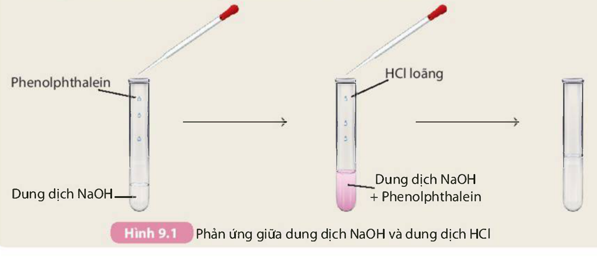
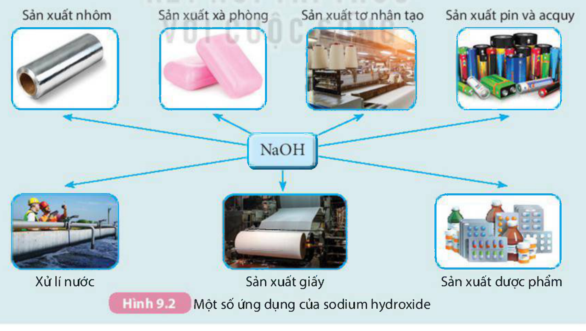
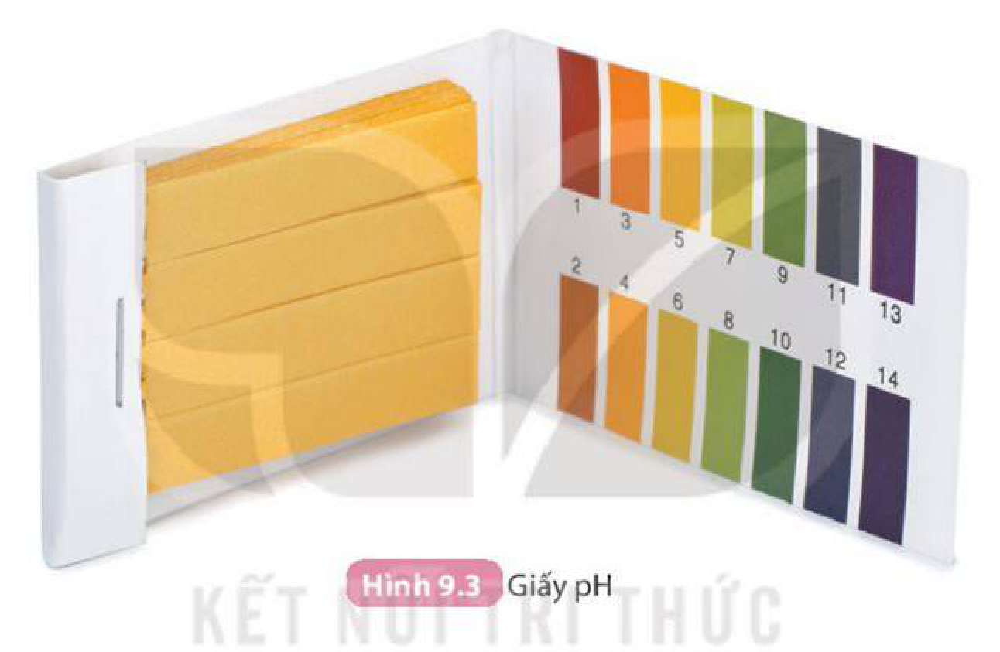

<!-- pdf:41 -->

# BÀI 9: BASE. THANG PH

## 🎯 Mục tiêu

- Nêu được khái niệm base (tạo ra ion $\ce{OH-}$), **kiềm** là các hydroxide tan tốt trong nước.
- Tiến hành được các thí nghiệm của base (làm đổi màu chất chỉ thị, phản ứng với acid tạo muối); nêu và giải thích được hiện tượng xảy ra trong thí nghiệm (viết phương trình hoá học) và rút ra nhận xét về tính chất của base.
- Tra được bảng tính tan để biết một hydroxide cụ thể thuộc loại kiềm hoặc base không tan.
- Nêu được thang pH, sử dụng pH để đánh giá độ acid – base của dung dịch.
- Tiến hành được một số thí nghiệm đo pH (bằng giấy pH) một số loại thực phẩm (đồ uống, hoa quả,...).
- Liên hệ được pH trong dạ dày, trong máu, trong nước mưa, đất.

## 🔴 Mở đầu

Tại sao khi bị ong hoặc kiến đốt, người ta thường bôi vôi vào vết đốt?

## I. Khái niệm

> ✋ Tìm hiểu khái niệm base
>
> Bảng 9.1. Tên một số base thông dụng, công thức hoá học và dạng tồn tại của base trong dung dịch
>
> | Tên base | Công thức hoá học | Dạng tồn tại của base trong dung dịch: Cation kim loại | Dạng tồn tại của base trong dung dịch: Anion |
> |---|---|---|---|
> | Sodium hydroxide | $\ce{NaOH}$ | $\ce{Na+}$ | $\ce{OH-}$ |
> | Barium hydroxide | $\ce{Ba(OH)2}$ | $\ce{Ba^2+}$ | $\ce{OH-}$ |
> <!-- ocr-ok: đã đối chiếu ảnh trang gốc 41 (trang sách 39), OCR đọc hỏng tiêu đề cột và các công thức ion trong Bảng 9.1 -->
>
> *Quan sát Bảng 9.1 và thực hiện các yêu cầu:*
>
> 1. Công thức hoá học của các base có đặc điểm gì giống nhau?
> 2. Các dung dịch base có đặc điểm gì chung?
> 3. Thảo luận nhóm và đề xuất khái niệm về base.
> 4. Em hãy nhận xét về cách gọi tên base và đọc tên base $\ce{Ca(OH)2}$.

Tương tự acid, base cũng là một trong những hợp chất phổ biến.

Công thức phân tử của base gồm có một nguyên tử kim loại và một hay nhiều nhóm hydroxide ($\ce{-OH}$). Số nhóm $\ce{-OH}$ bằng với hoá trị của kim loại.

Khái niệm về base được phát biểu như sau: **Base** là những hợp chất trong phân tử có nguyên tử kim loại liên kết với nhóm hydroxide. Khi tan trong nước, base tạo ra ion $\ce{OH-}$.

<!-- pdf:42 -->

Hầu hết các hydroxide của kim loại là các base. Quy tắc gọi tên các base như sau:

Tên kim loại (kèm hoá trị đối với kim loại có nhiều hoá trị) + hydroxide

Ví dụ: $\ce{Fe(OH)2}$: iron(II) hydroxide;
<!-- ocr-ok: đã đối chiếu ảnh trang gốc 42 (trang sách 40), OCR đọc sai chữ số La Mã II trong iron(II) hydroxide -->

$\ce{Fe(OH)3}$: iron(III) hydroxide.

Phần lớn các base không tan trong nước (**base không tan**), một số ít base tan trong nước tạo thành **dung dịch kiềm** (**base kiềm**) như: $\ce{KOH}$, $\ce{NaOH}$, $\ce{Ba(OH)2}$,...

> ❓ Dựa vào bảng tính tan dưới đây, hãy cho biết những base nào là base không tan và base nào là base kiềm? Viết công thức hoá học và đọc tên các base có trong bảng.
>
> | Kim loại | $\ce{K}$ | $\ce{Na}$ | $\ce{Mg}$ | $\ce{Ba}$ | $\ce{Cu}$ | $\ce{Fe}$ | $\ce{Fe}$ |
> |---|---|---|---|---|---|---|---|
> | Hoá trị | I | I | II | II | II | II | III |
> | Nhóm $\ce{-OH}$ | t | t | k | t | k | k | k |
>
> *(Trong đó: t – tan; k – không tan)*
<!-- ocr-ok: đã đối chiếu ảnh trang gốc 42 (trang sách 40), OCR đọc sai chữ số La Mã chỉ hoá trị trong bảng tính tan base -->

## II. Tính chất hoá học

> ✋ Tính chất hoá học của base
>
> *Chuẩn bị:* Dung dịch $\ce{NaOH}$ loãng, dung dịch $\ce{HCl}$ loãng, giấy quỳ tím, dung dịch phenolphthalein; ống nghiệm, ống hút nhỏ giọt.
>
> *Tiến hành:*
>
> *Thí nghiệm 1:* Nhỏ $1 - 2$ giọt dung dịch $\ce{NaOH}$ vào mẩu giấy quỳ tím.
>
> *Thí nghiệm 2:* Cho vào ống nghiệm khoảng $1\text{ mL}$ dung dịch $\ce{NaOH}$ loãng, sau đó nhỏ vào ống nghiệm $2 - 3$ giọt dung dịch phenolphthalein. Dùng ống hút nhỏ giọt nhỏ từ từ dung dịch $\ce{HCl}$ vào hỗn hợp, vừa nhỏ vừa lắc (Hình 9.1).
>
> 
>
> Hình 9.1. Phản ứng giữa dung dịch $\ce{NaOH}$ và dung dịch $\ce{HCl}$

<!-- pdf:43 -->

> *Quan sát hiện tượng và thực hiện các yêu cầu:*
>
> 1. Dung dịch kiềm làm đổi màu chất chỉ thị màu (giấy quỳ tím, dung dịch phenolphthalein) như thế nào?
> 2. Nêu hiện tượng xảy ra ở thí nghiệm 2 và rút ra nhận xét.

Các base khác như $\ce{KOH}$, $\ce{Ca(OH)2}$, $\ce{Mg(OH)2}$, $\ce{Fe(OH)3}$,... cũng phản ứng với dung dịch acid tạo thành muối và nước.

Phản ứng của base với acid tạo thành muối và nước. Phản ứng này được gọi là **phản ứng trung hoà**.

Ví dụ: $\ce{Ca(OH)2 + H2SO4 -> CaSO4 + 2H2O}$.

> 🔍 Trong nọc của con ong và kiến có chứa các acid. Khi bôi vôi tôi ($\ce{Ca(OH)2}$) vào vết ong hoặc kiến đốt sẽ có tác dụng giảm đau do xảy ra phản ứng trung hoà acid và base.

> ❓ 1. Có hai ống nghiệm không nhãn đựng dung dịch $\ce{NaOH}$ và dung dịch $\ce{HCl}$. Hãy nêu cách nhận biết hai dung dịch trên.
>
> 2. Ở nông thôn, người ta thường dùng vôi bột rắc lên ruộng để khử chua cho đất. Biết rằng thành phần chính của vôi bột là $\ce{CaO}$. $\ce{CaO}$ tác dụng với $\ce{H2O}$ tạo thành $\ce{Ca(OH)2}$ theo phương trình hoá học: $\ce{CaO + H2O -> Ca(OH)2}$. Hãy giải thích tác dụng của vôi bột.

> 🔍 Sodium hydroxide là base có nhiều ứng dụng trong sản xuất và đời sống (Hình 9.2).
>
> 
>
> Hình 9.2. Một số ứng dụng của sodium hydroxide

<!-- pdf:44 -->

## III. Thang pH

**Thang pH** là một tập hợp các con số có giá trị từ $1 - 14$ được sử dụng để đánh giá độ acid – base của dung dịch. Các dung dịch acid có giá trị pH nhỏ hơn 7, các dung dịch kiềm có giá trị pH lớn hơn 7 và dung dịch trung tính có giá trị pH bằng 7.

Ngoài ra giá trị pH còn có thể được sử dụng để so sánh độ mạnh của các acid cùng nồng độ hoặc các base cùng nồng độ. Ví dụ, hydrochloric acid $\ce{HCl}$ $0,1\text{ M}$ có $\text{pH} = 1$; acetic acid $\ce{CH3COOH}$ $0,1\text{ M}$ có $\text{pH} \approx 3$ nên hydrochloric acid mạnh hơn acetic acid.

pH của một dung dịch có thể được xác định bằng chất chỉ thị màu vạn năng. **Chất chỉ thị màu vạn năng** là hỗn hợp các chất màu (ở dạng dung dịch hoặc giấy pH). Mỗi màu của chất chỉ thị ứng với một khoảng giá trị pH. Khi cần xác định giá trị pH với độ chính xác cao, người ta sử dụng các thiết bị đo pH như: máy đo pH, bút đo pH,...

Hình 9.3. Giấy pH
<!-- ocr-ok: đã đối chiếu ảnh trang gốc 44 (trang sách 42), OCR bỏ sót nhãn Hình 9.3 -->

> ✋ Xác định pH của một số dung dịch bằng giấy pH
>
> *Chuẩn bị:* Các cốc đã được dán nhãn: nước lọc, nước chanh, nước ngọt có gas, nước rửa bát, giấm ăn, dung dịch baking soda, giấy pH; ống hút nhỏ giọt, đĩa thuỷ tinh.
>
> *Tiến hành:*
>
> - Cho 6 mẩu giấy pH dài khoảng $1\text{ cm}$ lên đĩa thuỷ tinh.
> - Nhỏ lên mỗi mẩu giấy pH một loại dung dịch đã chuẩn bị ở trên.
> - So sánh màu thu được trên các mẩu giấy pH với bảng màu dãy pH chuẩn và ghi giá trị pH.
>
> *Thực hiện các yêu cầu sau:*
>
> 1. Đọc giá trị pH của từng dung dịch và cho biết dung dịch nào có tính acid, dung dịch nào có tính base.
> 2. Tính chất chung của dung dịch các chất có giá trị $\text{pH} < 7$ và của dung dịch các chất có giá trị $\text{pH} > 7$ là gì?

<!-- pdf:45 -->

> ❓ 1. Hãy nêu cách để kiểm tra đất trồng có bị chua hay không.
>
> 2. Hãy tìm hiểu và cho biết giá trị pH trong máu, trong dịch dạ dày của người, trong nước mưa, trong đất. Nếu giá trị pH của máu và của dịch dạ dày ngoài khoảng chuẩn sẽ gây nguy hiểm cho sức khoẻ của người như thế nào?

## 📌 Em đã học

- Base là những hợp chất trong phân tử có nguyên tử kim loại liên kết với nhóm hydroxide. Khi tan trong nước, base tạo ra ion $\ce{OH-}$.
- Dung dịch base làm giấy quỳ tím chuyển sang màu xanh, dung dịch phenolphthalein không màu chuyển sang màu hồng. Phản ứng giữa dung dịch acid và base tạo thành muối và nước được gọi là phản ứng trung hoà.
- Theo thang pH: dung dịch có $\text{pH} < 7$: môi trường acid; dung dịch có $\text{pH} > 7$: môi trường base; dung dịch có $\text{pH} = 7$: môi trường trung tính.

## ✏️ Em có thể

- Sử dụng giấy pH để đánh giá độ acid, base của các dung dịch, môi trường đất, nước,... phục vụ cho sản xuất, đời sống và chăm sóc sức khoẻ.

## 📷 Danh sách hình trong bài

| Mã hình | Trang PDF | Trang sách | Chú thích |
|---|---|---|---|
| H8-khoa_hoc_tu_nhien-b09-01 | 42 | 40 | Hình 9.1. Phản ứng giữa dung dịch NaOH và dung dịch HCl |
| H8-khoa_hoc_tu_nhien-b09-02 | 43 | 41 | Hình 9.2. Một số ứng dụng của sodium hydroxide |
| H8-khoa_hoc_tu_nhien-b09-03 | 44 | 42 | Hình 9.3. Giấy pH |
