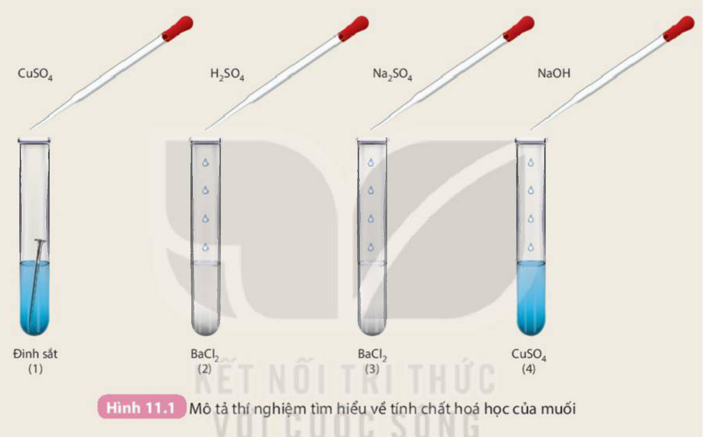
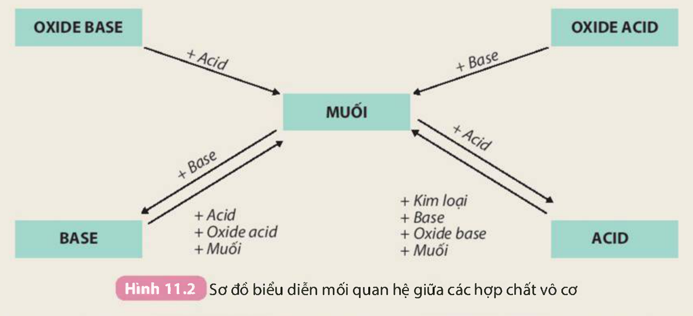

<!-- pdf:50 -->

# BÀI 11: MUỐI

## 🎯 Mục tiêu

- Nêu được khái niệm về muối, đọc được tên một số loại muối thông dụng và trình bày được một số phương pháp điều chế muối.
- Chỉ ra được một số muối tan và muối không tan từ bảng tính tan.
- Tiến hành được thí nghiệm muối phản ứng với kim loại, acid, base, muối; nêu và giải thích được hiện tượng xảy ra trong thí nghiệm và rút ra kết luận về tính chất hoá học của muối.
- Trình bày được mối quan hệ giữa acid, base, oxide và muối và rút ra được kết luận về tính chất hoá học của acid, base, oxide.

## 🔴 Mở đầu

Muối có rất nhiều ứng dụng trong đời sống như làm phân bón, bảo quản thực phẩm, làm bột nở cho các loại bánh, gia vị,... Muối có những tính chất hoá học nào và được điều chế như thế nào?

## I. Khái niệm

> ✋ Tìm hiểu về các phản ứng tạo muối
>
> Bảng 11.1. Phản ứng tạo thành muối, tên gọi và thành phần phân tử của một số muối
>
> | Phản ứng | Công thức phân tử của muối tạo thành và tên gọi | Thành phần phân tử của muối tạo thành: Cation kim loại | Thành phần phân tử của muối tạo thành: Anion gốc acid |
> |---|---|---|---|
> | Kim loại $+$ Acid $\rightarrow$ Muối $+$ Hydrogen: $\ce{Zn + 2HCl -> ZnCl2 + H2}$ | $\ce{ZnCl2}$ – Zinc chloride | $\ce{Zn^2+}$ | $\ce{Cl-}$ |
> | Acid $+$ Base $\rightarrow$ Muối $+$ Nước: $\ce{H2SO4 + Cu(OH)2 -> CuSO4 + 2H2O}$ | $\ce{CuSO4}$ – Copper(II) sulfate | $\ce{Cu^2+}$ | $\ce{SO4^2-}$ |
> | Acid $+$ Oxide base $\rightarrow$ Muối $+$ Nước: $\ce{H2SO4 + FeO -> FeSO4 + H2O}$ | $\ce{FeSO4}$ – Iron(II) sulfate | $\ce{Fe^2+}$ | $\ce{SO4^2-}$ |
> <!-- ocr-ok: đã đối chiếu ảnh trang gốc 50 (trang sách 48), OCR đọc xáo trộn các dòng và công thức trong Bảng 11.1 -->
>
> *Quan sát Bảng 11.1 và thực hiện các yêu cầu:*
>
> 1. Nhận xét về sự khác nhau giữa thành phần phân tử của acid (chất phản ứng) và muối (chất sản phẩm). Đặc điểm chung của các phản ứng ở Bảng 11.1 là gì?
> 2. Nhận xét về cách gọi tên muối.

**Muối** là hợp chất, được tạo thành từ sự thay thế ion $\ce{H+}$ của acid bằng ion kim loại hoặc ion ammonium ($\ce{NH4+}$).

Ví dụ: $\ce{Na2SO4}$ (sodium sulfate); $\ce{NH4Cl}$ (ammonium chloride).
<!-- ocr-ok: đã đối chiếu ảnh trang gốc 50 (trang sách 48), OCR đọc sai công thức NH4Cl -->

Công thức phân tử của muối gồm có cation kim loại và anion gốc acid được gọi tên theo quy tắc sau:

Tên kim loại (hoá trị, đối với kim loại nhiều hoá trị) + tên gốc acid

<!-- pdf:51 -->

Bảng 11.2. Tên gọi một số gốc acid

| Gốc acid | Tên gọi | Gốc acid | Tên gọi |
|---|---|---|---|
| $-\ce{Cl}$ | chloride | $-\ce{CH3COO}$ | acetate |
| $-\ce{Br}$ | bromide | $=\ce{S}$ | sulfide |
| $-\ce{I}$ | iodide | $-\ce{HS}$ | hydrogensulfide |
| $-\ce{NO3}$ | nitrate | $=\ce{CO3}$ | carbonate |
| $=\ce{SO4}$ | sulfate | $-\ce{HCO3}$ | hydrogencarbonate |
| $-\ce{HSO4}$ | hydrogensulfate | $\equiv\ce{PO4}$ | phosphate |
| $=\ce{SO3}$ | sulfite | $=\ce{HPO4}$ | hydrogenphosphate |
<!-- ocr-ok: đã đối chiếu ảnh trang gốc 51 (trang sách 49), OCR đọc sai kí hiệu gốc acid và từ sulfide trong Bảng 11.2 -->

> ❓ 1. Viết công thức của các muối sau: potassium sulfate, sodium hydrogensulfate, sodium hydrogencarbonate, sodium chloride, sodium nitrate, calcium hydrogenphosphate, magnesium sulfate, copper(II) sulfate.
>
> 2. Gọi tên các muối sau: $\ce{AlCl3}$, $\ce{KCl}$, $\ce{Al2(SO4)3}$, $\ce{MgSO4}$, $\ce{NH4NO3}$, $\ce{NaHCO3}$.
>
> 3. Viết phương trình hoá học của phản ứng tạo thành muối $\ce{KCl}$ và $\ce{MgSO4}$.

## II. Tính tan của muối

Đa số các muối là chất rắn, có những muối không tan trong nước, có muối ít tan, có muối tan tốt trong nước. Người ta đã xây dựng bảng tính tan của các chất để tiện sử dụng. <!-- term: Bảng tính tan -->

Bảng 11.3. Bảng tính tan trong nước của một số muối

| Gốc acid | $\ce{K}$ (I) | $\ce{Na}$ (I) | $\ce{Ag}$ (I) | $\ce{Mg}$ (II) | $\ce{Ca}$ (II) | $\ce{Ba}$ (II) | $\ce{Zn}$ (II) | $\ce{Pb}$ (II) | $\ce{Cu}$ (II) | $\ce{Fe}$ (II) | $\ce{Fe}$ (III) | $\ce{Al}$ (III) |
|---|---|---|---|---|---|---|---|---|---|---|---|---|
| $-\ce{Cl}$ | t | t | k | t | t | t | t | i | t | t | t | t |
| $-\ce{NO3}$ | t | t | t | t | t | t | t | t | t | t | t | t |
| $=\ce{SO4}$ | t | t | i | t | i | k | t | k | t | t | t | t |
| $=\ce{CO3}$ | t | t | k | k | k | k | k | k | – | k | – | – |
| $\equiv\ce{PO4}$ | t | t | k | k | k | k | k | k | k | k | k | k |
<!-- ocr-ok: đã đối chiếu ảnh trang gốc 51 (trang sách 49), OCR đọc sai các kí hiệu t, i, k và hoá trị kim loại trong Bảng 11.3 -->

t: chất dễ tan trong nước; k: chất không tan (độ tan nhỏ hơn $0,01\text{ g/100 g}$ nước); i: chất ít tan (độ tan nhỏ hơn $1\text{ g/100 g}$ nước); (–): chất không tồn tại hoặc bị nước phân huỷ.
<!-- ocr-ok: đã đối chiếu ảnh trang gốc 51 (trang sách 49), chú thích hai cột dưới Bảng 11.3 -->

<!-- pdf:52 -->

## III. Tính chất hoá học

> ✋ Tìm hiểu tính chất hoá học của muối
>
> *Chuẩn bị:* Các dung dịch: $\ce{H2SO4}$ loãng, $\ce{NaOH}$ loãng, $\ce{Na2SO4}$, $\ce{CuSO4}$; 4 ống nghiệm: ống (1) chứa 1 đinh sắt đã được làm sạch, ống (2) và (3) mỗi ống nghiệm chứa khoảng $1\text{ mL}$ dung dịch $\ce{BaCl2}$, ống (4) chứa khoảng $1\text{ mL}$ dung dịch $\ce{CuSO4}$.
>
> Tiến hành: ống (1) cho khoảng $2\text{ mL}$ dung dịch $\ce{CuSO4}$; ống (2) cho khoảng $1\text{ mL}$ dung dịch $\ce{H2SO4}$; ống (3) cho khoảng $1\text{ mL}$ dung dịch $\ce{Na2SO4}$; ống (4) cho khoảng $1\text{ mL}$ dung dịch $\ce{NaOH}$
>
> 
>
> Hình 11.1. Mô tả thí nghiệm tìm hiểu về tính chất hoá học của muối
>
> *Quan sát hiện tượng xảy ra ở mỗi ống nghiệm và thực hiện yêu cầu:*
>
> 1. Viết phương trình hoá học, giải thích hiện tượng xảy ra.
> 2. Thảo luận nhóm rút ra kết luận về tính chất hoá học của muối.

Một số tính chất chung của muối:

**Dung dịch muối tác dụng với kim loại**

Dung dịch muối có thể tác dụng với một số kim loại tạo thành muối mới và kim loại mới.

Ví dụ: $\ce{Zn + FeSO4 -> ZnSO4 + Fe}$.

**Muối tác dụng với dung dịch acid**

Muối có thể tác dụng với một số dung dịch acid tạo thành muối mới và acid mới. Sản phẩm của phản ứng tạo thành có ít nhất một chất là chất khí/chất ít tan/không tan,...

Ví dụ: $\ce{CaCO3 + 2HCl -> CaCl2 + CO2 + H2O}$.

<!-- pdf:53 -->

**Dung dịch muối tác dụng với dung dịch base**

Dung dịch muối tác dụng với dung dịch base tạo thành muối mới và base mới, trong đó có ít nhất một sản phẩm là chất khí/chất ít tan/không tan,...

Ví dụ: $\ce{FeSO4 + 2NaOH -> Fe(OH)2 + Na2SO4}$.

**Dung dịch muối tác dụng với dung dịch muối**

Hai dung dịch muối tác dụng với nhau tạo thành hai muối mới, trong đó ít nhất có một muối không tan hoặc ít tan. Ví dụ: $\ce{2AgNO3 + BaCl2 -> 2AgCl + Ba(NO3)2}$.

> ❓ Trong dung dịch, giữa các cặp chất nào sau đây có xảy ra phản ứng? Viết phương trình hoá học của các phản ứng đó.
>
> | | $\ce{Na2CO3}$ | $\ce{KCl}$ | $\ce{Na2SO4}$ | $\ce{NaNO3}$ |
> |---|---|---|---|---|
> | $\ce{Ca(NO3)2}$ | ? | ? | ? | ? |
> | $\ce{BaCl2}$ | ? | ? | ? | ? |
> | $\ce{HNO3}$ | ? | ? | ? | ? |

> 🔍 Phản ứng trao đổi
>
> Các phản ứng trong dung dịch giữa muối với acid, base, muối thuộc loại **phản ứng trao đổi**, trong đó hai hợp chất tham gia phản ứng trao đổi với nhau những thành phần cấu tạo của chúng để tạo ra những hợp chất mới.
>
> Điều kiện để phản ứng trao đổi trong dung dịch xảy ra là sản phẩm tạo thành ít nhất một chất không tan/chất khí,...

## IV. Điều chế

Muối có thể điều chế bằng một số phương pháp như sau:

- Dung dịch acid tác dụng với base. Ví dụ: $\ce{HCl + NaOH -> NaCl + H2O}$.
- Dung dịch acid tác dụng với oxide base. Ví dụ: $\ce{2HNO3 + CuO -> Cu(NO3)2 + H2O}$.
- Dung dịch acid tác dụng với muối. Ví dụ: $\ce{H2SO4 + BaCl2 -> BaSO4 + 2HCl}$.
- Oxide acid tác dụng với dung dịch base. Ví dụ: $\ce{CO2 + 2NaOH -> Na2CO3 + H2O}$.
- Dung dịch muối tác dụng với dung dịch muối. Ví dụ: $\ce{NaCl + AgNO3 -> AgCl + NaNO3}$.

> 🔍 Muối ăn được sản xuất từ nước biển bằng cách đưa nước biển vào ruộng. Để nước bốc hơi nhờ ánh nắng mặt trời, còn lại trên ruộng là muối.
>
> Muối ăn cũng có thể được sản xuất từ muối mỏ.

<!-- pdf:54 -->

## V. Mối quan hệ giữa các hợp chất vô cơ

> ❓ Tính chất hoá học của các hợp chất vô cơ được tóm tắt bằng sơ đồ dưới đây:
>
> 
>
> Hình 11.2. Sơ đồ biểu diễn mối quan hệ giữa các hợp chất vô cơ
>
> Dựa vào sơ đồ Hình 11.2 và cho biết tính chất của oxide, acid, base. Viết phương trình hoá học minh hoạ.

## 📌 Em đã học

- Muối là hợp chất được hình thành từ sự thay thế ion $\ce{H+}$ của acid bằng ion kim loại hoặc ion ammonium ($\ce{NH4+}$).
- Các muối có khả năng tan trong nước khác nhau, có muối tan nhiều, muối tan ít, muối không tan.
- Tên muối (chứa cation kim loại): tên kim loại (thêm hoá trị nếu kim loại có nhiều hoá trị) + tên gốc acid.
- Tính chất hoá học của muối: phản ứng với kim loại, acid, muối, base.
- Các hợp chất vô cơ có thể chuyển đổi hoá học thành các hợp chất vô cơ khác.

## ✏️ Em có thể

Phân biệt được các loại hợp chất vô cơ nhờ các tính chất đặc trưng.

## 📷 Danh sách hình trong bài

| Mã hình | Trang PDF | Trang sách | Chú thích |
|---|---|---|---|
| H8-khoa_hoc_tu_nhien-b11-01 | 52 | 50 | Hình 11.1. Mô tả thí nghiệm tìm hiểu về tính chất hoá học của muối |
| H8-khoa_hoc_tu_nhien-b11-02 | 54 | 52 | Hình 11.2. Sơ đồ biểu diễn mối quan hệ giữa các hợp chất vô cơ |
