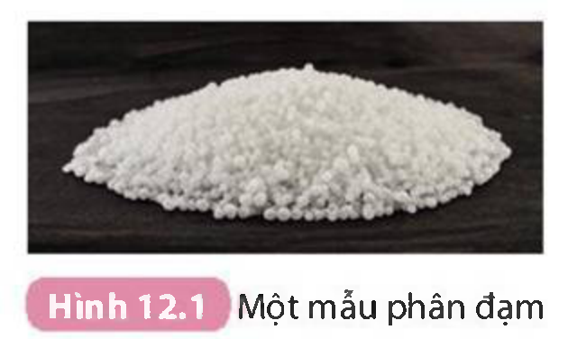
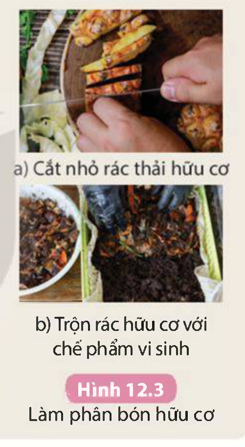

<!-- pdf:55 -->

# BÀI 12: PHÂN BÓN HOÁ HỌC

## 🎯 Mục tiêu

- Trình bày được vai trò của phân bón đối với cây trồng.
- Nêu được thành phần và tác dụng cơ bản của một số loại phân bón hoá học đối với cây trồng.
- Trình bày được ảnh hưởng của việc sử dụng phân bón hoá học đến môi trường của đất, nước và sức khoẻ của con người; đề xuất được biện pháp giảm thiểu ô nhiễm của phân bón.

## 🔴 Mở đầu

Phân bón hoá học là gì? Tại sao cần bón phân cho cây trồng?

## I. Vai trò của các nguyên tố hoá học với sự phát triển của cây trồng. Phân bón hoá học

> ✋ Trình bày về các nguyên tố dinh dưỡng cần thiết cho cây trồng
>
> *Chuẩn bị:* tranh, ảnh, tài liệu về các nguyên tố dinh dưỡng cần thiết cho cây trồng và vai trò của chúng đối với sự phát triển của cây trồng.
>
> *Thảo luận nhóm và xây dựng đề cương báo cáo theo các nội dung sau:*
>
> 1. Lí do cần phải bổ sung thêm các nguyên tố dinh dưỡng cho cây trồng.
> 2. Kể tên các nguyên tố hoá học mà cây trồng cần với số lượng nhiều (nhóm nguyên tố đa lượng), trung bình (nhóm nguyên tố trung lượng) và ít (nhóm nguyên tố vi lượng) và nêu vai trò của chúng đối với sự phát triển cây trồng.
>
> *Đại diện nhóm báo cáo trước lớp.*

Cây trồng cần các nguyên tố đa lượng, trung lượng và vi lượng để cấu tạo nên tế bào của chúng; điều chỉnh các hoạt động trao đổi chất, các hoạt động sinh lí trong cây và giúp cây trồng tăng khả năng chống lại điều kiện bất lợi của môi trường. <!-- term: Nguyên tố đa lượng -->

Bảng 12.1. Vai trò của một số nguyên tố đa lượng đối với cây trồng

| Nguyên tố | Tác dụng với cây trồng |
|---|---|
| Nitrogen | Đảm bảo cho cây sinh trưởng và phát triển tốt, tham gia điều tiết các quá trình trao đổi chất của cây,... |
| Phosphorus | Cần cho cây trồng nở hoa, đậu quả và phát triển bộ rễ. |
| Potassium (kali) | Chuyển hoá năng lượng trong quá trình đồng hoá các chất trong cây, làm cho cây ra nhiều nhánh, phân cành nhiều. |

Nhu cầu nước và muối khoáng ở từng loài và từng giai đoạn phát triển của cây là khác nhau. Để sinh trưởng và phát triển tốt, đảm bảo năng suất, cây trồng cần được bổ sung thêm các nguyên tố khoáng bằng cách bón phân và tưới nước.

Các nguyên tố vi lượng như $\ce{Zn}$, $\ce{Mn}$, $\ce{Fe}$, $\ce{Cu}$,... tuy cần hàm lượng ít nhưng không thể thiếu đối với cây trồng. Chúng giúp kích thích quá trình sinh trưởng, trao đổi chất của cây trồng. <!-- term: Nguyên tố vi lượng -->

**Phân bón hoá học** *là những hoá chất có chứa các nguyên tố dinh dưỡng, được bón cho cây nhằm nâng cao năng suất cây trồng.*

<!-- pdf:56 -->

> ❓ Tại sao cần phải bổ sung các nguyên tố đa lượng như nitrogen, phosphorus, potassium dưới dạng phân bón cho cây trồng?

## II. Một số loại phân bón thông thường

### 1. Phân đạm

Phân đạm cung cấp nguyên tố nitrogen cho cây trồng. Các loại phân đạm thường dùng có thành phần chính là muối nitrate của kim loại như $\ce{NaNO3}$, $\ce{Ca(NO3)2}$ hay muối ammonium nitrate ($\ce{NH4NO3}$), urea ($\ce{(NH2)2CO}$), chúng đều dễ tan trong nước. <!-- term: Phân đạm -->

Hình 12.1. Một mẫu phân đạm
<!-- ocr-ok: đã đối chiếu ảnh trang gốc 56 (trang sách 54), OCR bỏ sót nhãn Hình 12.1 -->

Phân đạm thúc đẩy quá trình sinh trưởng của cây trồng, giúp cây trồng phát triển thân, rễ, lá. <!-- term: Phân đạm -->

### 2. Phân lân

Phân lân cung cấp nguyên tố phosphorus cho cây trồng. Các loại phân lân thường dùng: phân lân nung chảy có thành phần chính là muối $\ce{Ca3(PO4)2}$, không tan trong nước và tan chậm trong đất chua; superphosphate đơn có thành phần chính là hai muối $\ce{Ca(H2PO4)2}$ và $\ce{CaSO4}$, tan ít trong nước; superphosphate kép có thành phần chính là muối $\ce{Ca(H2PO4)2}$, tan được trong nước. <!-- term: Phân lân -->

Tuỳ loại đất chua ít hay nhiều mà chọn loại phân lân thích hợp: super lân phù hợp cho tất cả các loại đất nhưng hiệu quả nhất trên đất không chua, hoặc chua ít ($\text{pH} = 5,6 - 6,5$); phân lân nung chảy thích hợp với đất chua;.... Phân lân chủ yếu dùng bón lót (để phát triển bộ rễ), bón thúc (để cây ra hoa, đậu quả nhiều, quả to, kích thích quá trình chín của quả). <!-- term: Phân lân -->

> 🔍 Một số lưu ý về an toàn
>
> Khi bón phân cần mặc bộ đồ bảo hộ, đeo khẩu trang, đi găng tay. Cần bảo quản phân bón ở đúng nơi quy định, tránh xa trẻ em và nhà bếp, nơi ăn uống.
>
> 
>
> Hình 12.2. Sử dụng găng tay khi bón phân

### 3. Phân kali

Phân kali cung cấp nguyên tố kali (potassium) cho cây trồng. Các loại phân kali thường dùng có thành phần chính là các muối chloride hoặc sulfate của potassium ($\ce{KCl}$ hoặc $\ce{K2SO4}$), ngoài ra phân kali có trong phân dơi, tro. <!-- term: Phân kali -->

Phân kali giúp tăng khả năng hấp thụ nước và chất dinh dưỡng của rễ cây, làm chậm sự đông kết của dịch tế bào khi gặp lạnh giúp cây chịu lạnh tốt, hình thành các mô tế bào giúp cây cứng cáp. <!-- term: Phân kali -->

### 4. Phân NPK

**Phân NPK** là loại phân bón hỗn hợp, chứa ba thành phần dinh dưỡng: đạm (nitrogen), lân (phosphorus) và kali (potassium). Ngoài ra, phân NPK còn có thể có các nguyên tố trung lượng (như $\ce{Ca}$, $\ce{Mg}$,...) và nguyên tố vi lượng (như $\ce{Zn}$, $\ce{Cu}$,...).

> ❓ 1. Hãy cho biết các nguyên tố dinh dưỡng trong phân đạm, phân lân, phân kali, phân NPK.
>
> 2. Tại sao đối với từng loại đất cần lựa chọn phân lân thích hợp?
>
> 3. Hãy cho biết vai trò của các nguyên tố vi lượng đối với cây trồng.

<!-- pdf:57 -->

## III. Cách sử dụng phân bón

Phân bón đóng góp phần lớn vào việc tăng năng suất cây trồng, tuy nhiên nếu sử dụng phân bón không đúng cách sẽ làm ảnh hưởng đến môi trường và sức khoẻ của con người. Phân bón dư thừa sẽ bị rửa trôi khỏi đất, ngấm vào các mạch nước ngầm và đi vào sông, hồ, gây ô nhiễm đất và nước hoặc phân huỷ ra khí ammonia, nitrogen oxide gây ô nhiễm không khí. Ngoài ra, việc lạm dụng phân bón có thể gây tồn dư hoá chất trong thực phẩm, rất có hại cho sức khoẻ con người.

Để giảm thiểu ô nhiễm cần bón phân đúng cách, không vượt quá khả năng hấp thụ của đất và cây trồng theo quy tắc bón phân “4 đúng” (đúng liều, đúng loại, đúng lúc, đúng nơi). <!-- term: Quy tắc bón phân “4 đúng” -->

Bên cạnh đó, cần giảm sử dụng phân bón hoá học bằng cách tăng cường sản xuất và sử dụng phân bón hữu cơ (phân huỷ rác thải hữu cơ) giàu chất dinh dưỡng, giúp đất tơi xốp, cây trồng dễ hấp thụ, an toàn khi sử dụng. <!-- term: Phân bón hữu cơ -->

> ✋ Làm phân bón hữu cơ
>
> *Chuẩn bị:* Khoảng $3\text{ kg}$ các loại rác thải hữu cơ (rau thừa; vỏ củ quả;...), khoảng $6\text{ gam}$ chế phẩm vi sinh (ví dụ: Trichoderma – Bacillus), nước, thùng nhựa (khoảng $5\text{ L}$), dao, kéo.
>
> *Tiến hành:* Chia lớp thành các nhóm, mỗi nhóm gồm 5 học sinh để thực hiện các bước như sau:
>
> - Băm nhỏ rác thải hữu cơ, xếp vào thùng nhựa.
> - Rắc chế phẩm vi sinh Trichoderma – Bacillus lên rác thải và trộn đều. Đậy nắp thùng nhựa.
> - Thỉnh thoảng bổ sung nước để giữ cho hỗn hợp ẩm.
>
> Sau $25 - 30$ ngày sẽ thu được phân bón hữu cơ.
>
> *Lưu ý:* Không sử dụng các thức ăn bỏ đi có nguồn gốc động vật để làm phân bón hữu cơ.
>
> *Thảo luận nhóm và cho biết lợi ích của việc sử dụng phân hữu cơ so với phân vô cơ.*
>
> 
>
> *a) Cắt nhỏ rác thải hữu cơ; b) Trộn rác hữu cơ với chế phẩm vi sinh*
> <!-- ocr-ok: đã đối chiếu ảnh trang gốc 57 (trang sách 55), OCR bỏ sót nhãn a) và đọc hỏng nhãn b) của Hình 12.3 -->
>
> Hình 12.3. Làm phân bón hữu cơ

> ❓ 1. Giải thích tại sao cần phải bón phân theo bốn quy tắc: đúng liều, đúng loại, đúng lúc, đúng nơi.
>
> 2. Hãy sưu tầm hình ảnh và trình bày về tác hại của việc bón phân không đúng cách.

## 📌 Em đã học

- Các nhóm nguyên tố dinh dưỡng cần thiết để cây trồng sinh trưởng và phát triển là: nhóm nguyên tố đa lượng ($\ce{N}$, $\ce{P}$, $\ce{K}$), nhóm nguyên tố trung lượng ($\ce{Mg}$, $\ce{Ca}$,...) và nhóm nguyên tố vi lượng ($\ce{Zn}$, $\ce{Cu}$,...).
- Một số loại phân bón thông thường như phân đạm chứa nguyên tố nitrogen, phân kali chứa nguyên tố potassium, phân lân chứa nguyên tố phosphorus và phân NPK chứa nhiều nguyên tố dinh dưỡng.
- Việc sử dụng phân bón không theo quy tắc “4 đúng” sẽ gây ô nhiễm môi trường và ảnh hưởng đến sức khoẻ con người.

## ✏️ Em có thể

- Áp dụng quy tắc “4 đúng” trong việc sử dụng phân bón.
- Làm phân bón hữu cơ tại nhà.

## 📷 Danh sách hình trong bài

| Mã hình | Trang PDF | Trang sách | Chú thích |
|---|---|---|---|
| H8-khoa_hoc_tu_nhien-b12-01 | 56 | 54 | Hình 12.1. Một mẫu phân đạm |
| H8-khoa_hoc_tu_nhien-b12-02 | 56 | 54 | Hình 12.2. Sử dụng găng tay khi bón phân |
| H8-khoa_hoc_tu_nhien-b12-03 | 57 | 55 | Hình 12.3. Làm phân bón hữu cơ |
