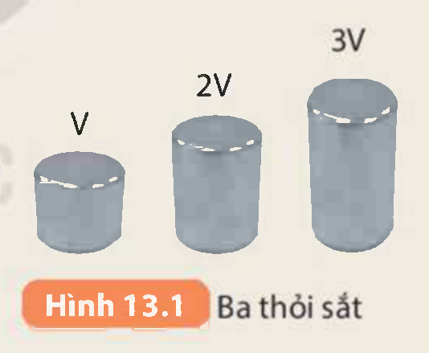
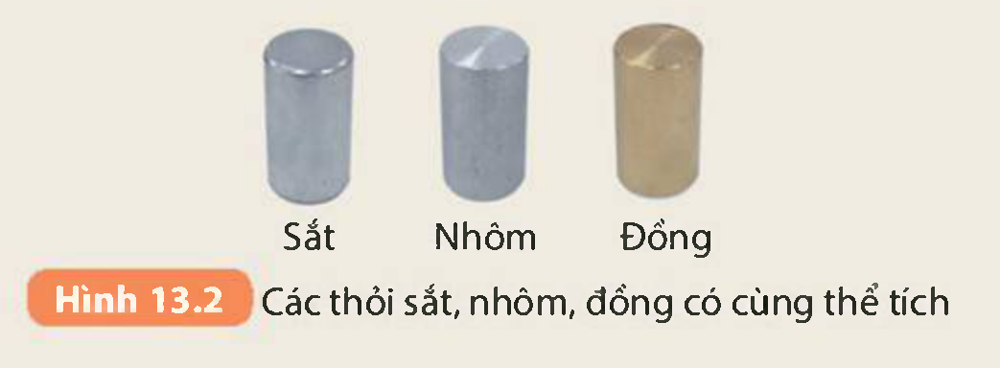
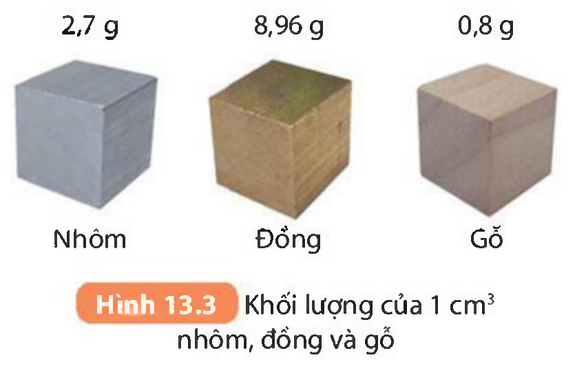

<!-- pdf:58 -->

# BÀI 13: KHỐI LƯỢNG RIÊNG

## 🎯 Mục tiêu

- Nêu được định nghĩa khối lượng riêng, xác định được khối lượng riêng qua khối lượng và thể tích tương ứng.
  $\text{Khối lượng riêng} = \dfrac{\text{Khối lượng}}{\text{Thể tích}}$.
- Liệt kê được một số đơn vị đo khối lượng riêng thường dùng.

## 🔴 Mở đầu

Trong đời sống, ta thường nói sắt nặng hơn nhôm. Nói như thế có đúng không? Làm thế nào để trả lời câu hỏi này?

## I. Thí nghiệm

> **Thí nghiệm 1:**
>
> *Chuẩn bị:* Ba thỏi sắt có thể tích lần lượt là $V_1 = V$, $V_2 = 2V$, $V_3 = 3V$ (Hình 13.1); cân điện tử.
>
> 
>
> Hình 13.1. Ba thỏi sắt
>
> *Tiến hành:*
>
> Bước 1: Dùng cân điện tử để xác định khối lượng từng thỏi sắt tương ứng $m_1$, $m_2$, $m_3$.
>
> Bước 2: Ghi số liệu, tính tỉ số khối lượng và thể tích tương ứng $\dfrac{m}{V}$ vào vở theo mẫu Bảng 13.1.
>
> Bảng 13.1. Tỉ số giữa khối lượng và thể tích của ba thỏi sắt
>
> | Đại lượng | Thỏi 1 | Thỏi 2 | Thỏi 3 |
> |---|---|---|---|
> | Thể tích | $V_1 = V$ | $V_2 = 2V$ | $V_3 = 3V$ |
> | Khối lượng | $m_1 = ?$ | $m_2 = ?$ | $m_3 = ?$ |
> | Tỉ số $\dfrac{m}{V}$ | $\dfrac{m_1}{V_1} = ?$ | $\dfrac{m_2}{V_2} = ?$ | $\dfrac{m_3}{V_3} = ?$ |
>
> 1. Hãy nhận xét về tỉ số khối lượng và thể tích của ba thỏi sắt.
> 2. Dự đoán về tỉ số này với các vật liệu khác nhau.

<!-- pdf:59 -->

> **Thí nghiệm 2:**
>
> *Chuẩn bị:* Ba thỏi sắt, nhôm, đồng có cùng thể tích là $V_1 = V_2 = V_3 = V$ (Hình 13.2), cân điện tử.
>
> 
>
> Hình 13.2. Các thỏi sắt, nhôm, đồng có cùng thể tích
>
> *Tiến hành:*
>
> Bước 1: Dùng cân điện tử để xác định khối lượng của thỏi sắt, nhôm, đồng tương ứng $m_1$, $m_2$, $m_3$.
>
> Bước 2: Tính tỉ số giữa khối lượng và thể tích tương ứng $\dfrac{m}{V}$, ghi số liệu vào vở theo mẫu Bảng 13.2.
>
> Bảng 13.2. Tỉ số giữa khối lượng và thể tích của các vật làm từ các chất khác nhau
>
> | Đại lượng | Thỏi sắt | Thỏi nhôm | Thỏi đồng |
> |---|---|---|---|
> | Thể tích | $V_1 = V$ | $V_2 = V$ | $V_3 = V$ |
> | Khối lượng | $m_1 = ?$ | $m_2 = ?$ | $m_3 = ?$ |
> | Tỉ số $\dfrac{m}{V}$ | $\dfrac{m_1}{V_1} = ?$ | $\dfrac{m_2}{V_2} = ?$ | $\dfrac{m_3}{V_3} = ?$ |
>
> Hãy nhận xét về tỉ số giữa khối lượng và thể tích của các thỏi sắt, nhôm, đồng.

## II. Khối lượng riêng, đơn vị khối lượng riêng
<!-- ocr-ok: đã đối chiếu ảnh trang 59, OCR đọc sai tiêu đề mục màu cam đè lên chữ chìm -->

**Khối lượng riêng** của một chất cho ta biết khối lượng của một đơn vị thể tích chất đó.

$\text{Khối lượng riêng} = \dfrac{\text{khối lượng}}{\text{thể tích}}.$

$D = \dfrac{m}{V}$

| Đơn vị khối lượng | $\text{kg}$ | $\text{g}$ |
|---|---|---|
| Đơn vị thể tích | $\text{m}^3$ | $\text{cm}^3$ (hoặc $\text{mL}$) |
| Đơn vị khối lượng riêng | $\text{kg/m}^3$ | $\text{g/cm}^3$ (hoặc $\text{g/mL}$) |
<!-- ocr-ok: đã đối chiếu ảnh trang 59, bảng đơn vị chứa kí hiệu LaTeX bị lược bỏ khi so khớp bigram -->

<!-- term: Đơn vị đo khối lượng riêng -->
$1\text{ kg/m}^3 = 0,001\text{ g/cm}^3$

$1\text{ g/cm}^3 = 1\text{ g/mL}$

Hình 13.3. Khối lượng của $1\text{ cm}^3$ nhôm, đồng và gỗ

Khi biết khối lượng riêng của một vật, ta có thể biết vật đó được cấu tạo bằng chất gì bằng cách đối chiếu với bảng khối lượng riêng của các chất.

<!-- pdf:60 -->

Bảng 13.3. Khối lượng riêng của một số chất ở nhiệt độ phòng

| Chất rắn | Khối lượng riêng ($\text{kg/m}^3$) | Chất lỏng | Khối lượng riêng ($\text{kg/m}^3$) |
|---|---|---|---|
| Chì | 11 300 | Thuỷ ngân | 13 600 |
| Sắt | 7 800 | Nước | 1 000 |
| Nhôm | 2 700 | Xăng | 700 |
| Đá | Khoảng 2 600 | Dầu hoả | Khoảng 800 |
| Gạo | Khoảng 1 200 | Dầu ăn | Khoảng 800 |
| Gỗ tốt | Khoảng 800 | Rượu, cồn | Khoảng 790 |

> ❓ 1. Dựa vào đại lượng nào, người ta nói sắt nặng hơn nhôm?
>
> 2. Một khối gang hình hộp chữ nhật có chiều dài các cạnh tương ứng là $2\text{ cm}$, $3\text{ cm}$, $5\text{ cm}$ và có khối lượng $210\text{ g}$. Hãy tính khối lượng riêng của gang.

> 🔍 Ngoài đại lượng khối lượng riêng của một chất, người ta còn sử dụng đại lượng khác là trọng lượng riêng.
>
> Trọng lượng của một mét khối một chất gọi là **trọng lượng riêng** $d$ của chất đó.
>
> Công thức tính trọng lượng riêng:
>
> $d = \dfrac{P}{V}$
>
> Trong đó:
> - $P$ là trọng lượng ($\text{N}$);
> - $V$ là thể tích ($\text{m}^3$);
>
> Đơn vị của trọng lượng riêng là $\text{N/m}^3$.

## 📌 Em đã học

- Khối lượng riêng của một chất được xác định bằng khối lượng của một đơn vị thể tích chất đó:
  $D = \dfrac{m}{V}.$
<!-- term: Đơn vị đo khối lượng riêng -->
- Đơn vị thường dùng đo khối lượng riêng là $\text{kg/m}^3$ hoặc $\text{g/cm}^3$ hay $\text{g/mL}$:
  $1\text{ kg/m}^3 = 0,001\text{ g/cm}^3$; $1\text{ g/cm}^3 = 1\text{ g/mL}$.

## ✏️ Em có thể

Tính được khối lượng của vật khi biết khối lượng riêng và thể tích. Ví dụ, tính khối lượng nước trong một bể hình hộp chữ nhật,...

## 📷 Danh sách hình trong bài

| Mã hình | Trang PDF | Trang sách | Chú thích |
|---|---|---|---|
| H8-khoa_hoc_tu_nhien-b13-01 | 58 | 56 | Hình 13.1. Ba thỏi sắt |
| H8-khoa_hoc_tu_nhien-b13-02 | 59 | 57 | Hình 13.2. Các thỏi sắt, nhôm, đồng có cùng thể tích |
| H8-khoa_hoc_tu_nhien-b13-03 | 59 | 57 | Hình 13.3. Khối lượng của 1 cm³ nhôm, đồng và gỗ |
