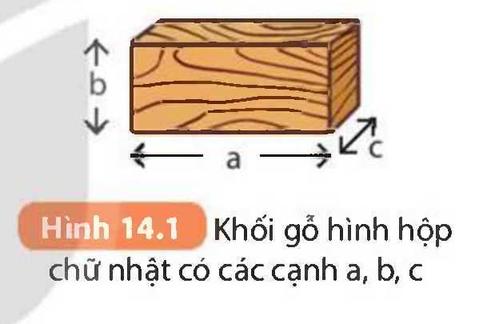
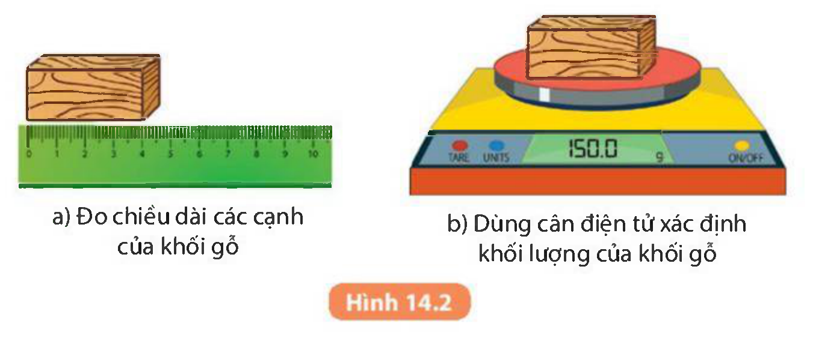
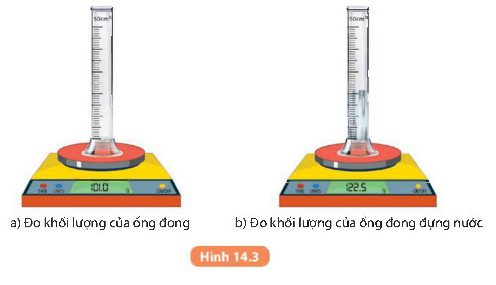
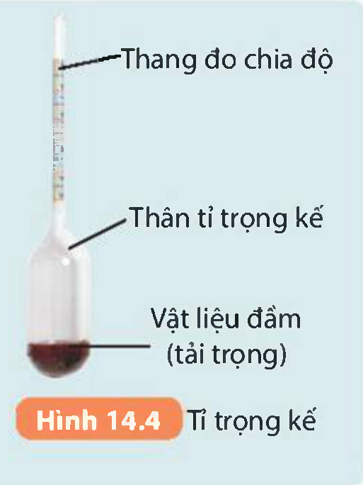

<!-- pdf:61 -->

# BÀI 14: THỰC HÀNH XÁC ĐỊNH KHỐI LƯỢNG RIÊNG

## 🎯 Mục tiêu

- Thực hiện thí nghiệm để xác định được khối lượng riêng của một khối hộp chữ nhật, của một vật có hình dạng bất kì, của một lượng chất lỏng.

## 🔴 Mở đầu

Để xác định khối lượng riêng của một chất tạo nên vật cần phải xác định được những đại lượng nào? Theo em, cách xác định khối lượng riêng của một vật rắn không thấm nước và của một lượng chất lỏng có khác nhau hay không?

## I. Xác định khối lượng riêng của một khối hình hộp chữ nhật

### 1. Chuẩn bị

- Cân điện tử.
- Thước đo độ dài có độ chia nhỏ nhất tới milimét.
- Khối gỗ hình hộp chữ nhật (Hình 14.1).

Hình 14.1. Khối gỗ hình hộp chữ nhật có các cạnh $a$, $b$, $c$

### 2. Cách tiến hành

- Dùng thước đo chiều dài mỗi cạnh $a$, $b$, $c$ của khối gỗ hình hộp chữ nhật (Hình 14.2a).
- Tính thể tích của khối gỗ hình hộp chữ nhật theo công thức:
  $V = a \cdot b \cdot c$
- Đo 3 lần, ghi số liệu vào vở theo mẫu Bảng 14.1, rồi tính giá trị trung bình của thể tích $V$ ($V_{\text{tb}}$).
- Cân khối lượng ($m$) của khối gỗ hình hộp chữ nhật (Hình 14.2b). Cân 3 lần, ghi số liệu vào vở theo mẫu Bảng 14.1, sau đó tính giá trị trung bình của $m$ ($m_{\text{tb}}$).
- Xác định khối lượng riêng của khối gỗ hình hộp chữ nhật theo công thức:
  $D = \dfrac{m}{V}.$

- *a) Đo chiều dài các cạnh của khối gỗ*
- *b) Dùng cân điện tử xác định khối lượng của khối gỗ*

Hình 14.2

<!-- pdf:62 -->

### 3. Kết quả

Hoàn thành bảng ghi kết quả thí nghiệm vào vở theo mẫu Bảng 14.1.

Bảng 14.1. Kết quả thí nghiệm xác định khối lượng riêng của khối gỗ hình hộp chữ nhật

| Lần đo | Đo thể tích $a$ ($\text{m}$) | Đo thể tích $b$ ($\text{m}$) | Đo thể tích $c$ ($\text{m}$) | Đo thể tích $V$ ($\text{m}^3$) | Đo khối lượng $m$ ($\text{kg}$) |
|---|---|---|---|---|---|
| 1 | $a_1 = ?$ | $b_1 = ?$ | $c_1 = ?$ | $V_1 = ?$ | $m_1 = ?$ |
| 2 | $a_2 = ?$ | $b_2 = ?$ | $c_2 = ?$ | $V_2 = ?$ | $m_2 = ?$ |
| 3 | $a_3 = ?$ | $b_3 = ?$ | $c_3 = ?$ | $V_3 = ?$ | $m_3 = ?$ |
| Trung bình | | | | $V_{\text{tb}} = \dfrac{V_1 + V_2 + V_3}{3} = ?$ | $m_{\text{tb}} = \dfrac{m_1 + m_2 + m_3}{3} = ?$ |

Tính khối lượng riêng của khối gỗ hình hộp chữ nhật theo công thức: $D_{\text{tb}} = \dfrac{m_{\text{tb}}}{V_{\text{tb}}}.$

## II. Xác định khối lượng riêng của một lượng nước

### 1. Chuẩn bị

- Cân điện tử.
- Ống đong; cốc thuỷ tinh.
- Một lượng nước sạch.

### 2. Cách tiến hành

- Xác định khối lượng của ống đong ($m_1$) (Hình 14.3a).
- Rót một lượng nước vào ống đong, xác định thể tích nước trong ống đong ($V_{\text{n1}}$).
- Xác định khối lượng của ống đong có đựng nước ($m_2$) (Hình 14.3b).
- Xác định khối lượng nước trong ống đong:
  $m_{\text{n}} = m_2 - m_1$
- Lặp lại thí nghiệm hai lần nữa, ghi số liệu vào vở theo mẫu Bảng 14.2, tính giá trị thể tích trung bình ($V_{\text{ntb}}$) và khối lượng trung bình ($m_{\text{ntb}}$) của nước.
- Xác định khối lượng riêng của nước theo công thức: $D = \dfrac{m}{V}.$

- *a) Đo khối lượng của ống đong*
- *b) Đo khối lượng của ống đong đựng nước*

Hình 14.3

<!-- pdf:63 -->

### 3. Kết quả

Hoàn thành bảng ghi kết quả thí nghiệm vào vở theo mẫu Bảng 14.2.

Bảng 14.2. Kết quả thí nghiệm xác định khối lượng riêng của một lượng nước

| Lần đo | Đo thể tích $V_{\text{n}}$ ($\text{m}^3$) | Đo khối lượng $m_1$ ($\text{kg}$) | Đo khối lượng $m_2$ ($\text{kg}$) | Đo khối lượng $m_2 - m_1$ ($\text{kg}$) |
|---|---|---|---|---|
| 1 | $V_{\text{n1}} = ?$ | $?$ | $?$ | $m_{\text{n1}} = ?$ |
| 2 | $V_{\text{n2}} = ?$ | $?$ | $?$ | $m_{\text{n2}} = ?$ |
| 3 | $V_{\text{n3}} = ?$ | $?$ | $?$ | $m_{\text{n3}} = ?$ |

$V_{\text{ntb}} = \dfrac{V_{\text{n1}} + V_{\text{n2}} + V_{\text{n3}}}{3} = ? \qquad m_{\text{ntb}} = \dfrac{m_{\text{n1}} + m_{\text{n2}} + m_{\text{n3}}}{3} = ?$

Tính khối lượng riêng của lượng nước theo công thức: $D_{\text{ntb}} = \dfrac{m_{\text{ntb}}}{V_{\text{ntb}}}.$

## III. Xác định khối lượng riêng của một vật có hình dạng bất kì không thấm nước

### 1. Chuẩn bị

- Cân điện tử.
- Ống đong; cốc thuỷ tinh có chứa nước.
- Hòn sỏi (có thể bỏ lọt vào ống đong).

### 2. Cách tiến hành

- Dùng cân điện tử xác định khối lượng của hòn sỏi ($m_{\text{s}}$).
- Rót một lượng nước vào ống đong, xác định thể tích nước trong ống đong ($V_1$).
- Buộc sợi chỉ vào hòn sỏi, thả từ từ cho nó ngập trong nước ở ống đong, xác định thể tích nước trong ống đong lúc này ($V_2$).
- Xác định thể tích của hòn sỏi:
  $V_{\text{sỏi}} = V_2 - V_1;$
- Kéo nhẹ hòn sỏi ra, lau khô và lặp lại thí nghiệm hai lần nữa. Ghi số liệu vào vở theo mẫu Bảng 14.3, rồi tính các giá trị thể tích trung bình ($V_{\text{stb}}$) và khối lượng trung bình ($m_{\text{stb}}$) của hòn sỏi.
- Xác định khối lượng riêng của hòn sỏi theo công thức: $D = \dfrac{m}{V}.$

<!-- pdf:64 -->

### 3. Kết quả

Hoàn thành bảng ghi kết quả thí nghiệm vào vở theo mẫu Bảng 14.3.

Bảng 14.3. Kết quả thí nghiệm xác định khối lượng riêng của hòn sỏi

| Lần đo | Đo khối lượng $m_{\text{s}}$ ($\text{kg}$) | Đo thể tích $V_1$ ($\text{m}^3$) | Đo thể tích $V_2$ ($\text{m}^3$) | Đo thể tích $V_2 - V_1$ ($\text{m}^3$) |
|---|---|---|---|---|
| 1 | $m_{\text{s1}} = ?$ | $?$ | $?$ | $V_{\text{s1}} = ?$ |
| 2 | $m_{\text{s2}} = ?$ | $?$ | $?$ | $V_{\text{s2}} = ?$ |
| 3 | $m_{\text{s3}} = ?$ | $?$ | $?$ | $V_{\text{s3}} = ?$ |

$m_{\text{stb}} = \dfrac{m_{\text{s1}} + m_{\text{s2}} + m_{\text{s3}}}{3} = ? \qquad V_{\text{stb}} = \dfrac{V_{\text{s1}} + V_{\text{s2}} + V_{\text{s3}}}{3} = ?$

Tính khối lượng riêng của hòn sỏi theo công thức: $D_{\text{stb}} = \dfrac{m_{\text{stb}}}{V_{\text{stb}}}.$

> *BÁO CÁO THỰC HÀNH*
>
> Họ và tên: ... Lớp: ...
>
> **1. Mục đích thí nghiệm:**
> Xác định khối lượng riêng của một khối gỗ hình hộp chữ nhật, của một lượng chất lỏng, của một vật có hình dạng bất kì.
>
> **2. Chuẩn bị:**
> Dụng cụ thí nghiệm: ...
>
> **3. Các bước tiến hành:**
> Mô tả các bước tiến hành: ...
>
> **4. Kết quả thí nghiệm:**
> Hoàn thành các bảng ghi kết quả thí nghiệm xác định khối lượng riêng của một khối gỗ hình hộp chữ nhật, của một lượng nước, của một hòn sỏi (theo các mẫu Bảng 14.1; 14.2 và 14.3).

<!-- term: Tỉ trọng kế -->
> 🔍 Trong thực tế người ta đo khối lượng riêng của chất lỏng bằng một dụng cụ gọi là “tỉ trọng kế” (còn gọi là phù kế) (Hình 14.4). Dụng cụ này hoạt động dựa trên định luật Archimedes (Acsimet) mà chúng ta sẽ học trong chương này.

<!-- term: Tỉ trọng kế -->
> Cách sử dụng tỉ trọng kế đo khối lượng riêng của chất lỏng: Rót chất lỏng vào một bình cao rồi thả nhẹ tỉ trọng kế vào để nó nổi lơ lửng. Khi tỉ trọng kế nằm cân bằng, đọc giá trị khối lượng riêng của chất lỏng trên thang đo chia độ tại vị trí mà bề mặt chất lỏng tiếp xúc với tỉ trọng kế.
>
> 
>
> Hình 14.4. Tỉ trọng kế

<!-- pdf:65 -->

## 📌 Em đã học

Cách xác định khối lượng riêng của:
- Một khối hình hộp chữ nhật.
- Một lượng chất lỏng.
- Một vật có hình dạng bất kì không thấm nước.
<!-- ocr-ok: đã đối chiếu ảnh trang 65, OCR bỏ sót nội dung trong khung màu Em đã học -->

## ✏️ Em có thể

- Biết được một vật làm bằng chất gì bằng cách đo khối lượng riêng của vật đó.
- So sánh được giá trị khối lượng riêng của nước xác định trong thí nghiệm này và khối lượng riêng của nước cho trong Bảng 13.3 (Bài 13). Từ đó, cho biết những yếu tố nào có thể dẫn tới sự chênh lệch giữa hai giá trị này.
<!-- ocr-ok: đã đối chiếu ảnh trang 65, OCR bỏ sót nội dung trong khung màu Em có thể -->

## 📷 Danh sách hình trong bài

| Mã hình | Trang PDF | Trang sách | Chú thích |
|---|---|---|---|
| H8-khoa_hoc_tu_nhien-b14-01 | 61 | 59 | Hình 14.1. Khối gỗ hình hộp chữ nhật có các cạnh a, b, c |
| H8-khoa_hoc_tu_nhien-b14-02 | 61 | 59 | Hình 14.2. a) Đo chiều dài các cạnh của khối gỗ; b) Dùng cân điện tử xác định khối lượng của khối gỗ |
| H8-khoa_hoc_tu_nhien-b14-03 | 62 | 60 | Hình 14.3. a) Đo khối lượng của ống đong; b) Đo khối lượng của ống đong đựng nước |
| H8-khoa_hoc_tu_nhien-b14-04 | 64 | 62 | Hình 14.4. Tỉ trọng kế |
