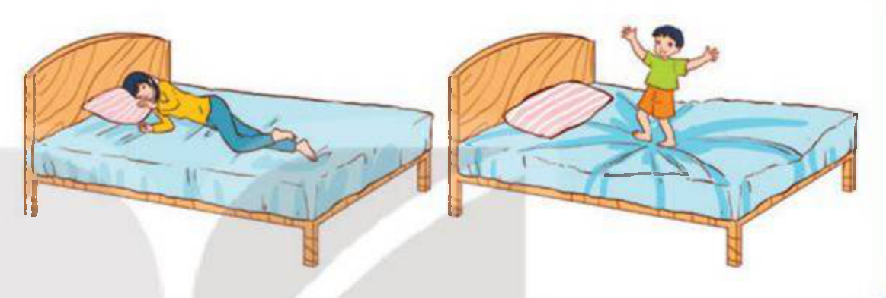
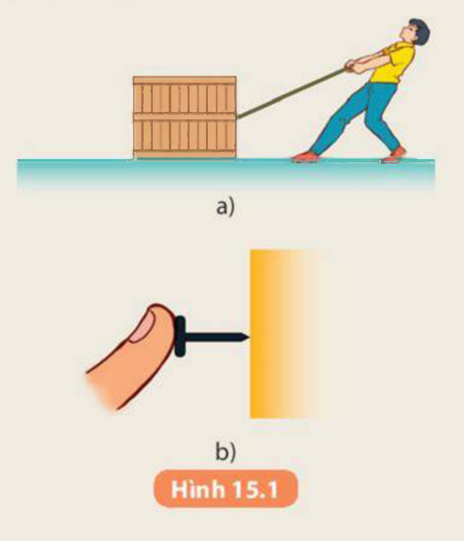
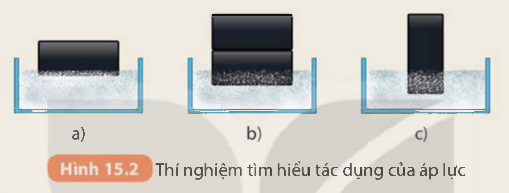

<!-- pdf:66 -->

# BÀI 15: ÁP SUẤT TRÊN MỘT BỀ MẶT

## 🎯 Mục tiêu

- Dùng dụng cụ thực hành, khẳng định được: áp suất sinh ra khi có áp lực tác dụng lên một diện tích bề mặt, $\text{áp suất} = \dfrac{\text{áp lực}}{\text{diện tích bề mặt}}$.
- Liệt kê được một số đơn vị đo áp suất thông dụng.
- Thảo luận được công dụng của việc tăng, giảm áp suất qua một số hiện tượng thực tế.

## 🔴 Mở đầu

Tại sao khi một em bé đứng lên chiếc đệm (nệm) thì đệm lại bị lún sâu hơn khi người lớn nằm trên nó (hình bên)?

## I. Áp lực là gì?

Học sinh đứng trên sân trường, ô tô trong bãi đỗ xe, bàn ghế đặt trong lớp học, máy móc trong nhà xưởng,... đều tác dụng lực ép có phương vuông góc với mặt sàn. Những lực này gọi là ***áp lực***.

**Áp lực** là lực ép có phương vuông góc với mặt bị ép.

> ❓ Quan sát Hình 15.1, hãy chỉ ra lực nào trong số các lực được mô tả dưới đây là áp lực.
> - Lực của người tác dụng lên sợi dây.
> - Lực của sợi dây tác dụng lên thùng hàng.
> - Lực của thùng hàng tác dụng lên mặt sàn.
> - Lực của ngón tay tác dụng lên mũ đinh.
> - Lực của đầu đinh tác dụng lên tấm xốp.
>
> 
>
> Hình 15.1

<!-- pdf:67 -->

## II. Áp suất

### 1. Thí nghiệm

> *Chuẩn bị:* Hai khối sắt giống nhau có dạng hình hộp chữ nhật; một khay nhựa hoặc thuỷ tinh trong suốt đựng bột mịn.
>
> *Tiến hành:*
> - Bố trí thí nghiệm lần lượt theo Hình 15.2 a, b, c.
> - Quan sát độ lún của khối sắt xuống bột mịn ứng với mỗi trường hợp a, b, c.
> - So sánh độ lớn của áp lực, diện tích bị ép, độ lún của khối sắt xuống bột mịn của trường hợp a với trường hợp b, của trường hợp a với trường hợp c. Chọn dấu “$=$”, “$>$”, “$<$” vào vị trí dấu “...” thích hợp để hoàn thành vào vở theo mẫu Bảng 15.1.
>
> 
>
> Hình 15.2. Thí nghiệm tìm hiểu tác dụng của áp lực
>
> Bảng 15.1. Kết quả thí nghiệm
>
> | Áp lực ($F$) | Diện tích bị ép ($S$) | Độ lún ($h$) |
> |---|---|---|
> | $F_{\text{b}} \dots F_{\text{a}}$ | $S_{\text{b}} \dots S_{\text{a}}$ | $h_{\text{b}} \dots h_{\text{a}}$ |
> | $F_{\text{c}} \dots F_{\text{a}}$ | $S_{\text{c}} \dots S_{\text{a}}$ | $h_{\text{c}} \dots h_{\text{a}}$ |
>
> Từ kết quả thí nghiệm trên có thể rút ra nhận xét gì về các yếu tố ảnh hưởng tới độ lún.

### 2. Công thức tính áp suất

Kết quả thí nghiệm ở mục 1 cho thấy: khi các áp lực khác nhau tác dụng lên diện tích bề mặt, nó làm cho mặt bị ép chịu những biến dạng khác nhau.

Áp suất sinh ra khi có áp lực tác dụng lên một diện tích bề mặt.

**Áp suất** được tính bằng độ lớn của áp lực trên một đơn vị diện tích bị ép.

$p = \dfrac{F}{S}$

Trong đó: $p$ là áp suất, $F$ là áp lực tác dụng lên mặt bị ép có diện tích là $S$.

<!-- term: Đơn vị đo áp suất -->
Nếu đơn vị lực là niutơn ($\text{N}$), đơn vị diện tích là mét vuông ($\text{m}^2$) thì đơn vị của áp suất là niutơn trên mét vuông ($\text{N/m}^2$), còn gọi là paxcan, kí hiệu là $\text{Pa}$:

$1\text{ Pa} = 1\text{ N/m}^2$

<!-- term: Đơn vị đo áp suất -->
Ngoài ra người ta còn dùng một số đơn vị khác của áp suất như:
- Atmôtphe (kí hiệu là $\text{atm}$): $1\text{ atm} = 1,013 \cdot 10^5\text{ Pa}$.
- Milimét thuỷ ngân (kí hiệu là $\text{mmHg}$): $1\text{ mmHg} = 133,3\text{ Pa}$.
- Bar: $1\text{ Bar} = 10^5\text{ Pa}$.

<!-- pdf:68 -->

> ❓ 1. Một xe tăng có trọng lượng $350\,000\text{ N}$.
>   a) Tính áp suất của xe tăng lên mặt đường nằm ngang, biết rằng diện tích tiếp xúc của các bản xích với mặt đường là $1,5\text{ m}^2$.
>   b) Hãy so sánh áp suất của xe tăng với áp suất của một ô tô có trọng lượng $25\,000\text{ N}$, diện tích các bánh xe tiếp xúc với mặt đường nằm ngang là $250\text{ cm}^2$.
>
> 2. Hãy trả lời câu hỏi đã đặt ra ở phần mở bài.
>
> 3. Từ công thức tính áp suất $p = \dfrac{F}{S}$, hãy đưa ra nguyên tắc để làm tăng, giảm áp suất.

### 3. Công dụng của việc làm tăng, giảm áp suất

<!-- term: Tăng, giảm áp suất -->
Việc làm tăng, giảm áp suất có công dụng lớn trong đời sống con người. Dựa vào cách làm tăng, giảm áp suất người ta có thể chế tạo những dụng cụ, máy móc phục vụ cho mục đích sử dụng.

> Thảo luận và thực hiện những nhiệm vụ dưới đây:
> 1. Một người làm vườn cần đóng một chiếc cọc xuống đất. Hãy đề xuất phương án để có thể đóng được chiếc cọc xuống đất một cách dễ dàng. Giải thích.
> 2. Để xe ô tô có thể vượt qua vùng đất sụt lún người ta thường làm như thế nào? Mô tả cách làm và giải thích.
> 3. Hãy giải thích tại sao cá sấu có hàm răng rất nhọn.

> ❓ Nêu thêm những ví dụ trong thực tế về công dụng của việc làm tăng, giảm áp suất.

<!-- term: Tăng, giảm áp suất -->
> 🔍 Không chỉ chất rắn mới gây ra áp suất lên mặt bị ép mà chất lỏng và chất khí cũng gây ra áp suất lên bình chứa. Vì chất khí có thể nén và dãn nên người ta sử dụng một số cách sau để làm tăng áp suất chất khí:
> - Với một bình chứa có thể tích cố định, cần làm tăng lượng chất khí trong bình bằng cách bổ sung thêm khí vào bình.
> - Với một lượng chất khí nhất định, cần làm giảm thể tích của bình chứa lượng chất khí đó.

## 📌 Em đã học

- Áp lực là lực ép có phương vuông góc với mặt bị ép.
- Áp suất được tính bằng độ lớn của áp lực trên một đơn vị diện tích bị ép.
  $p = \dfrac{F}{S}$
  Trong đó: $p$ là áp suất (đơn vị $\text{N/m}^2$ hoặc $\text{Pa}$, $1\text{ Pa} = 1\text{ N/m}^2$), $F$ là áp lực tác dụng lên mặt bị ép có diện tích là $S$.

## ✏️ Em có thể

- Nêu được biện pháp làm tăng, giảm áp suất bằng cách thay đổi áp lực hoặc diện tích mặt bị ép trong những tình huống cụ thể.
- Giải thích được vì sao ống hút cắm vào hộp sữa có một đầu nhọn.

## 📷 Danh sách hình trong bài

| Mã hình | Trang PDF | Trang sách | Chú thích |
|---|---|---|---|
| H8-khoa_hoc_tu_nhien-b15-01 | 66 | 64 | (Hình mở đầu Bài 15: Em bé đứng và người lớn nằm trên chiếc đệm) |
| H8-khoa_hoc_tu_nhien-b15-02 | 66 | 64 | Hình 15.1 |
| H8-khoa_hoc_tu_nhien-b15-03 | 67 | 65 | Hình 15.2. Thí nghiệm tìm hiểu tác dụng của áp lực |
