<!-- pdf:69 -->

# BÀI 16: ÁP SUẤT CHẤT LỎNG. ÁP SUẤT KHÍ QUYỂN

## 🎯 Mục tiêu

- Thực hiện thí nghiệm khảo sát tác dụng của chất lỏng lên vật đặt trong chất lỏng.
- Nêu được áp suất tác dụng vào chất lỏng sẽ được chất lỏng truyền đi nguyên vẹn theo mọi hướng. Lấy ví dụ minh hoạ.
- Thực hiện được thí nghiệm để chứng tỏ tồn tại áp suất khí quyển và áp suất này tác dụng theo mọi phương.
- Mô tả được sự tạo thành tiếng động trong tai khi tai chịu sự thay đổi áp suất đột ngột.
- Giải thích được một số ứng dụng về áp suất không khí trong đời sống (ví dụ như: giác mút, bình xịt, tàu đệm khí).

## 🔴 Mở đầu

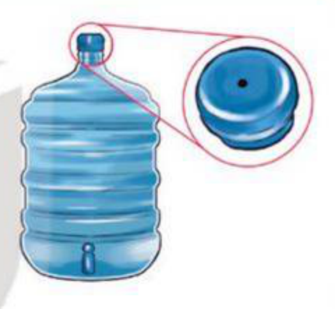

Vì sao muốn nước trong bình có thể chảy ra khi mở vòi thì trên nắp bình phải có một lỗ nhỏ (hình bên)?

## I. Áp suất chất lỏng

### 1. Tác dụng của áp suất chất lỏng lên vật đặt trong nó

> **Thí nghiệm 1:**
>
> *Chuẩn bị:*
> - Một bình hình trụ có đáy C và các lỗ A, B ở thành bình được bịt bằng một màng cao su mỏng (Hình 16.1).
> - Một bình lớn trong suốt chứa nước, chiều cao khoảng $50\text{ cm}$.
>
> 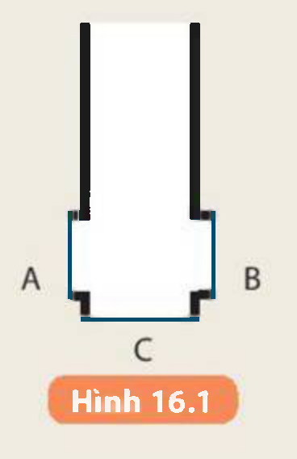
>
> Hình 16.1
>
> *Tiến hành:*
> - Nhúng bình trụ vào nước, mô tả hiện tượng xảy ra đối với các màng cao su.
> - Giữ nguyên độ sâu của bình trụ trong nước, di chuyển từ từ bình trụ đến các vị trí khác, mô tả hiện tượng xảy ra với các màng cao su.
> - Nhúng bình trụ vào nước sâu hơn (tối thiểu $10\text{ cm}$), mô tả hiện tượng xảy ra với các màng cao su.
> - Quan sát hiện tượng và trả lời câu hỏi.

<!-- pdf:70 -->

> ❓ 1. Nếu các màng cao su bị biến dạng như Hình 16.2 thì chứng tỏ điều gì?
> 2. Với những vị trí khác nhau ở cùng một độ sâu thì áp suất chất lỏng tác dụng lên bình có thay đổi không?
> 3. Khi đặt bình sâu hơn (từ vị trí P đến Q) thì tác dụng của chất lỏng lên bình thay đổi như thế nào?
> 4. Có phải chất lỏng chỉ tác dụng áp suất lên bình theo một phương như chất rắn không?
>
> 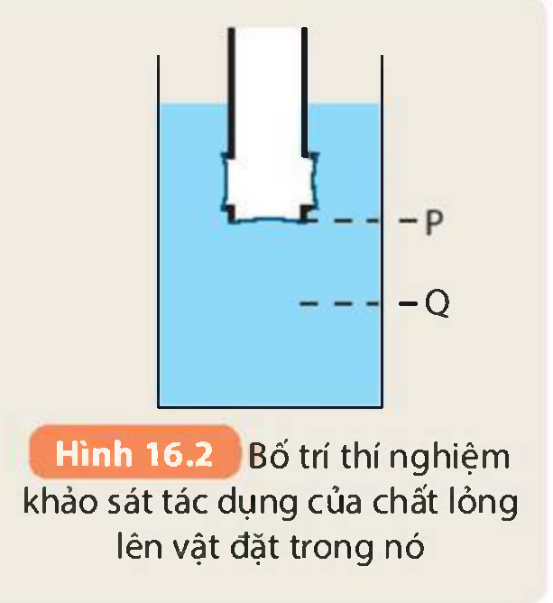
>
> Hình 16.2. Bố trí thí nghiệm khảo sát tác dụng của chất lỏng lên vật đặt trong nó

### 2. Sự truyền áp suất chất lỏng

> **Thí nghiệm 2:**
>
> Người ta đã làm thí nghiệm như Hình 16.3. Trong thí nghiệm này pit-tông (1) có tiết diện lớn gấp hai lần tiết diện của pit-tông (2). Các quả nặng được sử dụng trong thí nghiệm giống hệt nhau, khi đặt các quả nặng lên đĩa của một trong hai pit-tông sẽ làm tăng áp suất tác dụng lên chất lỏng. Ban đầu hai pit-tông ở vị trí cân bằng.
> - Nếu đặt 4 quả nặng lên pit-tông (1) thì thấy pit-tông (2) dịch chuyển lên trên. Để hai pit-tông trở về vị trí ban đầu cần đặt 2 quả nặng lên pit-tông (2).
> - Nếu đặt 2 quả nặng lên pit-tông (1) muốn pit-tông trở về vị trí ban đầu cần đặt 1 quả nặng lên pit-tông (2).
>
> 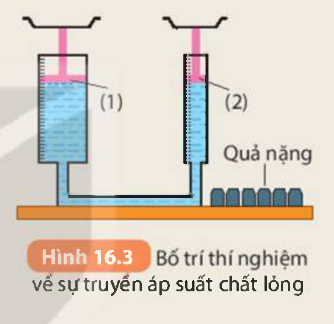
>
> Hình 16.3. Bố trí thí nghiệm về sự truyền áp suất chất lỏng

> ❓ Từ kết quả mô tả ở thí nghiệm trên, hãy rút ra kết luận về sự truyền áp suất tác dụng vào chất lỏng theo mọi hướng.

<!-- term: Sự truyền áp suất chất lỏng -->
Nhà bác học Pascan qua thí nghiệm đã tìm ra tính chất sau đây của sự truyền áp suất chất lỏng: Áp suất tác dụng vào chất lỏng sẽ được chất lỏng truyền đi nguyên vẹn theo mọi hướng.

> Hãy thảo luận nhóm và thực hiện nhiệm vụ sau:
>
> 1. Mô tả và giải thích các hiện tượng trong thí nghiệm ở Hình 16.4a và Hình 16.4b.
>
> 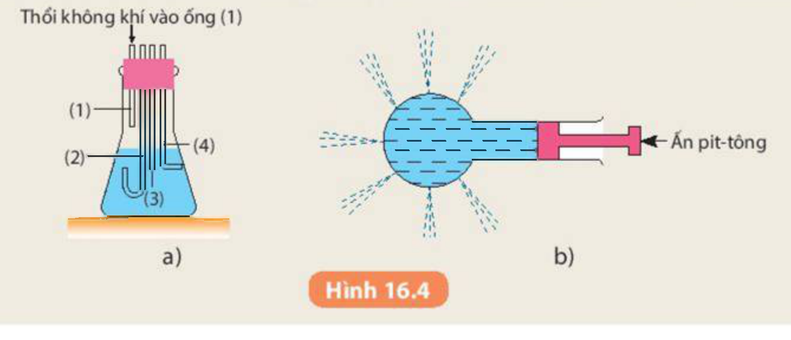
>
> Hình 16.4

<!-- pdf:71 -->

<!-- term: Máy nén thuỷ lực -->
> 2. Hình 16.5 vẽ sơ đồ nguyên lí máy nén thuỷ lực. Hãy vận dụng tính chất truyền nguyên vẹn áp suất theo mọi hướng của chất lỏng để giải thích tại sao khi người tác dụng một lực nhỏ vào pit-tông nhỏ lại nâng được ô tô đặt trên pit-tông lớn.
>
> 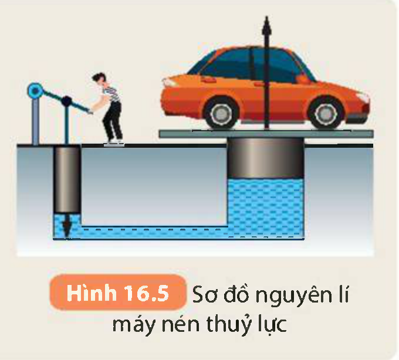
>
> Hình 16.5. Sơ đồ nguyên lí máy nén thuỷ lực

> ❓ Hãy tìm thêm ví dụ trong đời sống minh hoạ áp suất tác dụng vào chất lỏng sẽ được chất lỏng truyền đi nguyên vẹn theo mọi hướng.

## II. Áp suất khí quyển

### 1. Sự tồn tại của áp suất khí quyển

**a) Khí quyển và áp suất khí quyển**

Bao bọc quanh Trái Đất là một lớp không khí dày tới hàng nghìn kilômét, gọi là **khí quyển**. Con người cũng như mọi sinh vật khác trên Trái Đất đều đang sống dưới đáy của tầng khí quyển này.

Áp suất do lớp không khí bao quanh Trái Đất tác dụng lên mọi vật trên Trái Đất gọi là **áp suất khí quyển**.

Có rất nhiều thí nghiệm có thể chứng minh được có sự tồn tại của áp suất khí quyển và áp suất này tác dụng theo mọi phương.

**b) Thí nghiệm chứng tỏ sự tồn tại của áp suất khí quyển**

> **Thí nghiệm 3:**
>
> *Chuẩn bị:* Một cốc thuỷ tinh; một bình nước; một tấm nylon cứng; khay đựng dụng cụ thí nghiệm (Hình 16.6).
>
> 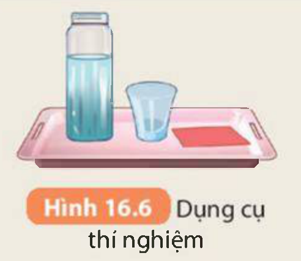
>
> Hình 16.6. Dụng cụ thí nghiệm
>
> *Tiến hành:*
> - Rót đầy nước vào cốc, đặt tấm nylon cứng che kín miệng cốc, rồi dùng tay giữ chặt tấm nylon cứng trên miệng cốc và từ từ úp ngược miệng cốc xuống (Hình 16.7).
> - Từ từ đưa nhẹ tay ra khỏi miệng cốc, quan sát xem tấm nylon có bị nước đẩy rời khỏi miệng cốc không. Giải thích hiện tượng quan sát được.
>
> 
>
> Hình 16.7. Bố trí thí nghiệm chứng tỏ tồn tại áp suất khí quyển từ dưới lên

<!-- pdf:72 -->

> Sử dụng một ống thuỷ tinh hở hai đầu và một cốc nước (Hình 16.8). Nhúng ống thuỷ tinh vào cốc nước để nước dâng lên một phần của ống, rồi lấy ngón tay bịt kín đầu trên và kéo ống ra khỏi nước. Quan sát xem nước có chảy ra khỏi ống hay không. Vẫn giữ tay bịt kín đầu trên của ống và nghiêng ống theo các phương khác nhau, khi đó nước có chảy ra khỏi ống hay không? Giải thích hiện tượng.
>
> 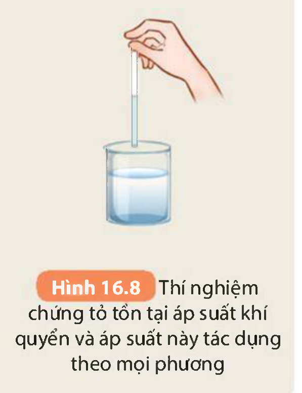
>
> Hình 16.8. Thí nghiệm chứng tỏ tồn tại áp suất khí quyển và áp suất này tác dụng theo mọi phương

> ❓ 1. Tìm một số ví dụ chứng tỏ sự tồn tại của áp suất khí quyển.
> 2. Em hãy cho biết áp suất tác dụng lên mặt hồ nước và áp suất tác dụng lên đáy hồ nước là áp suất nào.

### 2. Một số ảnh hưởng và ứng dụng của áp suất không khí

Hiểu một cách đơn giản, **áp suất không khí** là áp suất được hình thành trong môi trường không khí. Áp suất không khí có nhiều ảnh hưởng tới sự sống của các sinh vật trên Trái Đất, trong đó có con người. Dưới đây là một số ảnh hưởng và ứng dụng của áp suất không khí trong đời sống.

**a) Sự tạo thành tiếng động trong tai khi thay đổi áp suất đột ngột**

Ở lớp 7, ta đã biết cách âm thanh truyền từ nguồn âm qua môi trường không khí đến tai như thế nào. Trong thực tế có một số trường hợp khi thay đổi áp suất đột ngột, ta thấy có tiếng động trong tai như khi ngồi trên máy bay lúc hạ cánh hoặc cất cánh, khi leo núi cao,...

> ❓ Em hãy tìm ví dụ và mô tả hiện tượng trong thực tế về sự tạo thành tiếng động trong tai khi thay đổi áp suất đột ngột.

<!-- term: Vòi tai -->
Trong tai có một bộ phận là vòi tai (là ống nối tai giữa với vòm mũi, họng) có nhiệm vụ điều hòa và cân bằng áp suất hai bên màng nhĩ (Hình 16.9). Nếu áp suất thay đổi đột ngột như khi máy bay cất và hạ cánh, vòi tai thường không phản ứng kịp làm mất cân bằng áp suất hai bên màng nhĩ, khiến màng nhĩ đột ngột bị đẩy về phía có áp suất nhỏ hơn, gây nên tiếng động trong tai hoặc triệu chứng ù tai. Cử động nuốt hoặc ngáp sẽ khiến vòi tai mở rộng ra và không khí đi vào tai giữa nhiều hơn, giúp cân bằng lại áp suất, tránh gây ra tiếng động trong tai hoặc bị ù tai.

<!-- pdf:73 -->

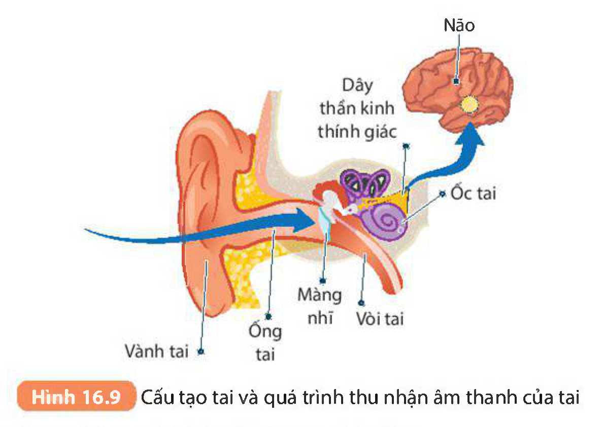

Hình 16.9. Cấu tạo tai và quá trình thu nhận âm thanh của tai

**b) Một số ứng dụng về áp suất không khí trong đời sống**

Trong đời sống và kĩ thuật có rất nhiều dụng cụ và máy móc được chế tạo nhờ ứng dụng áp suất không khí.

<!-- term: Giác mút -->
Hình 16.10 là một loại giác mút đơn giản (móc treo tường). Khi ấn phễu của giác mút sát vào mặt kính hoặc tường phẳng, do tính đàn hồi của giác mút mà khi thả tay ra, khoảng không gian bên trong giác mút tăng thể tích, làm cho áp suất không khí còn lại bên trong giác mút giảm, nhỏ hơn áp suất khí quyển bên ngoài, giúp giác mút bám chắc vào kính hoặc tường.

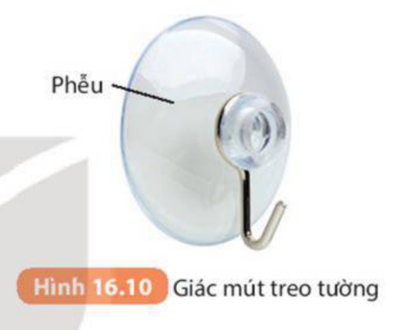

Hình 16.10. Giác mút treo tường

> ❓ Tìm thêm ví dụ về giác mút trong thực tế và giải thích hoạt động của nó.

<!-- term: Bình xịt nước -->
Bình xịt nước đơn giản có cấu tạo như Hình 16.11. Nguyên tắc hoạt động của bình xịt nước: khi tác dụng lực lên tay bơm, pit-tông của bơm sẽ hút không khí từ bên ngoài vào bình và nén lại, do đó áp suất không khí trong bình tăng lên, làm tăng áp lực đối với nước trong bình. Khi van được mở, nước trong bình sẽ bị đẩy ra ngoài thông qua đường ống nước nối với vòi phun. Để duy trì được áp suất trong bình ta cần phải bơm liên tục.

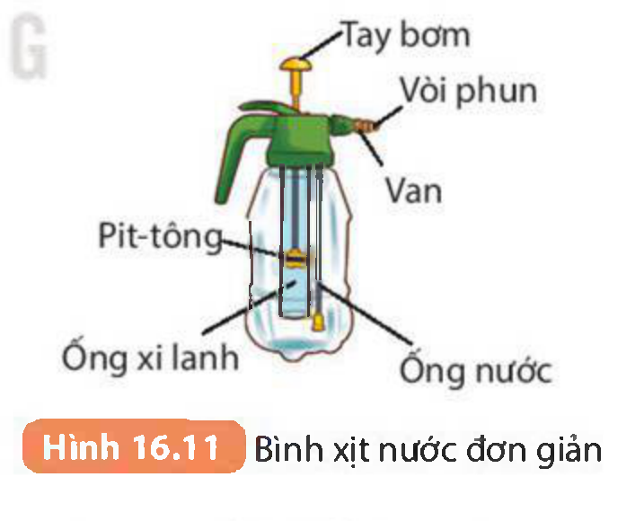

Hình 16.11. Bình xịt nước đơn giản

<!-- term: Tàu đệm khí -->
Tàu đệm khí được phát minh bởi nhà khoa học người Anh Christopher (Crít-tô-phơ). Tàu đệm khí sử dụng khí nén áp suất cao để nâng tàu khỏi mặt đất hay mặt nước. Nguyên tắc hoạt động của tàu đệm khí: các quạt bơm khí công suất lớn bơm không khí từ bên ngoài vào khoảng không gian tạo bởi tàu và mặt đất (mặt nước) sẽ tạo ra áp suất cao trong khoảng không gian đó, nâng con tàu lên khỏi mặt đất hay mặt nước, giảm thiểu được ma sát khi tàu di chuyển. Hình 16.12 mô tả đơn giản cấu tạo bên trong của tàu đệm khí.

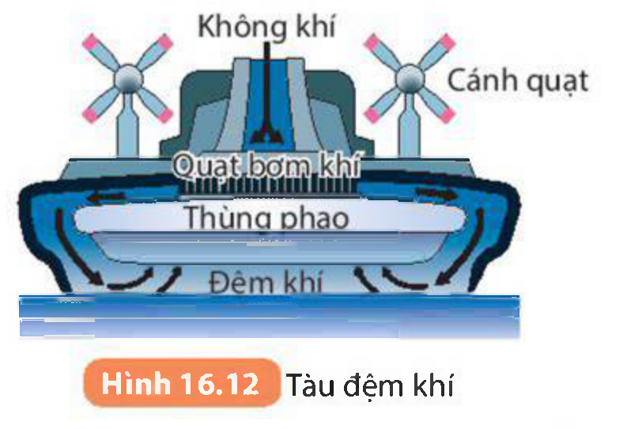

Hình 16.12. Tàu đệm khí

<!-- pdf:74 -->

> ❓ Hãy tìm trong thực tế những dụng cụ hoạt động theo nguyên lí của bình xịt. Cho biết chúng được sử dụng vào công việc gì.

## 📌 Em đã học

<!-- term: Áp suất chất lỏng -->
- Chất lỏng gây áp suất theo mọi phương lên các vật ở trong lòng nó. Vật càng ở sâu trong lòng chất lỏng thì chịu tác dụng của áp suất chất lỏng càng lớn.
- Áp suất tác dụng vào chất lỏng sẽ được chất lỏng truyền đi nguyên vẹn theo mọi hướng.
- Trái Đất và mọi vật trên Trái Đất đều chịu tác dụng của áp suất khí quyển theo mọi phương.
- Khi thay đổi áp suất đột ngột có thể gây ra tiếng động trong tai.
- Áp suất không khí được ứng dụng để chế tạo một số dụng cụ phục vụ đời sống như: giác mút, bình xịt,...

## ✏️ Em có thể

Tự chế tạo bình xịt nước từ các vật liệu đơn giản, dễ kiếm.

## 📷 Danh sách hình trong bài

| Mã hình | Trang PDF | Trang sách | Chú thích |
|---|---|---|---|
| H8-khoa_hoc_tu_nhien-b16-01 | 69 | 67 | (Hình mở đầu Bài 16: Bình nước có vòi và lỗ nhỏ trên nắp bình) |
| H8-khoa_hoc_tu_nhien-b16-02 | 69 | 67 | Hình 16.1 |
| H8-khoa_hoc_tu_nhien-b16-03 | 70 | 68 | Hình 16.2. Bố trí thí nghiệm khảo sát tác dụng của chất lỏng lên vật đặt trong nó |
| H8-khoa_hoc_tu_nhien-b16-04 | 70 | 68 | Hình 16.3. Bố trí thí nghiệm về sự truyền áp suất chất lỏng |
| H8-khoa_hoc_tu_nhien-b16-05 | 70 | 68 | Hình 16.4 |
| H8-khoa_hoc_tu_nhien-b16-06 | 71 | 69 | Hình 16.5. Sơ đồ nguyên lí máy nén thuỷ lực |
| H8-khoa_hoc_tu_nhien-b16-07 | 71 | 69 | Hình 16.6. Dụng cụ thí nghiệm |
| H8-khoa_hoc_tu_nhien-b16-08 | 71 | 69 | Hình 16.7. Bố trí thí nghiệm chứng tỏ tồn tại áp suất khí quyển từ dưới lên |
| H8-khoa_hoc_tu_nhien-b16-09 | 72 | 70 | Hình 16.8. Thí nghiệm chứng tỏ tồn tại áp suất khí quyển và áp suất này tác dụng theo mọi phương |
| H8-khoa_hoc_tu_nhien-b16-10 | 73 | 71 | Hình 16.9. Cấu tạo tai và quá trình thu nhận âm thanh của tai |
| H8-khoa_hoc_tu_nhien-b16-11 | 73 | 71 | Hình 16.10. Giác mút treo tường |
| H8-khoa_hoc_tu_nhien-b16-12 | 73 | 71 | Hình 16.11. Bình xịt nước đơn giản |
| H8-khoa_hoc_tu_nhien-b16-13 | 73 | 71 | Hình 16.12. Tàu đệm khí |
