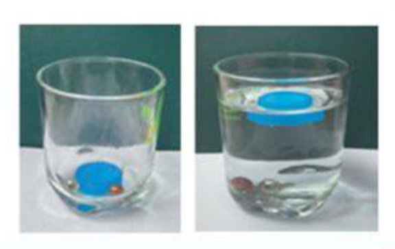
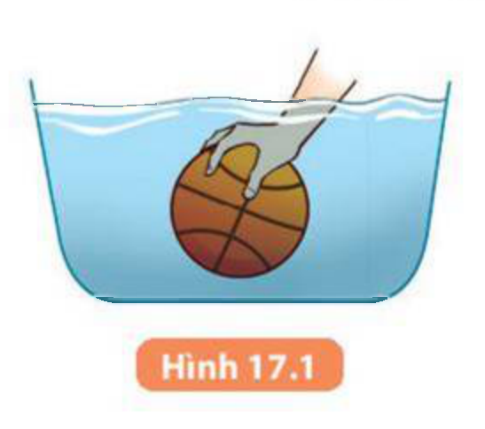
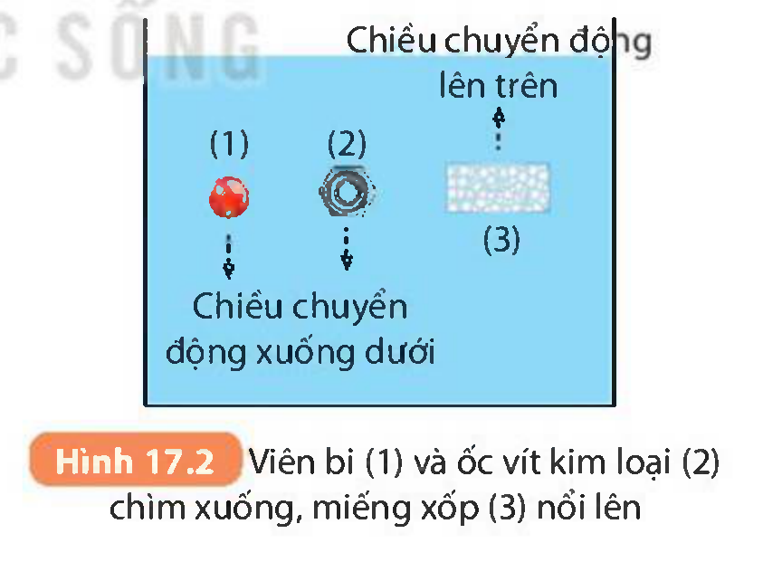
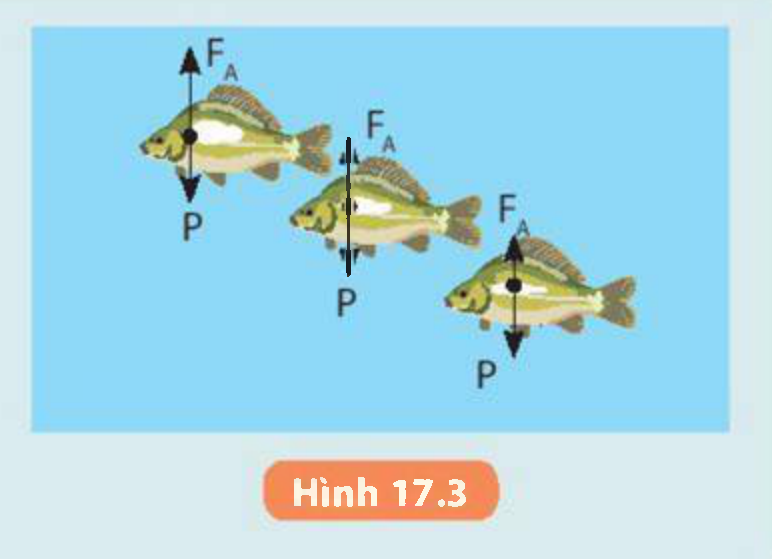
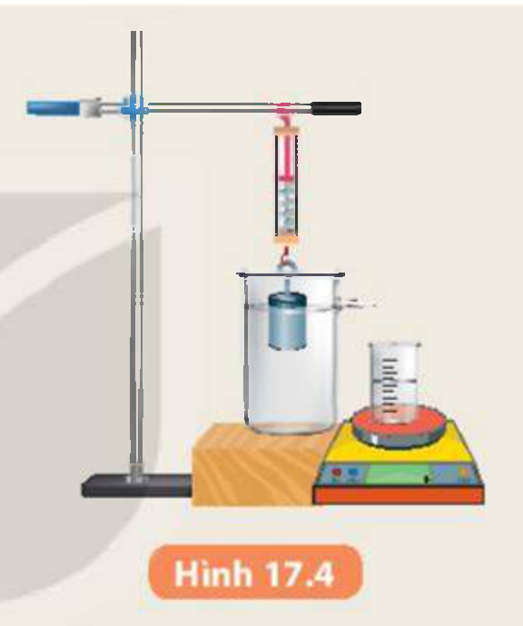

<!-- pdf:75 -->

# BÀI 17: LỰC ĐẨY ARCHIMEDES

## 🎯 Mục tiêu

- Thực hiện thí nghiệm khảo sát tác dụng của chất lỏng lên vật đặt trong chất lỏng, rút ra được: điều kiện định tính về vật nổi, vật chìm; định luật Archimedes (Acsimet).

## 🔴 Mở đầu

Đặt viên bi sắt, ốc vít kim loại, nắp chai nhựa vào một cốc thuỷ tinh. Vì sao khi đổ nước vào cốc, có vật nổi lên, có vật lại không nổi lên?

## I. Lực đẩy tác dụng lên vật đặt trong chất lỏng

Mọi vật đều chịu tác dụng của trọng lực. Trong thí nghiệm ở phần khởi động, khi đổ nước vào cốc, nắp chai nhựa nổi lên, chứng tỏ nước tác dụng lực đẩy lên vật ngược chiều với trọng lực. Em cũng có thể cảm nhận được lực đẩy lên quả bóng khi dùng tay nhấn chìm quả bóng xuống nước (Hình 17.1).

Lực đẩy do chất lỏng tác dụng lên vật đặt trong nó gọi là **lực đẩy Archimedes**. Lực này tác dụng lên mọi vật đặt trong lòng chất lỏng. Thả viên bi, ốc vít kim loại trong nước, trọng lực tác dụng lên chúng lớn hơn lực đẩy Archimedes, do vậy chúng chìm xuống. Trong khi đó, lực đẩy Archimedes lớn hơn trọng lực tác dụng lên miếng xốp, do đó miếng xốp nổi lên (Hình 17.2).

Hình 17.1

Hình 17.2. Viên bi (1) và ốc vít kim loại (2) chìm xuống, miếng xốp (3) nổi lên

> ❓ 1. Hãy biểu diễn các lực tác dụng vào viên bi, ốc vít kim loại, miếng xốp khi chúng ở vị trí như trong Hình 17.2.
> 2. Hãy rút ra điều kiện để một vật chìm xuống hoặc nổi lên khi đặt trong chất lỏng.
> 3. Mô tả sự thay đổi lực đẩy của nước lên quả bóng trong Hình 17.1 từ khi bắt đầu nhấn quả bóng vào nước, đến khi quả bóng chìm hoàn toàn trong nước.

<!-- pdf:76 -->

> 🔍 Cá chép cũng như nhiều loài cá khác có khả năng thay đổi thể tích cơ thể bằng cách đưa không khí vào làm phồng bong bóng khí. Khi bong bóng khí nhỏ lại, thể tích giảm và lực đẩy Archimedes giảm, khiến cá chìm xuống. Khi bong bóng khí to ra, thể tích tăng và lực đẩy Archimedes tăng, khiến cá nổi lên. Nhờ cơ chế này, cá có thể nổi lên hoặc chìm xuống trong nước dễ dàng (Hình 17.3).
>
> 
>
> Hình 17.3

## II. Độ lớn của lực đẩy Archimedes

### 1. Thí nghiệm

> *Dụng cụ:*
> - Một lực kế có giới hạn đo $2\text{ N}$;
> - Cân điện tử;
> - Quả nặng bằng nhựa $130\text{ g}$;
> - Bình tràn; ống đong; giá thí nghiệm.
>
> *Tiến hành thí nghiệm:*
> - Treo quả nặng vào lực kế được móc trên giá thí nghiệm. Số chỉ của lực kế là $P$.
> - Nhúng quả nặng vào bình tràn đựng đầy nước (Hình 17.4).
>
> 
>
> Hình 17.4
>
> - Khi nước từ bình tràn chảy ra ống đong đạt giá trị $20\text{ cm}^3$, đọc giá trị $F_1$ trên lực kế.
> - Ghi giá trị lực đẩy Archimedes có độ lớn $P - F_1$ vào vở theo mẫu Bảng 17.1.
> - Dùng cân điện tử đo khối lượng nước từ bình tràn chảy ra ống đong và tính trọng lượng của lượng nước đó, ghi vào vở theo mẫu Bảng 17.1.
> - Tiếp tục nhúng quả nặng chìm xuống khi nước trong bình tràn chảy ra lần lượt là $40\text{ cm}^3$, $60\text{ cm}^3$, $80\text{ cm}^3$, xác định độ lớn lực đẩy Archimedes và trọng lượng của lượng nước tràn ra tương ứng. Ghi vào vở theo mẫu Bảng 17.1.
> - Thay nước bằng nước muối đặc và lặp lại thí nghiệm.
> - So sánh trọng lượng của lượng chất lỏng tràn ra với lực đẩy Archimedes tương ứng.
>
> Bảng 17.1.
>
> | Thể tích chất lỏng bị chiếm chỗ | Lực đẩy Archimedes của nước | Trọng lượng nước bị vật chiếm chỗ | Lực đẩy Archimedes của nước muối | Trọng lượng nước muối bị vật chiếm chỗ |
> |---|---|---|---|---|
> | $20\text{ cm}^3$ | $?$ | $?$ | $?$ | $?$ |
> | $40\text{ cm}^3$ | $?$ | $?$ | $?$ | $?$ |
> | $60\text{ cm}^3$ | $?$ | $?$ | $?$ | $?$ |
> | $80\text{ cm}^3$ | $?$ | $?$ | $?$ | $?$ |

Từ bảng số liệu ta có thể rút ra được kết luận gì về độ lớn lực đẩy Archimedes.

<!-- pdf:77 -->

### 2. Định luật Archimedes

Nội dung định luật Archimedes được phát biểu như sau:

<!-- term: Định luật Archimedes -->
Một vật đặt trong chất lỏng chịu tác dụng một lực đẩy hướng thẳng đứng từ dưới lên trên có độ lớn tính bằng công thức:

$F_{\text{A}} = d \cdot V$

<!-- term: Định luật Archimedes -->
Trong đó $d$ là trọng lượng riêng của chất lỏng có đơn vị là $\text{N/m}^3$, $V$ là thể tích phần chất lỏng bị vật chiếm chỗ.

> Thả một viên đất nặn hình tròn nặng khoảng $100\text{ g}$ vào cốc nước, viên đất nặn sẽ chìm xuống đáy. Hãy tạo hình viên đất nặn này thành một vật có thể nổi được trên mặt nước. Vận dụng công thức định luật Archimedes, hãy giải thích vì sao cùng một viên đất nặn với hình dạng khác nhau lại có thể lúc thì chìm, lúc thì nổi.

> ❓ 1. Giải thích vì sao trong thí nghiệm mở đầu, nắp chai nhựa lại nổi lên còn viên bi, ốc vít kim loại vẫn nằm ở đáy cốc.
> 2. Hãy so sánh trọng lượng riêng của vật và trọng lượng riêng của nước khi vật chìm, vật nổi.

## 📌 Em đã học

- Một vật đặt trong chất lỏng chịu tác dụng một lực đẩy hướng thẳng đứng từ dưới lên trên có độ lớn tính bằng công thức: $F_{\text{A}} = d \cdot V$, trong đó $d$ là trọng lượng riêng của chất lỏng, $V$ là thể tích phần chất lỏng bị vật chiếm chỗ.
<!-- term: Điều kiện định tính về vật nổi, vật chìm -->
- Một vật ở trong lòng chất lỏng sẽ:
  + Chìm xuống khi lực đẩy Archimedes nhỏ hơn trọng lượng của vật ($F_{\text{A}} < P$).
  + Nổi lên khi lực đẩy Archimedes lớn hơn trọng lượng của vật ($F_{\text{A}} > P$).
<!-- term: Điều kiện định tính về vật nổi, vật chìm -->
- Một vật sẽ chìm xuống chất lỏng nếu trọng lượng riêng của vật lớn hơn trọng lượng riêng chất lỏng, vật sẽ nổi lên nếu trọng lượng riêng của vật nhỏ hơn trọng lượng riêng của chất lỏng.

## ✏️ Em có thể

- Ước tính được thể tích phần nước biển bị tàu chiếm chỗ khi biết trọng lượng riêng của nước biển, kích thước và khối lượng của con tàu.
- Giải thích được tại sao con tàu rất nặng mà vẫn nổi được trên mặt nước.

## 📷 Danh sách hình trong bài

| Mã hình | Trang PDF | Trang sách | Chú thích |
|---|---|---|---|
| H8-khoa_hoc_tu_nhien-b17-01 | 75 | 73 | (Hình mở đầu Bài 17: Viên bi sắt, ốc vít kim loại, nắp chai nhựa trong cốc trước và sau khi đổ nước) |
| H8-khoa_hoc_tu_nhien-b17-02 | 75 | 73 | Hình 17.1 |
| H8-khoa_hoc_tu_nhien-b17-03 | 75 | 73 | Hình 17.2. Viên bi (1) và ốc vít kim loại (2) chìm xuống, miếng xốp (3) nổi lên |
| H8-khoa_hoc_tu_nhien-b17-04 | 76 | 74 | Hình 17.3 |
| H8-khoa_hoc_tu_nhien-b17-05 | 76 | 74 | Hình 17.4 |
