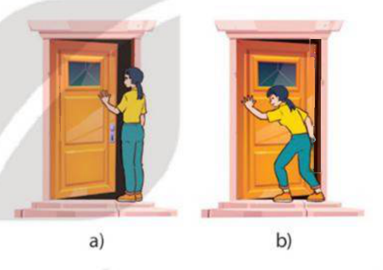
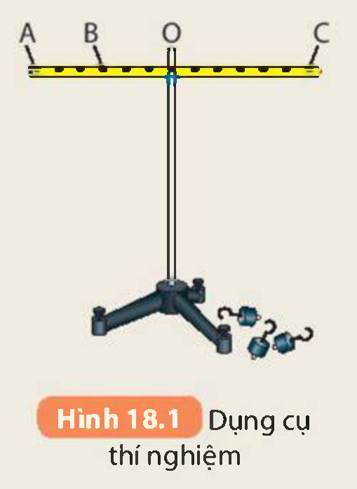
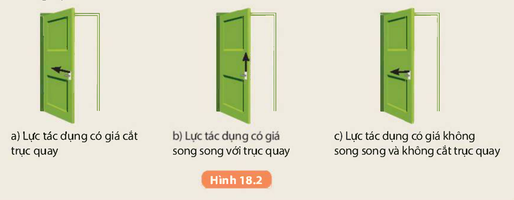
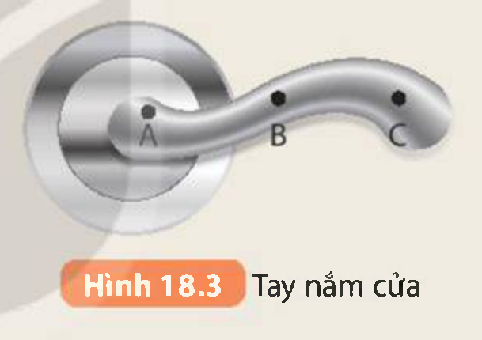
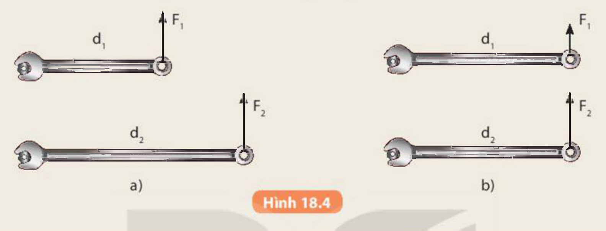

<!-- pdf:78 -->

# BÀI 18: TÁC DỤNG LÀM QUAY CỦA LỰC. MOMENT LỰC

## 🎯 Mục tiêu

- Thực hiện thí nghiệm để mô tả được tác dụng làm quay của lực.
- Nêu được tác dụng làm quay của lực lên một vật quanh một điểm hoặc một trục được đặc trưng bằng moment lực.

## 🔴 Mở đầu

Tại sao khi đẩy nhẹ cửa, tay ta đặt xa các bản lề của cánh cửa (hình a) thì mở cửa sẽ dễ dàng hơn khi đặt tay gần bản lề (hình b)?

## I. Lực có thể làm quay vật

> **Thí nghiệm:**
>
> *Chuẩn bị:*
> - Thanh nhựa cứng có lỗ cách đều;
> - Giá thí nghiệm;
> - Các quả nặng có móc treo.
>
> *Tiến hành:*
> - Gắn thanh nhựa lên giá tại trục quay $O$ sao cho thanh nằm cân bằng theo phương ngang (Hình 18.1).
> - Lần lượt treo quả nặng vào các vị trí $A$, $O$, $C$ trên thanh và quan sát hiện tượng xảy ra.
>
> 
>
> Hình 18.1. Dụng cụ thí nghiệm
>
> Từ kết quả thí nghiệm, thực hiện nhiệm vụ sau:
> 1. Treo quả nặng vào vị trí nào thì thanh quay, vào vị trí nào thì thanh không quay?
> 2. Mô tả tác dụng làm quay của lực khi treo quả nặng vào điểm $A$, điểm $C$.

<!-- pdf:79 -->

> Lấy tay tác dụng vào cánh cửa các lực khác nhau theo chiều mũi tên biểu diễn như ở Hình 18.2. Đường chứa mũi tên biểu diễn lực còn gọi là **giá của lực**. Trường hợp nào lực làm quay cánh cửa?
>
> 
>
> - *a) Lực tác dụng có giá cắt trục quay*
> - *b) Lực tác dụng có giá song song với trục quay*
> - *c) Lực tác dụng có giá không song song và không cắt trục quay*
>
> Hình 18.2

> ❓ 1. Vị trí tác dụng lực nào trong Hình 18.3 có thể làm cho tay nắm cửa quay quanh trục của nó? Vị trí nào làm tay nắm cửa không quay quanh trục của nó?
> 2. Lực tác dụng ở vị trí nào có thể làm cho tay nắm cửa quay dễ dàng hơn?
>
> 
>
> Hình 18.3. Tay nắm cửa

<!-- term: Tác dụng làm quay của lực -->
Khi lực tác dụng vào vật có giá không song song và không cắt trục quay thì sẽ làm quay vật.

## II. Moment lực

> **Thí nghiệm:**
>
> *Chuẩn bị:* Dụng cụ thí nghiệm như ở Hình 18.1.
>
> *Tiến hành:*
>
> Thực hiện thí nghiệm và hoàn thành vào vở theo mẫu Bảng 18.1.
>
> Bảng 18.1
>
> | Vị trí treo quả nặng | Trạng thái của thanh ngang |
> |---|---|
> | Treo đồng thời hai quả nặng giống nhau vào hai điểm $A$ và $C$ | $?$ |
> | Treo hai quả nặng vào điểm $A$ và một quả nặng vào điểm $C$ | $?$ |
> | Treo một quả nặng vào điểm $B$ và một quả nặng vào điểm $C$ | $?$ |
>
> 1. Tác dụng làm quay của lực phụ thuộc vào độ lớn của lực như thế nào?
> 2. Giá của lực càng xa trục quay thì tác dụng làm quay của lực thay đổi như thế nào?

<!-- pdf:80 -->

Tác dụng làm quay của lực lên một vật quanh một điểm hoặc một trục được đặc trưng bằng **moment lực**.

<!-- term: Tác dụng làm quay của lực -->
- Lực càng lớn, moment lực càng lớn, tác dụng làm quay càng lớn.
- Giá của lực càng cách xa trục quay, moment lực càng lớn, tác dụng làm quay càng lớn.

> ❓ So sánh moment của lực $F_1$, moment của lực $F_2$ trong các Hình 18.4a và Hình 18.4b.
>
> 
>
> Hình 18.4

## 📌 Em đã học

- Tác dụng làm quay của lực lên một vật quanh một điểm hoặc một trục được đặc trưng bằng moment lực.
- Lực càng lớn, moment lực càng lớn, tác dụng làm quay càng lớn.
- Giá của lực càng cách xa trục quay, moment lực càng lớn, tác dụng làm quay càng lớn.

## ✏️ Em có thể

- Giải thích được cách tác dụng lực khi bắt đầu đạp pê-đan để xe đạp có thể chuyển động.
- Giải thích được cách sử dụng cờ lê để vặn ốc một cách dễ dàng.

## 📷 Danh sách hình trong bài

| Mã hình | Trang PDF | Trang sách | Chú thích |
|---|---|---|---|
| H8-khoa_hoc_tu_nhien-b18-01 | 78 | 76 | (Hình mở đầu Bài 18: Đẩy cửa khi đặt tay xa bản lề (hình a) và gần bản lề (hình b)) |
| H8-khoa_hoc_tu_nhien-b18-02 | 78 | 76 | Hình 18.1. Dụng cụ thí nghiệm |
| H8-khoa_hoc_tu_nhien-b18-03 | 79 | 77 | Hình 18.2. a) Lực tác dụng có giá cắt trục quay; b) Lực tác dụng có giá song song với trục quay; c) Lực tác dụng có giá không song song và không cắt trục quay |
| H8-khoa_hoc_tu_nhien-b18-04 | 79 | 77 | Hình 18.3. Tay nắm cửa |
| H8-khoa_hoc_tu_nhien-b18-05 | 80 | 78 | Hình 18.4 |
