<!-- pdf:81 -->

# BÀI 19: ĐÒN BẨY VÀ ỨNG DỤNG

## 🎯 Mục tiêu

- Dùng dụng cụ đơn giản, minh hoạ được đòn bẩy có thể làm thay đổi hướng tác dụng của lực.
- Lấy được ví dụ về một số loại đòn bẩy khác nhau trong thực tiễn.
- Sử dụng kiến thức, kĩ năng về đòn bẩy để giải quyết được một số vấn đề thực tiễn.

## 🔴 Mở đầu

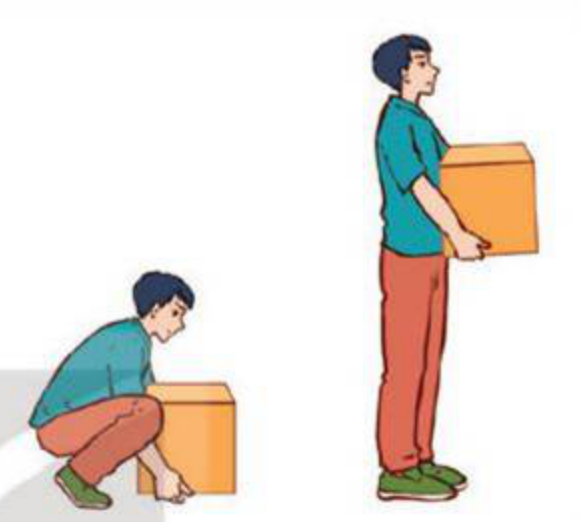

Khi muốn nâng một vật, người ta cần tác dụng lực có hướng thẳng đứng lên trên (hình bên). Có cách nào tận dụng được trọng lượng của người để nâng được vật lên cao hay không?

## I. Tác dụng của đòn bẩy

<!-- term: Tác dụng của đòn bẩy -->
Trong thí nghiệm ở Hình 18.1 (Bài 18), khi tác dụng một lực vào thanh nhựa cứng theo hướng xuống dưới, có thể nâng được quả nặng lên trên. Thanh nhựa cứng trong thí nghiệm đó là một ví dụ về đòn bẩy. Khi chịu tác dụng lực làm quay, đòn bẩy có thể làm thay đổi hướng tác dụng của lực.

Trong thực tiễn, hình dạng đòn bẩy rất đa dạng nhưng trục quay luôn đi qua một điểm tựa $O$. Khoảng cách từ giá của lực tác dụng tới điểm tựa gọi là **cánh tay đòn**.

> **Thí nghiệm:**
>
> *Chuẩn bị:* Thanh nhựa cứng có lỗ cách đều, giá thí nghiệm, lực kế, các quả nặng có móc treo.
>
> *Tiến hành:*
> - Dùng lực kế tác dụng lực vào đòn bẩy $AB$, đòn bẩy có thể tác dụng lực nâng quả nặng.
> - Thay đổi cánh tay đòn bằng cách móc lực kế vào các vị trí khác nhau. Đọc giá trị của lực kế khi thanh cân bằng tại mỗi vị trí.
>
> 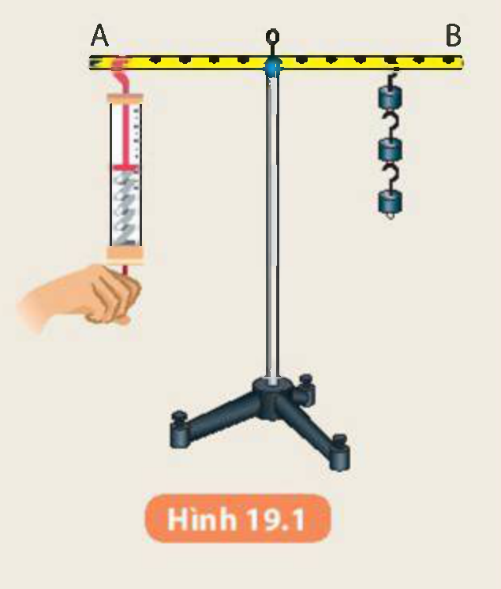
>
> Hình 19.1
>
> Từ kết quả thí nghiệm, trả lời các câu hỏi sau:
> 1. Đòn bẩy $AB$ có tác dụng thay đổi hướng lực tác dụng khi nâng quả nặng như thế nào?
> 2. Khi nào đòn bẩy cho ta lợi về lực?

<!-- pdf:82 -->

> ❓ 1. Xác định điểm tựa, cánh tay đòn trong các trường hợp ở Hình 19.2.
>
> 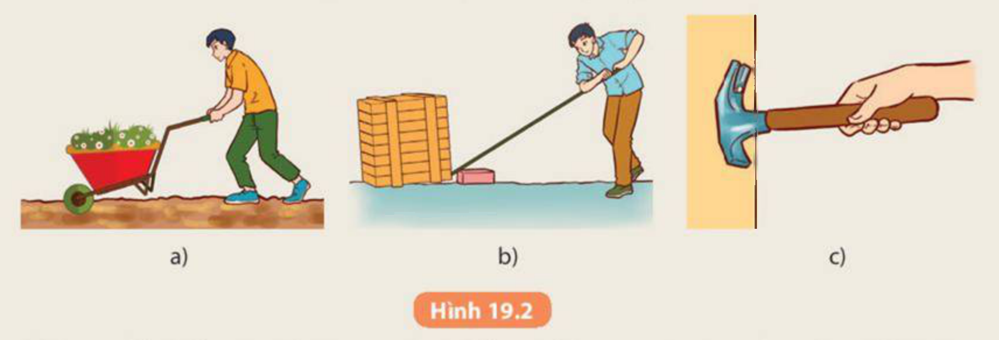
>
> Hình 19.2
>
> 2. Sử dụng đòn bẩy như Hình 19.2 có thể làm đổi hướng tác dụng lực như thế nào?

## II. Các loại đòn bẩy

Trong thực tiễn, tuỳ theo vị trí của điểm tựa $O$ và điểm đặt của các lực tác dụng $F_1$; $F_2$ mà ta có hai loại đòn bẩy. Để dễ hình dung, ta mô tả đòn bẩy là một thanh cứng thẳng.

**Đòn bẩy loại 1**
Là loại đòn bẩy có điểm tựa $O$ nằm trong khoảng giữa điểm đặt $O_1$, $O_2$ của các lực $F_1$ và $F_2$ (Hình 19.3).

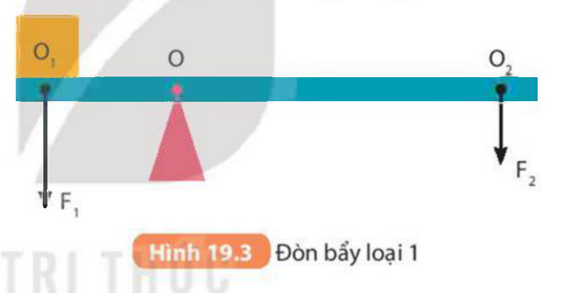

Hình 19.3. Đòn bẩy loại 1

**Đòn bẩy loại 2**
Là loại đòn bẩy có điểm tựa $O$ nằm ngoài khoảng giữa điểm đặt $O_1$, $O_2$ của hai lực, lực tác dụng lên đòn bẩy $F_2$ nằm xa điểm tựa $O$ hơn vị trí của lực $F_1$ (Hình 19.4).

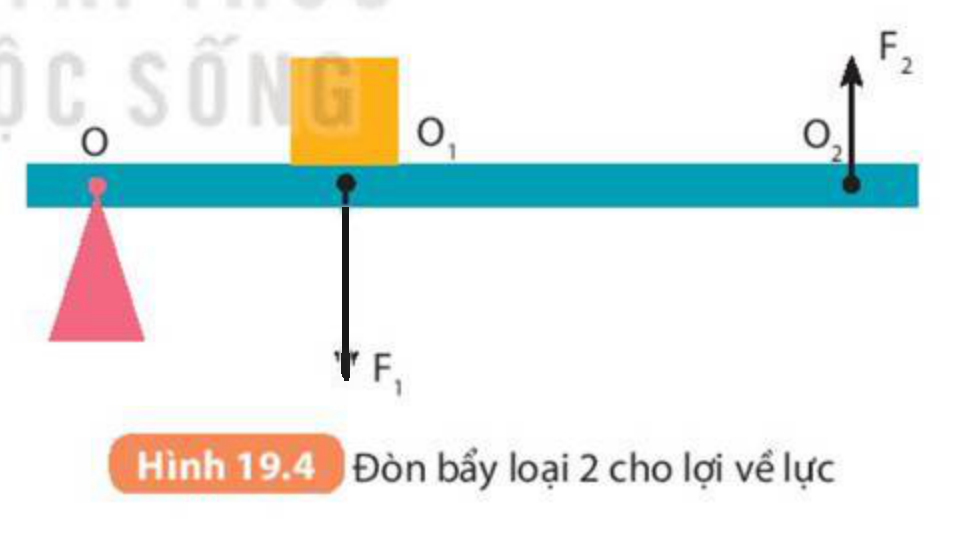

Hình 19.4. Đòn bẩy loại 2 cho lợi về lực

Trong thực tiễn có một số đòn bẩy không cho ta lợi về lực. Trong trường hợp này, điểm tựa $O$ nằm ngoài khoảng giữa điểm đặt $O_1$, $O_2$ của hai lực, lực tác dụng lên đòn bẩy $F_2$ nằm gần điểm tựa $O$ hơn vị trí của lực $F_1$ (Hình 19.5). Có tài liệu còn gọi đây là **đòn bẩy loại 3**.

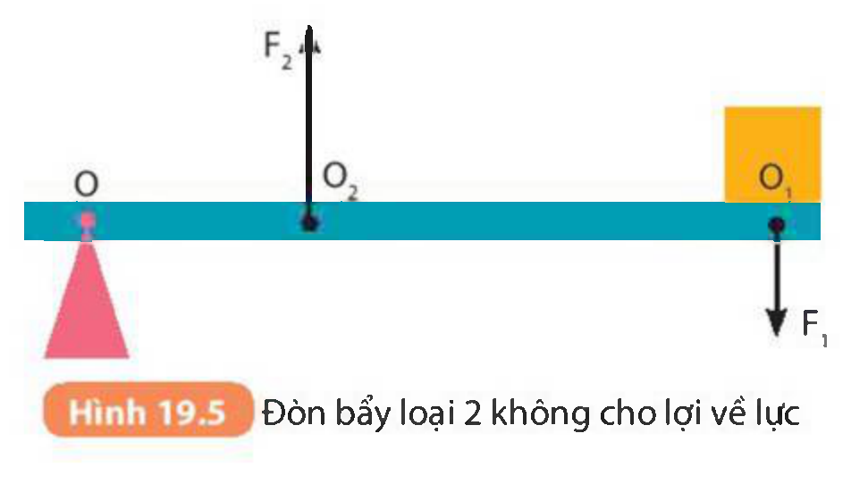

Hình 19.5. Đòn bẩy loại 2 không cho lợi về lực

<!-- pdf:83 -->

> 1. Hình 19.6 vẽ các dụng cụ, các vật có cấu tạo và chức năng của đòn bẩy.
> - Em hãy chỉ rõ loại đòn bẩy trong từng trường hợp.
> - Sử dụng đòn bẩy như vậy đem lại lợi ích như thế nào?
>
> 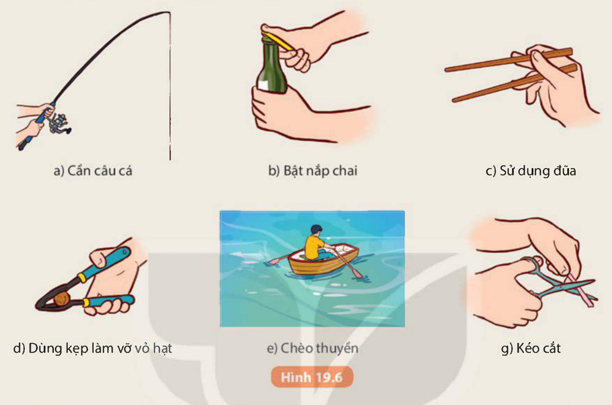
>
> - *a) Cần câu cá*
> - *b) Bật nắp chai*
> - *c) Sử dụng đũa*
> - *d) Dùng kẹp làm vỡ vỏ hạt*
> - *e) Chèo thuyền*
> - *g) Kéo cắt*
>
> Hình 19.6
>
> 2. Mô tả cách sử dụng đòn bẩy để tận dụng trọng lượng của người để nâng vật lên cao trong tình huống ở đầu bài học.
> 3. Lấy các ví dụ khác về mỗi loại đòn bẩy trong cuộc sống và phân tích tác dụng của chúng.

## III. Ứng dụng của đòn bẩy

Trong cuộc sống, đòn bẩy được ứng dụng vào nhiều công việc, chế tạo nhiều công cụ hữu ích.

### 1. Bơm nước bằng tay

> ❓ Đòn bẩy trong máy bơm nước bằng tay (Hình 19.7) là đòn bẩy loại nào? Sử dụng máy bơm nước này cho ta những lợi ích gì?
>
> 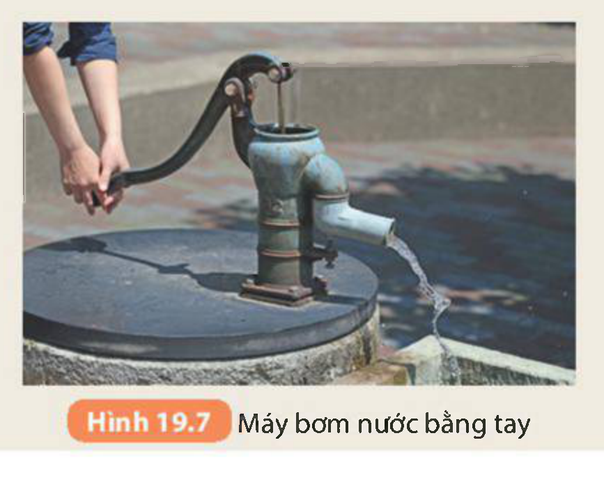
>
> Hình 19.7. Máy bơm nước bằng tay

<!-- pdf:84 -->

### 2. Đòn bẩy trong cơ thể người

Trong cơ thể chúng ta có nhiều bộ phận có cấu tạo và hoạt động tương tự một đòn bẩy. Hai ví dụ dưới đây mô tả các đòn bẩy có trong cơ thể người.

<!-- term: Đòn bẩy trong cơ thể người -->
Đầu là một đòn bẩy loại 1 với trục quay là đốt sống trên cùng. Trọng lượng đầu được chia hai bên trục quay giúp đầu ở trạng thái cân bằng. Lực tác dụng giúp đầu có thể quay quanh đốt sống là nhờ hệ thống cơ sau gáy (Hình 19.8).

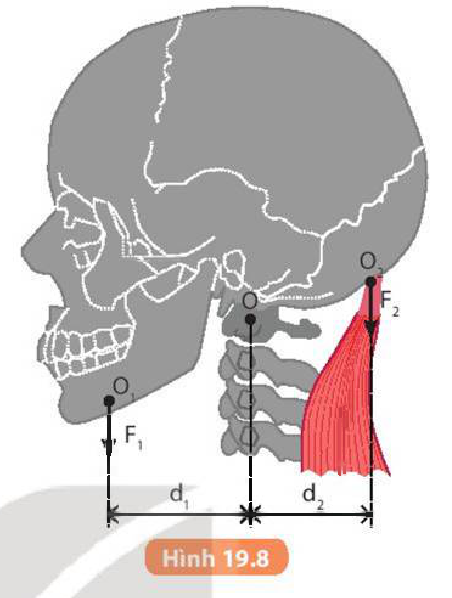

Hình 19.8

> ❓ Dựa trên cấu tạo của cơ thể và tác dụng của đòn bẩy em hãy đưa ra tư thế ngồi để tránh mỏi cổ.

<!-- term: Đòn bẩy trong cơ thể người -->
Cánh tay là đòn bẩy loại 2. Khi ta cầm một vật nặng trên tay, cơ bắp tay sẽ tạo ra một lực giúp cánh tay nằm cân bằng với trục quay chính là khớp xương ở khuỷu tay (Hình 19.9).

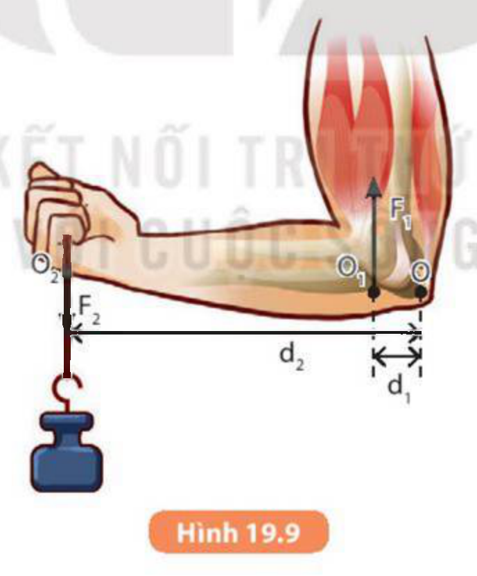

Hình 19.9

> ❓ Em hãy giải thích vì sao khi cầm vật nặng, ta cần gập sát cánh tay vào bắp tay.

### 3. Đòn bẩy trong xe đạp

Xe đạp là phương tiện quen thuộc với chúng ta. Trong xe đạp có nhiều bộ phận có chức năng như một đòn bẩy.

<!-- pdf:85 -->

> Thảo luận nhóm về vấn đề sau:
> - Em hãy xác định các đòn bẩy trên xe đạp khi ta sử dụng xe. Ứng với mỗi trường hợp hãy xác định trục quay, các lực tác dụng và xác định loại đòn bẩy tương ứng.
> - Hãy mô tả sự thay đổi hướng của lực khi dùng chân tác dụng lực lên pê-đan xe đạp để đẩy xe đạp tiến về phía trước. Xét quá trình tác dụng lực với hai trục quay tại trục giữa $A$ và trục bánh sau $B$ (Hình 19.10).
>
> 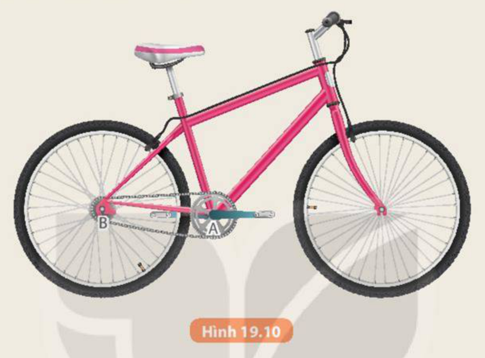
>
> Hình 19.10

## 📌 Em đã học

- Đòn bẩy có thể làm thay đổi hướng tác dụng của lực.
- Đòn bẩy quay quanh một trục quay xác định, gọi là **điểm tựa** $O$.
- Tuỳ theo vị trí của điểm tựa $O$ với vị trí của điểm tác dụng lực lên đòn bẩy mà đòn bẩy thông dụng được phân thành hai loại.

## ✏️ Em có thể

- Chỉ ra được các loại đòn bẩy và lợi ích của nó trong thực tiễn.
- Lựa chọn được loại đòn bẩy phù hợp để sử dụng trong một số trường hợp đơn giản trong đời sống.
- Vận dụng được kiến thức về đòn bẩy để có các thao tác vận động đúng trong sinh hoạt hằng ngày.

## 📷 Danh sách hình trong bài

| Mã hình | Trang PDF | Trang sách | Chú thích |
|---|---|---|---|
| H8-khoa_hoc_tu_nhien-b19-01 | 81 | 79 | (Hình mở đầu Bài 19: Người nâng vật theo hướng thẳng đứng lên trên) |
| H8-khoa_hoc_tu_nhien-b19-02 | 81 | 79 | Hình 19.1 |
| H8-khoa_hoc_tu_nhien-b19-03 | 82 | 80 | Hình 19.2 |
| H8-khoa_hoc_tu_nhien-b19-04 | 82 | 80 | Hình 19.3. Đòn bẩy loại 1 |
| H8-khoa_hoc_tu_nhien-b19-05 | 82 | 80 | Hình 19.4. Đòn bẩy loại 2 cho lợi về lực |
| H8-khoa_hoc_tu_nhien-b19-06 | 82 | 80 | Hình 19.5. Đòn bẩy loại 2 không cho lợi về lực |
| H8-khoa_hoc_tu_nhien-b19-07 | 83 | 81 | Hình 19.6. a) Cần câu cá; b) Bật nắp chai; c) Sử dụng đũa; d) Dùng kẹp làm vỡ vỏ hạt; e) Chèo thuyền; g) Kéo cắt |
| H8-khoa_hoc_tu_nhien-b19-08 | 83 | 81 | Hình 19.7. Máy bơm nước bằng tay |
| H8-khoa_hoc_tu_nhien-b19-09 | 84 | 82 | Hình 19.8 |
| H8-khoa_hoc_tu_nhien-b19-10 | 84 | 82 | Hình 19.9 |
| H8-khoa_hoc_tu_nhien-b19-11 | 85 | 83 | Hình 19.10 |
